# Weekly Corn and Ethanol Intel Report

<strong>Week of October 22, 2026</strong>Market data through: October 21, 2026Narrative created: October 23, 2026Nearby corn: $4.633/bu (-$0.147 (-3.1%) week)

Weekly review of corn, ethanol, energy, co-product, policy, and related public-company performance for commodities risk managers at U.S. ethanol plants.

## Strategy Narrative

Nearby futures from Yahoo Finance. Nearby corn is the market&#x27;s current perception of yield and demand risk.

<table><thead><tr><th>Contract</th><th>Last</th><th>Week change</th><th>As of</th></tr></thead><tbody><tr><td>Nearby corn</td><td>$4.633/bu</td><td>-$0.147 (-3.1%)</td><td>October 21, 2026</td></tr><tr><td>RBOB gasoline</td><td>$3.120/gal</td><td>-0.060 (-1.9%)</td><td>October 21, 2026</td></tr><tr><td>Henry Hub</td><td>$2.790/MMBtu</td><td>-0.446 (-13.8%)</td><td>October 21, 2026</td></tr></tbody></table>

<nav class="strategy-narrative-links" aria-label="Strategy narrative sections">
<ul>
<li><a href="#strategy-executive-view-1-harvest-delays-failed-to-challenge-usda-s-larger-corn-cushion">1. Harvest delays failed to challenge USDA’s larger corn cushion</a></li>
<li><a href="#strategy-executive-view-2-rising-production-converted-ethanol-clearance-back-into-an-overhang">2. Rising production converted ethanol clearance back into an overhang</a></li>
<li><a href="#strategy-executive-view-3-natural-gas-relief-improved-variable-cost-but-gasoline-offered-no-price-umbrella">3. Natural-gas relief improved variable cost, but gasoline offered no price umbrella</a></li>
<li><a href="#strategy-executive-view-4-valero-demonstrated-strong-realized-margins-but-not-a-representative-spot-crush">4. Valero demonstrated strong realized margins—but not a representative spot crush</a></li>
</ul>
</nav>

<h3 id="executive-view">Executive View</h3>

- **USDA’s larger corn balance sheet strengthened as the controlling procurement regime.** The official framework remains a **181.2-bushel yield, 16.034-billion-bushel crop and 1.849-billion-bushel 2026/27 carryout**. Harvest reached only **44% versus a 52% five-year average**, but condition held at 56% good-to-excellent and the delay produced no national supply repricing. Nearby corn closed October 21 at **$4.633 per bushel, down $0.147, or 3.1%, from October 15**—consistent with ample supply, harvest pressure and insufficient demand risk to challenge USDA’s reset. (USDA NASS, *Crop Progress*, October 19, 2026.) ([esmis.nal.usda.gov](https://esmis.nal.usda.gov/sites/default/release-files/796110/prog4226.txt))
- **Ethanol’s product balance deteriorated more decisively than last week.** Production increased **29,000 barrels per day to 1.094 million**, inventories built **616,000 barrels to 24.558 million**, and EIA refiner and blender ethanol inputs fell **8,000 barrels per day to 891,000**. Stocks have rebuilt 815,000 barrels in two weeks, reversing more than half of September’s maintenance-led draw. (EIA, *U.S. Weekly Supply Estimates*, October 21, 2026.) ([eia.gov](https://www.eia.gov/dnav/pet/pet_sum_sndw_dcus_nus_w.htm))
- **Lower process-energy costs partly offset weaker output economics.** Henry Hub fell **$0.446 to $2.790 per MMBtu, down 13.8%**, while Lower-48 storage increased 77 Bcf to **3,644 Bcf**. RBOB fell **$0.060 to $3.120 per gallon, down 1.9%**, despite a 2.952-million-barrel gasoline-stock draw and a one-week increase in gasoline supplied to 8.982 million barrels per day. ([eia.gov](https://www.eia.gov/dnav/ng/hist/nw2_epg0_swo_r48_bcfw.htm))
- **Corn export sales recovered, but commitments remain well below last year’s exceptional pace.** Net sales reached **1.527 million metric tons**, taking total 2026/27 commitments to **22.193 million tons**, versus 33.560 million a year ago. Commitments equal roughly 26% of USDA’s 3.3-billion-bushel forecast—adequate this early in the year, but not strong enough to offset the larger crop in market perception. (USDA FAS, *Weekly Export Sales*, October 22, 2026; Price Futures Group, USDA sales table, October 22, 2026.) ([fas-prod.azureedge.us](https://fas-prod.azureedge.us/data/weekly-export-sales-10222026))
- **Valero’s third-quarter result confirms that low corn and credit monetization can preserve strong realized earnings, but it is not a pure spot-crush benchmark.** Ethanol operating income was **$272 million**, up from $183 million a year ago but below the second quarter’s $318 million. Valero’s second-quarter filing showed that 45Z recognition materially affected segment earnings, limiting comparability with plants lacking equivalent credit capture. ([santabarbara.newsnetmedia.com](https://santabarbara.newsnetmedia.com/story/523347/valero-energy-reports-third-quarter-2026-results/?utm_source=openai))
- **Overall margin and risk conditions improved modestly:** cheaper corn and sharply lower natural gas outweighed weaker RBOB, but the benefit is vulnerable to rising ethanol inventories. Corn procurement improved materially; prompt ethanol selling deteriorated.

| Exposure | Current signal | Change from last week | Horizon | Confidence | Main driver |
|---|---|---:|---|---|---|
| Corn procurement | Ample national supply; delayed local harvest | Improved materially | Harvest–Q2 2027 | High | Corn −3.1%; 1.849-billion-bushel carryout |
| Ethanol selling | Output rising faster than disappearance | Deteriorated materially | 1–4 weeks | High | 616,000-barrel stock build |
| Natural gas | Lower price; storage rebuilding | Improved materially | 1–4 months | High | Henry Hub −13.8% |
| Corn exports | Good weekly sale, weaker year/year base | Broadly unchanged | 1–6 months | Medium-high | Commitments 34% below last year |
| 45Z/RFS | Important but no new operative change | Unchanged | 2026–29 | High | Execution and final SRE allocation |
| Overall plant margin | Lower inputs versus product overhang | Improved modestly | Near term | Medium | Corn and gas relief partly retained |

The week extends the **post-October USDA supply regime rather than modifying it**. The incremental problem has shifted from obtaining corn coverage to preventing cheaper inputs from inducing production that the ethanol market cannot clear. Existing 45Z feedstock verification, regenerative-ag documentation and strong monthly ethanol exports remain strategically important but are not re-narrated. EPA’s SRE-reallocation proposal was formally published October 16, but publication did not change obligations or resolve the 2026-versus-2027 allocation. (EPA, *Proposed Reallocation of Additional 2025 Small Refinery Exemptions*, October 16, 2026.) ([epa.gov](https://www.epa.gov/renewable-fuel-standard/proposed-reallocation-additional-2025-small-refinery-exemptions))

<h3 id="strategy-executive-view-1-harvest-delays-failed-to-challenge-usda-s-larger-corn-cushion">1. Harvest delays failed to challenge USDA’s larger corn cushion</h3>

**What happened**

Corn harvest advanced from 33% to **44%**, eight points behind normal. Iowa was only **26% complete versus 50% normally**, Minnesota 38% versus 53%, Nebraska 37% versus 48% and South Dakota 29% versus 47%. National condition nevertheless held at **56% good-to-excellent**, and 95% of the crop was mature. ([esmis.nal.usda.gov](https://esmis.nal.usda.gov/sites/default/release-files/796110/prog4226.txt))

Weekly export sales improved to 1.527 million tons, but total commitments remained 34% below last year. The combination of delayed harvest and better bookings was therefore insufficient to counter USDA’s supply increase; nearby corn’s 14.7-cent decline confirms that the market reduced rather than increased its scarcity premium.

**Why it matters**

The delay is now principally a **basis, moisture, storage and quality issue**, not compelling evidence that national yield is below USDA’s 181.2-bushel estimate. Local plants in the slowest states may see firmer nearby basis or higher drying costs even while national futures weaken.

**Risk-manager implication**

Futures procurement risk improved materially. Plants should distinguish national supply relief from local cash exposure: delayed receipts can temporarily tighten plant origination territories, while rapid later harvest could produce abrupt basis weakness. Export performance supports use but currently does not justify reversing the lower-cost regime.

**Watch next**

Whether Iowa and the northwestern Corn Belt close the harvest gap without quality losses—and whether November USDA data sustain the 181.2-bushel yield.

---

<h3 id="strategy-executive-view-2-rising-production-converted-ethanol-clearance-back-into-an-overhang">2. Rising production converted ethanol clearance back into an overhang</h3>

| EIA ethanol balance | Week ended Oct. 9 | Week ended Oct. 16 | Change |
|---|---:|---:|---:|
| Production, million bpd | 1.065 | 1.094 | +0.029 |
| Inventories, million bbl | 23.942 | 24.558 | +0.616 |
| Refiner/blender inputs, million bpd | 0.899 | 0.891 | −0.008 |
| Weekly exports, million bpd | 0.121 | 0.132 | +0.011 |

(EIA, *U.S. Weekly Supply Estimates*, released October 21, 2026.) ([eia.gov](https://www.eia.gov/dnav/pet/pet_sum_sndw_dcus_nus_w.htm))

**Why it matters**

This was not a marginal build. Production returned near early-September levels while domestic inputs weakened, and the modest increase in estimated exports did not prevent inventories from rising. Four-week-average ethanol inputs fell to **900,000 barrels per day**, versus 906,000 in the comparable 2025 period. ([eia.gov](https://www.eia.gov/dnav/pet/hist/LeafHandler.ashx?f=4&n=pet&s=w_epooxe_yir_nus_mbbld&utm_source=openai))

The print strengthens last week’s warning that USDA’s additional 50 million bushels of assumed ethanol corn use requires sustained export clearance or firmer domestic blending—not simply higher plant utilization.

**Risk-manager implication**

Prompt ethanol price, basis and storage risk deteriorated materially. Lower corn improves the incentive to run, but industry-wide utilization near 1.1 million barrels per day is currently exceeding visible domestic absorption. Plants should avoid treating feedstock relief as fully retainable margin until inventories stabilize.

**Watch next**

Whether production moves above 1.10 million barrels per day and whether Gulf and East Coast stocks absorb continued inland output.

---

<h3 id="strategy-executive-view-3-natural-gas-relief-improved-variable-cost-but-gasoline-offered-no-price-umbrella">3. Natural-gas relief improved variable cost, but gasoline offered no price umbrella</h3>

Gasoline inventories fell to **205.310 million barrels**, while gasoline supplied rebounded to 8.982 million barrels per day. Refinery utilization remained high at 93.4%. The positive physical print did not translate into a stronger futures umbrella: RBOB still declined 1.9%. ([eia.gov](https://www.eia.gov/dnav/pet/pet_sum_sndw_dcus_nus_w.htm))

Lower-48 gas inventories increased to 3,644 Bcf, 154 Bcf below the same 2025 week. However, EIA’s October outlook still projected inventories ending the month about 2% above the five-year average, consistent with the sharp Henry Hub decline rather than a developing availability problem. (EIA, *October 2026 Short-Term Energy Outlook*.) ([eia.gov](https://www.eia.gov/dnav/ng/hist/nw2_epg0_swo_r48_bcfw.htm))

**Risk-manager implication**

Natural-gas purchasing exposure improved materially, particularly for plants without adverse local basis. The lower gas price and cheaper corn provide meaningful variable-cost relief, but weaker RBOB and rising ethanol stocks make the output side the binding margin risk. The net signal is modestly positive for current production cost and negative for incremental gallons.

---

<h3 id="strategy-executive-view-4-valero-demonstrated-strong-realized-margins-but-not-a-representative-spot-crush">4. Valero demonstrated strong realized margins—but not a representative spot crush</h3>

**What happened**

Valero reported third-quarter ethanol operating income of **$272 million**, up 49% year over year but down $46 million from the second quarter. ([santabarbara.newsnetmedia.com](https://santabarbara.newsnetmedia.com/story/523347/valero-energy-reports-third-quarter-2026-results/?utm_source=openai))

**Why it matters**

The result confirms that large integrated producers can monetize low corn, co-products and clean-fuel credits even when weekly industry inventories are heavy. But Valero recognized $99 million of ethanol-related clean-fuel production credits in the second quarter, demonstrating why consolidated segment income cannot be used as a direct proxy for an uncredited plant’s spot crush. ([sec.gov](https://www.sec.gov/Archives/edgar/data/1035002/000162828026050937/vlo-20260630.htm?utm_source=openai))

**Risk-manager implication**

45Z execution is now a material source of margin dispersion between plants. Benchmarking should separate commodity crush, co-product realization and transferable-credit value. Strong corporate earnings do not refute the current prompt inventory warning.

<h3 id="strategic-synthesis">Strategic synthesis</h3>

The corn-cost reset is becoming more secure, while ethanol clearance is becoming less secure. Lower gas adds genuine near-term relief, but plants collectively risk transferring those savings to ethanol buyers through excessive utilization. Export bookings remain sufficient to support USDA’s demand case, not strong enough to neutralize record supply. The incremental thesis is therefore **procurement opportunity paired with stricter production and ethanol-sales discipline**.

<h3 id="what-i-m-watching-next">What I’m Watching Next</h3>

- **October 28, 2026:** EIA ethanol balance—whether the 616,000-barrel build persists.
- **November 4, 2026:** EPA virtual hearing on additional 2025 SRE reallocation. ([epa.gov](https://www.epa.gov/renewable-fuel-standard/proposed-reallocation-additional-2025-small-refinery-exemptions))
- **November 10, 2026:** USDA WASDE and Crop Production—the next national test of the 181.2-bushel yield and 1.849-billion-bushel carryout.

<h3 id="bottom-line">Bottom Line</h3>

The most consequential weekly change was the **acceleration in ethanol production and 616,000-barrel inventory build**, which threatens to transfer part of the corn and natural-gas cost relief into weaker ethanol realizations. Corn procurement has improved further, but ethanol selling and utilization now require the closest attention. The October 28 EIA balance is the next print most capable of changing the near-term margin view.

## Notable Changes

Comparison with the final report dated October 15, 2026 (market data through October 14, 2026).

### Sectors

#### Top-three comparison

<table class="sortable"><thead><tr><th class="sortable-heading" data-column="0" data-type="text">Entity</th><th class="sortable-heading" data-column="1" data-type="number">Previous</th><th class="sortable-heading" data-column="2" data-type="number">Current</th><th class="sortable-heading" data-column="3" data-type="number">Change</th><th class="sortable-heading" data-column="4" data-type="number">Current return</th></tr></thead><tbody><tr><td class="text" data-sort="fuel blending, refining, and retail" style=""><a href="#category-fuel-blending-refining-and-retail">Fuel blending, refining, and retail</a></td><td class="" data-sort="2" style="">#2</td><td class="" data-sort="1" style="">#1</td><td class="rank-change-up" data-sort="-1" style="">↑ 1</td><td class="" data-sort="1.2828266477001073" style="background:#1a7a3c;color:#ffffff;">+128.3%</td></tr><tr><td class="text" data-sort="u.s. ethanol and process technology" style=""><a href="#category-u-s-ethanol-and-process-technology">U.S. ethanol and process technology</a></td><td class="" data-sort="1" style="">#1</td><td class="" data-sort="2" style="">#2</td><td class="rank-change-down" data-sort="1" style="">↓ 1</td><td class="" data-sort="1.2699305534468506" style="background:#1a7a3c;color:#ffffff;">+127.0%</td></tr><tr><td class="text" data-sort="advanced biofuels and saf" style=""><a href="#category-advanced-biofuels-and-saf">Advanced biofuels and SAF</a></td><td class="" data-sort="3" style="">#3</td><td class="" data-sort="3" style="">#3</td><td class="" data-sort="0" style="">— 0</td><td class="" data-sort="0.45773606736517336" style="background:#a9d9a4;color:#111820;">+45.8%</td></tr></tbody></table>

### Stocks

#### Top-three comparison

<table class="sortable"><thead><tr><th class="sortable-heading" data-column="0" data-type="text">Entity</th><th class="sortable-heading" data-column="1" data-type="number">Previous</th><th class="sortable-heading" data-column="2" data-type="number">Current</th><th class="sortable-heading" data-column="3" data-type="number">Change</th><th class="sortable-heading" data-column="4" data-type="number">Current return</th></tr></thead><tbody><tr><td class="text" data-sort="valero energy" style=""><a href="#earnings-vlo">Valero Energy</a> (<a href="#company-vlo">VLO</a>)</td><td class="" data-sort="1" style="">#1</td><td class="" data-sort="1" style="">#1</td><td class="" data-sort="0" style="">— 0</td><td class="" data-sort="1.6981528386977205" style="background:#1a7a3c;color:#ffffff;">+169.8%</td></tr><tr><td class="text" data-sort="marathon petroleum" style="">Marathon Petroleum (<a href="#company-mpc">MPC</a>)</td><td class="" data-sort="2" style="">#2</td><td class="" data-sort="2" style="">#2</td><td class="" data-sort="0" style="">— 0</td><td class="" data-sort="1.4821258088469293" style="background:#1a7a3c;color:#ffffff;">+148.2%</td></tr><tr><td class="text" data-sort="hf sinclair" style="">HF Sinclair (<a href="#company-dino">DINO</a>)</td><td class="" data-sort="3" style="">#3</td><td class="" data-sort="3" style="">#3</td><td class="" data-sort="0" style="">— 0</td><td class="" data-sort="1.3741728114955567" style="background:#1a7a3c;color:#ffffff;">+137.4%</td></tr></tbody></table>

#### Largest rank changes

<table class="sortable"><thead><tr><th class="sortable-heading" data-column="0" data-type="text">Entity</th><th class="sortable-heading" data-column="1" data-type="number">Previous</th><th class="sortable-heading" data-column="2" data-type="number">Current</th><th class="sortable-heading" data-column="3" data-type="number">Change</th><th class="sortable-heading" data-column="4" data-type="number">Current return</th></tr></thead><tbody><tr><td class="text" data-sort="green plains" style="">Green Plains (<a href="#company-gpre">GPRE</a>)</td><td class="" data-sort="19" style="">#19</td><td class="" data-sort="9" style="">#9</td><td class="rank-change-up" data-sort="-10" style="">↑ 10</td><td class="" data-sort="0.4613003095975232" style="background:#1a7a3c;color:#ffffff;">+46.1%</td></tr><tr><td class="text" data-sort="casey&#x27;s general stores" style="">Casey&#x27;s General Stores (<a href="#company-casy">CASY</a>)</td><td class="" data-sort="26" style="">#26</td><td class="" data-sort="20" style="">#20</td><td class="rank-change-up" data-sort="-6" style="">↑ 6</td><td class="" data-sort="0.2752270017426397" style="background:#7cc077;color:#111820;">+27.5%</td></tr><tr><td class="text" data-sort="adecoagro" style="">Adecoagro (<a href="#company-agro">AGRO</a>)</td><td class="" data-sort="15" style="">#15</td><td class="" data-sort="21" style="">#21</td><td class="rank-change-down" data-sort="6" style="">↓ 6</td><td class="" data-sort="0.24901185770751" style="background:#7cc077;color:#111820;">+24.9%</td></tr></tbody></table>

### Subcategory movement since the previous report

<table class="sortable"><thead><tr><th class="sortable-heading" data-column="0" data-type="text">Subcategory</th><th class="sortable-heading" data-column="1" data-type="number">Move</th><th class="sortable-heading" data-column="2" data-type="number">Last Report, 12m Ret</th><th class="sortable-heading" data-column="3" data-type="number">Current Report, 12m Ret</th></tr></thead><tbody><tr><td class="text" data-sort="advanced biofuels and saf" style=""><a href="#category-advanced-biofuels-and-saf">Advanced biofuels and SAF</a></td><td class="" data-sort="0.021347504954062346" style="background:#a9d9a4;color:#111820;">+2.1%</td><td class="" data-sort="0.459733087897" style="background:#a9d9a4;color:#111820;">+46.0%</td><td class="" data-sort="0.45773606736517336" style="background:#a9d9a4;color:#111820;">+45.8%</td></tr><tr><td class="text" data-sort="logistics" style=""><a href="#category-logistics">Logistics</a></td><td class="" data-sort="0.00778186901771052" style="background:#d6ecd4;color:#111820;">+0.8%</td><td class="" data-sort="0.242581970874" style="background:#d6ecd4;color:#111820;">+24.3%</td><td class="" data-sort="0.25826634964462586" style="background:#a9d9a4;color:#111820;">+25.8%</td></tr><tr><td class="text" data-sort="fuel blending, refining, and retail" style=""><a href="#category-fuel-blending-refining-and-retail">Fuel blending, refining, and retail</a></td><td class="" data-sort="-0.025354941380960973" style="background:#ee8483;color:#111820;">-2.5%</td><td class="" data-sort="1.38739887081" style="background:#1a7a3c;color:#ffffff;">+138.7%</td><td class="" data-sort="1.2828266477001073" style="background:#1a7a3c;color:#ffffff;">+128.3%</td></tr><tr><td class="text" data-sort="crop inputs, equipment, and irrigation" style=""><a href="#category-crop-inputs-equipment-and-irrigation">Crop inputs, equipment, and irrigation</a></td><td class="" data-sort="-0.02954259530435203" style="background:#ee8483;color:#111820;">-3.0%</td><td class="" data-sort="0.149507854014" style="background:#d6ecd4;color:#111820;">+15.0%</td><td class="" data-sort="0.09899906356862095" style="background:#d6ecd4;color:#111820;">+9.9%</td></tr><tr><td class="text" data-sort="international ethanol" style=""><a href="#category-international-ethanol">International ethanol</a></td><td class="" data-sort="-0.029794015459955928" style="background:#ee8483;color:#111820;">-3.0%</td><td class="" data-sort="-0.096167317426" style="background:#fbd5d4;color:#111820;">-9.6%</td><td class="" data-sort="-0.14057269266806988" style="background:#fbd5d4;color:#111820;">-14.1%</td></tr><tr><td class="text" data-sort="wet milling, ingredients, and co-products" style=""><a href="#category-wet-milling-ingredients-and-co-products">Wet milling, ingredients, and co-products</a></td><td class="" data-sort="-0.03223641099700624" style="background:#e34948;color:#111820;">-3.2%</td><td class="" data-sort="0.185963037558" style="background:#d6ecd4;color:#111820;">+18.6%</td><td class="" data-sort="0.1487052346827545" style="background:#d6ecd4;color:#111820;">+14.9%</td></tr><tr><td class="text" data-sort="u.s. ethanol and process technology" style=""><a href="#category-u-s-ethanol-and-process-technology">U.S. ethanol and process technology</a></td><td class="" data-sort="-0.049708518048671844" style="background:#c0302f;color:#ffffff;">-5.0%</td><td class="" data-sort="1.38819881243" style="background:#1a7a3c;color:#ffffff;">+138.8%</td><td class="" data-sort="1.2699305534468506" style="background:#1a7a3c;color:#ffffff;">+127.0%</td></tr><tr><td class="text" data-sort="grain origination and agribusiness" style=""><a href="#category-grain-origination-and-agribusiness">Grain origination and agribusiness</a></td><td class="" data-sort="-0.05372555826739807" style="background:#c0302f;color:#ffffff;">-5.4%</td><td class="" data-sort="0.272532786495" style="background:#d6ecd4;color:#111820;">+27.3%</td><td class="" data-sort="0.21404692417452412" style="background:#d6ecd4;color:#111820;">+21.4%</td></tr></tbody></table>

### Largest company moves

<table class="sortable"><thead><tr><th class="sortable-heading" data-column="0" data-type="text">Direction</th><th class="sortable-heading" data-column="1" data-type="text">Company</th><th class="sortable-heading" data-column="2" data-type="text">Ticker</th><th class="sortable-heading" data-column="3" data-type="number">Move</th></tr></thead><tbody><tr><td class="text" data-sort="0" style="">Gain</td><td class="text" data-sort="casey&#x27;s general stores" style="">Casey&#x27;s General Stores</td><td class="text text" data-sort="casy" style=""><a href="#company-casy">CASY</a></td><td class="" data-sort="0.06361591774911646" style="background:#1a7a3c;color:#ffffff;">+6.4%</td></tr><tr><td class="text" data-sort="0" style="">Gain</td><td class="text" data-sort="tyson foods" style="">Tyson Foods</td><td class="text text" data-sort="tsn" style=""><a href="#company-tsn">TSN</a></td><td class="" data-sort="0.030984876429361874" style="background:#a9d9a4;color:#111820;">+3.1%</td></tr><tr><td class="text" data-sort="0" style="">Gain</td><td class="text" data-sort="canadian pacific kansas city" style="">Canadian Pacific Kansas City</td><td class="text text" data-sort="cp" style=""><a href="#company-cp">CP</a></td><td class="" data-sort="0.022991175104505324" style="background:#a9d9a4;color:#111820;">+2.3%</td></tr><tr><td class="text" data-sort="1" style="">Decline</td><td class="text" data-sort="adecoagro" style="">Adecoagro</td><td class="text text" data-sort="agro" style=""><a href="#company-agro">AGRO</a></td><td class="" data-sort="-0.07871720116618064" style="background:#c0302f;color:#ffffff;">-7.9%</td></tr><tr><td class="text" data-sort="1" style="">Decline</td><td class="text" data-sort="mosaic" style="">Mosaic</td><td class="text text" data-sort="mos" style=""><a href="#company-mos">MOS</a></td><td class="" data-sort="-0.06996317727511847" style="background:#c0302f;color:#ffffff;">-7.0%</td></tr><tr><td class="text" data-sort="1" style="">Decline</td><td class="text" data-sort="bunge" style="">Bunge</td><td class="text text" data-sort="bg" style=""><a href="#company-bg">BG</a></td><td class="" data-sort="-0.06133504728675043" style="background:#e34948;color:#111820;">-6.1%</td></tr></tbody></table>

## Subcategory Performance

<table class="sortable"><thead><tr><th class="sortable-heading" data-column="0" data-type="text">Subcategory</th><th class="sortable-heading" data-column="1" data-type="number">Companies</th><th class="sortable-heading" data-column="2" data-type="number">Market cap</th><th class="sortable-heading" data-column="3" data-type="number">3m Return</th><th class="sortable-heading" data-column="4" data-type="number">12m Return</th><th class="sortable-heading" data-column="5" data-type="number">24m Return</th></tr></thead><tbody><tr><td class="text" data-sort="crop inputs, equipment, and irrigation" style=""><a href="#category-crop-inputs-equipment-and-irrigation">Crop inputs, equipment, and irrigation</a></td><td class="" data-sort="11" style="">11</td><td class="" data-sort="300745184478.91" style="">$300.7B</td><td class="" data-sort="-0.1359289649211877" style="background:#ee8483;color:#111820;">-13.6%</td><td class="" data-sort="0.09899906356862095" style="background:#d6ecd4;color:#111820;">+9.9%</td><td class="" data-sort="0.24010501968512343" style="background:#d6ecd4;color:#111820;">+24.0%</td></tr><tr><td class="text" data-sort="grain origination and agribusiness" style=""><a href="#category-grain-origination-and-agribusiness">Grain origination and agribusiness</a></td><td class="" data-sort="3" style="">3</td><td class="" data-sort="63125801301.18" style="">$63.1B</td><td class="" data-sort="-0.12368157704242666" style="background:#f5aead;color:#111820;">-12.4%</td><td class="" data-sort="0.21404692417452412" style="background:#d6ecd4;color:#111820;">+21.4%</td><td class="" data-sort="0.3267298310011534" style="background:#d6ecd4;color:#111820;">+32.7%</td></tr><tr><td class="text" data-sort="u.s. ethanol and process technology" style=""><a href="#category-u-s-ethanol-and-process-technology">U.S. ethanol and process technology</a></td><td class="" data-sort="6" style="">6</td><td class="" data-sort="143490589721.54" style="">$143.5B</td><td class="" data-sort="0.2505744142582637" style="background:#2f9e44;color:#111820;">+25.1%</td><td class="" data-sort="1.2699305534468506" style="background:#1a7a3c;color:#ffffff;">+127.0%</td><td class="" data-sort="1.6729066803880885" style="background:#1a7a3c;color:#ffffff;">+167.3%</td></tr><tr><td class="text" data-sort="wet milling, ingredients, and co-products" style=""><a href="#category-wet-milling-ingredients-and-co-products">Wet milling, ingredients, and co-products</a></td><td class="" data-sort="5" style="">5</td><td class="" data-sort="122070417790.07" style="">$122.1B</td><td class="" data-sort="-0.03710175891294291" style="background:#fbd5d4;color:#111820;">-3.7%</td><td class="" data-sort="0.1487052346827545" style="background:#d6ecd4;color:#111820;">+14.9%</td><td class="" data-sort="0.2495444818247836" style="background:#d6ecd4;color:#111820;">+25.0%</td></tr><tr><td class="text" data-sort="fuel blending, refining, and retail" style=""><a href="#category-fuel-blending-refining-and-retail">Fuel blending, refining, and retail</a></td><td class="" data-sort="8" style="">8</td><td class="" data-sort="374068702481.42" style="">$374.1B</td><td class="" data-sort="0.33844426316441784" style="background:#1a7a3c;color:#ffffff;">+33.8%</td><td class="" data-sort="1.2828266477001073" style="background:#1a7a3c;color:#ffffff;">+128.3%</td><td class="" data-sort="1.6157496593171636" style="background:#1a7a3c;color:#ffffff;">+161.6%</td></tr><tr><td class="text" data-sort="advanced biofuels and saf" style=""><a href="#category-advanced-biofuels-and-saf">Advanced biofuels and SAF</a></td><td class="" data-sort="2" style="">2</td><td class="" data-sort="403619489658.24" style="">$403.6B</td><td class="" data-sort="0.17514768369779257" style="background:#7cc077;color:#111820;">+17.5%</td><td class="" data-sort="0.45773606736517336" style="background:#a9d9a4;color:#111820;">+45.8%</td><td class="" data-sort="0.5026504108136762" style="background:#a9d9a4;color:#111820;">+50.3%</td></tr><tr><td class="text" data-sort="international ethanol" style=""><a href="#category-international-ethanol">International ethanol</a></td><td class="" data-sort="2" style="">2</td><td class="" data-sort="4030007905.26" style="">$4.0B</td><td class="" data-sort="-0.1366961512229119" style="background:#ee8483;color:#111820;">-13.7%</td><td class="" data-sort="-0.14057269266806988" style="background:#fbd5d4;color:#111820;">-14.1%</td><td class="" data-sort="-0.4804232177472346" style="background:#f5aead;color:#111820;">-48.0%</td></tr><tr><td class="text" data-sort="logistics" style=""><a href="#category-logistics">Logistics</a></td><td class="" data-sort="6" style="">6</td><td class="" data-sort="366182560910.12" style="">$366.2B</td><td class="" data-sort="-0.028156324998118563" style="background:#fbd5d4;color:#111820;">-2.8%</td><td class="" data-sort="0.25826634964462586" style="background:#a9d9a4;color:#111820;">+25.8%</td><td class="" data-sort="0.2285160335107096" style="background:#d6ecd4;color:#111820;">+22.9%</td></tr></tbody></table>

Subcategory returns use the most recently saved market capitalizations as weights.

## Stock Performance vs. SPY

The same selected stocks appear in every chart. Each line is labeled at the right with its ticker and return for the displayed window.
### Last 6 months

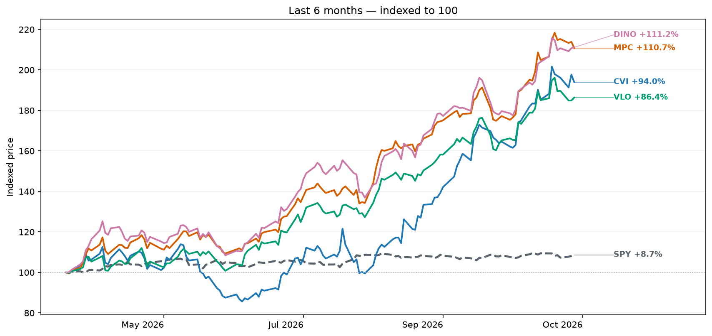

### Last 12 months

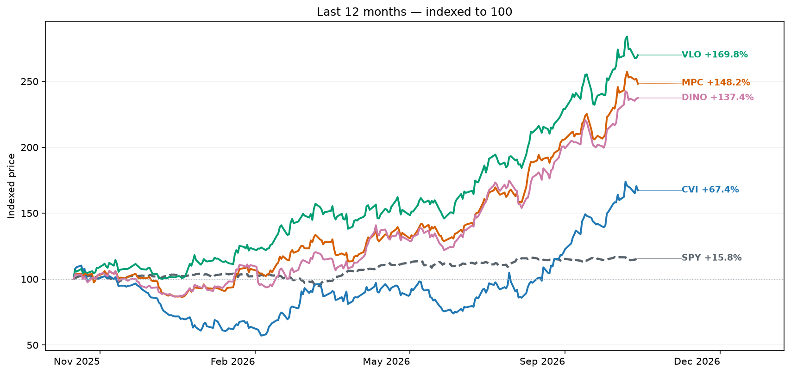

### Last 24 months

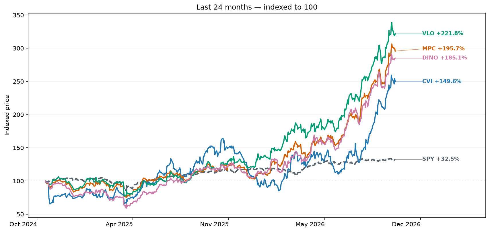

## Current Top Stocks

### Last 3 months

<table class="sortable"><thead><tr><th class="sortable-heading" data-column="0" data-type="number">Rank</th><th class="sortable-heading" data-column="1" data-type="text">Company</th><th class="sortable-heading" data-column="2" data-type="text">Ticker</th><th class="sortable-heading" data-column="3" data-type="number">Market cap</th><th class="sortable-heading" data-column="4" data-type="number">Return</th></tr></thead><tbody><tr><td class="" data-sort="1" style="">1</td><td class="text" data-sort="cvr energy" style="">CVR Energy</td><td class="text text" data-sort="cvi" style=""><a href="#company-cvi">CVI</a></td><td class="" data-sort="3689472983.3" style="">$3.7B</td><td class="" data-sort="0.7411123853211008" style="background:#1a7a3c;color:#ffffff;">+74.1%</td></tr><tr><td class="" data-sort="2" style="">2</td><td class="text" data-sort="marathon petroleum" style="">Marathon Petroleum</td><td class="text text" data-sort="mpc" style=""><a href="#company-mpc">MPC</a></td><td class="" data-sort="101307533252.25" style="">$101.3B</td><td class="" data-sort="0.48179342663542535" style="background:#2f9e44;color:#111820;">+48.2%</td></tr><tr><td class="" data-sort="3" style="">3</td><td class="text" data-sort="valero energy" style=""><a href="#earnings-vlo">Valero Energy</a></td><td class="text text" data-sort="vlo" style=""><a href="#company-vlo">VLO</a></td><td class="" data-sort="99697762645.86" style="">$99.7B</td><td class="" data-sort="0.40470217419271837" style="background:#7cc077;color:#111820;">+40.5%</td></tr><tr><td class="" data-sort="4" style="">4</td><td class="text" data-sort="hf sinclair" style="">HF Sinclair</td><td class="text text" data-sort="dino" style=""><a href="#company-dino">DINO</a></td><td class="" data-sort="16821907792.380001" style="">$16.8B</td><td class="" data-sort="0.38201628879594973" style="background:#7cc077;color:#111820;">+38.2%</td></tr><tr><td class="" data-sort="5" style="">5</td><td class="text" data-sort="phillips 66" style="">Phillips 66</td><td class="text text" data-sort="psx" style=""><a href="#company-psx">PSX</a></td><td class="" data-sort="96678777737.64" style="">$96.7B</td><td class="" data-sort="0.3720732226479353" style="background:#7cc077;color:#111820;">+37.2%</td></tr></tbody></table>

### Last 12 months

<table class="sortable"><thead><tr><th class="sortable-heading" data-column="0" data-type="number">Rank</th><th class="sortable-heading" data-column="1" data-type="text">Company</th><th class="sortable-heading" data-column="2" data-type="text">Ticker</th><th class="sortable-heading" data-column="3" data-type="number">Market cap</th><th class="sortable-heading" data-column="4" data-type="number">Return</th></tr></thead><tbody><tr><td class="" data-sort="1" style="">1</td><td class="text" data-sort="valero energy" style=""><a href="#earnings-vlo">Valero Energy</a></td><td class="text text" data-sort="vlo" style=""><a href="#company-vlo">VLO</a></td><td class="" data-sort="99697762645.86" style="">$99.7B</td><td class="" data-sort="1.6981528386977205" style="background:#1a7a3c;color:#ffffff;">+169.8%</td></tr><tr><td class="" data-sort="2" style="">2</td><td class="text" data-sort="marathon petroleum" style="">Marathon Petroleum</td><td class="text text" data-sort="mpc" style=""><a href="#company-mpc">MPC</a></td><td class="" data-sort="101307533252.25" style="">$101.3B</td><td class="" data-sort="1.4821258088469293" style="background:#1a7a3c;color:#ffffff;">+148.2%</td></tr><tr><td class="" data-sort="3" style="">3</td><td class="text" data-sort="hf sinclair" style="">HF Sinclair</td><td class="text text" data-sort="dino" style=""><a href="#company-dino">DINO</a></td><td class="" data-sort="16821907792.380001" style="">$16.8B</td><td class="" data-sort="1.3741728114955567" style="background:#1a7a3c;color:#ffffff;">+137.4%</td></tr><tr><td class="" data-sort="4" style="">4</td><td class="text" data-sort="phillips 66" style="">Phillips 66</td><td class="text text" data-sort="psx" style=""><a href="#company-psx">PSX</a></td><td class="" data-sort="96678777737.64" style="">$96.7B</td><td class="" data-sort="1.2075342465753423" style="background:#2f9e44;color:#111820;">+120.8%</td></tr><tr><td class="" data-sort="5" style="">5</td><td class="text" data-sort="darling ingredients" style="">Darling Ingredients</td><td class="text text" data-sort="dar" style=""><a href="#company-dar">DAR</a></td><td class="" data-sort="10563327197.039999" style="">$10.6B</td><td class="" data-sort="0.8987789203084833" style="background:#7cc077;color:#111820;">+89.9%</td></tr></tbody></table>

### Last 24 months

<table class="sortable"><thead><tr><th class="sortable-heading" data-column="0" data-type="number">Rank</th><th class="sortable-heading" data-column="1" data-type="text">Company</th><th class="sortable-heading" data-column="2" data-type="text">Ticker</th><th class="sortable-heading" data-column="3" data-type="number">Market cap</th><th class="sortable-heading" data-column="4" data-type="number">Return</th></tr></thead><tbody><tr><td class="" data-sort="1" style="">1</td><td class="text" data-sort="valero energy" style=""><a href="#earnings-vlo">Valero Energy</a></td><td class="text text" data-sort="vlo" style=""><a href="#company-vlo">VLO</a></td><td class="" data-sort="99697762645.86" style="">$99.7B</td><td class="" data-sort="2.2182595239849676" style="background:#1a7a3c;color:#ffffff;">+221.8%</td></tr><tr><td class="" data-sort="2" style="">2</td><td class="text" data-sort="marathon petroleum" style="">Marathon Petroleum</td><td class="text text" data-sort="mpc" style=""><a href="#company-mpc">MPC</a></td><td class="" data-sort="101307533252.25" style="">$101.3B</td><td class="" data-sort="1.9574064711830133" style="background:#1a7a3c;color:#ffffff;">+195.7%</td></tr><tr><td class="" data-sort="3" style="">3</td><td class="text" data-sort="hf sinclair" style="">HF Sinclair</td><td class="text text" data-sort="dino" style=""><a href="#company-dino">DINO</a></td><td class="" data-sort="16821907792.380001" style="">$16.8B</td><td class="" data-sort="1.8506242905788874" style="background:#1a7a3c;color:#ffffff;">+185.1%</td></tr><tr><td class="" data-sort="4" style="">4</td><td class="text" data-sort="cvr energy" style="">CVR Energy</td><td class="text text" data-sort="cvi" style=""><a href="#company-cvi">CVI</a></td><td class="" data-sort="3689472983.3" style="">$3.7B</td><td class="" data-sort="1.4960953555281544" style="background:#2f9e44;color:#111820;">+149.6%</td></tr><tr><td class="" data-sort="5" style="">5</td><td class="text" data-sort="phillips 66" style="">Phillips 66</td><td class="text text" data-sort="psx" style=""><a href="#company-psx">PSX</a></td><td class="" data-sort="96678777737.64" style="">$96.7B</td><td class="" data-sort="1.2070303583656696" style="background:#7cc077;color:#111820;">+120.7%</td></tr></tbody></table>

## Companies by Subcategory

<h3 id="category-crop-inputs-equipment-and-irrigation"><a href="#subcategory-performance">Crop inputs, equipment, and irrigation</a>Last 3m: -13.6%</h3>

<table class="sortable"><thead><tr><th class="sortable-heading" data-column="0" data-type="text">Company</th><th class="sortable-heading" data-column="1" data-type="text">Ticker</th><th class="sortable-heading" data-column="2" data-type="number">Market cap</th><th class="sortable-heading" data-column="3" data-type="number">3m Return</th><th class="sortable-heading" data-column="4" data-type="number">12m Return</th><th class="sortable-heading" data-column="5" data-type="number">24m Return</th></tr></thead><tbody><tr><td class="text" data-sort="corteva" style="">Corteva</td><td class="text text" data-sort="ctva" style=""><a href="#company-ctva">CTVA</a></td><td class="" data-sort="52421589719.99999" style="">$52.4B</td><td class="" data-sort="-0.8563198915621824" style="background:#c0302f;color:#ffffff;">-85.6%</td><td class="" data-sort="-0.7984790874524714" style="background:#c0302f;color:#ffffff;">-79.8%</td><td class="" data-sort="-0.7848443843031123" style="background:#e34948;color:#111820;">-78.5%</td></tr><tr><td class="text" data-sort="bayer" style="">Bayer</td><td class="text text" data-sort="bayry" style=""><a href="#company-bayry">BAYRY</a></td><td class="" data-sort="n/a" style="">n/a</td><td class="" data-sort="0.04272863568215901" style="background:#d6ecd4;color:#111820;">+4.3%</td><td class="" data-sort="0.7540983606557379" style="background:#1a7a3c;color:#ffffff;">+75.4%</td><td class="" data-sort="0.9814814814814816" style="background:#1a7a3c;color:#ffffff;">+98.1%</td></tr><tr><td class="text" data-sort="basf" style="">BASF</td><td class="text text" data-sort="basfy" style=""><a href="#company-basfy">BASFY</a></td><td class="" data-sort="n/a" style="">n/a</td><td class="" data-sort="0.05591397849462365" style="background:#d6ecd4;color:#111820;">+5.6%</td><td class="" data-sort="0.182182985553772" style="background:#a9d9a4;color:#111820;">+18.2%</td><td class="" data-sort="0.18313253012048203" style="background:#d6ecd4;color:#111820;">+18.3%</td></tr><tr><td class="text" data-sort="nutrien" style="">Nutrien</td><td class="text text" data-sort="ntr" style=""><a href="#company-ntr">NTR</a></td><td class="" data-sort="33643310217.0" style="">$33.6B</td><td class="" data-sort="-0.005547445255474348" style="background:#fbd5d4;color:#111820;">-0.6%</td><td class="" data-sort="0.19866267816294214" style="background:#a9d9a4;color:#111820;">+19.9%</td><td class="" data-sort="0.4156275976724857" style="background:#7cc077;color:#111820;">+41.6%</td></tr><tr><td class="text" data-sort="cf industries" style="">CF Industries</td><td class="text text" data-sort="cf" style=""><a href="#company-cf">CF</a></td><td class="" data-sort="18012264232.6" style="">$18.0B</td><td class="" data-sort="-0.08676874754613273" style="background:#fbd5d4;color:#111820;">-8.7%</td><td class="" data-sort="0.3534272081927148" style="background:#7cc077;color:#111820;">+35.3%</td><td class="" data-sort="0.3863392537847181" style="background:#a9d9a4;color:#111820;">+38.6%</td></tr><tr><td class="text" data-sort="yara international" style="">Yara International</td><td class="text text" data-sort="yariy" style=""><a href="#company-yariy">YARIY</a></td><td class="" data-sort="n/a" style="">n/a</td><td class="" data-sort="-0.04269081500646843" style="background:#fbd5d4;color:#111820;">-4.3%</td><td class="" data-sort="0.1909871244635193" style="background:#a9d9a4;color:#111820;">+19.1%</td><td class="" data-sort="0.4663143989431968" style="background:#7cc077;color:#111820;">+46.6%</td></tr><tr><td class="text" data-sort="mosaic" style="">Mosaic</td><td class="text text" data-sort="mos" style=""><a href="#company-mos">MOS</a></td><td class="" data-sort="7066820210.58" style="">$7.1B</td><td class="" data-sort="-0.22388059701492546" style="background:#f5aead;color:#111820;">-22.4%</td><td class="" data-sort="-0.4037099494097808" style="background:#ee8483;color:#111820;">-40.4%</td><td class="" data-sort="-0.3313161875945537" style="background:#f5aead;color:#111820;">-33.1%</td></tr><tr><td class="text" data-sort="deere" style="">Deere</td><td class="text text" data-sort="de" style=""><a href="#company-de">DE</a></td><td class="" data-sort="156733767077.75" style="">$156.7B</td><td class="" data-sort="0.0480957634235093" style="background:#d6ecd4;color:#111820;">+4.8%</td><td class="" data-sort="0.37671943939787167" style="background:#7cc077;color:#111820;">+37.7%</td><td class="" data-sort="0.565326447805238" style="background:#7cc077;color:#111820;">+56.5%</td></tr><tr><td class="text" data-sort="cnh industrial" style="">CNH Industrial</td><td class="text text" data-sort="cnh" style=""><a href="#company-cnh">CNH</a></td><td class="" data-sort="16547953475.759998" style="">$16.5B</td><td class="" data-sort="0.07663551401869162" style="background:#d6ecd4;color:#111820;">+7.7%</td><td class="" data-sort="0.0857681432610744" style="background:#d6ecd4;color:#111820;">+8.6%</td><td class="" data-sort="0.04918032786885229" style="background:#d6ecd4;color:#111820;">+4.9%</td></tr><tr><td class="text" data-sort="agco" style="">AGCO</td><td class="text text" data-sort="agco" style=""><a href="#company-agco">AGCO</a></td><td class="" data-sort="6969557670.08" style="">$7.0B</td><td class="" data-sort="-0.10283083219645295" style="background:#fbd5d4;color:#111820;">-10.3%</td><td class="" data-sort="-0.019019205668469152" style="background:#fbd5d4;color:#111820;">-1.9%</td><td class="" data-sort="0.06681537057690368" style="background:#d6ecd4;color:#111820;">+6.7%</td></tr><tr><td class="text" data-sort="valmont industries" style=""><a href="#earnings-vmi">Valmont Industries</a></td><td class="text text" data-sort="vmi" style=""><a href="#company-vmi">VMI</a></td><td class="" data-sort="9349921875.14" style="">$9.3B</td><td class="" data-sort="-0.08004102564102555" style="background:#fbd5d4;color:#111820;">-8.0%</td><td class="" data-sort="0.1179579220261242" style="background:#d6ecd4;color:#111820;">+11.8%</td><td class="" data-sort="0.5205804570421104" style="background:#7cc077;color:#111820;">+52.1%</td></tr></tbody></table>

<h3 id="category-grain-origination-and-agribusiness"><a href="#subcategory-performance">Grain origination and agribusiness</a>Last 3m: -12.4%</h3>

<table class="sortable"><thead><tr><th class="sortable-heading" data-column="0" data-type="text">Company</th><th class="sortable-heading" data-column="1" data-type="text">Ticker</th><th class="sortable-heading" data-column="2" data-type="number">Market cap</th><th class="sortable-heading" data-column="3" data-type="number">3m Return</th><th class="sortable-heading" data-column="4" data-type="number">12m Return</th><th class="sortable-heading" data-column="5" data-type="number">24m Return</th></tr></thead><tbody><tr><td class="text" data-sort="archer daniels midland" style="">Archer Daniels Midland</td><td class="text text" data-sort="adm" style=""><a href="#company-adm">ADM</a></td><td class="" data-sort="38923055923.08" style="">$38.9B</td><td class="" data-sort="-0.09115895556573517" style="background:#ee8483;color:#111820;">-9.1%</td><td class="" data-sort="0.2818607656275238" style="background:#2f9e44;color:#111820;">+28.2%</td><td class="" data-sort="0.4250314239540314" style="background:#1a7a3c;color:#ffffff;">+42.5%</td></tr><tr><td class="text" data-sort="bunge" style="">Bunge</td><td class="text text" data-sort="bg" style=""><a href="#company-bg">BG</a></td><td class="" data-sort="21901580022.0" style="">$21.9B</td><td class="" data-sort="-0.174765902486277" style="background:#c0302f;color:#ffffff;">-17.5%</td><td class="" data-sort="0.07069543359865937" style="background:#d6ecd4;color:#111820;">+7.1%</td><td class="" data-sort="0.14389616202305033" style="background:#a9d9a4;color:#111820;">+14.4%</td></tr><tr><td class="text" data-sort="the andersons" style="">The Andersons</td><td class="text text" data-sort="ande" style=""><a href="#company-ande">ANDE</a></td><td class="" data-sort="2301165356.1" style="">$2.3B</td><td class="" data-sort="-0.18758501298380115" style="background:#c0302f;color:#ffffff;">-18.8%</td><td class="" data-sort="0.43137254901960786" style="background:#1a7a3c;color:#ffffff;">+43.1%</td><td class="" data-sort="0.4041461850822827" style="background:#1a7a3c;color:#ffffff;">+40.4%</td></tr></tbody></table>

<h3 id="category-u-s-ethanol-and-process-technology"><a href="#subcategory-performance">U.S. ethanol and process technology</a>Last 3m: +25.1%</h3>

<table class="sortable"><thead><tr><th class="sortable-heading" data-column="0" data-type="text">Company</th><th class="sortable-heading" data-column="1" data-type="text">Ticker</th><th class="sortable-heading" data-column="2" data-type="number">Market cap</th><th class="sortable-heading" data-column="3" data-type="number">3m Return</th><th class="sortable-heading" data-column="4" data-type="number">12m Return</th><th class="sortable-heading" data-column="5" data-type="number">24m Return</th></tr></thead><tbody><tr><td class="text" data-sort="valero energy" style=""><a href="#earnings-vlo">Valero Energy</a></td><td class="text text" data-sort="vlo" style=""><a href="#company-vlo">VLO</a></td><td class="" data-sort="99697762645.86" style="">$99.7B</td><td class="" data-sort="0.40470217419271837" style="background:#1a7a3c;color:#ffffff;">+40.5%</td><td class="" data-sort="1.6981528386977205" style="background:#1a7a3c;color:#ffffff;">+169.8%</td><td class="" data-sort="2.2182595239849676" style="background:#1a7a3c;color:#ffffff;">+221.8%</td></tr><tr><td class="text" data-sort="green plains" style="">Green Plains</td><td class="text text" data-sort="gpre" style=""><a href="#company-gpre">GPRE</a></td><td class="" data-sort="1123628107.8400002" style="">$1.1B</td><td class="" data-sort="-0.20315137872819355" style="background:#ee8483;color:#111820;">-20.3%</td><td class="" data-sort="0.4613003095975232" style="background:#a9d9a4;color:#111820;">+46.1%</td><td class="" data-sort="0.2133676092544987" style="background:#d6ecd4;color:#111820;">+21.3%</td></tr><tr><td class="text" data-sort="rex american resources" style="">REX American Resources</td><td class="text text" data-sort="rex" style=""><a href="#company-rex">REX</a></td><td class="" data-sort="1444977688.6599998" style="">$1.4B</td><td class="" data-sort="-0.12783240701154353" style="background:#f5aead;color:#111820;">-12.8%</td><td class="" data-sort="0.3039309683604985" style="background:#d6ecd4;color:#111820;">+30.4%</td><td class="" data-sort="0.8149466192170818" style="background:#a9d9a4;color:#111820;">+81.5%</td></tr><tr><td class="text" data-sort="novonesis" style="">Novonesis</td><td class="text text" data-sort="nvzmy" style=""><a href="#company-nvzmy">NVZMY</a></td><td class="" data-sort="n/a" style="">n/a</td><td class="" data-sort="-0.007260930016993683" style="background:#fbd5d4;color:#111820;">-0.7%</td><td class="" data-sort="0.012606366214938713" style="background:#d6ecd4;color:#111820;">+1.3%</td><td class="" data-sort="-0.006954102920723071" style="background:#fbd5d4;color:#111820;">-0.7%</td></tr><tr><td class="text" data-sort="archer daniels midland" style="">Archer Daniels Midland</td><td class="text text" data-sort="adm" style=""><a href="#company-adm">ADM</a></td><td class="" data-sort="38923055923.08" style="">$38.9B</td><td class="" data-sort="-0.09115895556573517" style="background:#f5aead;color:#111820;">-9.1%</td><td class="" data-sort="0.2818607656275238" style="background:#d6ecd4;color:#111820;">+28.2%</td><td class="" data-sort="0.4250314239540314" style="background:#d6ecd4;color:#111820;">+42.5%</td></tr><tr><td class="text" data-sort="the andersons" style="">The Andersons</td><td class="text text" data-sort="ande" style=""><a href="#company-ande">ANDE</a></td><td class="" data-sort="2301165356.1" style="">$2.3B</td><td class="" data-sort="-0.18758501298380115" style="background:#ee8483;color:#111820;">-18.8%</td><td class="" data-sort="0.43137254901960786" style="background:#a9d9a4;color:#111820;">+43.1%</td><td class="" data-sort="0.4041461850822827" style="background:#d6ecd4;color:#111820;">+40.4%</td></tr></tbody></table>

<h3 id="category-wet-milling-ingredients-and-co-products"><a href="#subcategory-performance">Wet milling, ingredients, and co-products</a>Last 3m: -3.7%</h3>

<table class="sortable"><thead><tr><th class="sortable-heading" data-column="0" data-type="text">Company</th><th class="sortable-heading" data-column="1" data-type="text">Ticker</th><th class="sortable-heading" data-column="2" data-type="number">Market cap</th><th class="sortable-heading" data-column="3" data-type="number">3m Return</th><th class="sortable-heading" data-column="4" data-type="number">12m Return</th><th class="sortable-heading" data-column="5" data-type="number">24m Return</th></tr></thead><tbody><tr><td class="text" data-sort="ingredion" style="">Ingredion</td><td class="text text" data-sort="ingr" style=""><a href="#company-ingr">INGR</a></td><td class="" data-sort="6757305349.85" style="">$6.8B</td><td class="" data-sort="-0.06608101512933129" style="background:#e34948;color:#111820;">-6.6%</td><td class="" data-sort="-0.20419196539965068" style="background:#f5aead;color:#111820;">-20.4%</td><td class="" data-sort="-0.2880422650494827" style="background:#ee8483;color:#111820;">-28.8%</td></tr><tr><td class="text" data-sort="darling ingredients" style="">Darling Ingredients</td><td class="text text" data-sort="dar" style=""><a href="#company-dar">DAR</a></td><td class="" data-sort="10563327197.039999" style="">$10.6B</td><td class="" data-sort="-0.08783575177523928" style="background:#c0302f;color:#ffffff;">-8.8%</td><td class="" data-sort="0.8987789203084833" style="background:#1a7a3c;color:#ffffff;">+89.9%</td><td class="" data-sort="0.5324170124481329" style="background:#1a7a3c;color:#ffffff;">+53.2%</td></tr><tr><td class="text" data-sort="tyson foods" style="">Tyson Foods</td><td class="text text" data-sort="tsn" style=""><a href="#company-tsn">TSN</a></td><td class="" data-sort="20597978527.6" style="">$20.6B</td><td class="" data-sort="-0.020329477742726976" style="background:#f5aead;color:#111820;">-2.0%</td><td class="" data-sort="0.06031866464339908" style="background:#d6ecd4;color:#111820;">+6.0%</td><td class="" data-sort="-0.050772626931567366" style="background:#fbd5d4;color:#111820;">-5.1%</td></tr><tr><td class="text" data-sort="jbs" style="">JBS</td><td class="text text" data-sort="jbs" style=""><a href="#company-jbs">JBS</a></td><td class="" data-sort="45228750792.5" style="">$45.2B</td><td class="" data-sort="0.01795918367346938" style="background:#d6ecd4;color:#111820;">+1.8%</td><td class="" data-sort="-0.04809160305343507" style="background:#fbd5d4;color:#111820;">-4.8%</td><td class="missing" data-sort="—" style="background:#f0efec;color:#111820;">—</td></tr><tr><td class="text" data-sort="archer daniels midland" style="">Archer Daniels Midland</td><td class="text text" data-sort="adm" style=""><a href="#company-adm">ADM</a></td><td class="" data-sort="38923055923.08" style="">$38.9B</td><td class="" data-sort="-0.09115895556573517" style="background:#c0302f;color:#ffffff;">-9.1%</td><td class="" data-sort="0.2818607656275238" style="background:#a9d9a4;color:#111820;">+28.2%</td><td class="" data-sort="0.4250314239540314" style="background:#2f9e44;color:#111820;">+42.5%</td></tr></tbody></table>

<h3 id="category-fuel-blending-refining-and-retail"><a href="#subcategory-performance">Fuel blending, refining, and retail</a>Last 3m: +33.8%</h3>

<table class="sortable"><thead><tr><th class="sortable-heading" data-column="0" data-type="text">Company</th><th class="sortable-heading" data-column="1" data-type="text">Ticker</th><th class="sortable-heading" data-column="2" data-type="number">Market cap</th><th class="sortable-heading" data-column="3" data-type="number">3m Return</th><th class="sortable-heading" data-column="4" data-type="number">12m Return</th><th class="sortable-heading" data-column="5" data-type="number">24m Return</th></tr></thead><tbody><tr><td class="text" data-sort="valero energy" style=""><a href="#earnings-vlo">Valero Energy</a></td><td class="text text" data-sort="vlo" style=""><a href="#company-vlo">VLO</a></td><td class="" data-sort="99697762645.86" style="">$99.7B</td><td class="" data-sort="0.40470217419271837" style="background:#7cc077;color:#111820;">+40.5%</td><td class="" data-sort="1.6981528386977205" style="background:#1a7a3c;color:#ffffff;">+169.8%</td><td class="" data-sort="2.2182595239849676" style="background:#1a7a3c;color:#ffffff;">+221.8%</td></tr><tr><td class="text" data-sort="marathon petroleum" style="">Marathon Petroleum</td><td class="text text" data-sort="mpc" style=""><a href="#company-mpc">MPC</a></td><td class="" data-sort="101307533252.25" style="">$101.3B</td><td class="" data-sort="0.48179342663542535" style="background:#2f9e44;color:#111820;">+48.2%</td><td class="" data-sort="1.4821258088469293" style="background:#1a7a3c;color:#ffffff;">+148.2%</td><td class="" data-sort="1.9574064711830133" style="background:#1a7a3c;color:#ffffff;">+195.7%</td></tr><tr><td class="text" data-sort="phillips 66" style="">Phillips 66</td><td class="text text" data-sort="psx" style=""><a href="#company-psx">PSX</a></td><td class="" data-sort="96678777737.64" style="">$96.7B</td><td class="" data-sort="0.3720732226479353" style="background:#7cc077;color:#111820;">+37.2%</td><td class="" data-sort="1.2075342465753423" style="background:#2f9e44;color:#111820;">+120.8%</td><td class="" data-sort="1.2070303583656696" style="background:#7cc077;color:#111820;">+120.7%</td></tr><tr><td class="text" data-sort="hf sinclair" style="">HF Sinclair</td><td class="text text" data-sort="dino" style=""><a href="#company-dino">DINO</a></td><td class="" data-sort="16821907792.380001" style="">$16.8B</td><td class="" data-sort="0.38201628879594973" style="background:#7cc077;color:#111820;">+38.2%</td><td class="" data-sort="1.3741728114955567" style="background:#1a7a3c;color:#ffffff;">+137.4%</td><td class="" data-sort="1.8506242905788874" style="background:#1a7a3c;color:#ffffff;">+185.1%</td></tr><tr><td class="text" data-sort="cvr energy" style="">CVR Energy</td><td class="text text" data-sort="cvi" style=""><a href="#company-cvi">CVI</a></td><td class="" data-sort="3689472983.3" style="">$3.7B</td><td class="" data-sort="0.7411123853211008" style="background:#1a7a3c;color:#ffffff;">+74.1%</td><td class="" data-sort="0.6739250275633957" style="background:#a9d9a4;color:#111820;">+67.4%</td><td class="" data-sort="1.4960953555281544" style="background:#2f9e44;color:#111820;">+149.6%</td></tr><tr><td class="text" data-sort="sunoco lp" style="">Sunoco LP</td><td class="text text" data-sort="sun" style=""><a href="#company-sun">SUN</a></td><td class="" data-sort="14487140849.61" style="">$14.5B</td><td class="" data-sort="-0.033048057932850594" style="background:#fbd5d4;color:#111820;">-3.3%</td><td class="" data-sort="0.3475229357798164" style="background:#a9d9a4;color:#111820;">+34.8%</td><td class="" data-sort="0.42022819570682657" style="background:#d6ecd4;color:#111820;">+42.0%</td></tr><tr><td class="text" data-sort="casey&#x27;s general stores" style="">Casey&#x27;s General Stores</td><td class="text text" data-sort="casy" style=""><a href="#company-casy">CASY</a></td><td class="" data-sort="30941658841.1" style="">$30.9B</td><td class="" data-sort="-0.1885636249037047" style="background:#f5aead;color:#111820;">-18.9%</td><td class="" data-sort="0.2752270017426397" style="background:#d6ecd4;color:#111820;">+27.5%</td><td class="" data-sort="0.7806208698324881" style="background:#a9d9a4;color:#111820;">+78.1%</td></tr><tr><td class="text" data-sort="murphy usa" style="">Murphy USA</td><td class="text text" data-sort="musa" style=""><a href="#company-musa">MUSA</a></td><td class="" data-sort="10444448379.28" style="">$10.4B</td><td class="" data-sort="-0.13161983685096468" style="background:#fbd5d4;color:#111820;">-13.2%</td><td class="" data-sort="0.4324389267120543" style="background:#a9d9a4;color:#111820;">+43.2%</td><td class="" data-sort="0.13013438934996002" style="background:#d6ecd4;color:#111820;">+13.0%</td></tr></tbody></table>

<h3 id="category-advanced-biofuels-and-saf"><a href="#subcategory-performance">Advanced biofuels and SAF</a>Last 3m: +17.5%</h3>

<table class="sortable"><thead><tr><th class="sortable-heading" data-column="0" data-type="text">Company</th><th class="sortable-heading" data-column="1" data-type="text">Ticker</th><th class="sortable-heading" data-column="2" data-type="number">Market cap</th><th class="sortable-heading" data-column="3" data-type="number">3m Return</th><th class="sortable-heading" data-column="4" data-type="number">12m Return</th><th class="sortable-heading" data-column="5" data-type="number">24m Return</th></tr></thead><tbody><tr><td class="text" data-sort="neste" style="">Neste</td><td class="text text" data-sort="ntoiy" style=""><a href="#company-ntoiy">NTOIY</a></td><td class="" data-sort="n/a" style="">n/a</td><td class="" data-sort="-0.10118890356671062" style="background:#ee8483;color:#111820;">-10.1%</td><td class="" data-sort="0.730417090539166" style="background:#1a7a3c;color:#ffffff;">+73.0%</td><td class="" data-sort="1.0593220338983054" style="background:#1a7a3c;color:#ffffff;">+105.9%</td></tr><tr><td class="text" data-sort="chevron" style="">Chevron</td><td class="text text" data-sort="cvx" style=""><a href="#company-cvx">CVX</a></td><td class="" data-sort="403619489658.24" style="">$403.6B</td><td class="" data-sort="0.17514768369779254" style="background:#1a7a3c;color:#ffffff;">+17.5%</td><td class="" data-sort="0.45773606736517336" style="background:#2f9e44;color:#111820;">+45.8%</td><td class="" data-sort="0.5026504108136762" style="background:#7cc077;color:#111820;">+50.3%</td></tr></tbody></table>

<h3 id="category-international-ethanol"><a href="#subcategory-performance">International ethanol</a>Last 3m: -13.7%</h3>

<table class="sortable"><thead><tr><th class="sortable-heading" data-column="0" data-type="text">Company</th><th class="sortable-heading" data-column="1" data-type="text">Ticker</th><th class="sortable-heading" data-column="2" data-type="number">Market cap</th><th class="sortable-heading" data-column="3" data-type="number">3m Return</th><th class="sortable-heading" data-column="4" data-type="number">12m Return</th><th class="sortable-heading" data-column="5" data-type="number">24m Return</th></tr></thead><tbody><tr><td class="text" data-sort="cosan" style="">Cosan</td><td class="text text" data-sort="csan" style=""><a href="#company-csan">CSAN</a></td><td class="" data-sort="2504672704.64" style="">$2.5B</td><td class="" data-sort="-0.12140575079872207" style="background:#e34948;color:#111820;">-12.1%</td><td class="" data-sort="-0.3778280542986425" style="background:#c0302f;color:#ffffff;">-37.8%</td><td class="" data-sort="-0.6629901960784315" style="background:#c0302f;color:#ffffff;">-66.3%</td></tr><tr><td class="text" data-sort="adecoagro" style="">Adecoagro</td><td class="text text" data-sort="agro" style=""><a href="#company-agro">AGRO</a></td><td class="" data-sort="1525335200.6200001" style="">$1.5B</td><td class="" data-sort="-0.1618037135278515" style="background:#c0302f;color:#ffffff;">-16.2%</td><td class="" data-sort="0.24901185770751" style="background:#2f9e44;color:#111820;">+24.9%</td><td class="" data-sort="-0.18063958513396716" style="background:#f5aead;color:#111820;">-18.1%</td></tr></tbody></table>

<h3 id="category-logistics"><a href="#subcategory-performance">Logistics</a>Last 3m: -2.8%</h3>

<table class="sortable"><thead><tr><th class="sortable-heading" data-column="0" data-type="text">Company</th><th class="sortable-heading" data-column="1" data-type="text">Ticker</th><th class="sortable-heading" data-column="2" data-type="number">Market cap</th><th class="sortable-heading" data-column="3" data-type="number">3m Return</th><th class="sortable-heading" data-column="4" data-type="number">12m Return</th><th class="sortable-heading" data-column="5" data-type="number">24m Return</th></tr></thead><tbody><tr><td class="text" data-sort="union pacific" style=""><a href="#earnings-unp">Union Pacific</a></td><td class="text text" data-sort="unp" style=""><a href="#company-unp">UNP</a></td><td class="" data-sort="179291985296.4" style="">$179.3B</td><td class="" data-sort="-0.016030899644517316" style="background:#fbd5d4;color:#111820;">-1.6%</td><td class="" data-sort="0.27805895933226776" style="background:#1a7a3c;color:#ffffff;">+27.8%</td><td class="" data-sort="0.1922551252847382" style="background:#7cc077;color:#111820;">+19.2%</td></tr><tr><td class="text" data-sort="csx" style=""><a href="#earnings-csx">CSX</a></td><td class="text text" data-sort="csx" style=""><a href="#company-csx">CSX</a></td><td class="" data-sort="93883428793.56" style="">$93.9B</td><td class="" data-sort="-0.03064290006008419" style="background:#fbd5d4;color:#111820;">-3.1%</td><td class="" data-sort="0.3474387527839642" style="background:#1a7a3c;color:#ffffff;">+34.7%</td><td class="" data-sort="0.4298375184638108" style="background:#1a7a3c;color:#ffffff;">+43.0%</td></tr><tr><td class="text" data-sort="canadian pacific kansas city" style="">Canadian Pacific Kansas City</td><td class="text text" data-sort="cp" style=""><a href="#company-cp">CP</a></td><td class="" data-sort="83020241914.56" style="">$83.0B</td><td class="" data-sort="-0.03526062198861146" style="background:#fbd5d4;color:#111820;">-3.5%</td><td class="" data-sort="0.15163398692810448" style="background:#7cc077;color:#111820;">+15.2%</td><td class="" data-sort="0.10608913998744485" style="background:#a9d9a4;color:#111820;">+10.6%</td></tr><tr><td class="text" data-sort="gatx" style="">GATX</td><td class="text text" data-sort="gatx" style=""><a href="#company-gatx">GATX</a></td><td class="" data-sort="6219339017.28" style="">$6.2B</td><td class="" data-sort="-0.08894310746367962" style="background:#f5aead;color:#111820;">-8.9%</td><td class="" data-sort="-0.0027314112291350057" style="background:#fbd5d4;color:#111820;">-0.3%</td><td class="" data-sort="0.17466218631586483" style="background:#7cc077;color:#111820;">+17.5%</td></tr><tr><td class="text" data-sort="trinity industries" style="">Trinity Industries</td><td class="text text" data-sort="trn" style=""><a href="#company-trn">TRN</a></td><td class="" data-sort="2359810175.32" style="">$2.4B</td><td class="" data-sort="-0.30033277870216313" style="background:#c0302f;color:#ffffff;">-30.0%</td><td class="" data-sort="-0.09667024704618687" style="background:#f5aead;color:#111820;">-9.7%</td><td class="" data-sort="-0.27458309373202994" style="background:#e34948;color:#111820;">-27.5%</td></tr><tr><td class="text" data-sort="greenbrier" style="">Greenbrier</td><td class="text text" data-sort="gbx" style=""><a href="#company-gbx">GBX</a></td><td class="" data-sort="1407755713.0" style="">$1.4B</td><td class="" data-sort="-0.26285937805593595" style="background:#c0302f;color:#ffffff;">-26.3%</td><td class="" data-sort="-0.1729207812157122" style="background:#ee8483;color:#111820;">-17.3%</td><td class="" data-sort="-0.2782458828035236" style="background:#e34948;color:#111820;">-27.8%</td></tr></tbody></table>

## Upcoming Earnings

### Crop inputs, equipment, and irrigation

<table class="sortable"><thead><tr><th class="sortable-heading" data-column="0" data-type="text">Company</th><th class="sortable-heading" data-column="1" data-type="text">Ticker</th><th class="sortable-heading" data-column="2" data-type="text">Date</th><th class="sortable-heading" data-column="3" data-type="number">Market cap</th><th class="sortable-heading" data-column="4" data-type="number">3m Return</th><th class="sortable-heading" data-column="5" data-type="number">12m Return</th></tr></thead><tbody><tr><td class="text" data-sort="corteva" style="">Corteva</td><td class="text text" data-sort="ctva" style=""><a href="#company-ctva">CTVA</a></td><td class="text" data-sort="2026-10-29" style="">October 29, 2026</td><td class="" data-sort="52421589719.99999" style="">$52.4B</td><td class="" data-sort="-0.8563198915621824" style="background:#c0302f;color:#ffffff;">-85.6%</td><td class="" data-sort="-0.7984790874524714" style="background:#c0302f;color:#ffffff;">-79.8%</td></tr><tr><td class="text" data-sort="agco" style="">AGCO</td><td class="text text" data-sort="agco" style=""><a href="#company-agco">AGCO</a></td><td class="text" data-sort="2026-10-29" style="">October 29, 2026</td><td class="" data-sort="6969557670.08" style="">$7.0B</td><td class="" data-sort="-0.10283083219645295" style="background:#fbd5d4;color:#111820;">-10.3%</td><td class="" data-sort="-0.019019205668469152" style="background:#fbd5d4;color:#111820;">-1.9%</td></tr></tbody></table>

### Grain origination and agribusiness

<table class="sortable"><thead><tr><th class="sortable-heading" data-column="0" data-type="text">Company</th><th class="sortable-heading" data-column="1" data-type="text">Ticker</th><th class="sortable-heading" data-column="2" data-type="text">Date</th><th class="sortable-heading" data-column="3" data-type="number">Market cap</th><th class="sortable-heading" data-column="4" data-type="number">3m Return</th><th class="sortable-heading" data-column="5" data-type="number">12m Return</th></tr></thead><tbody><tr><td class="text" data-sort="bunge" style="">Bunge</td><td class="text text" data-sort="bg" style=""><a href="#company-bg">BG</a></td><td class="text" data-sort="2026-10-29" style="">October 29, 2026</td><td class="" data-sort="21901580022.0" style="">$21.9B</td><td class="" data-sort="-0.174765902486277" style="background:#c0302f;color:#ffffff;">-17.5%</td><td class="" data-sort="0.07069543359865937" style="background:#1a7a3c;color:#ffffff;">+7.1%</td></tr></tbody></table>

### U.S. ethanol and process technology

<table class="sortable"><thead><tr><th class="sortable-heading" data-column="0" data-type="text">Company</th><th class="sortable-heading" data-column="1" data-type="text">Ticker</th><th class="sortable-heading" data-column="2" data-type="text">Date</th><th class="sortable-heading" data-column="3" data-type="number">Market cap</th><th class="sortable-heading" data-column="4" data-type="number">3m Return</th><th class="sortable-heading" data-column="5" data-type="number">12m Return</th></tr></thead><tbody><tr><td class="text" data-sort="valero energy" style=""><a href="#earnings-vlo">Valero Energy</a></td><td class="text text" data-sort="vlo" style=""><a href="#company-vlo">VLO</a></td><td class="text" data-sort="2026-10-22" style="">October 22, 2026</td><td class="" data-sort="99697762645.86" style="">$99.7B</td><td class="" data-sort="0.40470217419271837" style="background:#1a7a3c;color:#ffffff;">+40.5%</td><td class="" data-sort="1.6981528386977205" style="background:#1a7a3c;color:#ffffff;">+169.8%</td></tr></tbody></table>

### Wet milling, ingredients, and co-products

<table class="sortable"><thead><tr><th class="sortable-heading" data-column="0" data-type="text">Company</th><th class="sortable-heading" data-column="1" data-type="text">Ticker</th><th class="sortable-heading" data-column="2" data-type="text">Date</th><th class="sortable-heading" data-column="3" data-type="number">Market cap</th><th class="sortable-heading" data-column="4" data-type="number">3m Return</th><th class="sortable-heading" data-column="5" data-type="number">12m Return</th></tr></thead><tbody><tr><td class="text" data-sort="darling ingredients" style="">Darling Ingredients</td><td class="text text" data-sort="dar" style=""><a href="#company-dar">DAR</a></td><td class="text" data-sort="2026-10-29" style="">October 29, 2026</td><td class="" data-sort="10563327197.039999" style="">$10.6B</td><td class="" data-sort="-0.08783575177523928" style="background:#c0302f;color:#ffffff;">-8.8%</td><td class="" data-sort="0.8987789203084833" style="background:#1a7a3c;color:#ffffff;">+89.9%</td></tr></tbody></table>

### Fuel blending, refining, and retail

<table class="sortable"><thead><tr><th class="sortable-heading" data-column="0" data-type="text">Company</th><th class="sortable-heading" data-column="1" data-type="text">Ticker</th><th class="sortable-heading" data-column="2" data-type="text">Date</th><th class="sortable-heading" data-column="3" data-type="number">Market cap</th><th class="sortable-heading" data-column="4" data-type="number">3m Return</th><th class="sortable-heading" data-column="5" data-type="number">12m Return</th></tr></thead><tbody><tr><td class="text" data-sort="hf sinclair" style="">HF Sinclair</td><td class="text text" data-sort="dino" style=""><a href="#company-dino">DINO</a></td><td class="text" data-sort="2026-10-28" style="">October 28, 2026</td><td class="" data-sort="16821907792.380001" style="">$16.8B</td><td class="" data-sort="0.38201628879594973" style="background:#1a7a3c;color:#ffffff;">+38.2%</td><td class="" data-sort="1.3741728114955567" style="background:#1a7a3c;color:#ffffff;">+137.4%</td></tr><tr><td class="text" data-sort="murphy usa" style="">Murphy USA</td><td class="text text" data-sort="musa" style=""><a href="#company-musa">MUSA</a></td><td class="text" data-sort="2026-10-29" style="">October 29, 2026</td><td class="" data-sort="10444448379.28" style="">$10.4B</td><td class="" data-sort="-0.13161983685096468" style="background:#f5aead;color:#111820;">-13.2%</td><td class="" data-sort="0.4324389267120543" style="background:#a9d9a4;color:#111820;">+43.2%</td></tr></tbody></table>

### Logistics

<table class="sortable"><thead><tr><th class="sortable-heading" data-column="0" data-type="text">Company</th><th class="sortable-heading" data-column="1" data-type="text">Ticker</th><th class="sortable-heading" data-column="2" data-type="text">Date</th><th class="sortable-heading" data-column="3" data-type="number">Market cap</th><th class="sortable-heading" data-column="4" data-type="number">3m Return</th><th class="sortable-heading" data-column="5" data-type="number">12m Return</th></tr></thead><tbody><tr><td class="text" data-sort="union pacific" style=""><a href="#earnings-unp">Union Pacific</a></td><td class="text text" data-sort="unp" style=""><a href="#company-unp">UNP</a></td><td class="text" data-sort="2026-10-22" style="">October 22, 2026</td><td class="" data-sort="179291985296.4" style="">$179.3B</td><td class="" data-sort="-0.016030899644517316" style="background:#fbd5d4;color:#111820;">-1.6%</td><td class="" data-sort="0.27805895933226776" style="background:#1a7a3c;color:#ffffff;">+27.8%</td></tr><tr><td class="text" data-sort="canadian pacific kansas city" style="">Canadian Pacific Kansas City</td><td class="text text" data-sort="cp" style=""><a href="#company-cp">CP</a></td><td class="text" data-sort="2026-10-28" style="">October 28, 2026</td><td class="" data-sort="83020241914.56" style="">$83.0B</td><td class="" data-sort="-0.03526062198861146" style="background:#fbd5d4;color:#111820;">-3.5%</td><td class="" data-sort="0.15163398692810448" style="background:#7cc077;color:#111820;">+15.2%</td></tr><tr><td class="text" data-sort="gatx" style="">GATX</td><td class="text text" data-sort="gatx" style=""><a href="#company-gatx">GATX</a></td><td class="text" data-sort="2026-10-29" style="">October 29, 2026</td><td class="" data-sort="6219339017.28" style="">$6.2B</td><td class="" data-sort="-0.08894310746367962" style="background:#f5aead;color:#111820;">-8.9%</td><td class="" data-sort="-0.0027314112291350057" style="background:#fbd5d4;color:#111820;">-0.3%</td></tr><tr><td class="text" data-sort="trinity industries" style="">Trinity Industries</td><td class="text text" data-sort="trn" style=""><a href="#company-trn">TRN</a></td><td class="text" data-sort="2026-10-29" style="">October 29, 2026</td><td class="" data-sort="2359810175.32" style="">$2.4B</td><td class="" data-sort="-0.30033277870216313" style="background:#c0302f;color:#ffffff;">-30.0%</td><td class="" data-sort="-0.09667024704618687" style="background:#f5aead;color:#111820;">-9.7%</td></tr><tr><td class="text" data-sort="greenbrier" style="">Greenbrier</td><td class="text text" data-sort="gbx" style=""><a href="#company-gbx">GBX</a></td><td class="text" data-sort="2026-10-26" style="">October 26, 2026</td><td class="" data-sort="1407755713.0" style="">$1.4B</td><td class="" data-sort="-0.26285937805593595" style="background:#c0302f;color:#ffffff;">-26.3%</td><td class="" data-sort="-0.1729207812157122" style="background:#e34948;color:#111820;">-17.3%</td></tr></tbody></table>

## Recent Earnings Highlights — 3m Ret

Companies covered in this section:
<ul class="section-jump-list">
<li><a href="#earnings-unp">Union Pacific (UNP)</a></li>
<li><a href="#earnings-vlo">Valero Energy (VLO)</a></li>
<li><a href="#earnings-csx">CSX (CSX)</a></li>
<li><a href="#earnings-vmi">Valmont Industries (VMI)</a></li>
</ul>
<h3 id="earnings-unp">Union Pacific (<a href="#company-unp">UNP</a>) -1.6%</h3>

**Reported:** October 22, 2026 · [Google Finance earnings page](https://www.google.com/finance/quote/UNP:NYSE?tab=earnings&hl=en)

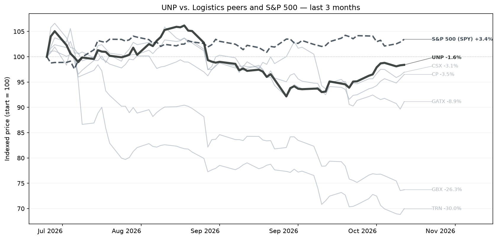

#### Earnings Call Summary

Union Pacific reported record third-quarter 2026 financial results with a 15% increase in adjusted earnings per share to $3.53 and net income totaling $2.1 billion. The company achieved 6% volume growth during the quarter and expanded its core operating ratio by 110 basis points when excluding fuel price impacts and merger-related costs.

#### At a Glance

- **Union Pacific Beats Expectations Comfortably:** Union Pacific reported a third-quarter adjusted EPS of $3.53, topping the analyst consensus estimate of $3.476, while its quarterly revenue reached $7.2 billion, beating the estimated $7.13 billion.
- **Volume Growth Drives Operating Efficiencies:** The company registered a 6% growth in total revenue carloads, marking an acceleration in demand while posting a solid operating ratio of 59.1% despite severe headwinds from elevated diesel fuel costs.
- **Capital Expenditure Target Revised Upward:** Management affirmed its high-single-digit reported full-year EPS growth outlook but updated its 2026 capital budget to $3.5 billion to pull forward key infrastructure projects originally slated for 2027.
- **Workforce Productivity Hits Fresh Records:** Union Pacific recorded 1,219 car miles per employee, representing a 5% increase and marking its ninth consecutive quarter of record workforce productivity.
- **Norfolk Southern Merger Remains Primary Focus:** The railroad operator continues to face regulatory scrutiny over its proposed merger with Norfolk Southern, which is anticipated to close in the second half of 2027.

#### Key Moments from the Call

- **28m — Unwavering Focus on Regulatory Approval and Ex Parte Talk:** Union Pacific requested a second round of ex parte communications with the STB to clarify benefits in its 8,000-page application for the Norfolk Southern merger. Management projects closing in the second half of 2027 and is 99.999% confident of approval, noting it has already secured an agreement with Canadian National to address competitive overlap.
- **37m — Capital Expenditure Increase to Accelerate Growth and Modernization:** Management raised 2026 capital guidance to $3.5 billion to pull ahead infrastructure investments planned for 2027 and fast-track locomotive modernization contracts. Investors will welcome this proactive strategy as it allows Union Pacific to build out resource buffers and support robust intermodal and industrial volume gains.
- **48m — Intermodal Volume Surge Outpaces Truck Market Shifts:** Domestic intermodal delivered its fifth consecutive record quarter of volume growth, driven by previous network capacity investments and strong West Coast port import activity. Because much of the volume was secured before summer pricing inflections, management anticipates contract resets in early 2027 will yield an even better environment for stronger pricing.
- **57m — Technology and Operational Discipline Drive Record Productivity Metrics:** Union Pacific registered record workforce productivity and fuel consumption efficiency despite a 140-basis-point operating ratio drag from higher fuel prices. Operational metrics improved across the board, with freight car velocity up 1%, terminal dwell dropping under 20 hours for a fourth straight quarter, and average train lengths expanding 2% to nearly 10,000 feet.
<h3 id="earnings-vlo">Valero Energy (<a href="#company-vlo">VLO</a>) +40.5%</h3>

**Reported:** October 22, 2026 · [Google Finance earnings page](https://www.google.com/finance/quote/VLO:NYSE?tab=earnings&hl=en)

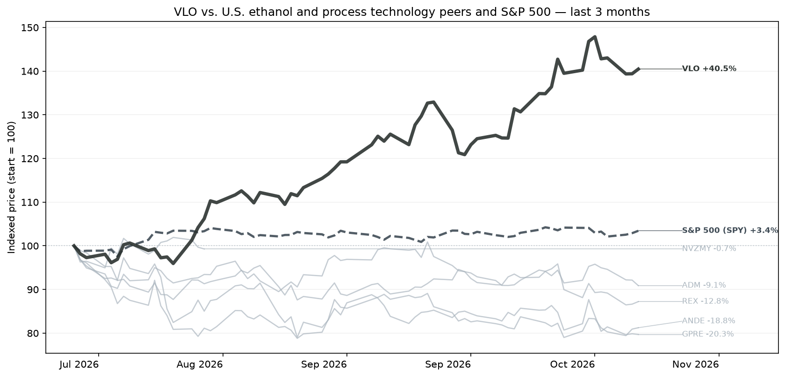

#### Earnings Call Summary

Valero Energy reported strong Q2 2026 adjusted net income of $3.7 billion, or $12.54 per share, significantly up from $714 million ($2.28 per share) in Q2 2025. The refining segment led performance with $4.4 billion in adjusted operating income, compared to $1.3 billion in the prior year quarter, while throughput volumes averaged 3 million bbl per day.

#### At a Glance

- **Valero Beats EPS and Revenue Estimates:** Valero reported third-quarter 2026 adjusted EPS of $23.90, comfortably beating the estimated $21.234, and generated revenues of $46.10 billion, which surpassed the estimated $41.72 billion.
- **Refining Margins and Volumes Climb Sharply:** Refining throughput volumes averaged 3.0 million barrels per day with near-record utilization, while the segment&#x27;s operating income skyrocketed to $8.8 billion from $1.6 billion in the prior-year period.
- **Throughput Guidance Maintained for Fourth Quarter:** Valero provided guidance projecting fourth-quarter refining throughput to stay elevated between 2.88 and 2.98 million barrels per day, supported by a light seasonal maintenance schedule.
- **Renewable Diesel Segment Swings to Profitability:** The renewable diesel segment reported operating income of $353 million, reversing a $28 million operating loss from the third quarter of 2025 due to strategic feedstock advantages.
- **Shares Fall Despite Record Earnings Surge:** Valero&#x27;s stock fell roughly 4% in early trading following the release, indicating that investors view the massive profit bump as a peak-cycle performance rather than a sustainable long-term trend.

#### Key Moments from the Call

- **4m — Massive Q2 Earnings Beat:** Valero delivered an extraordinary Q2 2026 performance with reported EPS of $12.54, vastly exceeding consensus estimates of $10.126. Reported revenue reached $42.82 billion against the estimated $38.43 billion. This massive outperformance will highly please investors, underscoring exceptional execution and strong capture rates in a volatile geopolitical and macroeconomic climate.
- **13m — Constructive Q3 Outlook and Tailwinds:** Management signaled that Q3 2026 refining margins and capture rates look even more constructive than Q2, driven primarily by lower delivered crude costs relative to benchmarks. Investors will be pleased by early Q3 feedstock discounts, strengthening propylene and sulfur prices, and an open arbitrage to export jet fuel to Europe, pointing to continued earnings momentum.
- **17m — Elevated Mid-Cycle Refining Margins:** Valero outlined a structurally higher view for future mid-cycle refining margins, driven by tight global capacity and Northwest Europe hydro skimming margins setting the floor for crack spreads. Coupled with rising carbon costs in Europe and favorable heavy sour crude discounts, this structural shift provides long-term valuation support that should reassure investors.
- **21m — Tight Global Inventories Through 2027:** Management highlighted that 5 million bbl per day of global refining capacity is offline due to geopolitical conflicts. With clean product inventories substantially below five-year averages, Valero expects supply deficits to persist through 2027. Extended damage to Russian and Middle Eastern plants means a prolonged high-margin environment, which will strongly encourage investors.
<h3 id="earnings-csx">CSX (<a href="#company-csx">CSX</a>) -3.1%</h3>

**Reported:** October 21, 2026 · [Google Finance earnings page](https://www.google.com/finance/quote/CSX:NASDAQ?tab=earnings&hl=en)

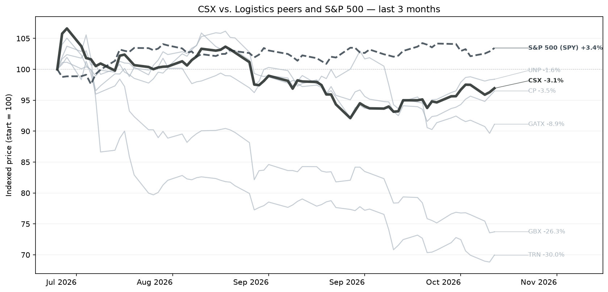

#### Earnings Call Summary

CSX delivered strong Q3 2026 financial performance, with reported EPS of $0.57 (up 30% year-over-year compared to adjusted results) and a 12% revenue increase driven by a 5% volume growth, pricing gains, and higher fuel surcharges. Operating margin expanded by 420 basis points to 39.1% due to substantial progress in productivity.

#### At a Glance

- **CSX Beats EPS and Revenue Estimates:** CSX reported a record third-quarter revenue of $4.017 billion and an adjusted EPS of $0.57, outperforming the estimated revenue of $3.963 billion and estimated adjusted EPS of $0.531.
- **Strong Volume and Operating Margin Expansion:** Total volume grew 5% year-over-year to 1.69 million units, while the company&#x27;s operating margin expanded significantly by 420 basis points to 39.1% due to strong pricing and efficiency gains.
- **Full-Year 2026 Revenue Guidance Raised:** Management raised its full-year 2026 revenue outlook to high-single-digit growth from the prior mid-to-high single-digit range, citing robust merchandise and intermodal demand.
- **Intermodal Segment Hits Record Performance:** The intermodal business led sector growth with a record volume increase of 7% and a 20% revenue surge, fueled by double-stack capabilities along the I-95 corridor.
- **Market Reacts Positively After Hours:** Shares of CSX jumped over 4% in after-hours trading following the announcement, reflecting strong investor enthusiasm for the earnings beat and expanding margins.

#### Key Moments from the Call

- **14m — Full-Year Revenue Guidance Upgraded:** Strong financial performance through the first nine months prompted management to raise full-year 2026 revenue expectations to high single-digit growth from the previously forecast mid to high single-digit range, signaling strong market momentum.
- **18m — Management Succession and Operations Direct Reports:** Following the retirement announcement of COO Mike Cory, the heads of network operations and engineering/transportation will now report directly to CEO Steve Angel, who highlighted his own deep background in manufacturing operations and lean systems.
- **24m — Domestic Intermodal Expansion Tailwinds:** Domestic intermodal drove significant segment volume, benefiting from the full double-stack clearance completion through the Howard Street Tunnel. Tightening truck capacity and higher highway rates are encouraging strong direct truck-to-rail freight conversions.
- **30m — Robust Productivity Program Pipeline:** Management revealed that over 100 concrete initiatives are already integrated into the 2027 budgeting process to sustain continuous margin and operational efficiency gains, while early planning is already underway for the 2028 pipeline.
<h3 id="earnings-vmi">Valmont Industries (<a href="#company-vmi">VMI</a>) -8.0%</h3>

**Reported:** October 20, 2026 · [Google Finance earnings page](https://www.google.com/finance/quote/VMI:NYSE?tab=earnings&hl=en)

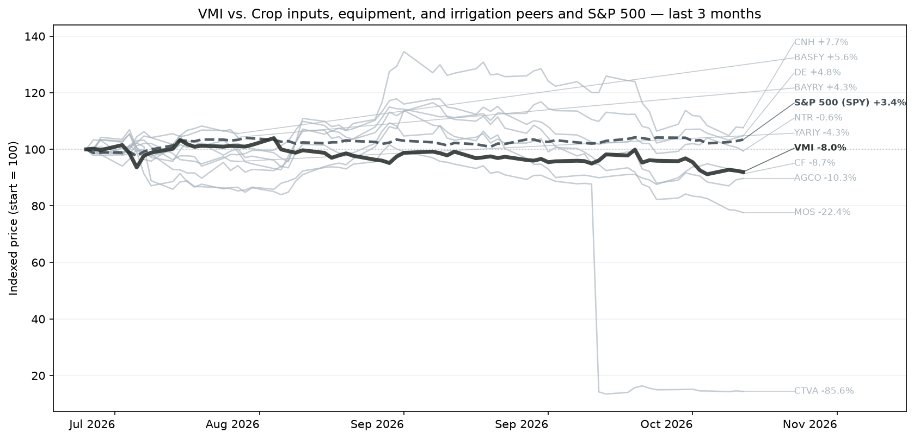

#### Earnings Call Summary

Valmont Industries delivered positive Q3 2026 results, with net sales increasing 5.5% year-over-year to $1.1 billion, operating margin expanding 220 basis points to 15.7%, and diluted EPS rising 25.3% to $6.24, driven by strong growth in the infrastructure segment.

#### At a Glance

- **Valmont Beats EPS, Misses Revenue:** Valmont Industries reported an adjusted diluted EPS of $6.24, comfortably beating the estimated $5.74, while quarterly revenue of $1.104 billion slightly missed the consensus target of $1.113 billion.
- **Infrastructure Backlog Reaches Record Levels:** The company&#x27;s performance was bolstered by a strong infrastructure segment, driving the total infrastructure backlog to $1.8 billion with industry lead times expanding to 60–70 weeks.
- **Full-Year Adjusted EPS Guidance Raised:** Valmont raised its full-year 2026 adjusted diluted EPS guidance to a range of $22.75 to $23.75 from its previous projection, while keeping its full-year net sales expectations unchanged.
- **Divergent Demand in Agriculture Segment:** The agriculture division faced a 6.4% decline in net sales due to international softness in Brazil and the Middle East, though this was partly cushioned by strong storm-replacement demand in North America.
- **Input Costs Threaten Q4 Margins:** Management warned that fourth-quarter earnings and margins are expected to moderate as a result of accelerating input costs, particularly with third-party index steel prices sitting 50% above prior-year levels.

#### Key Moments from the Call

- **16m — EPS Guidance Raised:** Valmont raised its full-year adjusted EPS guidance to $22.75-$23.75, following a strong Q3 performance that beat consensus estimates, which will likely please investors looking for near-term profitability enhancements.
- **17m — Near-Term Margin Compression:** Management warned that Q4 2026 margins will moderate due to accelerated steel and freight inflation. Because contractual price adjustments lag cost increases by two to three quarters, near-term profitability will face pressure before stabilizing in 2027.
- **23m — Utility Backlog Strength:** The infrastructure backlog increased to $1.8 billion, driven by robust utility demand and long-term grid investments. Lead times have expanded to 60-70 weeks, indicating substantial revenue visibility through 2028 and supporting the path to $35 EPS by 2029.
- **26m — Major North Africa Project Win:** Valmont secured a $100 million agricultural project in North Africa to support food and water security. Revenue recognition will span 18 to 24 months starting in H1 2027, helping offset ongoing macroeconomic weakness in Brazil and the Middle East.

## Company Overviews

<h3 id="company-ctva">Corteva (CTVA)</h3>

*Crop inputs, equipment, and irrigation · $52.4B · 3m -85.6% · 12m -79.8% · 24m -78.5%*

[Google Finance](https://www.google.com/finance/quote/CTVA:NYSE?tab=earnings&hl=en)

Largest U.S. corn-seed franchise (Pioneer) and a primary input cost for Corn Belt acres.

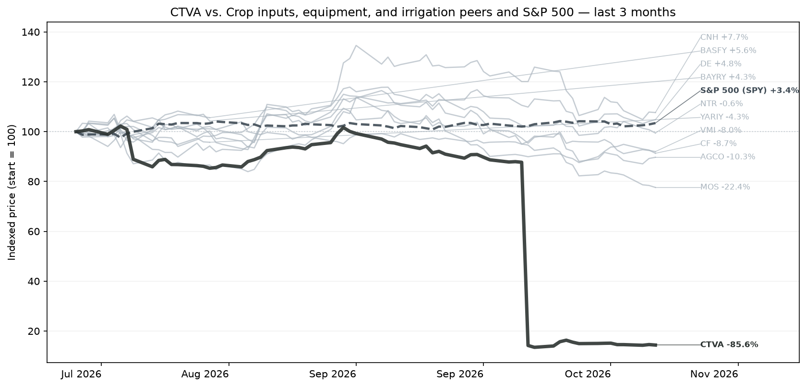

Corteva is an agricultural inputs pure play that was formed in 2019 when it was spun off from DowDuPont. The company is a leader in the development of new seed and crop protection products. Seeds generate the majority of profits with the remainder coming from crop protection products. Corteva plans to spin off its seeds business in late 2026. The seeds business will be named Vylor, while the crop protection business will retain the Corteva name and be a pure-play crop protection company following the divestiture. Corteva operates globally, but around half of revenue comes from North America.

<h3 id="company-bayry">Bayer (BAYRY)</h3>

*Crop inputs, equipment, and irrigation · n/a · 3m +4.3% · 12m +75.4% · 24m +98.1%*

[Google Finance](https://www.google.com/finance/quote/BAYRY:NYSE?tab=earnings&hl=en)

Dekalb and former Monsanto corn-seed brands; together with Corteva dominates U.S. corn seed.

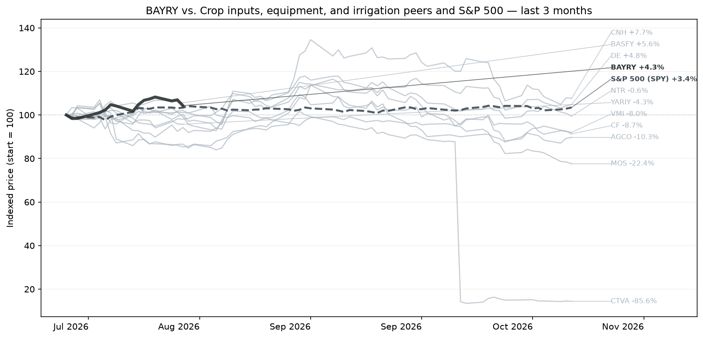

BAYER AG S/ADR

<h3 id="company-basfy">BASF (BASFY)</h3>

*Crop inputs, equipment, and irrigation · n/a · 3m +5.6% · 12m +18.2% · 24m +18.3%*

[Google Finance](https://www.google.com/finance/quote/BASFY:NYSE?tab=earnings&hl=en)

Crop-protection chemistry used on U.S. corn acres.

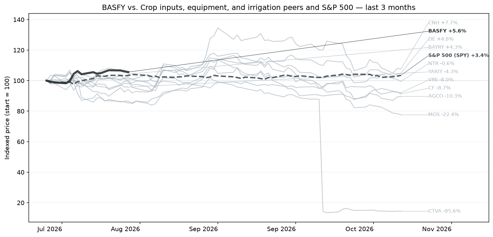

BASF SE S/ADR

<h3 id="company-ntr">Nutrien (NTR)</h3>

*Crop inputs, equipment, and irrigation · $33.6B · 3m -0.6% · 12m +19.9% · 24m +41.6%*

[Google Finance](https://www.google.com/finance/quote/NTR:NYSE?tab=earnings&hl=en)

Largest North American agricultural retailer and a major potash and nitrogen producer.

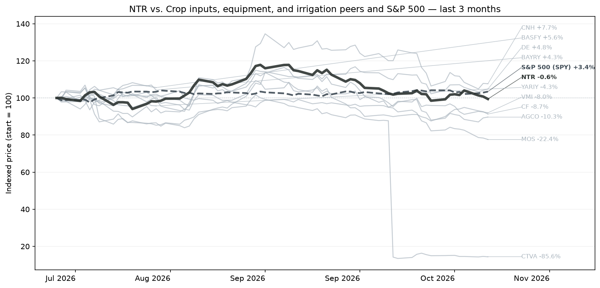

Created in 2018 as a result of the merger between PotashCorp and Agrium, Nutrien is the world's largest fertilizer producer by capacity. Nutrien produces the three main crop nutrients—nitrogen, potash, and phosphate—although its main focus is potash, where it is the global leader in installed capacity with a roughly 20% market share. The company is also the largest agricultural retailer in North America and Australia, selling fertilizers, crop chemicals, seeds, and services directly to farm customers through its brick-and-mortar stores and online platforms.

<h3 id="company-cf">CF Industries (CF)</h3>

*Crop inputs, equipment, and irrigation · $18.0B · 3m -8.7% · 12m +35.3% · 24m +38.6%*

[Google Finance](https://www.google.com/finance/quote/CF:NYSE?tab=earnings&hl=en)

Nitrogen fertilizer producer; corn is the crop that most moves UAN and urea demand.

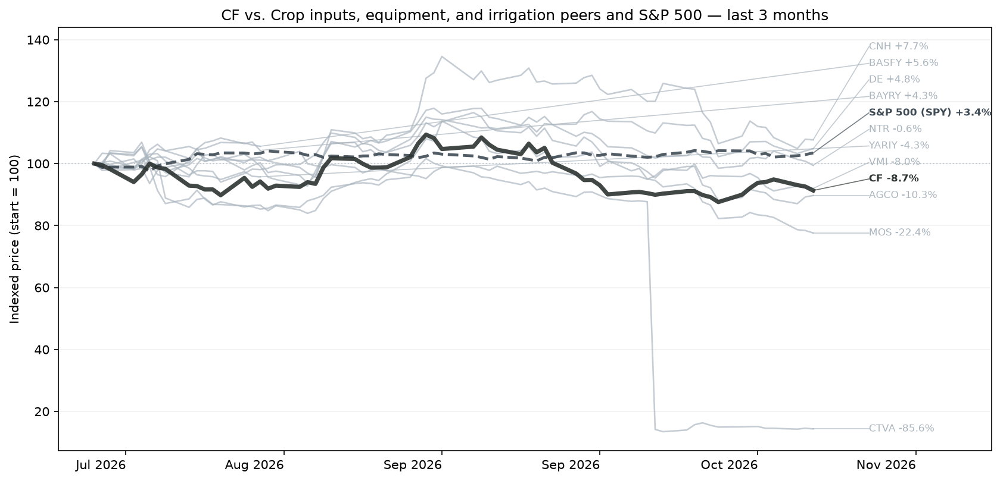

CF Industries is a leading producer and distributor of nitrogen, which is primarily used in fertilizers. The company operates nitrogen manufacturing plants primarily in North America. CF also produces nitrogen in the United Kingdom and holds a joint venture interest in a nitrogen production facility in Trinidad and Tobago. CF makes nitrogen primarily using low-cost US natural gas as its feedstock, making the company one of the lowest-cost nitrogen producers globally. It is also investing in carbon-free blue and green ammonia, which can be used as an alternative fuel to hydrogen or as a means to transport hydrogen.

<h3 id="company-yariy">Yara International (YARIY)</h3>

*Crop inputs, equipment, and irrigation · n/a · 3m -4.3% · 12m +19.1% · 24m +46.6%*

[Google Finance](https://www.google.com/finance/quote/YARIY:NYSE?tab=earnings&hl=en)

Global nitrogen producer that sets the international urea and ammonia reference.

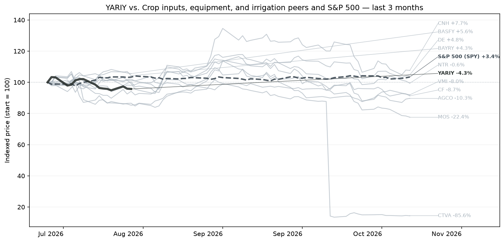

YARA INTL ASA S/ADR

<h3 id="company-mos">Mosaic (MOS)</h3>

*Crop inputs, equipment, and irrigation · $7.1B · 3m -22.4% · 12m -40.4% · 24m -33.1%*

[Google Finance](https://www.google.com/finance/quote/MOS:NYSE?tab=earnings&hl=en)

Phosphate and potash producer that completes corn production budgets.

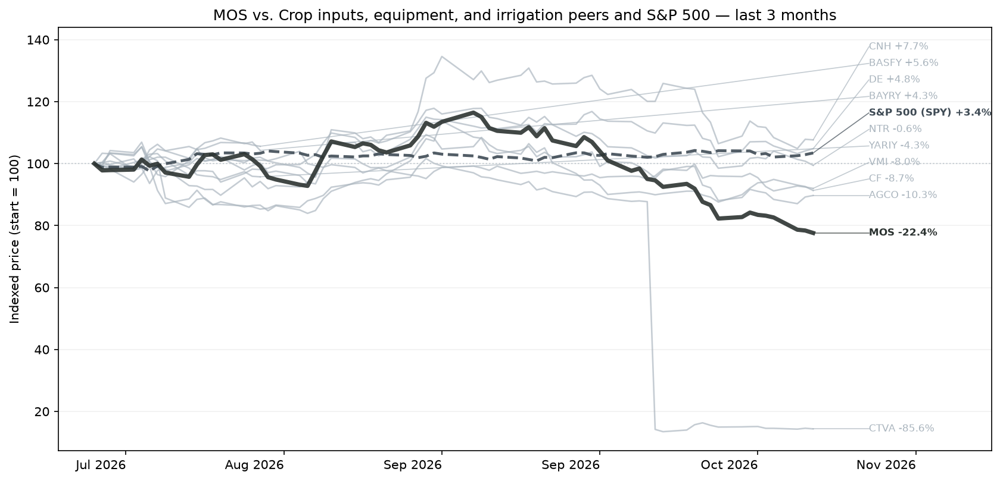

Mosaic is one of the largest phosphate and potash producers in the world. The company's assets include phosphate rock mines in the US and potash mines in Canada. Mosaic also runs a large fertilizer distribution operation in Brazil through its Mosaic Fertilizantes business.

<h3 id="company-de">Deere (DE)</h3>

*Crop inputs, equipment, and irrigation · $156.7B · 3m +4.8% · 12m +37.7% · 24m +56.5%*

[Google Finance](https://www.google.com/finance/quote/DE:NYSE?tab=earnings&hl=en)

Dominant North American farm-equipment maker for corn planting, harvest, and grain handling.

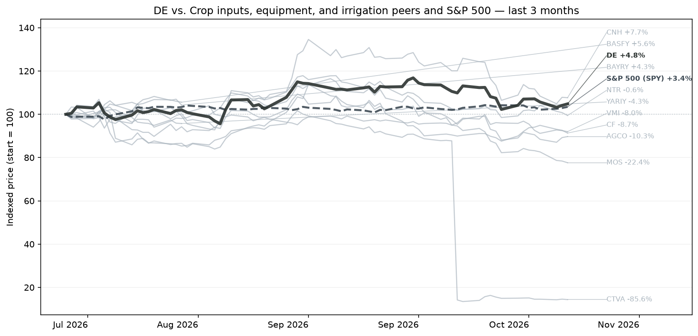

Deere is the world's leading manufacturer of agricultural equipment and a major producer of construction machinery. The company is divided into four reporting segments: production & precision agriculture, or PPA, small agriculture & turf, or SAT, construction & forestry, or CF, and financial services, or FS, its captive finance subsidiary. The core PPA business is the largest contributor to sales and profits by far. Geographically, Deere sales are 60% US/Canada, 17% Europe, 14% Latin America, and 9% rest of the world. Deere goes to market through a robust dealer network that includes over 2,000 dealer locations in North America with reach into over 100 countries. John Deere Financial provides retail financing for machinery to its customers and wholesale financing for dealers.

<h3 id="company-cnh">CNH Industrial (CNH)</h3>

*Crop inputs, equipment, and irrigation · $16.5B · 3m +7.7% · 12m +8.6% · 24m +4.9%*

[Google Finance](https://www.google.com/finance/quote/CNH:NYSE?tab=earnings&hl=en)

Case IH and New Holland farm equipment serving corn growers.

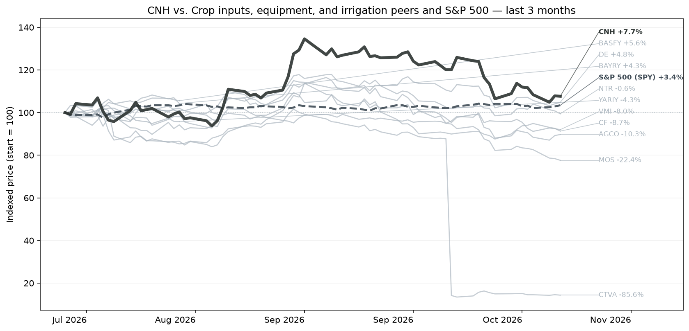

CNH Industrial is the world's second largest manufacturer of agricultural machinery (82% of industrial net sales) as well as a major player in construction equipment (18% of industrial net sales). Its Case and New Holland brands have served farmers for generations. Geographically, agricultural sales are 40% in North America, 32% in Europe, the Middle East, and Africa, 18% in South America, and 10% in Asia-Pacific. CNH's products are available through a robust independent dealer network, which includes over 2,600 dealer and distribution locations and reach into 164 countries. The construction business leverages over 400 dealers. The company's captive finance arm provides retail financing to its customers and wholesale financing to dealers to maintain inventory, thereby supporting sales.

<h3 id="company-agco">AGCO (AGCO)</h3>

*Crop inputs, equipment, and irrigation · $7.0B · 3m -10.3% · 12m -1.9% · 24m +6.7%*

[Google Finance](https://www.google.com/finance/quote/AGCO:NYSE?tab=earnings&hl=en)

Fendt, Massey Ferguson, and Challenger farm equipment with Corn Belt exposure.

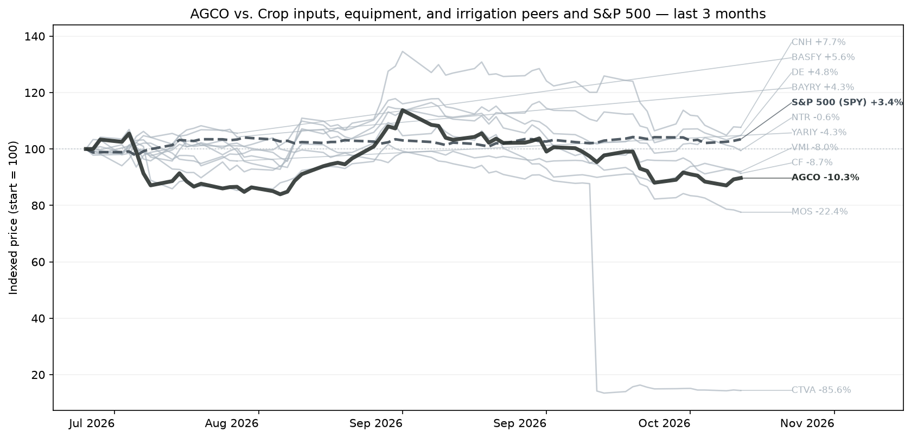

Agco is a global manufacturer of agricultural equipment. Its main machine brands are Fendt, Massey Ferguson, and Valtra; its initiatives in precision agriculture have been organized under the PTx umbrella following a series of acquisitions. While a global business, Agco's sales skew heavily toward Europe/Middle East, representing 50%-60% of sales and even more of operating profits. The company is trying to increase its exposure to the larger North and South American markets. Its products are available through a global dealer network, which includes over 3,000 dealers and distribution locations and reaches into over 140 countries. Additionally, Agco offers retail and wholesale financing to customers through its partnership with Rabobank of the Netherlands, having exited their JV in 2026.

<h3 id="company-vmi">Valmont Industries (VMI)</h3>

*Crop inputs, equipment, and irrigation · $9.3B · 3m -8.0% · 12m +11.8% · 24m +52.1%*

[Google Finance](https://www.google.com/finance/quote/VMI:NYSE?tab=earnings&hl=en)

Center-pivot irrigation (Valley) used on irrigated High Plains corn.

Valmont Industries Inc, along with its subsidiaries, operates as a manufacturer of products and services for infrastructure and agriculture markets. Its reportable segments are Infrastructure and Agriculture. The company generates maximum revenue from the Infrastructure segment, which includes the manufacturing and distribution of products and solutions to serve the infrastructure markets of utility, solar, lighting, transportation, and telecommunications, along with coatings services to protect metal products. The Agriculture segment provides irrigation equipment components, including aftermarket parts and tubular products, and technology solutions for precision agriculture. Geographically, it derives key revenue from the United States, followed by Australia, Brazil, and other regions.

<h3 id="company-adm">Archer Daniels Midland (ADM)</h3>

*Grain origination and agribusiness, U.S. ethanol and process technology, Wet milling, ingredients, and co-products · $38.9B · 3m -9.1% · 12m +28.2% · 24m +42.5%*

[Google Finance](https://www.google.com/finance/quote/ADM:NYSE?tab=earnings&hl=en)

Global grain trader, top U.S. ethanol producer, and major corn wet miller.

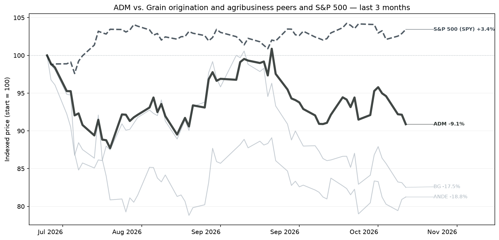

Archer-Daniels-Midland is a major processor of oilseeds, corn, wheat, and other agricultural commodities. The company is also one of the largest grain merchandisers through its extensive network of logistical assets to store and transport crops around the globe. ADM also runs a nutrition business that focuses on both human and animal ingredients and is a large producer of corn-based sweeteners, starches, and ethanol.

<h3 id="company-bg">Bunge (BG)</h3>

*Grain origination and agribusiness · $21.9B · 3m -17.5% · 12m +7.1% · 24m +14.4%*

[Google Finance](https://www.google.com/finance/quote/BG:NYSE?tab=earnings&hl=en)

Global grain and oilseed merchant after the Viterra combination; competitor for corn origination.

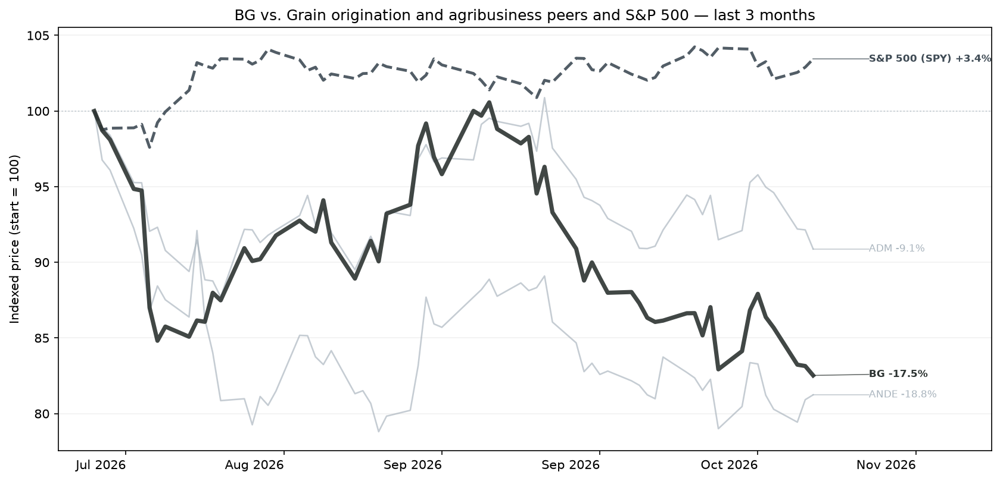

Bunge Global SA is an agribusiness solutions company, connecting farmers to consumers and delivering essential food, feed and fuel to the globe. The company segments include Soybean Processing and Refining; Softseed Processing and Refining; Other Oilseeds Processing and Refining; Grain Merchandising and Milling; and Corporate and Other. It generates maximum revenue from the Soybean Processing and Refining segment, which includes integrated business principally involved in the purchase, storage, transportation, processing, distribution, refining, marketing, and sale of soybeans and soybean related products, as well as biodiesel and fertilizer production and distribution. Geographically, the company operates in United States, Switzerland, Netherlands, and Rest of the World.

<h3 id="company-ande">The Andersons (ANDE)</h3>

*Grain origination and agribusiness, U.S. ethanol and process technology · $2.3B · 3m -18.8% · 12m +43.1% · 24m +40.4%*

[Google Finance](https://www.google.com/finance/quote/ANDE:NASDAQ?tab=earnings&hl=en)

Grain elevators plus four wholly owned ethanol plants totaling about 500 million gallons a year.

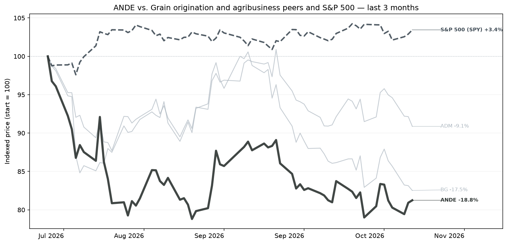

Andersons Inc is an agriculture and renewable fuels company. Its operations are classified into two reportable business segments: Agribusiness, which generates maximum revenue, and Renewables. The Agribusiness segment includes merchandising and managing logistics across various commodities, as well as being a manufacturer, distributor, and retailer of agricultural and related plant nutrients. The segment specializes in the movement of physical commodities such as whole grains, grain products, feed ingredients, and domestic fuel products, among other agricultural commodities. The Renewables segment mainly produces, purchases, and sells ethanol and co-products. Geographically, the company generates maximum revenue from the United States, followed by Canada, Mexico, and other markets.

<h3 id="company-vlo">Valero Energy (VLO)</h3>

*U.S. ethanol and process technology, Fuel blending, refining, and retail · $99.7B · 3m +40.5% · 12m +169.8% · 24m +221.8%*

[Google Finance](https://www.google.com/finance/quote/VLO:NYSE?tab=earnings&hl=en)

World's second-largest corn-ethanol producer with a distinct Ethanol segment and a major blender.

Valero Energy is one of the largest independent refiners in the United States. It operates 15 refineries, with a total throughput capacity of 3.2 million barrels a day in the US, Canada, and the United Kingdom. Valero also owns 12 ethanol plants with capacity of 1.6 billion gallons a year and holds a 50% stake in Diamond Green Diesel, which can produce 1.2 billion gallons per year of renewable diesel.

<h3 id="company-gpre">Green Plains (GPRE)</h3>

*U.S. ethanol and process technology · $1.1B · 3m -20.3% · 12m +46.1% · 24m +21.3%*

[Google Finance](https://www.google.com/finance/quote/GPRE:NASDAQ?tab=earnings&hl=en)

Largest U.S. ethanol pure play, with high-protein feed, corn oil, and Nebraska carbon-capture work.

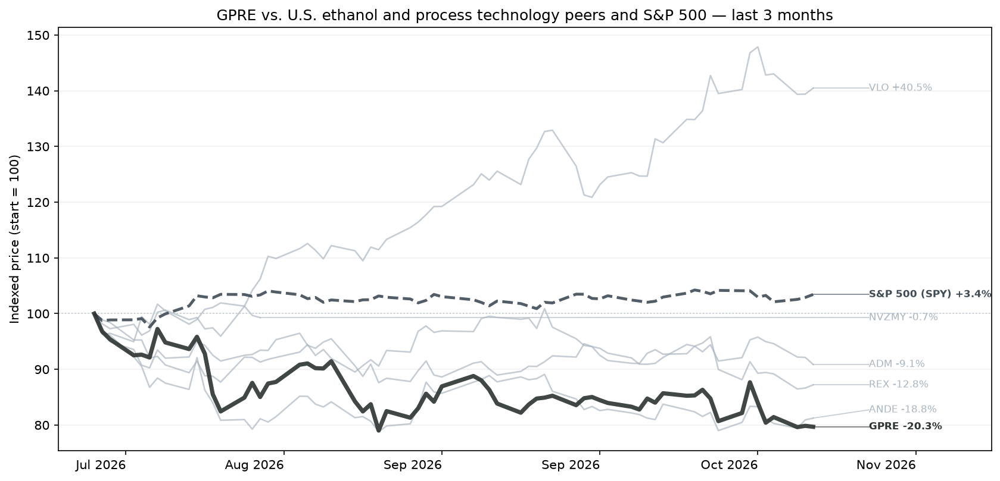

Green Plains Inc manufactures and sells ethanol and ethanol byproducts in two segments based on function. The ethanol production segment, which generates the majority of revenue, includes the production of ethanol, distillers grains, Ultra-High Protein and renewable corn oil. The agribusiness and energy services segment includes grain handling and storage, commodity marketing and merchant trading for company-produced and third-party ethanol, distillers grains, Ultra-High Protein, renewable corn oil, natural gas and other commodities.

<h3 id="company-rex">REX American Resources (REX)</h3>

*U.S. ethanol and process technology · $1.4B · 3m -12.8% · 12m +30.4% · 24m +81.5%*

[Google Finance](https://www.google.com/finance/quote/REX:NYSE?tab=earnings&hl=en)

Holding company with interests in six Corn Belt ethanol plants; cleanest public crush-margin equity.

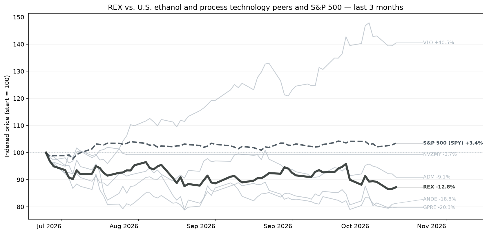

REX American Resources Corp operates as a holding company that engages in investments in alternative energy and ethanol production entities. Its operating segments include Ethanol and By-Products. Its products include Ethanol, dried distillers grains, modified distillers grains, Distillers corn oil, Modified distillers grains, and Other.

<h3 id="company-nvzmy">Novonesis (NVZMY)</h3>

*U.S. ethanol and process technology · n/a · 3m -0.7% · 12m +1.3% · 24m -0.7%*

[Google Finance](https://www.google.com/finance/quote/NVZMY:NYSE?tab=earnings&hl=en)

Dominant supplier of enzymes used in dry-mill ethanol fermentation.

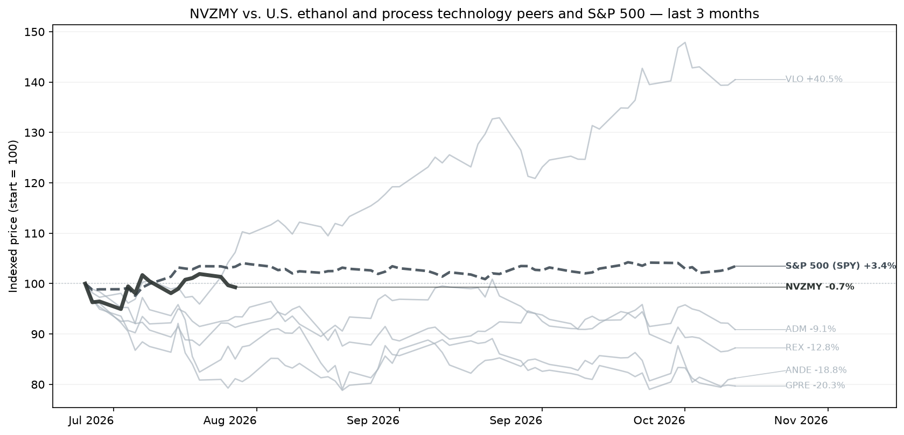

NOVONESIS B UNSP/ADR

<h3 id="company-ingr">Ingredion (INGR)</h3>

*Wet milling, ingredients, and co-products · $6.8B · 3m -6.6% · 12m -20.4% · 24m -28.8%*

[Google Finance](https://www.google.com/finance/quote/INGR:NYSE?tab=earnings&hl=en)

Major corn wet miller producing sweeteners, starches, and specialty ingredients.

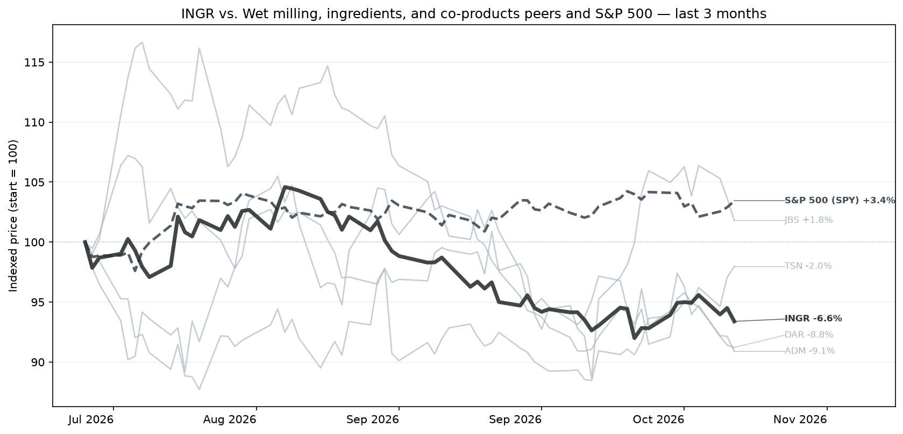

Ingredion is an ingredients provider for the food, beverage, brewing, and animal nutrition industries. The company processes corn, tapioca, potatoes, stevia, grains, fruits, gums, and vegetables into value-added ingredients. The company sells specialty ingredients that include starch-based texturizers and natural alternative sweeteners such as stevia. Ingredion also sells commodity ingredients that include sweeteners, such as high-fructose corn syrup, and starches, such as those used for sustainable packaging, as well as plant-based proteins. The company plans to acquire Tate & Lyle in an all-cash deal that should close in 2027.

<h3 id="company-dar">Darling Ingredients (DAR)</h3>

*Wet milling, ingredients, and co-products · $10.6B · 3m -8.8% · 12m +89.9% · 24m +53.2%*

[Google Finance](https://www.google.com/finance/quote/DAR:NYSE?tab=earnings&hl=en)

Rendering and used cooking oil; 50/50 owner of Diamond Green Diesel with Valero.

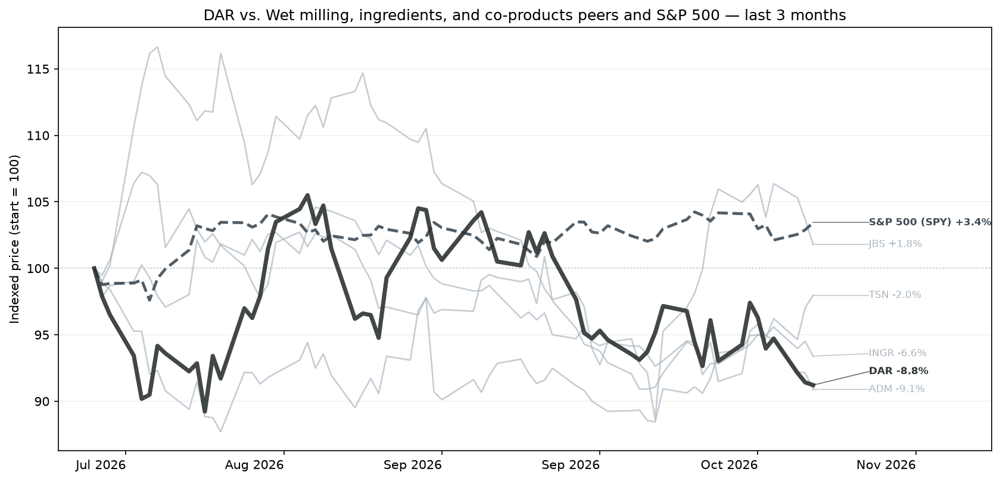

Darling Ingredients Inc is a developer and producer of sustainable natural ingredients from edible and inedible bio-nutrients, creating a wide range of ingredients and customized specialty solutions for customers in the pharmaceutical, food, pet food, animal feed, industrial, fuel, bioenergy and fertilizer industries. It processes by-products from the animal agriculture and food industries into ingredients and products for human nutrition, animal feed, crop inputs, and renewable energy applications. The company operates processing facilities across multiple countries and produces collagen, including gelatin and hydrolyzed collagen, as well as renewable energy products.

<h3 id="company-tsn">Tyson Foods (TSN)</h3>

*Wet milling, ingredients, and co-products · $20.6B · 3m -2.0% · 12m +6.0% · 24m -5.1%*

[Google Finance](https://www.google.com/finance/quote/TSN:NYSE?tab=earnings&hl=en)

Largest U.S. protein company and a primary domestic sink for distillers grains.

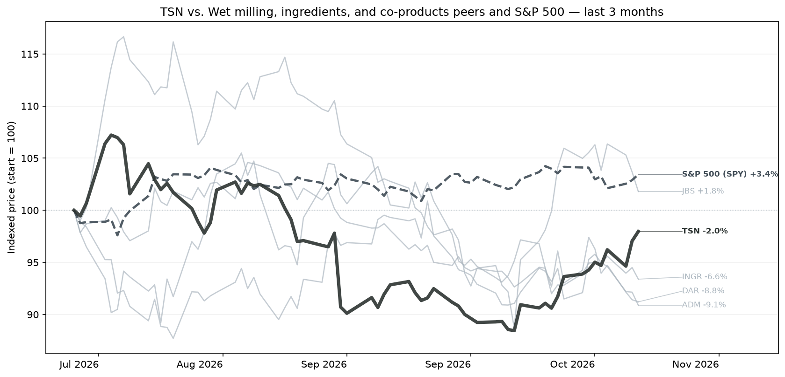

Tyson Foods is a protein-focused food producer, selling raw chicken, beef, pork, and prepared foods. Chicken and beef are its two largest segments, composing about 40% and 30% of sales, respectively. Prepared foods constituted 18% of fiscal 2025 sales and include brands like Tyson, Jimmy Dean, Hillshire Farm, Ball Park, and Sara Lee. However, most of these are in product categories rife with competition where Tyson does not have a massive market share lead. Tyson sells some products overseas, but the international segment accounts for just 4% of total revenue. The company is an active acquirer, with more recent years' purchases focused on international and food-service markets.

<h3 id="company-jbs">JBS (JBS)</h3>

*Wet milling, ingredients, and co-products · $45.2B · 3m +1.8% · 12m -4.8% · 24m n/a*

[Google Finance](https://www.google.com/finance/quote/JBS:NYSE?tab=earnings&hl=en)

World's largest protein company and a major DDGS buyer in the U.S. and Brazil.

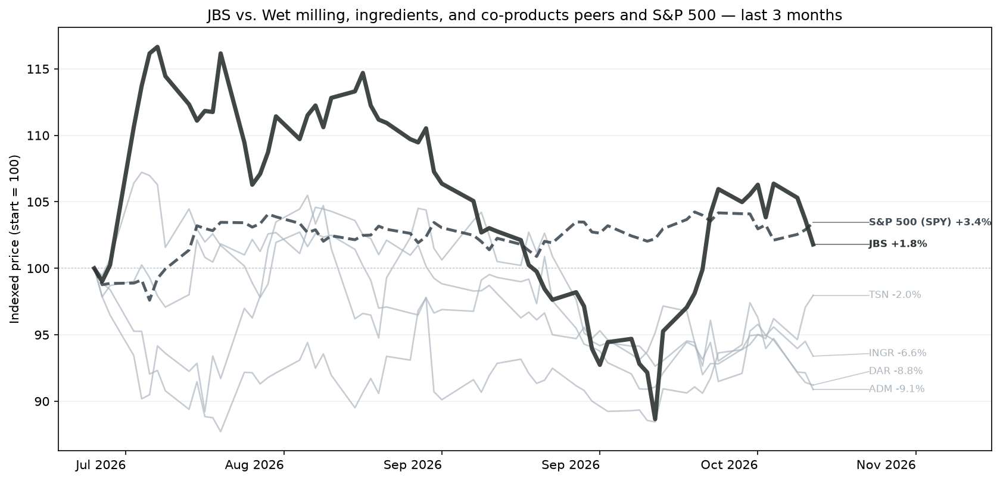

JBS NV is a protein food company, selling protein products, which include fresh and frozen cuts of beef, pork, lamb, fish, whole chickens, and chicken parts, to retailers, and foodservice companies. The food products are marketed under different brands such as Swift, Just Bare, Pilgrim's Pride, Sunnyvalley, Reserva Friboi, Great Southern, etc., globally. The company's reportable segments are Beef North America, which generates maximum revenue, Brazil, Seara, Pork USA, Pilgrim's Pride, Australia, and Others. Geographically, it derives majority of its revenue from United States of America.

<h3 id="company-mpc">Marathon Petroleum (MPC)</h3>

*Fuel blending, refining, and retail · $101.3B · 3m +48.2% · 12m +148.2% · 24m +195.7%*

[Google Finance](https://www.google.com/finance/quote/MPC:NYSE?tab=earnings&hl=en)

Largest U.S. independent refiner and a major Midwest ethanol blender.

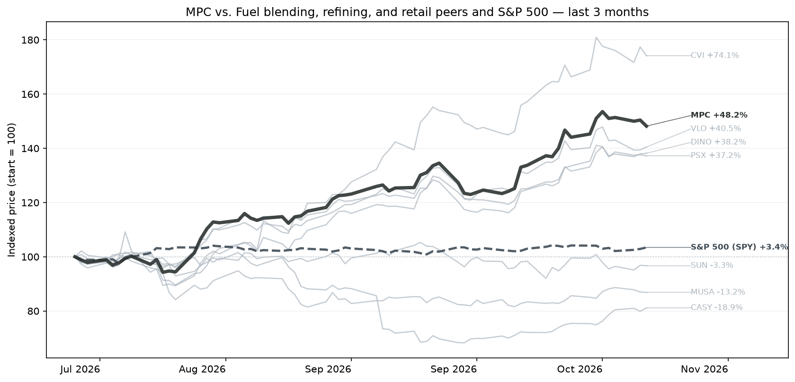

Marathon Petroleum is a leading integrated downstream and midstream energy company that operates 13 refineries in the Gulf Coast, Mid-Continent, and West Coast regions of the United States with an aggregate crude oil refining capacity of 3.0 million barrels per day. The company is one of the largest producers of renewable diesel in the US; its Dickinson, North Dakota facility has the capacity to produce 184 million gallons per year, and its Martinez, California, joint venture facility (a 50/50 partnership with Neste) reached its full capacity of 730 million gallons per year in late 2024. Marathon also owns the general partner and approximately 64% of MPLX LP, a large-cap master limited partnership that owns and operates midstream energy infrastructure and logistics assets.

<h3 id="company-psx">Phillips 66 (PSX)</h3>

*Fuel blending, refining, and retail · $96.7B · 3m +37.2% · 12m +120.8% · 24m +120.7%*

[Google Finance](https://www.google.com/finance/quote/PSX:NYSE?tab=earnings&hl=en)

Large blender and marketer with West Coast renewable-diesel capacity.

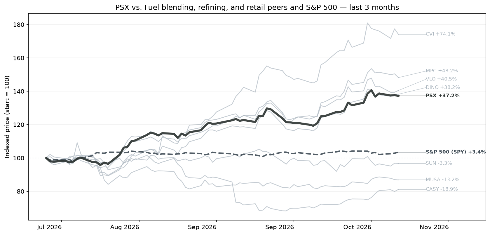

Phillips 66 is an independent refiner that owns or holds interest in 10 refineries with a total crude throughput capacity of 2.0 million barrels per day, or mmb/d, at the end of 2025. The midstream segment comprises extensive transportation and NGL processing assets. It includes 70,000 miles of crude oil, refined petroleum product, NGL and natural gas pipeline systems, and a comprehensive set of refined petroleum product, NGL and crude oil terminals, gathering and processing plants and fractionation facilities and various other storage and loading facilities. Its CPChem chemical joint venture operates facilities primarily in the United States and the Middle East and produces olefins and polyolefins.

<h3 id="company-dino">HF Sinclair (DINO)</h3>

*Fuel blending, refining, and retail · $16.8B · 3m +38.2% · 12m +137.4% · 24m +185.1%*

[Google Finance](https://www.google.com/finance/quote/DINO:NYSE?tab=earnings&hl=en)

Independent Mid-Continent and Rockies refiner with renewable diesel and RFS blending obligations.

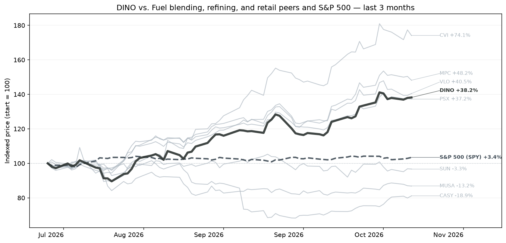

HF Sinclair is an integrated petroleum refiner that owns and operates seven refineries serving the Rockies, midcontinent, Southwest, and Pacific Northwest, with a total crude oil throughput capacity of 678,000 barrels per day. It can produce 380 million gallons of renewable diesel annually. It operates a marketing business with over 350 distributors and 1,700 branded wholesale sites across 30 states. It also owns and operates 4,500 miles of petroleum product pipelines and terminals principally in the Southwestern United States.

<h3 id="company-cvi">CVR Energy (CVI)</h3>

*Fuel blending, refining, and retail · $3.7B · 3m +74.1% · 12m +67.4% · 24m +149.6%*

[Google Finance](https://www.google.com/finance/quote/CVI:NYSE?tab=earnings&hl=en)

Coffeyville, Kansas refiner in the corn complex with renewable diesel and a nitrogen affiliate.

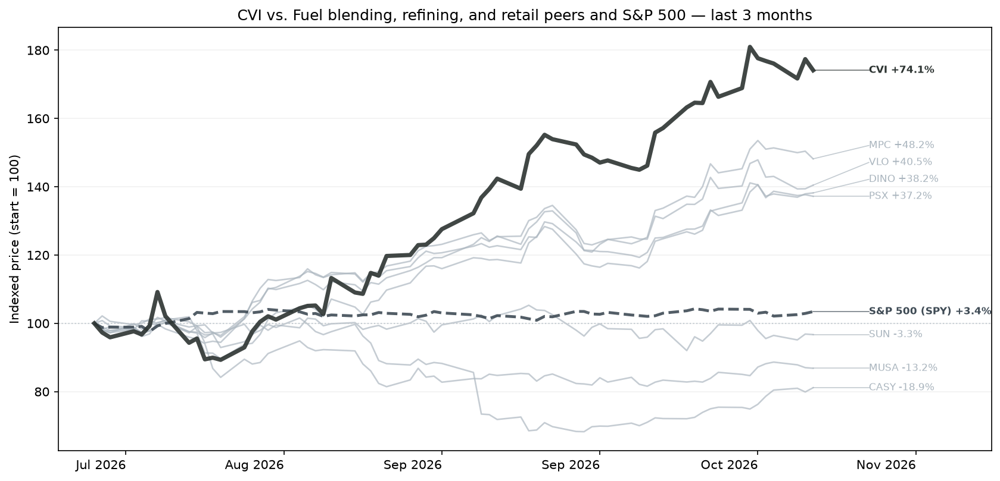

CVR Energy Inc is a holding company that engages in petroleum refining and nitrogen fertilizer manufacturing through its subsidiaries. Subsidiaries include several complex, full-coking crude oil refineries, along with a crude oil gathering system, pipelines, storage tanks, and marketing and supply. The company's refineries can process blends of a variety of crude oil ranging from heavy sour to light sweet crude oil. Crude oil for CVR's refineries is supplied through its wholly-owned gathering system and pipeline. From its refineries, CVR supplies products through tanker trucks directly to customers located in close geographic proximity and customers at throughput terminals. The company's customers include retailers, railroads, and farm cooperatives.

<h3 id="company-sun">Sunoco LP (SUN)</h3>

*Fuel blending, refining, and retail · $14.5B · 3m -3.3% · 12m +34.8% · 24m +42.0%*

[Google Finance](https://www.google.com/finance/quote/SUN:NYSE?tab=earnings&hl=en)

Fuel distributor and terminal operator that moves finished gasoline and ethanol.

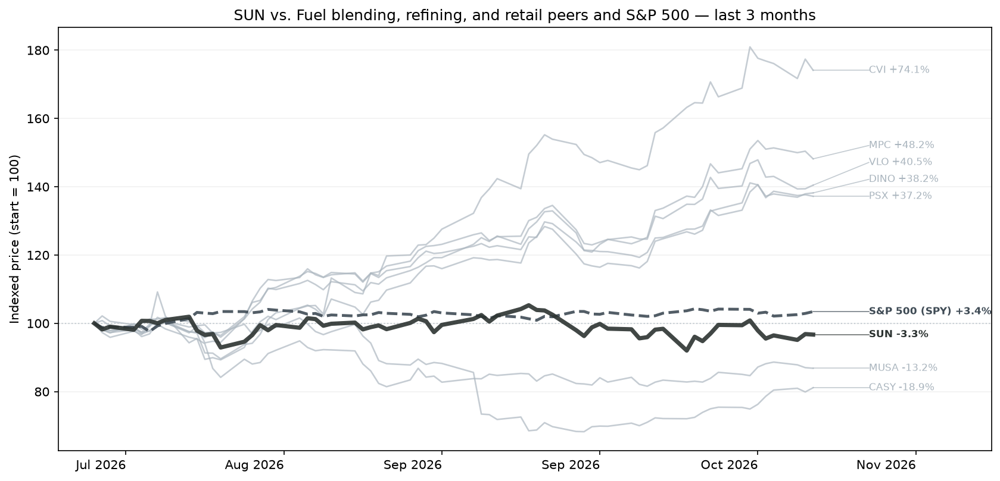

Sunoco LP is engaged in the distribution of motor fuels to independent dealers, distributors, and other commercial customers as well as the distribution of motor fuels to end-use customers at retail sites operated by commission agents. It is a growth-oriented master limited partnership (MLP) that operates as a wholesale and retail fuel distributor in the United States. The firm operates through the Fuel Distribution; Pipeline Systems; Refinery and Terminals segments. It generates the majority of its revenue from the Fuel Distribution segment. It distributes motor fuel to convenience stores, dealers, and commercial customers in various states.

<h3 id="company-casy">Casey&#x27;s General Stores (CASY)</h3>

*Fuel blending, refining, and retail · $30.9B · 3m -18.9% · 12m +27.5% · 24m +78.1%*

[Google Finance](https://www.google.com/finance/quote/CASY:NASDAQ?tab=earnings&hl=en)

Corn Belt convenience-store chain with high E10/E15/E85 exposure.

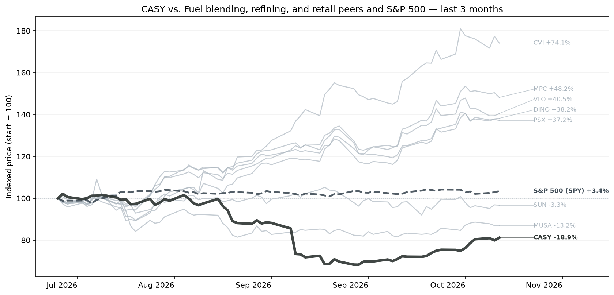

Casey's General Stores Inc, along with its subsidiaries, operates convenience stores mainly under the names Casey's, GoodStop (by Casey's), and Casey's General Store throughout various states in the USA, approximately half of which are located in Iowa, Missouri, and Illinois. These stores offer a broad selection of food items (which includes prepared foods such as regular and breakfast pizza, donuts, hot breakfast items, and hot and cold sandwiches), beverages, tobacco and nicotine products, groceries, health and beauty aids, automotive products, and other non-food items. The majority of the company's revenue is mainly derived from the retail sale of fuel and the products offered inside its stores.

<h3 id="company-musa">Murphy USA (MUSA)</h3>

*Fuel blending, refining, and retail · $10.4B · 3m -13.2% · 12m +43.2% · 24m +13.0%*

[Google Finance](https://www.google.com/finance/quote/MUSA:NYSE?tab=earnings&hl=en)

High-volume fuel retailer and national ethanol blender.

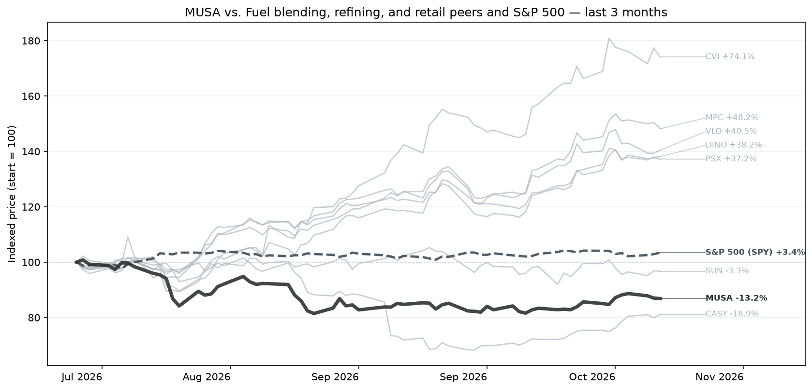

Murphy USA Inc is mainly engaged in the marketing of retail motor fuel products and convenience merchandise through a network of several retail stores in the Southwest, Southeast, Midwest, and Northeast United States. The majority of Murphy USA's stores are located in proximity to Walmart Supercenters, but it also operates standalone stores that market gasoline and other products under the Murphy USA, Murphy Express, and QuickChek brands. In addition, the company also markets fuel to unbranded wholesale customers through a mixture of company-owned and third-party product distribution terminals and pipeline positions. The firm generates maximum revenue through retail sales of petroleum products, and the rest from merchandise sales and wholesale of petroleum products.

<h3 id="company-ntoiy">Neste (NTOIY)</h3>

*Advanced biofuels and SAF · n/a · 3m -10.1% · 12m +73.0% · 24m +105.9%*

[Google Finance](https://www.google.com/finance/quote/NTOIY:NYSE?tab=earnings&hl=en)

Largest global producer of renewable diesel and SAF; sets the price umbrella for corn oil.

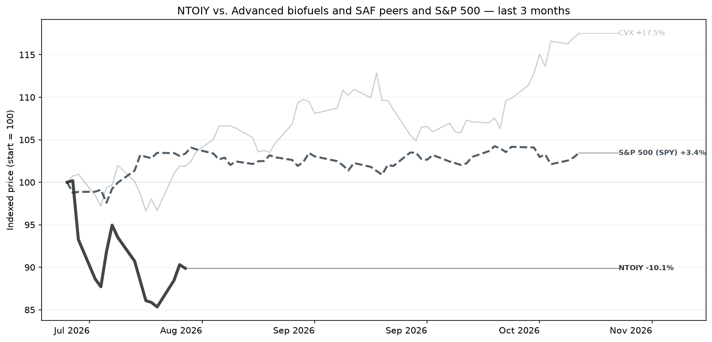

NESTE OYJ UNSP/ADR

<h3 id="company-cvx">Chevron (CVX)</h3>

*Advanced biofuels and SAF · $403.6B · 3m +17.5% · 12m +45.8% · 24m +50.3%*

[Google Finance](https://www.google.com/finance/quote/CVX:NYSE?tab=earnings&hl=en)

Owner of Renewable Energy Group biodiesel and renewable-diesel plants that take corn oil at the margin.

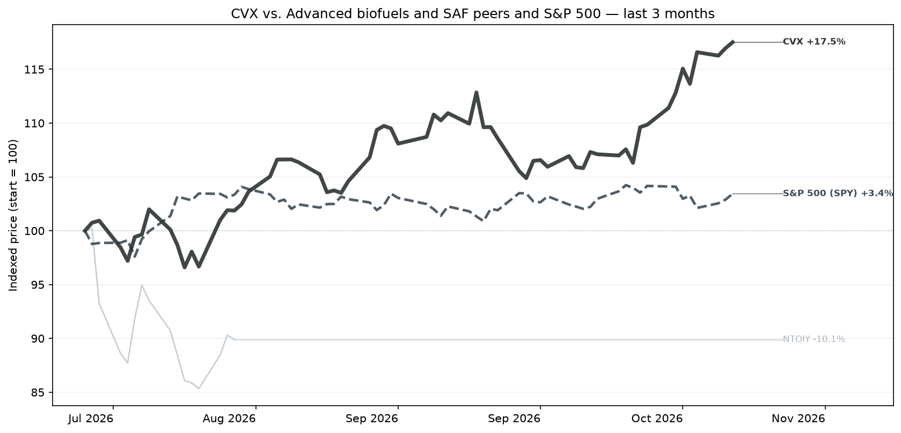

Chevron is an integrated energy company with exploration, production, and refining operations worldwide. It is the second-largest oil company in the United States with 2025 worldwide net oil-equivalent production of 3.7 million barrels per day, including 8.5 billion cubic feet per day of natural gas and 2.3 million barrels of liquids per day. Production takes place in North America, South America, Europe, Africa, Asia, and Australia. The company's refining networks arelocated in the United States and Asia, with a total worldwide refining capacity of 1.8 million barrels of oil a day at year-end 2025. Net proved reserves at year-end 2025 stood at 10.6 billion barrels of oil equivalent, consisting of 5.7 billion barrels of liquids and 29.2 trillion cubic feet of natural gas.

<h3 id="company-csan">Cosan (CSAN)</h3>

*International ethanol · $2.5B · 3m -12.1% · 12m -37.8% · 24m -66.3%*

[Google Finance](https://www.google.com/finance/quote/CSAN:NYSE?tab=earnings&hl=en)

Brazilian holding company and the liquid U.S.-listed proxy for sugarcane ethanol via Raizen.

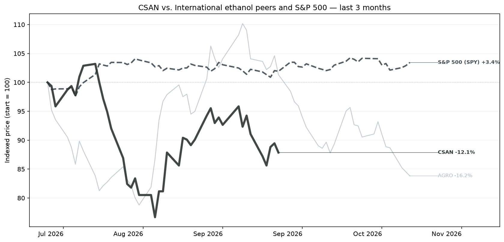

Cosan SA engages in several services throughout the energy and logistics sectors. Its reportable segments are Raizen, Compass, Moove, Rumo, and Radar. It generates the majority of its revenue from Raizen which operates in the production, commercialization, origination, and trading of ethanol, bioenergy, resale, and trading of electricity, renewable sources, marketing, origination, and trading of sugar and fuels, and lubricant.

<h3 id="company-agro">Adecoagro (AGRO)</h3>

*International ethanol · $1.5B · 3m -16.2% · 12m +24.9% · 24m -18.1%*

[Google Finance](https://www.google.com/finance/quote/AGRO:NYSE?tab=earnings&hl=en)

South American farmland and sugar/ethanol producer with U.S.-listed equity.

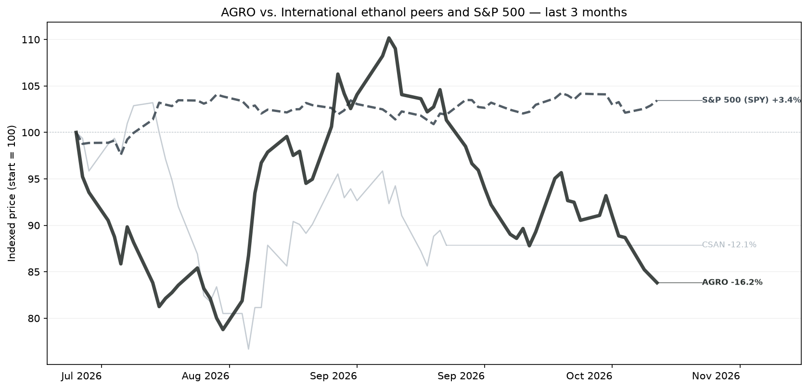

Adecoagro SA is a Luxembourg-based agricultural company. It is involved in a wide range of businesses, including farming crops and other agricultural products, dairy operations sugar, ethanol, energy production, and land transformation. The group operates in two lines of business, namely, Farming and Sugar, Ethanol and Energy. The Farming is further comprised of three reportable segments: Crops, Rice and Dairy. Sugar, Ethanol and Energy Segment, consists of cultivating sugarcane, which is processed in owned sugar mills, transformed into ethanol, sugar and electricity, in addition to biomethane and then marketed.

<h3 id="company-unp">Union Pacific (UNP)</h3>

*Logistics · $179.3B · 3m -1.6% · 12m +27.8% · 24m +19.2%*

[Google Finance](https://www.google.com/finance/quote/UNP:NYSE?tab=earnings&hl=en)

Primary western Class I for Corn Belt corn, ethanol unit trains, DDGS, and corn oil.

Omaha, Nebraska-based Union Pacific is the largest public railroad in North America. Operating on more than 30,000 miles of track in the western two-thirds of the US, Union Pacific generated $24.5 billion of revenue in 2025 by hauling coal, industrial products, intermodal containers, agricultural goods, chemicals, fertilizers, and automotive goods. Union Pacific owns about one-fourth of Mexican railroad Ferromex and historically derives roughly 10% of its revenue hauling freight to and from Mexico.

<h3 id="company-csx">CSX (CSX)</h3>

*Logistics · $93.9B · 3m -3.1% · 12m +34.7% · 24m +43.0%*

[Google Finance](https://www.google.com/finance/quote/CSX:NASDAQ?tab=earnings&hl=en)

Primary eastern Class I into Northeast and Southeast gasoline markets for ethanol unit trains.

Operating in the Eastern United States, Class I railroad CSX generated revenue of nearly $14 billion in 2025. On its more than 21,000 miles of track, CSX hauls shipments of coal (16% of consolidated revenue), chemicals (17%), intermodal containers (16%), automotive cargo (7%), and a diverse mix of other bulk and industrial merchandise.

<h3 id="company-cp">Canadian Pacific Kansas City (CP)</h3>

*Logistics · $83.0B · 3m -3.5% · 12m +15.2% · 24m +10.6%*

[Google Finance](https://www.google.com/finance/quote/CP:NYSE?tab=earnings&hl=en)

North-south railroad for Midwest corn and ethanol to the Gulf and Mexico.

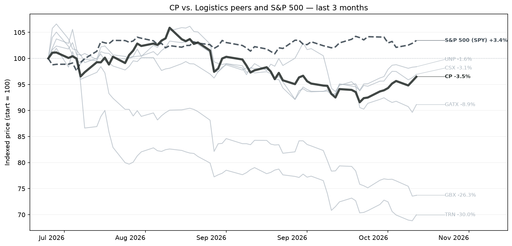

Canadian Pacific Kansas City is a Class I railroad operating on tracks that span most of Canada and into parts of the Midwestern and Northeastern United States. Following the April 2023 Kansas City Southern merger, CPKC operates new single-linehaul services from Canada and the Upper Midwest down through Texas, the Gulf of Mexico, and into Mexico. It also hauls cross-border and intra-Mexico freight via operating concessions on more than 3,000 miles of rail in Mexico. CPKC hauls shipments of grain, intermodal containers, energy products (like crude and frac sand), chemicals, plastics, coal, fertilizer and potash, automotive products, and a diverse mix of other merchandise.

<h3 id="company-gatx">GATX (GATX)</h3>

*Logistics · $6.2B · 3m -8.9% · 12m -0.3% · 24m +17.5%*

[Google Finance](https://www.google.com/finance/quote/GATX:NYSE?tab=earnings&hl=en)

Largest public railcar lessor of ethanol tank cars and grain/DDGS hoppers.

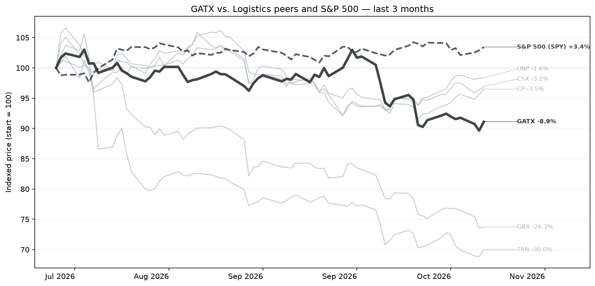

GATX Corp leases transportation assets, including railcars, aircraft spare engines, and tank containers, to customers in North America, Europe, and India. The company's reportable business segments are: Rail North America, Rail International, Engine Leasing, and Other. The majority of its revenue is generated from the Rail North America segment, which is composed of the company's operations in the United States, Canada, and Mexico. This segment mainly provides railcars pursuant to full-service leases under which it maintains the railcars, pays ad valorem taxes and insurance, and provides other ancillary services.

<h3 id="company-trn">Trinity Industries (TRN)</h3>

*Logistics · $2.4B · 3m -30.0% · 12m -9.7% · 24m -27.5%*

[Google Finance](https://www.google.com/finance/quote/TRN:NYSE?tab=earnings&hl=en)

Builds and leases covered hoppers and tank cars used for grain, DDGS, and ethanol.

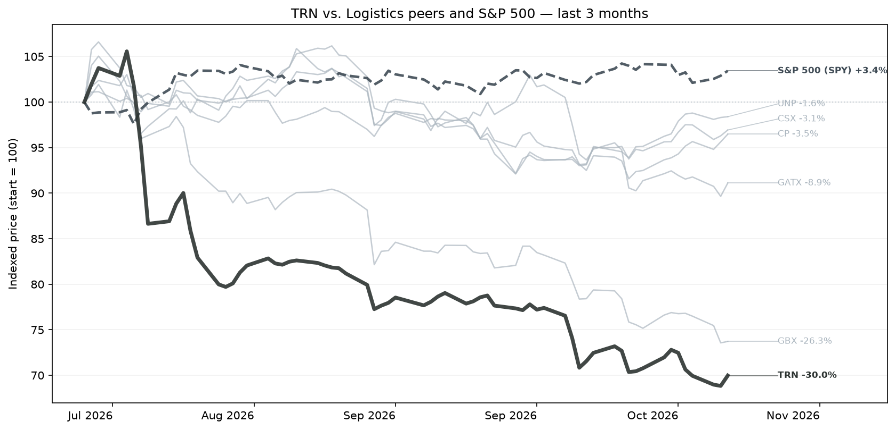

Trinity Industries Inc sells and leases railroad products and railcar maintenance services in North America. The company operates under the name TrinityRail in two main segments: railcar leasing and management services, which owns railcars and provides fleet management and administration services; rail products, which builds, sells, and modifies freight and tank railcars and their components; and all other, which sells highway products such as guardrail and other highway barriers. Customers include railroads, leasing companies, and shipping companies in agriculture, construction, consumer products, energy, and chemicals.

<h3 id="company-gbx">Greenbrier (GBX)</h3>

*Logistics · $1.4B · 3m -26.3% · 12m -17.3% · 24m -27.8%*

[Google Finance](https://www.google.com/finance/quote/GBX:NYSE?tab=earnings&hl=en)

Builds tank cars used for ethanol, renewable fuels, and CO2.

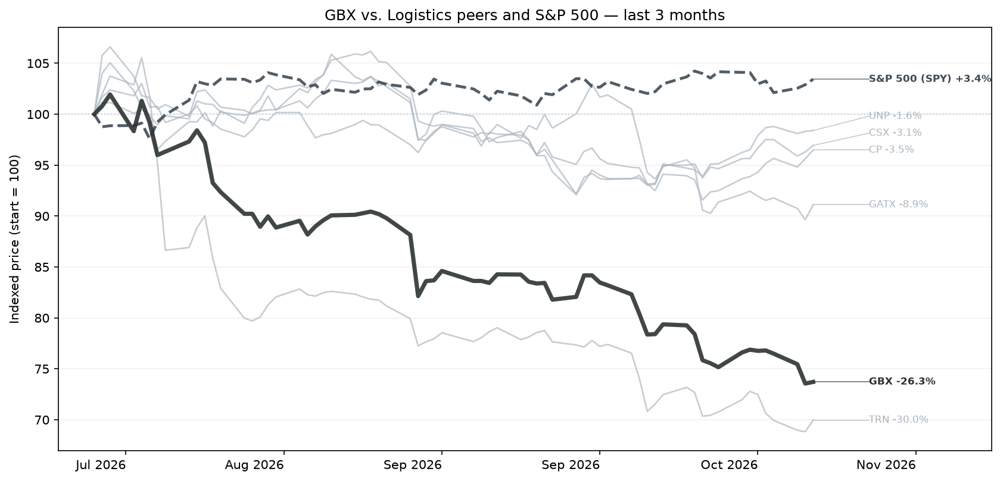

Greenbrier Companies Inc supplies equipment and services to international freight transportation markets, designing and marketing freight railcars in North America, Europe, and Brazil through subsidiaries and joint ventures. It provides railcar wheel services, parts, maintenance, and conversion services in North America. The company owns a lease fleet sourced mainly from its manufacturing operations and offers railcar management, regulatory compliance, and leasing services to railroads and owners. It operates two segments: Manufacturing and Leasing & Fleet Management, with the majority of revenue from Manufacturing. The company operates in the U.S. and internationally, with the majority of revenue from the U.S. market.

