# Weekly Corn and Ethanol Intel Report

<strong>Week of October 29, 2026</strong>Market data through: October 28, 2026Narrative created: October 23, 2026Nearby corn: $4.513/bu (-$0.092 (-2.0%) week)

Weekly review of corn, ethanol, energy, co-product, policy, and related public-company performance for commodities risk managers at U.S. ethanol plants.

## Strategy Narrative

Nearby futures from Yahoo Finance. Nearby corn is the market&#x27;s current perception of yield and demand risk.

<table><thead><tr><th>Contract</th><th>Last</th><th>Week change</th><th>As of</th></tr></thead><tbody><tr><td>Nearby corn</td><td>$4.513/bu</td><td>-$0.092 (-2.0%)</td><td>October 29, 2026</td></tr><tr><td>RBOB gasoline</td><td>$3.185/gal</td><td>+0.009 (+0.3%)</td><td>October 29, 2026</td></tr><tr><td>Henry Hub</td><td>$2.952/MMBtu</td><td>+0.156 (+5.6%)</td><td>October 29, 2026</td></tr></tbody></table>

<nav class="strategy-narrative-links" aria-label="Strategy narrative sections">
<ul>
<li><a href="#strategy-executive-view-1-harvest-delays-failed-to-challenge-usda-s-larger-corn-cushion">1. Harvest delays failed to challenge USDA’s larger corn cushion</a></li>
<li><a href="#strategy-executive-view-2-rising-production-converted-ethanol-clearance-back-into-an-overhang">2. Rising production converted ethanol clearance back into an overhang</a></li>
<li><a href="#strategy-executive-view-3-natural-gas-relief-improved-variable-cost-but-gasoline-offered-no-price-umbrella">3. Natural-gas relief improved variable cost, but gasoline offered no price umbrella</a></li>
<li><a href="#strategy-executive-view-4-valero-demonstrated-strong-realized-margins-but-not-a-representative-spot-crush">4. Valero demonstrated strong realized margins—but not a representative spot crush</a></li>
</ul>
</nav>

<h3 id="executive-view">Executive View</h3>

- **USDA’s larger corn balance sheet strengthened as the controlling procurement regime.** The official framework remains a **181.2-bushel yield, 16.034-billion-bushel crop and 1.849-billion-bushel 2026/27 carryout**. Harvest reached only **44% versus a 52% five-year average**, but condition held at 56% good-to-excellent and the delay produced no national supply repricing. Nearby corn closed October 21 at **$4.633 per bushel, down $0.147, or 3.1%, from October 15**—consistent with ample supply, harvest pressure and insufficient demand risk to challenge USDA’s reset. (USDA NASS, *Crop Progress*, October 19, 2026.) ([esmis.nal.usda.gov](https://esmis.nal.usda.gov/sites/default/release-files/796110/prog4226.txt))
- **Ethanol’s product balance deteriorated more decisively than last week.** Production increased **29,000 barrels per day to 1.094 million**, inventories built **616,000 barrels to 24.558 million**, and EIA refiner and blender ethanol inputs fell **8,000 barrels per day to 891,000**. Stocks have rebuilt 815,000 barrels in two weeks, reversing more than half of September’s maintenance-led draw. (EIA, *U.S. Weekly Supply Estimates*, October 21, 2026.) ([eia.gov](https://www.eia.gov/dnav/pet/pet_sum_sndw_dcus_nus_w.htm))
- **Lower process-energy costs partly offset weaker output economics.** Henry Hub fell **$0.446 to $2.790 per MMBtu, down 13.8%**, while Lower-48 storage increased 77 Bcf to **3,644 Bcf**. RBOB fell **$0.060 to $3.120 per gallon, down 1.9%**, despite a 2.952-million-barrel gasoline-stock draw and a one-week increase in gasoline supplied to 8.982 million barrels per day. ([eia.gov](https://www.eia.gov/dnav/ng/hist/nw2_epg0_swo_r48_bcfw.htm))
- **Corn export sales recovered, but commitments remain well below last year’s exceptional pace.** Net sales reached **1.527 million metric tons**, taking total 2026/27 commitments to **22.193 million tons**, versus 33.560 million a year ago. Commitments equal roughly 26% of USDA’s 3.3-billion-bushel forecast—adequate this early in the year, but not strong enough to offset the larger crop in market perception. (USDA FAS, *Weekly Export Sales*, October 22, 2026; Price Futures Group, USDA sales table, October 22, 2026.) ([fas-prod.azureedge.us](https://fas-prod.azureedge.us/data/weekly-export-sales-10222026))
- **Valero’s third-quarter result confirms that low corn and credit monetization can preserve strong realized earnings, but it is not a pure spot-crush benchmark.** Ethanol operating income was **$272 million**, up from $183 million a year ago but below the second quarter’s $318 million. Valero’s second-quarter filing showed that 45Z recognition materially affected segment earnings, limiting comparability with plants lacking equivalent credit capture. ([santabarbara.newsnetmedia.com](https://santabarbara.newsnetmedia.com/story/523347/valero-energy-reports-third-quarter-2026-results/?utm_source=openai))
- **Overall margin and risk conditions improved modestly:** cheaper corn and sharply lower natural gas outweighed weaker RBOB, but the benefit is vulnerable to rising ethanol inventories. Corn procurement improved materially; prompt ethanol selling deteriorated.

| Exposure | Current signal | Change from last week | Horizon | Confidence | Main driver |
|---|---|---:|---|---|---|
| Corn procurement | Ample national supply; delayed local harvest | Improved materially | Harvest–Q2 2027 | High | Corn −3.1%; 1.849-billion-bushel carryout |
| Ethanol selling | Output rising faster than disappearance | Deteriorated materially | 1–4 weeks | High | 616,000-barrel stock build |
| Natural gas | Lower price; storage rebuilding | Improved materially | 1–4 months | High | Henry Hub −13.8% |
| Corn exports | Good weekly sale, weaker year/year base | Broadly unchanged | 1–6 months | Medium-high | Commitments 34% below last year |
| 45Z/RFS | Important but no new operative change | Unchanged | 2026–29 | High | Execution and final SRE allocation |
| Overall plant margin | Lower inputs versus product overhang | Improved modestly | Near term | Medium | Corn and gas relief partly retained |

The week extends the **post-October USDA supply regime rather than modifying it**. The incremental problem has shifted from obtaining corn coverage to preventing cheaper inputs from inducing production that the ethanol market cannot clear. Existing 45Z feedstock verification, regenerative-ag documentation and strong monthly ethanol exports remain strategically important but are not re-narrated. EPA’s SRE-reallocation proposal was formally published October 16, but publication did not change obligations or resolve the 2026-versus-2027 allocation. (EPA, *Proposed Reallocation of Additional 2025 Small Refinery Exemptions*, October 16, 2026.) ([epa.gov](https://www.epa.gov/renewable-fuel-standard/proposed-reallocation-additional-2025-small-refinery-exemptions))

<h3 id="strategy-executive-view-1-harvest-delays-failed-to-challenge-usda-s-larger-corn-cushion">1. Harvest delays failed to challenge USDA’s larger corn cushion</h3>

**What happened**

Corn harvest advanced from 33% to **44%**, eight points behind normal. Iowa was only **26% complete versus 50% normally**, Minnesota 38% versus 53%, Nebraska 37% versus 48% and South Dakota 29% versus 47%. National condition nevertheless held at **56% good-to-excellent**, and 95% of the crop was mature. ([esmis.nal.usda.gov](https://esmis.nal.usda.gov/sites/default/release-files/796110/prog4226.txt))

Weekly export sales improved to 1.527 million tons, but total commitments remained 34% below last year. The combination of delayed harvest and better bookings was therefore insufficient to counter USDA’s supply increase; nearby corn’s 14.7-cent decline confirms that the market reduced rather than increased its scarcity premium.

**Why it matters**

The delay is now principally a **basis, moisture, storage and quality issue**, not compelling evidence that national yield is below USDA’s 181.2-bushel estimate. Local plants in the slowest states may see firmer nearby basis or higher drying costs even while national futures weaken.

**Risk-manager implication**

Futures procurement risk improved materially. Plants should distinguish national supply relief from local cash exposure: delayed receipts can temporarily tighten plant origination territories, while rapid later harvest could produce abrupt basis weakness. Export performance supports use but currently does not justify reversing the lower-cost regime.

**Watch next**

Whether Iowa and the northwestern Corn Belt close the harvest gap without quality losses—and whether November USDA data sustain the 181.2-bushel yield.

---

<h3 id="strategy-executive-view-2-rising-production-converted-ethanol-clearance-back-into-an-overhang">2. Rising production converted ethanol clearance back into an overhang</h3>

| EIA ethanol balance | Week ended Oct. 9 | Week ended Oct. 16 | Change |
|---|---:|---:|---:|
| Production, million bpd | 1.065 | 1.094 | +0.029 |
| Inventories, million bbl | 23.942 | 24.558 | +0.616 |
| Refiner/blender inputs, million bpd | 0.899 | 0.891 | −0.008 |
| Weekly exports, million bpd | 0.121 | 0.132 | +0.011 |

(EIA, *U.S. Weekly Supply Estimates*, released October 21, 2026.) ([eia.gov](https://www.eia.gov/dnav/pet/pet_sum_sndw_dcus_nus_w.htm))

**Why it matters**

This was not a marginal build. Production returned near early-September levels while domestic inputs weakened, and the modest increase in estimated exports did not prevent inventories from rising. Four-week-average ethanol inputs fell to **900,000 barrels per day**, versus 906,000 in the comparable 2025 period. ([eia.gov](https://www.eia.gov/dnav/pet/hist/LeafHandler.ashx?f=4&n=pet&s=w_epooxe_yir_nus_mbbld&utm_source=openai))

The print strengthens last week’s warning that USDA’s additional 50 million bushels of assumed ethanol corn use requires sustained export clearance or firmer domestic blending—not simply higher plant utilization.

**Risk-manager implication**

Prompt ethanol price, basis and storage risk deteriorated materially. Lower corn improves the incentive to run, but industry-wide utilization near 1.1 million barrels per day is currently exceeding visible domestic absorption. Plants should avoid treating feedstock relief as fully retainable margin until inventories stabilize.

**Watch next**

Whether production moves above 1.10 million barrels per day and whether Gulf and East Coast stocks absorb continued inland output.

---

<h3 id="strategy-executive-view-3-natural-gas-relief-improved-variable-cost-but-gasoline-offered-no-price-umbrella">3. Natural-gas relief improved variable cost, but gasoline offered no price umbrella</h3>

Gasoline inventories fell to **205.310 million barrels**, while gasoline supplied rebounded to 8.982 million barrels per day. Refinery utilization remained high at 93.4%. The positive physical print did not translate into a stronger futures umbrella: RBOB still declined 1.9%. ([eia.gov](https://www.eia.gov/dnav/pet/pet_sum_sndw_dcus_nus_w.htm))

Lower-48 gas inventories increased to 3,644 Bcf, 154 Bcf below the same 2025 week. However, EIA’s October outlook still projected inventories ending the month about 2% above the five-year average, consistent with the sharp Henry Hub decline rather than a developing availability problem. (EIA, *October 2026 Short-Term Energy Outlook*.) ([eia.gov](https://www.eia.gov/dnav/ng/hist/nw2_epg0_swo_r48_bcfw.htm))

**Risk-manager implication**

Natural-gas purchasing exposure improved materially, particularly for plants without adverse local basis. The lower gas price and cheaper corn provide meaningful variable-cost relief, but weaker RBOB and rising ethanol stocks make the output side the binding margin risk. The net signal is modestly positive for current production cost and negative for incremental gallons.

---

<h3 id="strategy-executive-view-4-valero-demonstrated-strong-realized-margins-but-not-a-representative-spot-crush">4. Valero demonstrated strong realized margins—but not a representative spot crush</h3>

**What happened**

Valero reported third-quarter ethanol operating income of **$272 million**, up 49% year over year but down $46 million from the second quarter. ([santabarbara.newsnetmedia.com](https://santabarbara.newsnetmedia.com/story/523347/valero-energy-reports-third-quarter-2026-results/?utm_source=openai))

**Why it matters**

The result confirms that large integrated producers can monetize low corn, co-products and clean-fuel credits even when weekly industry inventories are heavy. But Valero recognized $99 million of ethanol-related clean-fuel production credits in the second quarter, demonstrating why consolidated segment income cannot be used as a direct proxy for an uncredited plant’s spot crush. ([sec.gov](https://www.sec.gov/Archives/edgar/data/1035002/000162828026050937/vlo-20260630.htm?utm_source=openai))

**Risk-manager implication**

45Z execution is now a material source of margin dispersion between plants. Benchmarking should separate commodity crush, co-product realization and transferable-credit value. Strong corporate earnings do not refute the current prompt inventory warning.

<h3 id="strategic-synthesis">Strategic synthesis</h3>

The corn-cost reset is becoming more secure, while ethanol clearance is becoming less secure. Lower gas adds genuine near-term relief, but plants collectively risk transferring those savings to ethanol buyers through excessive utilization. Export bookings remain sufficient to support USDA’s demand case, not strong enough to neutralize record supply. The incremental thesis is therefore **procurement opportunity paired with stricter production and ethanol-sales discipline**.

<h3 id="what-i-m-watching-next">What I’m Watching Next</h3>

- **October 28, 2026:** EIA ethanol balance—whether the 616,000-barrel build persists.
- **November 4, 2026:** EPA virtual hearing on additional 2025 SRE reallocation. ([epa.gov](https://www.epa.gov/renewable-fuel-standard/proposed-reallocation-additional-2025-small-refinery-exemptions))
- **November 10, 2026:** USDA WASDE and Crop Production—the next national test of the 181.2-bushel yield and 1.849-billion-bushel carryout.

<h3 id="bottom-line">Bottom Line</h3>

The most consequential weekly change was the **acceleration in ethanol production and 616,000-barrel inventory build**, which threatens to transfer part of the corn and natural-gas cost relief into weaker ethanol realizations. Corn procurement has improved further, but ethanol selling and utilization now require the closest attention. The October 28 EIA balance is the next print most capable of changing the near-term margin view.

## Notable Changes

Comparison with the final report dated October 22, 2026 (market data through October 21, 2026).

### Sectors

#### Top-three comparison

<table class="sortable"><thead><tr><th class="sortable-heading" data-column="0" data-type="text">Entity</th><th class="sortable-heading" data-column="1" data-type="number">Previous</th><th class="sortable-heading" data-column="2" data-type="number">Current</th><th class="sortable-heading" data-column="3" data-type="number">Change</th><th class="sortable-heading" data-column="4" data-type="number">Current return</th></tr></thead><tbody><tr><td class="text" data-sort="fuel blending, refining, and retail" style=""><a href="#category-fuel-blending-refining-and-retail">Fuel blending, refining, and retail</a></td><td class="" data-sort="1" style="">#1</td><td class="" data-sort="1" style="">#1</td><td class="" data-sort="0" style="">— 0</td><td class="" data-sort="1.0302906697135168" style="background:#1a7a3c;color:#ffffff;">+103.0%</td></tr><tr><td class="text" data-sort="u.s. ethanol and process technology" style=""><a href="#category-u-s-ethanol-and-process-technology">U.S. ethanol and process technology</a></td><td class="" data-sort="2" style="">#2</td><td class="" data-sort="2" style="">#2</td><td class="" data-sort="0" style="">— 0</td><td class="" data-sort="0.9724495798779195" style="background:#1a7a3c;color:#ffffff;">+97.2%</td></tr><tr><td class="text" data-sort="advanced biofuels and saf" style=""><a href="#category-advanced-biofuels-and-saf">Advanced biofuels and SAF</a></td><td class="" data-sort="3" style="">#3</td><td class="" data-sort="3" style="">#3</td><td class="" data-sort="0" style="">— 0</td><td class="" data-sort="0.47775628626692446" style="background:#7cc077;color:#111820;">+47.8%</td></tr></tbody></table>

### Stocks

#### Top-three comparison

<table class="sortable"><thead><tr><th class="sortable-heading" data-column="0" data-type="text">Entity</th><th class="sortable-heading" data-column="1" data-type="number">Previous</th><th class="sortable-heading" data-column="2" data-type="number">Current</th><th class="sortable-heading" data-column="3" data-type="number">Change</th><th class="sortable-heading" data-column="4" data-type="number">Current return</th></tr></thead><tbody><tr><td class="text" data-sort="valero energy" style=""><a href="#earnings-vlo">Valero Energy</a> (<a href="#company-vlo">VLO</a>)</td><td class="" data-sort="1" style="">#1</td><td class="" data-sort="1" style="">#1</td><td class="" data-sort="0" style="">— 0</td><td class="" data-sort="1.2763389194890427" style="background:#1a7a3c;color:#ffffff;">+127.6%</td></tr><tr><td class="text" data-sort="marathon petroleum" style="">Marathon Petroleum (<a href="#company-mpc">MPC</a>)</td><td class="" data-sort="2" style="">#2</td><td class="" data-sort="2" style="">#2</td><td class="" data-sort="0" style="">— 0</td><td class="" data-sort="1.251698595146871" style="background:#1a7a3c;color:#ffffff;">+125.2%</td></tr><tr><td class="text" data-sort="hf sinclair" style=""><a href="#earnings-dino">HF Sinclair</a> (<a href="#company-dino">DINO</a>)</td><td class="" data-sort="3" style="">#3</td><td class="" data-sort="3" style="">#3</td><td class="" data-sort="0" style="">— 0</td><td class="" data-sort="1.0748702742772425" style="background:#1a7a3c;color:#ffffff;">+107.5%</td></tr></tbody></table>

#### Largest rank changes

<table class="sortable"><thead><tr><th class="sortable-heading" data-column="0" data-type="text">Entity</th><th class="sortable-heading" data-column="1" data-type="number">Previous</th><th class="sortable-heading" data-column="2" data-type="number">Current</th><th class="sortable-heading" data-column="3" data-type="number">Change</th><th class="sortable-heading" data-column="4" data-type="number">Current return</th></tr></thead><tbody><tr><td class="text" data-sort="csx" style="">CSX (<a href="#company-csx">CSX</a>)</td><td class="" data-sort="16" style="">#16</td><td class="" data-sort="9" style="">#9</td><td class="rank-change-up" data-sort="-7" style="">↑ 7</td><td class="" data-sort="0.47252124645892346" style="background:#1a7a3c;color:#ffffff;">+47.3%</td></tr><tr><td class="text" data-sort="union pacific" style=""><a href="#earnings-unp">Union Pacific</a> (<a href="#company-unp">UNP</a>)</td><td class="" data-sort="19" style="">#19</td><td class="" data-sort="12" style="">#12</td><td class="rank-change-up" data-sort="-7" style="">↑ 7</td><td class="" data-sort="0.37634607385497065" style="background:#2f9e44;color:#111820;">+37.6%</td></tr><tr><td class="text" data-sort="green plains" style="">Green Plains (<a href="#company-gpre">GPRE</a>)</td><td class="" data-sort="9" style="">#9</td><td class="" data-sort="16" style="">#16</td><td class="rank-change-down" data-sort="7" style="">↓ 7</td><td class="" data-sort="0.33074684772065965" style="background:#2f9e44;color:#111820;">+33.1%</td></tr></tbody></table>

### Subcategory movement since the previous report

<table class="sortable"><thead><tr><th class="sortable-heading" data-column="0" data-type="text">Subcategory</th><th class="sortable-heading" data-column="1" data-type="number">Move</th><th class="sortable-heading" data-column="2" data-type="number">Last Report, 12m Ret</th><th class="sortable-heading" data-column="3" data-type="number">Current Report, 12m Ret</th></tr></thead><tbody><tr><td class="text" data-sort="logistics" style=""><a href="#category-logistics">Logistics</a></td><td class="" data-sort="0.03981136113841402" style="background:#7cc077;color:#111820;">+4.0%</td><td class="" data-sort="0.258266349645" style="background:#a9d9a4;color:#111820;">+25.8%</td><td class="" data-sort="0.35597806876566424" style="background:#a9d9a4;color:#111820;">+35.6%</td></tr><tr><td class="text" data-sort="international ethanol" style=""><a href="#category-international-ethanol">International ethanol</a></td><td class="" data-sort="0.013574691682059914" style="background:#d6ecd4;color:#111820;">+1.4%</td><td class="" data-sort="-0.140572692668" style="background:#fbd5d4;color:#111820;">-14.1%</td><td class="" data-sort="-0.16554116835875488" style="background:#fbd5d4;color:#111820;">-16.6%</td></tr><tr><td class="text" data-sort="advanced biofuels and saf" style=""><a href="#category-advanced-biofuels-and-saf">Advanced biofuels and SAF</a></td><td class="" data-sort="0.010671135020724918" style="background:#d6ecd4;color:#111820;">+1.1%</td><td class="" data-sort="0.457736067365" style="background:#a9d9a4;color:#111820;">+45.8%</td><td class="" data-sort="0.47775628626692446" style="background:#7cc077;color:#111820;">+47.8%</td></tr><tr><td class="text" data-sort="crop inputs, equipment, and irrigation" style=""><a href="#category-crop-inputs-equipment-and-irrigation">Crop inputs, equipment, and irrigation</a></td><td class="" data-sort="-0.015497834870057113" style="background:#fbd5d4;color:#111820;">-1.5%</td><td class="" data-sort="0.0989990635686" style="background:#d6ecd4;color:#111820;">+9.9%</td><td class="" data-sort="0.08477325121642866" style="background:#d6ecd4;color:#111820;">+8.5%</td></tr><tr><td class="text" data-sort="grain origination and agribusiness" style=""><a href="#category-grain-origination-and-agribusiness">Grain origination and agribusiness</a></td><td class="" data-sort="-0.02222359273358506" style="background:#f5aead;color:#111820;">-2.2%</td><td class="" data-sort="0.214046924175" style="background:#d6ecd4;color:#111820;">+21.4%</td><td class="" data-sort="0.20074087155024312" style="background:#d6ecd4;color:#111820;">+20.1%</td></tr><tr><td class="text" data-sort="wet milling, ingredients, and co-products" style=""><a href="#category-wet-milling-ingredients-and-co-products">Wet milling, ingredients, and co-products</a></td><td class="" data-sort="-0.03445594110525625" style="background:#ee8483;color:#111820;">-3.4%</td><td class="" data-sort="0.148705234683" style="background:#d6ecd4;color:#111820;">+14.9%</td><td class="" data-sort="0.11705235180114822" style="background:#d6ecd4;color:#111820;">+11.7%</td></tr><tr><td class="text" data-sort="fuel blending, refining, and retail" style=""><a href="#category-fuel-blending-refining-and-retail">Fuel blending, refining, and retail</a></td><td class="" data-sort="-0.0702532256936456" style="background:#c0302f;color:#ffffff;">-7.0%</td><td class="" data-sort="1.2828266477" style="background:#1a7a3c;color:#ffffff;">+128.3%</td><td class="" data-sort="1.0302906697135168" style="background:#1a7a3c;color:#ffffff;">+103.0%</td></tr><tr><td class="text" data-sort="u.s. ethanol and process technology" style=""><a href="#category-u-s-ethanol-and-process-technology">U.S. ethanol and process technology</a></td><td class="" data-sort="-0.08517890273518215" style="background:#c0302f;color:#ffffff;">-8.5%</td><td class="" data-sort="1.26993055345" style="background:#1a7a3c;color:#ffffff;">+127.0%</td><td class="" data-sort="0.9724495798779195" style="background:#1a7a3c;color:#ffffff;">+97.2%</td></tr></tbody></table>

### Largest company moves

<table class="sortable"><thead><tr><th class="sortable-heading" data-column="0" data-type="text">Direction</th><th class="sortable-heading" data-column="1" data-type="text">Company</th><th class="sortable-heading" data-column="2" data-type="text">Ticker</th><th class="sortable-heading" data-column="3" data-type="number">Move</th></tr></thead><tbody><tr><td class="text" data-sort="0" style="">Gain</td><td class="text" data-sort="csx" style="">CSX</td><td class="text text" data-sort="csx" style=""><a href="#company-csx">CSX</a></td><td class="" data-sort="0.07396694214876032" style="background:#2f9e44;color:#111820;">+7.4%</td></tr><tr><td class="text" data-sort="0" style="">Gain</td><td class="text" data-sort="mosaic" style="">Mosaic</td><td class="text text" data-sort="mos" style=""><a href="#company-mos">MOS</a></td><td class="" data-sort="0.03676470588235281" style="background:#a9d9a4;color:#111820;">+3.7%</td></tr><tr><td class="text" data-sort="0" style="">Gain</td><td class="text" data-sort="adecoagro" style="">Adecoagro</td><td class="text text" data-sort="agro" style=""><a href="#company-agro">AGRO</a></td><td class="" data-sort="0.03586497890295348" style="background:#a9d9a4;color:#111820;">+3.6%</td></tr><tr><td class="text" data-sort="1" style="">Decline</td><td class="text" data-sort="valero energy" style=""><a href="#earnings-vlo">Valero Energy</a></td><td class="text text" data-sort="vlo" style=""><a href="#company-vlo">VLO</a></td><td class="" data-sort="-0.11052089295935885" style="background:#c0302f;color:#ffffff;">-11.1%</td></tr><tr><td class="text" data-sort="1" style="">Decline</td><td class="text" data-sort="corteva" style="">Corteva</td><td class="text text" data-sort="ctva" style=""><a href="#company-ctva">CTVA</a></td><td class="" data-sort="-0.10927672955974843" style="background:#c0302f;color:#ffffff;">-10.9%</td></tr><tr><td class="text" data-sort="1" style="">Decline</td><td class="text" data-sort="hf sinclair" style=""><a href="#earnings-dino">HF Sinclair</a></td><td class="text text" data-sort="dino" style=""><a href="#company-dino">DINO</a></td><td class="" data-sort="-0.1083857609301585" style="background:#c0302f;color:#ffffff;">-10.8%</td></tr></tbody></table>

## Subcategory Performance

<table class="sortable"><thead><tr><th class="sortable-heading" data-column="0" data-type="text">Subcategory</th><th class="sortable-heading" data-column="1" data-type="number">Companies</th><th class="sortable-heading" data-column="2" data-type="number">Market cap</th><th class="sortable-heading" data-column="3" data-type="number">3m Return</th><th class="sortable-heading" data-column="4" data-type="number">12m Return</th><th class="sortable-heading" data-column="5" data-type="number">24m Return</th></tr></thead><tbody><tr><td class="text" data-sort="crop inputs, equipment, and irrigation" style=""><a href="#category-crop-inputs-equipment-and-irrigation">Crop inputs, equipment, and irrigation</a></td><td class="" data-sort="11" style="">11</td><td class="" data-sort="300745184478.91" style="">$300.7B</td><td class="" data-sort="-0.14053937875753364" style="background:#ee8483;color:#111820;">-14.1%</td><td class="" data-sort="0.08477325121642866" style="background:#d6ecd4;color:#111820;">+8.5%</td><td class="" data-sort="0.2407263758573115" style="background:#d6ecd4;color:#111820;">+24.1%</td></tr><tr><td class="text" data-sort="grain origination and agribusiness" style=""><a href="#category-grain-origination-and-agribusiness">Grain origination and agribusiness</a></td><td class="" data-sort="3" style="">3</td><td class="" data-sort="63125801301.18" style="">$63.1B</td><td class="" data-sort="-0.0497238106817434" style="background:#fbd5d4;color:#111820;">-5.0%</td><td class="" data-sort="0.20074087155024312" style="background:#d6ecd4;color:#111820;">+20.1%</td><td class="" data-sort="0.2943869826361679" style="background:#d6ecd4;color:#111820;">+29.4%</td></tr><tr><td class="text" data-sort="u.s. ethanol and process technology" style=""><a href="#category-u-s-ethanol-and-process-technology">U.S. ethanol and process technology</a></td><td class="" data-sort="6" style="">6</td><td class="" data-sort="143490589721.54" style="">$143.5B</td><td class="" data-sort="0.1868961953090007" style="background:#2f9e44;color:#111820;">+18.7%</td><td class="" data-sort="0.9724495798779195" style="background:#1a7a3c;color:#ffffff;">+97.2%</td><td class="" data-sort="1.5319763207248067" style="background:#1a7a3c;color:#ffffff;">+153.2%</td></tr><tr><td class="text" data-sort="wet milling, ingredients, and co-products" style=""><a href="#category-wet-milling-ingredients-and-co-products">Wet milling, ingredients, and co-products</a></td><td class="" data-sort="5" style="">5</td><td class="" data-sort="122070417790.07" style="">$122.1B</td><td class="" data-sort="-0.09864629931296931" style="background:#f5aead;color:#111820;">-9.9%</td><td class="" data-sort="0.11705235180114822" style="background:#d6ecd4;color:#111820;">+11.7%</td><td class="" data-sort="0.20616844109314214" style="background:#d6ecd4;color:#111820;">+20.6%</td></tr><tr><td class="text" data-sort="fuel blending, refining, and retail" style=""><a href="#category-fuel-blending-refining-and-retail">Fuel blending, refining, and retail</a></td><td class="" data-sort="8" style="">8</td><td class="" data-sort="374068702481.42" style="">$374.1B</td><td class="" data-sort="0.26814749742859" style="background:#1a7a3c;color:#ffffff;">+26.8%</td><td class="" data-sort="1.0302906697135168" style="background:#1a7a3c;color:#ffffff;">+103.0%</td><td class="" data-sort="1.5827967217358063" style="background:#1a7a3c;color:#ffffff;">+158.3%</td></tr><tr><td class="text" data-sort="advanced biofuels and saf" style=""><a href="#category-advanced-biofuels-and-saf">Advanced biofuels and SAF</a></td><td class="" data-sort="2" style="">2</td><td class="" data-sort="403619489658.24" style="">$403.6B</td><td class="" data-sort="0.1946210778692796" style="background:#2f9e44;color:#111820;">+19.5%</td><td class="" data-sort="0.47775628626692446" style="background:#7cc077;color:#111820;">+47.8%</td><td class="" data-sort="0.5432265014812818" style="background:#a9d9a4;color:#111820;">+54.3%</td></tr><tr><td class="text" data-sort="international ethanol" style=""><a href="#category-international-ethanol">International ethanol</a></td><td class="" data-sort="2" style="">2</td><td class="" data-sort="4030007905.26" style="">$4.0B</td><td class="" data-sort="-0.05867520772685875" style="background:#f5aead;color:#111820;">-5.9%</td><td class="" data-sort="-0.16554116835875488" style="background:#fbd5d4;color:#111820;">-16.6%</td><td class="" data-sort="-0.4735752139446662" style="background:#f5aead;color:#111820;">-47.4%</td></tr><tr><td class="text" data-sort="logistics" style=""><a href="#category-logistics">Logistics</a></td><td class="" data-sort="6" style="">6</td><td class="" data-sort="366182560910.12" style="">$366.2B</td><td class="" data-sort="0.0068950074003064745" style="background:#d6ecd4;color:#111820;">+0.7%</td><td class="" data-sort="0.35597806876566424" style="background:#a9d9a4;color:#111820;">+35.6%</td><td class="" data-sort="0.31684810677292324" style="background:#a9d9a4;color:#111820;">+31.7%</td></tr></tbody></table>

Subcategory returns use the most recently saved market capitalizations as weights.

## Stock Performance vs. SPY

The same selected stocks appear in every chart. Each line is labeled at the right with its ticker and return for the displayed window.
### Last 6 months

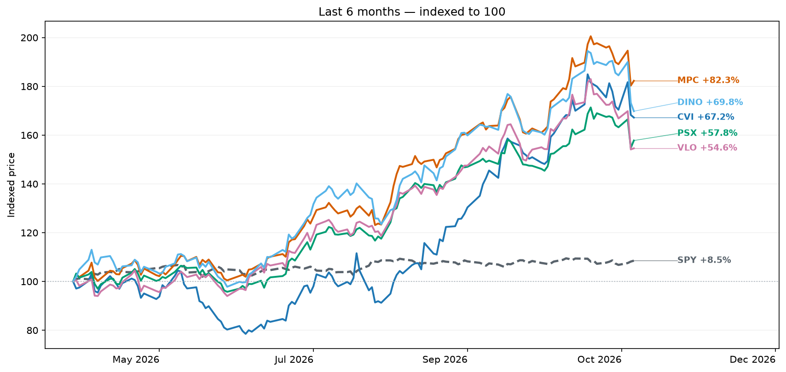

### Last 12 months

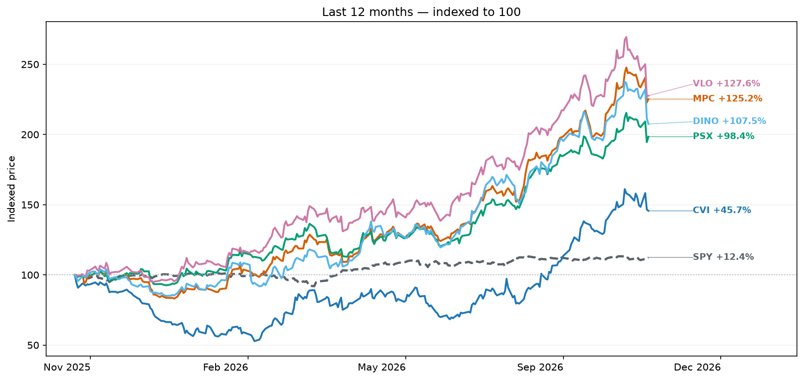

### Last 24 months

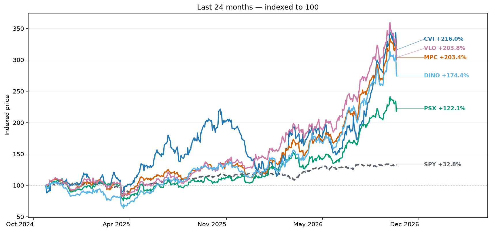

## Current Top Stocks

### Last 3 months

<table class="sortable"><thead><tr><th class="sortable-heading" data-column="0" data-type="number">Rank</th><th class="sortable-heading" data-column="1" data-type="text">Company</th><th class="sortable-heading" data-column="2" data-type="text">Ticker</th><th class="sortable-heading" data-column="3" data-type="number">Market cap</th><th class="sortable-heading" data-column="4" data-type="number">Return</th></tr></thead><tbody><tr><td class="" data-sort="1" style="">1</td><td class="text" data-sort="cvr energy" style="">CVR Energy</td><td class="text text" data-sort="cvi" style=""><a href="#company-cvi">CVI</a></td><td class="" data-sort="3689472983.3" style="">$3.7B</td><td class="" data-sort="0.6484690930098211" style="background:#1a7a3c;color:#ffffff;">+64.8%</td></tr><tr><td class="" data-sort="2" style="">2</td><td class="text" data-sort="marathon petroleum" style="">Marathon Petroleum</td><td class="text text" data-sort="mpc" style=""><a href="#company-mpc">MPC</a></td><td class="" data-sort="101307533252.25" style="">$101.3B</td><td class="" data-sort="0.4277338688779475" style="background:#2f9e44;color:#111820;">+42.8%</td></tr><tr><td class="" data-sort="3" style="">3</td><td class="text" data-sort="phillips 66" style=""><a href="#earnings-psx">Phillips 66</a></td><td class="text text" data-sort="psx" style=""><a href="#company-psx">PSX</a></td><td class="" data-sort="96678777737.64" style="">$96.7B</td><td class="" data-sort="0.3237270925003626" style="background:#7cc077;color:#111820;">+32.4%</td></tr><tr><td class="" data-sort="4" style="">4</td><td class="text" data-sort="valero energy" style=""><a href="#earnings-vlo">Valero Energy</a></td><td class="text text" data-sort="vlo" style=""><a href="#company-vlo">VLO</a></td><td class="" data-sort="99697762645.86" style="">$99.7B</td><td class="" data-sort="0.28926058675162625" style="background:#7cc077;color:#111820;">+28.9%</td></tr><tr><td class="" data-sort="5" style="">5</td><td class="text" data-sort="hf sinclair" style=""><a href="#earnings-dino">HF Sinclair</a></td><td class="text text" data-sort="dino" style=""><a href="#company-dino">DINO</a></td><td class="" data-sort="16821907792.380001" style="">$16.8B</td><td class="" data-sort="0.244" style="background:#a9d9a4;color:#111820;">+24.4%</td></tr></tbody></table>

### Last 12 months

<table class="sortable"><thead><tr><th class="sortable-heading" data-column="0" data-type="number">Rank</th><th class="sortable-heading" data-column="1" data-type="text">Company</th><th class="sortable-heading" data-column="2" data-type="text">Ticker</th><th class="sortable-heading" data-column="3" data-type="number">Market cap</th><th class="sortable-heading" data-column="4" data-type="number">Return</th></tr></thead><tbody><tr><td class="" data-sort="1" style="">1</td><td class="text" data-sort="valero energy" style=""><a href="#earnings-vlo">Valero Energy</a></td><td class="text text" data-sort="vlo" style=""><a href="#company-vlo">VLO</a></td><td class="" data-sort="99697762645.86" style="">$99.7B</td><td class="" data-sort="1.2763389194890427" style="background:#1a7a3c;color:#ffffff;">+127.6%</td></tr><tr><td class="" data-sort="2" style="">2</td><td class="text" data-sort="marathon petroleum" style="">Marathon Petroleum</td><td class="text text" data-sort="mpc" style=""><a href="#company-mpc">MPC</a></td><td class="" data-sort="101307533252.25" style="">$101.3B</td><td class="" data-sort="1.251698595146871" style="background:#1a7a3c;color:#ffffff;">+125.2%</td></tr><tr><td class="" data-sort="3" style="">3</td><td class="text" data-sort="hf sinclair" style=""><a href="#earnings-dino">HF Sinclair</a></td><td class="text text" data-sort="dino" style=""><a href="#company-dino">DINO</a></td><td class="" data-sort="16821907792.380001" style="">$16.8B</td><td class="" data-sort="1.0748702742772425" style="background:#1a7a3c;color:#ffffff;">+107.5%</td></tr><tr><td class="" data-sort="4" style="">4</td><td class="text" data-sort="phillips 66" style=""><a href="#earnings-psx">Phillips 66</a></td><td class="text text" data-sort="psx" style=""><a href="#company-psx">PSX</a></td><td class="" data-sort="96678777737.64" style="">$96.7B</td><td class="" data-sort="0.9837681159420288" style="background:#2f9e44;color:#111820;">+98.4%</td></tr><tr><td class="" data-sort="5" style="">5</td><td class="text" data-sort="bayer" style="">Bayer</td><td class="text text" data-sort="bayry" style=""><a href="#company-bayry">BAYRY</a></td><td class="" data-sort="n/a" style="">n/a</td><td class="" data-sort="0.7540983606557379" style="background:#7cc077;color:#111820;">+75.4%</td></tr></tbody></table>

### Last 24 months

<table class="sortable"><thead><tr><th class="sortable-heading" data-column="0" data-type="number">Rank</th><th class="sortable-heading" data-column="1" data-type="text">Company</th><th class="sortable-heading" data-column="2" data-type="text">Ticker</th><th class="sortable-heading" data-column="3" data-type="number">Market cap</th><th class="sortable-heading" data-column="4" data-type="number">Return</th></tr></thead><tbody><tr><td class="" data-sort="1" style="">1</td><td class="text" data-sort="cvr energy" style="">CVR Energy</td><td class="text text" data-sort="cvi" style=""><a href="#company-cvi">CVI</a></td><td class="" data-sort="3689472983.3" style="">$3.7B</td><td class="" data-sort="2.1600221483942414" style="background:#1a7a3c;color:#ffffff;">+216.0%</td></tr><tr><td class="" data-sort="2" style="">2</td><td class="text" data-sort="valero energy" style=""><a href="#earnings-vlo">Valero Energy</a></td><td class="text text" data-sort="vlo" style=""><a href="#company-vlo">VLO</a></td><td class="" data-sort="99697762645.86" style="">$99.7B</td><td class="" data-sort="2.0378479824835787" style="background:#1a7a3c;color:#ffffff;">+203.8%</td></tr><tr><td class="" data-sort="3" style="">3</td><td class="text" data-sort="marathon petroleum" style="">Marathon Petroleum</td><td class="text text" data-sort="mpc" style=""><a href="#company-mpc">MPC</a></td><td class="" data-sort="101307533252.25" style="">$101.3B</td><td class="" data-sort="2.0339344713656384" style="background:#1a7a3c;color:#ffffff;">+203.4%</td></tr><tr><td class="" data-sort="4" style="">4</td><td class="text" data-sort="hf sinclair" style=""><a href="#earnings-dino">HF Sinclair</a></td><td class="text text" data-sort="dino" style=""><a href="#company-dino">DINO</a></td><td class="" data-sort="16821907792.380001" style="">$16.8B</td><td class="" data-sort="1.7441176470588236" style="background:#1a7a3c;color:#ffffff;">+174.4%</td></tr><tr><td class="" data-sort="5" style="">5</td><td class="text" data-sort="phillips 66" style=""><a href="#earnings-psx">Phillips 66</a></td><td class="text text" data-sort="psx" style=""><a href="#company-psx">PSX</a></td><td class="" data-sort="96678777737.64" style="">$96.7B</td><td class="" data-sort="1.2208160947513589" style="background:#7cc077;color:#111820;">+122.1%</td></tr></tbody></table>

## Companies by Subcategory

<h3 id="category-crop-inputs-equipment-and-irrigation"><a href="#subcategory-performance">Crop inputs, equipment, and irrigation</a>Last 3m: -14.1%</h3>

<table class="sortable"><thead><tr><th class="sortable-heading" data-column="0" data-type="text">Company</th><th class="sortable-heading" data-column="1" data-type="text">Ticker</th><th class="sortable-heading" data-column="2" data-type="number">Market cap</th><th class="sortable-heading" data-column="3" data-type="number">3m Return</th><th class="sortable-heading" data-column="4" data-type="number">12m Return</th><th class="sortable-heading" data-column="5" data-type="number">24m Return</th></tr></thead><tbody><tr><td class="text" data-sort="corteva" style="">Corteva</td><td class="text text" data-sort="ctva" style=""><a href="#company-ctva">CTVA</a></td><td class="" data-sort="52421589719.99999" style="">$52.4B</td><td class="" data-sort="-0.8748204618274225" style="background:#c0302f;color:#ffffff;">-87.5%</td><td class="" data-sort="-0.8207278481012659" style="background:#c0302f;color:#ffffff;">-82.1%</td><td class="" data-sort="-0.8136206612929758" style="background:#c0302f;color:#ffffff;">-81.4%</td></tr><tr><td class="text" data-sort="bayer" style="">Bayer</td><td class="text text" data-sort="bayry" style=""><a href="#company-bayry">BAYRY</a></td><td class="" data-sort="n/a" style="">n/a</td><td class="" data-sort="0.019794721407624616" style="background:#d6ecd4;color:#111820;">+2.0%</td><td class="" data-sort="0.7540983606557379" style="background:#1a7a3c;color:#ffffff;">+75.4%</td><td class="" data-sort="1.0014388489208632" style="background:#1a7a3c;color:#ffffff;">+100.1%</td></tr><tr><td class="text" data-sort="basf" style="">BASF</td><td class="text text" data-sort="basfy" style=""><a href="#company-basfy">BASFY</a></td><td class="" data-sort="n/a" style="">n/a</td><td class="" data-sort="0.010981468771448233" style="background:#d6ecd4;color:#111820;">+1.1%</td><td class="" data-sort="0.1671949286846277" style="background:#a9d9a4;color:#111820;">+16.7%</td><td class="" data-sort="0.20836751435602952" style="background:#a9d9a4;color:#111820;">+20.8%</td></tr><tr><td class="text" data-sort="nutrien" style="">Nutrien</td><td class="text text" data-sort="ntr" style=""><a href="#company-ntr">NTR</a></td><td class="" data-sort="33643310217.0" style="">$33.6B</td><td class="" data-sort="-0.021532795013458172" style="background:#fbd5d4;color:#111820;">-2.2%</td><td class="" data-sort="0.22377746279234567" style="background:#a9d9a4;color:#111820;">+22.4%</td><td class="" data-sort="0.4489196559681139" style="background:#7cc077;color:#111820;">+44.9%</td></tr><tr><td class="text" data-sort="cf industries" style="">CF Industries</td><td class="text text" data-sort="cf" style=""><a href="#company-cf">CF</a></td><td class="" data-sort="18012264232.6" style="">$18.0B</td><td class="" data-sort="-0.05834314880251268" style="background:#fbd5d4;color:#111820;">-5.8%</td><td class="" data-sort="0.42507427213309557" style="background:#7cc077;color:#111820;">+42.5%</td><td class="" data-sort="0.4739429695181907" style="background:#7cc077;color:#111820;">+47.4%</td></tr><tr><td class="text" data-sort="yara international" style="">Yara International</td><td class="text text" data-sort="yariy" style=""><a href="#company-yariy">YARIY</a></td><td class="" data-sort="n/a" style="">n/a</td><td class="" data-sort="-0.054514480408858645" style="background:#fbd5d4;color:#111820;">-5.5%</td><td class="" data-sort="0.19870410367170632" style="background:#a9d9a4;color:#111820;">+19.9%</td><td class="" data-sort="0.4672835426305353" style="background:#7cc077;color:#111820;">+46.7%</td></tr><tr><td class="text" data-sort="mosaic" style="">Mosaic</td><td class="text text" data-sort="mos" style=""><a href="#company-mos">MOS</a></td><td class="" data-sort="7066820210.58" style="">$7.1B</td><td class="" data-sort="-0.18965517241379326" style="background:#f5aead;color:#111820;">-19.0%</td><td class="" data-sort="-0.36020942408376966" style="background:#ee8483;color:#111820;">-36.0%</td><td class="" data-sort="-0.31322592731360066" style="background:#f5aead;color:#111820;">-31.3%</td></tr><tr><td class="text" data-sort="deere" style="">Deere</td><td class="text text" data-sort="de" style=""><a href="#company-de">DE</a></td><td class="" data-sort="156733767077.75" style="">$156.7B</td><td class="" data-sort="0.04864555200916598" style="background:#d6ecd4;color:#111820;">+4.9%</td><td class="" data-sort="0.35308031848613486" style="background:#7cc077;color:#111820;">+35.3%</td><td class="" data-sort="0.577849472958329" style="background:#7cc077;color:#111820;">+57.8%</td></tr><tr><td class="text" data-sort="cnh industrial" style="">CNH Industrial</td><td class="text text" data-sort="cnh" style=""><a href="#company-cnh">CNH</a></td><td class="" data-sort="16547953475.759998" style="">$16.5B</td><td class="" data-sort="0.02230483271375472" style="background:#d6ecd4;color:#111820;">+2.2%</td><td class="" data-sort="0.03578154425612068" style="background:#d6ecd4;color:#111820;">+3.6%</td><td class="" data-sort="-0.026548672566371723" style="background:#fbd5d4;color:#111820;">-2.7%</td></tr><tr><td class="text" data-sort="agco" style=""><a href="#earnings-agco">AGCO</a></td><td class="text text" data-sort="agco" style=""><a href="#company-agco">AGCO</a></td><td class="" data-sort="6969557670.08" style="">$7.0B</td><td class="" data-sort="-0.12059912197641387" style="background:#fbd5d4;color:#111820;">-12.1%</td><td class="" data-sort="-0.05669436749769163" style="background:#fbd5d4;color:#111820;">-5.7%</td><td class="" data-sort="0.019255711862715685" style="background:#d6ecd4;color:#111820;">+1.9%</td></tr><tr><td class="text" data-sort="valmont industries" style="">Valmont Industries</td><td class="text text" data-sort="vmi" style=""><a href="#company-vmi">VMI</a></td><td class="" data-sort="9349921875.14" style="">$9.3B</td><td class="" data-sort="-0.04753555852637581" style="background:#fbd5d4;color:#111820;">-4.8%</td><td class="" data-sort="0.036662452591656125" style="background:#d6ecd4;color:#111820;">+3.7%</td><td class="" data-sort="0.3592293738662664" style="background:#a9d9a4;color:#111820;">+35.9%</td></tr></tbody></table>

<h3 id="category-grain-origination-and-agribusiness"><a href="#subcategory-performance">Grain origination and agribusiness</a>Last 3m: -5.0%</h3>

<table class="sortable"><thead><tr><th class="sortable-heading" data-column="0" data-type="text">Company</th><th class="sortable-heading" data-column="1" data-type="text">Ticker</th><th class="sortable-heading" data-column="2" data-type="number">Market cap</th><th class="sortable-heading" data-column="3" data-type="number">3m Return</th><th class="sortable-heading" data-column="4" data-type="number">12m Return</th><th class="sortable-heading" data-column="5" data-type="number">24m Return</th></tr></thead><tbody><tr><td class="text" data-sort="archer daniels midland" style="">Archer Daniels Midland</td><td class="text text" data-sort="adm" style=""><a href="#company-adm">ADM</a></td><td class="" data-sort="38923055923.08" style="">$38.9B</td><td class="" data-sort="-0.0391888529484945" style="background:#ee8483;color:#111820;">-3.9%</td><td class="" data-sort="0.2761070720423" style="background:#2f9e44;color:#111820;">+27.6%</td><td class="" data-sort="0.3712713068181819" style="background:#1a7a3c;color:#ffffff;">+37.1%</td></tr><tr><td class="text" data-sort="bunge" style=""><a href="#earnings-bg">Bunge</a></td><td class="text text" data-sort="bg" style=""><a href="#company-bg">BG</a></td><td class="" data-sort="21901580022.0" style="">$21.9B</td><td class="" data-sort="-0.06476155130822048" style="background:#e34948;color:#111820;">-6.5%</td><td class="" data-sort="0.048907388137356955" style="background:#d6ecd4;color:#111820;">+4.9%</td><td class="" data-sort="0.14754098360655732" style="background:#a9d9a4;color:#111820;">+14.8%</td></tr><tr><td class="text" data-sort="the andersons" style="">The Andersons</td><td class="text text" data-sort="ande" style=""><a href="#company-ande">ANDE</a></td><td class="" data-sort="2301165356.1" style="">$2.3B</td><td class="" data-sort="-0.08479407154054441" style="background:#c0302f;color:#ffffff;">-8.5%</td><td class="" data-sort="0.37105038428693415" style="background:#1a7a3c;color:#ffffff;">+37.1%</td><td class="" data-sort="0.3915492957746478" style="background:#1a7a3c;color:#ffffff;">+39.2%</td></tr></tbody></table>

<h3 id="category-u-s-ethanol-and-process-technology"><a href="#subcategory-performance">U.S. ethanol and process technology</a>Last 3m: +18.7%</h3>

<table class="sortable"><thead><tr><th class="sortable-heading" data-column="0" data-type="text">Company</th><th class="sortable-heading" data-column="1" data-type="text">Ticker</th><th class="sortable-heading" data-column="2" data-type="number">Market cap</th><th class="sortable-heading" data-column="3" data-type="number">3m Return</th><th class="sortable-heading" data-column="4" data-type="number">12m Return</th><th class="sortable-heading" data-column="5" data-type="number">24m Return</th></tr></thead><tbody><tr><td class="text" data-sort="valero energy" style=""><a href="#earnings-vlo">Valero Energy</a></td><td class="text text" data-sort="vlo" style=""><a href="#company-vlo">VLO</a></td><td class="" data-sort="99697762645.86" style="">$99.7B</td><td class="" data-sort="0.28926058675162625" style="background:#1a7a3c;color:#ffffff;">+28.9%</td><td class="" data-sort="1.2763389194890427" style="background:#1a7a3c;color:#ffffff;">+127.6%</td><td class="" data-sort="2.0378479824835787" style="background:#1a7a3c;color:#ffffff;">+203.8%</td></tr><tr><td class="text" data-sort="green plains" style="">Green Plains</td><td class="text text" data-sort="gpre" style=""><a href="#company-gpre">GPRE</a></td><td class="" data-sort="1123628107.8400002" style="">$1.1B</td><td class="" data-sort="-0.16188149053145995" style="background:#ee8483;color:#111820;">-16.2%</td><td class="" data-sort="0.33074684772065965" style="background:#a9d9a4;color:#111820;">+33.1%</td><td class="" data-sort="0.22064056939501775" style="background:#d6ecd4;color:#111820;">+22.1%</td></tr><tr><td class="text" data-sort="rex american resources" style="">REX American Resources</td><td class="text text" data-sort="rex" style=""><a href="#company-rex">REX</a></td><td class="" data-sort="1444977688.6599998" style="">$1.4B</td><td class="" data-sort="-0.08195168166745626" style="background:#f5aead;color:#111820;">-8.2%</td><td class="" data-sort="0.2192513368983957" style="background:#d6ecd4;color:#111820;">+21.9%</td><td class="" data-sort="0.7303571428571429" style="background:#a9d9a4;color:#111820;">+73.0%</td></tr><tr><td class="text" data-sort="novonesis" style="">Novonesis</td><td class="text text" data-sort="nvzmy" style=""><a href="#company-nvzmy">NVZMY</a></td><td class="" data-sort="n/a" style="">n/a</td><td class="" data-sort="0.012127894156560126" style="background:#d6ecd4;color:#111820;">+1.2%</td><td class="" data-sort="0.07746478873239449" style="background:#d6ecd4;color:#111820;">+7.7%</td><td class="" data-sort="0.006263701847792236" style="background:#d6ecd4;color:#111820;">+0.6%</td></tr><tr><td class="text" data-sort="archer daniels midland" style="">Archer Daniels Midland</td><td class="text text" data-sort="adm" style=""><a href="#company-adm">ADM</a></td><td class="" data-sort="38923055923.08" style="">$38.9B</td><td class="" data-sort="-0.0391888529484945" style="background:#fbd5d4;color:#111820;">-3.9%</td><td class="" data-sort="0.2761070720423" style="background:#a9d9a4;color:#111820;">+27.6%</td><td class="" data-sort="0.3712713068181819" style="background:#d6ecd4;color:#111820;">+37.1%</td></tr><tr><td class="text" data-sort="the andersons" style="">The Andersons</td><td class="text text" data-sort="ande" style=""><a href="#company-ande">ANDE</a></td><td class="" data-sort="2301165356.1" style="">$2.3B</td><td class="" data-sort="-0.08479407154054441" style="background:#f5aead;color:#111820;">-8.5%</td><td class="" data-sort="0.37105038428693415" style="background:#a9d9a4;color:#111820;">+37.1%</td><td class="" data-sort="0.3915492957746478" style="background:#d6ecd4;color:#111820;">+39.2%</td></tr></tbody></table>

<h3 id="category-wet-milling-ingredients-and-co-products"><a href="#subcategory-performance">Wet milling, ingredients, and co-products</a>Last 3m: -9.9%</h3>

<table class="sortable"><thead><tr><th class="sortable-heading" data-column="0" data-type="text">Company</th><th class="sortable-heading" data-column="1" data-type="text">Ticker</th><th class="sortable-heading" data-column="2" data-type="number">Market cap</th><th class="sortable-heading" data-column="3" data-type="number">3m Return</th><th class="sortable-heading" data-column="4" data-type="number">12m Return</th><th class="sortable-heading" data-column="5" data-type="number">24m Return</th></tr></thead><tbody><tr><td class="text" data-sort="ingredion" style="">Ingredion</td><td class="text text" data-sort="ingr" style=""><a href="#company-ingr">INGR</a></td><td class="" data-sort="6757305349.85" style="">$6.8B</td><td class="" data-sort="-0.07361902889718885" style="background:#ee8483;color:#111820;">-7.4%</td><td class="" data-sort="-0.18546365914786966" style="background:#f5aead;color:#111820;">-18.5%</td><td class="" data-sort="-0.293266346730654" style="background:#e34948;color:#111820;">-29.3%</td></tr><tr><td class="text" data-sort="darling ingredients" style=""><a href="#earnings-dar">Darling Ingredients</a></td><td class="text text" data-sort="dar" style=""><a href="#company-dar">DAR</a></td><td class="" data-sort="10563327197.039999" style="">$10.6B</td><td class="" data-sort="-0.053906516547253425" style="background:#f5aead;color:#111820;">-5.4%</td><td class="" data-sort="0.6570062742754708" style="background:#1a7a3c;color:#ffffff;">+65.7%</td><td class="" data-sort="0.41986687147977464" style="background:#1a7a3c;color:#ffffff;">+42.0%</td></tr><tr><td class="text" data-sort="tyson foods" style="">Tyson Foods</td><td class="text text" data-sort="tsn" style=""><a href="#company-tsn">TSN</a></td><td class="" data-sort="20597978527.6" style="">$20.6B</td><td class="" data-sort="-0.09305373525557015" style="background:#ee8483;color:#111820;">-9.3%</td><td class="" data-sort="0.09148264984227139" style="background:#d6ecd4;color:#111820;">+9.1%</td><td class="" data-sort="-0.05156758608874423" style="background:#fbd5d4;color:#111820;">-5.2%</td></tr><tr><td class="text" data-sort="jbs" style="">JBS</td><td class="text text" data-sort="jbs" style=""><a href="#company-jbs">JBS</a></td><td class="" data-sort="45228750792.5" style="">$45.2B</td><td class="" data-sort="-0.16654954321855242" style="background:#c0302f;color:#ffffff;">-16.7%</td><td class="" data-sort="-0.08909370199692779" style="background:#fbd5d4;color:#111820;">-8.9%</td><td class="missing" data-sort="—" style="background:#f0efec;color:#111820;">—</td></tr><tr><td class="text" data-sort="archer daniels midland" style="">Archer Daniels Midland</td><td class="text text" data-sort="adm" style=""><a href="#company-adm">ADM</a></td><td class="" data-sort="38923055923.08" style="">$38.9B</td><td class="" data-sort="-0.0391888529484945" style="background:#f5aead;color:#111820;">-3.9%</td><td class="" data-sort="0.2761070720423" style="background:#7cc077;color:#111820;">+27.6%</td><td class="" data-sort="0.3712713068181819" style="background:#1a7a3c;color:#ffffff;">+37.1%</td></tr></tbody></table>

<h3 id="category-fuel-blending-refining-and-retail"><a href="#subcategory-performance">Fuel blending, refining, and retail</a>Last 3m: +26.8%</h3>

<table class="sortable"><thead><tr><th class="sortable-heading" data-column="0" data-type="text">Company</th><th class="sortable-heading" data-column="1" data-type="text">Ticker</th><th class="sortable-heading" data-column="2" data-type="number">Market cap</th><th class="sortable-heading" data-column="3" data-type="number">3m Return</th><th class="sortable-heading" data-column="4" data-type="number">12m Return</th><th class="sortable-heading" data-column="5" data-type="number">24m Return</th></tr></thead><tbody><tr><td class="text" data-sort="valero energy" style=""><a href="#earnings-vlo">Valero Energy</a></td><td class="text text" data-sort="vlo" style=""><a href="#company-vlo">VLO</a></td><td class="" data-sort="99697762645.86" style="">$99.7B</td><td class="" data-sort="0.28926058675162625" style="background:#7cc077;color:#111820;">+28.9%</td><td class="" data-sort="1.2763389194890427" style="background:#1a7a3c;color:#ffffff;">+127.6%</td><td class="" data-sort="2.0378479824835787" style="background:#1a7a3c;color:#ffffff;">+203.8%</td></tr><tr><td class="text" data-sort="marathon petroleum" style="">Marathon Petroleum</td><td class="text text" data-sort="mpc" style=""><a href="#company-mpc">MPC</a></td><td class="" data-sort="101307533252.25" style="">$101.3B</td><td class="" data-sort="0.4277338688779475" style="background:#2f9e44;color:#111820;">+42.8%</td><td class="" data-sort="1.251698595146871" style="background:#1a7a3c;color:#ffffff;">+125.2%</td><td class="" data-sort="2.0339344713656384" style="background:#1a7a3c;color:#ffffff;">+203.4%</td></tr><tr><td class="text" data-sort="phillips 66" style=""><a href="#earnings-psx">Phillips 66</a></td><td class="text text" data-sort="psx" style=""><a href="#company-psx">PSX</a></td><td class="" data-sort="96678777737.64" style="">$96.7B</td><td class="" data-sort="0.3237270925003626" style="background:#7cc077;color:#111820;">+32.4%</td><td class="" data-sort="0.9837681159420288" style="background:#2f9e44;color:#111820;">+98.4%</td><td class="" data-sort="1.2208160947513589" style="background:#7cc077;color:#111820;">+122.1%</td></tr><tr><td class="text" data-sort="hf sinclair" style=""><a href="#earnings-dino">HF Sinclair</a></td><td class="text text" data-sort="dino" style=""><a href="#company-dino">DINO</a></td><td class="" data-sort="16821907792.380001" style="">$16.8B</td><td class="" data-sort="0.244" style="background:#a9d9a4;color:#111820;">+24.4%</td><td class="" data-sort="1.0748702742772425" style="background:#1a7a3c;color:#ffffff;">+107.5%</td><td class="" data-sort="1.7441176470588236" style="background:#1a7a3c;color:#ffffff;">+174.4%</td></tr><tr><td class="text" data-sort="cvr energy" style="">CVR Energy</td><td class="text text" data-sort="cvi" style=""><a href="#company-cvi">CVI</a></td><td class="" data-sort="3689472983.3" style="">$3.7B</td><td class="" data-sort="0.6484690930098211" style="background:#1a7a3c;color:#ffffff;">+64.8%</td><td class="" data-sort="0.456610515569168" style="background:#a9d9a4;color:#111820;">+45.7%</td><td class="" data-sort="2.1600221483942414" style="background:#1a7a3c;color:#ffffff;">+216.0%</td></tr><tr><td class="text" data-sort="sunoco lp" style="">Sunoco LP</td><td class="text text" data-sort="sun" style=""><a href="#company-sun">SUN</a></td><td class="" data-sort="14487140849.61" style="">$14.5B</td><td class="" data-sort="-0.06316202432326401" style="background:#fbd5d4;color:#111820;">-6.3%</td><td class="" data-sort="0.34182431166885174" style="background:#a9d9a4;color:#111820;">+34.2%</td><td class="" data-sort="0.38675958188153325" style="background:#d6ecd4;color:#111820;">+38.7%</td></tr><tr><td class="text" data-sort="casey&#x27;s general stores" style="">Casey&#x27;s General Stores</td><td class="text text" data-sort="casy" style=""><a href="#company-casy">CASY</a></td><td class="" data-sort="30941658841.1" style="">$30.9B</td><td class="" data-sort="-0.2273398219475068" style="background:#f5aead;color:#111820;">-22.7%</td><td class="" data-sort="0.2663630006237123" style="background:#a9d9a4;color:#111820;">+26.6%</td><td class="" data-sort="0.6813128905171766" style="background:#a9d9a4;color:#111820;">+68.1%</td></tr><tr><td class="text" data-sort="murphy usa" style=""><a href="#earnings-musa">Murphy USA</a></td><td class="text text" data-sort="musa" style=""><a href="#company-musa">MUSA</a></td><td class="" data-sort="10444448379.28" style="">$10.4B</td><td class="" data-sort="-0.16381870405530408" style="background:#f5aead;color:#111820;">-16.4%</td><td class="" data-sort="0.31361851832967935" style="background:#a9d9a4;color:#111820;">+31.4%</td><td class="" data-sort="0.07977619915760359" style="background:#d6ecd4;color:#111820;">+8.0%</td></tr></tbody></table>

<h3 id="category-advanced-biofuels-and-saf"><a href="#subcategory-performance">Advanced biofuels and SAF</a>Last 3m: +19.5%</h3>

<table class="sortable"><thead><tr><th class="sortable-heading" data-column="0" data-type="text">Company</th><th class="sortable-heading" data-column="1" data-type="text">Ticker</th><th class="sortable-heading" data-column="2" data-type="number">Market cap</th><th class="sortable-heading" data-column="3" data-type="number">3m Return</th><th class="sortable-heading" data-column="4" data-type="number">12m Return</th><th class="sortable-heading" data-column="5" data-type="number">24m Return</th></tr></thead><tbody><tr><td class="text" data-sort="neste" style="">Neste</td><td class="text text" data-sort="ntoiy" style=""><a href="#company-ntoiy">NTOIY</a></td><td class="" data-sort="n/a" style="">n/a</td><td class="" data-sort="-0.02128883774453383" style="background:#fbd5d4;color:#111820;">-2.1%</td><td class="" data-sort="0.5548446069469837" style="background:#1a7a3c;color:#ffffff;">+55.5%</td><td class="" data-sort="1.1051980198019802" style="background:#1a7a3c;color:#ffffff;">+110.5%</td></tr><tr><td class="text" data-sort="chevron" style="">Chevron</td><td class="text text" data-sort="cvx" style=""><a href="#company-cvx">CVX</a></td><td class="" data-sort="403619489658.24" style="">$403.6B</td><td class="" data-sort="0.19462107786927962" style="background:#1a7a3c;color:#ffffff;">+19.5%</td><td class="" data-sort="0.47775628626692446" style="background:#1a7a3c;color:#ffffff;">+47.8%</td><td class="" data-sort="0.5432265014812818" style="background:#7cc077;color:#111820;">+54.3%</td></tr></tbody></table>

<h3 id="category-international-ethanol"><a href="#subcategory-performance">International ethanol</a>Last 3m: -5.9%</h3>

<table class="sortable"><thead><tr><th class="sortable-heading" data-column="0" data-type="text">Company</th><th class="sortable-heading" data-column="1" data-type="text">Ticker</th><th class="sortable-heading" data-column="2" data-type="number">Market cap</th><th class="sortable-heading" data-column="3" data-type="number">3m Return</th><th class="sortable-heading" data-column="4" data-type="number">12m Return</th><th class="sortable-heading" data-column="5" data-type="number">24m Return</th></tr></thead><tbody><tr><td class="text" data-sort="cosan" style="">Cosan</td><td class="text text" data-sort="csan" style=""><a href="#company-csan">CSAN</a></td><td class="" data-sort="2504672704.64" style="">$2.5B</td><td class="" data-sort="-0.10130718954248363" style="background:#c0302f;color:#ffffff;">-10.1%</td><td class="" data-sort="-0.3902439024390244" style="background:#c0302f;color:#ffffff;">-39.0%</td><td class="" data-sort="-0.6698679471788715" style="background:#c0302f;color:#ffffff;">-67.0%</td></tr><tr><td class="text" data-sort="adecoagro" style="">Adecoagro</td><td class="text text" data-sort="agro" style=""><a href="#company-agro">AGRO</a></td><td class="" data-sort="1525335200.6200001" style="">$1.5B</td><td class="" data-sort="0.011328527291452062" style="background:#d6ecd4;color:#111820;">+1.1%</td><td class="" data-sort="0.20343137254901955" style="background:#7cc077;color:#111820;">+20.3%</td><td class="" data-sort="-0.15125324114088157" style="background:#f5aead;color:#111820;">-15.1%</td></tr></tbody></table>

<h3 id="category-logistics"><a href="#subcategory-performance">Logistics</a>Last 3m: +0.7%</h3>

<table class="sortable"><thead><tr><th class="sortable-heading" data-column="0" data-type="text">Company</th><th class="sortable-heading" data-column="1" data-type="text">Ticker</th><th class="sortable-heading" data-column="2" data-type="number">Market cap</th><th class="sortable-heading" data-column="3" data-type="number">3m Return</th><th class="sortable-heading" data-column="4" data-type="number">12m Return</th><th class="sortable-heading" data-column="5" data-type="number">24m Return</th></tr></thead><tbody><tr><td class="text" data-sort="union pacific" style=""><a href="#earnings-unp">Union Pacific</a></td><td class="text text" data-sort="unp" style=""><a href="#company-unp">UNP</a></td><td class="" data-sort="179291985296.4" style="">$179.3B</td><td class="" data-sort="0.019199835723330727" style="background:#d6ecd4;color:#111820;">+1.9%</td><td class="" data-sort="0.37634607385497065" style="background:#2f9e44;color:#111820;">+37.6%</td><td class="" data-sort="0.2836760205181257" style="background:#7cc077;color:#111820;">+28.4%</td></tr><tr><td class="text" data-sort="csx" style="">CSX</td><td class="text text" data-sort="csx" style=""><a href="#company-csx">CSX</a></td><td class="" data-sort="93883428793.56" style="">$93.9B</td><td class="" data-sort="0.02443831296807253" style="background:#d6ecd4;color:#111820;">+2.4%</td><td class="" data-sort="0.47252124645892346" style="background:#1a7a3c;color:#ffffff;">+47.3%</td><td class="" data-sort="0.5633082706766916" style="background:#1a7a3c;color:#ffffff;">+56.3%</td></tr><tr><td class="text" data-sort="canadian pacific kansas city" style="">Canadian Pacific Kansas City</td><td class="text text" data-sort="cp" style=""><a href="#company-cp">CP</a></td><td class="" data-sort="83020241914.56" style="">$83.0B</td><td class="" data-sort="-0.02037463029904696" style="background:#fbd5d4;color:#111820;">-2.0%</td><td class="" data-sort="0.22222222222222232" style="background:#7cc077;color:#111820;">+22.2%</td><td class="" data-sort="0.14668547249647412" style="background:#a9d9a4;color:#111820;">+14.7%</td></tr><tr><td class="text" data-sort="gatx" style=""><a href="#earnings-gatx">GATX</a></td><td class="text text" data-sort="gatx" style=""><a href="#company-gatx">GATX</a></td><td class="" data-sort="6219339017.28" style="">$6.2B</td><td class="" data-sort="-0.07020151965642552" style="background:#f5aead;color:#111820;">-7.0%</td><td class="" data-sort="0.06596389344779707" style="background:#d6ecd4;color:#111820;">+6.6%</td><td class="" data-sort="0.21131913062190666" style="background:#a9d9a4;color:#111820;">+21.1%</td></tr><tr><td class="text" data-sort="trinity industries" style=""><a href="#earnings-trn">Trinity Industries</a></td><td class="text text" data-sort="trn" style=""><a href="#company-trn">TRN</a></td><td class="" data-sort="2359810175.32" style="">$2.4B</td><td class="" data-sort="-0.3035422343324251" style="background:#c0302f;color:#ffffff;">-30.4%</td><td class="" data-sort="-0.08156665468918434" style="background:#fbd5d4;color:#111820;">-8.2%</td><td class="" data-sort="-0.2828282828282829" style="background:#ee8483;color:#111820;">-28.3%</td></tr><tr><td class="text" data-sort="greenbrier" style=""><a href="#earnings-gbx">Greenbrier</a></td><td class="text text" data-sort="gbx" style=""><a href="#company-gbx">GBX</a></td><td class="" data-sort="1407755713.0" style="">$1.4B</td><td class="" data-sort="-0.26104100946372244" style="background:#c0302f;color:#ffffff;">-26.1%</td><td class="" data-sort="-0.10761904761904773" style="background:#f5aead;color:#111820;">-10.8%</td><td class="" data-sort="-0.38828137750938474" style="background:#e34948;color:#111820;">-38.8%</td></tr></tbody></table>

## Upcoming Earnings

### Crop inputs, equipment, and irrigation

<table class="sortable"><thead><tr><th class="sortable-heading" data-column="0" data-type="text">Company</th><th class="sortable-heading" data-column="1" data-type="text">Ticker</th><th class="sortable-heading" data-column="2" data-type="text">Date</th><th class="sortable-heading" data-column="3" data-type="number">Market cap</th><th class="sortable-heading" data-column="4" data-type="number">3m Return</th><th class="sortable-heading" data-column="5" data-type="number">12m Return</th></tr></thead><tbody><tr><td class="text" data-sort="nutrien" style="">Nutrien</td><td class="text text" data-sort="ntr" style=""><a href="#company-ntr">NTR</a></td><td class="text" data-sort="2026-11-05" style="">November 5, 2026</td><td class="" data-sort="33643310217.0" style="">$33.6B</td><td class="" data-sort="-0.021532795013458172" style="background:#fbd5d4;color:#111820;">-2.2%</td><td class="" data-sort="0.22377746279234567" style="background:#7cc077;color:#111820;">+22.4%</td></tr><tr><td class="text" data-sort="cf industries" style="">CF Industries</td><td class="text text" data-sort="cf" style=""><a href="#company-cf">CF</a></td><td class="text" data-sort="2026-11-05" style="">November 5, 2026</td><td class="" data-sort="18012264232.6" style="">$18.0B</td><td class="" data-sort="-0.05834314880251268" style="background:#f5aead;color:#111820;">-5.8%</td><td class="" data-sort="0.42507427213309557" style="background:#1a7a3c;color:#ffffff;">+42.5%</td></tr><tr><td class="text" data-sort="mosaic" style="">Mosaic</td><td class="text text" data-sort="mos" style=""><a href="#company-mos">MOS</a></td><td class="text" data-sort="2026-11-04" style="">November 4, 2026</td><td class="" data-sort="7066820210.58" style="">$7.1B</td><td class="" data-sort="-0.18965517241379326" style="background:#c0302f;color:#ffffff;">-19.0%</td><td class="" data-sort="-0.36020942408376966" style="background:#c0302f;color:#ffffff;">-36.0%</td></tr><tr><td class="text" data-sort="agco" style=""><a href="#earnings-agco">AGCO</a></td><td class="text text" data-sort="agco" style=""><a href="#company-agco">AGCO</a></td><td class="text" data-sort="2026-10-29" style="">October 29, 2026</td><td class="" data-sort="6969557670.08" style="">$7.0B</td><td class="" data-sort="-0.12059912197641387" style="background:#e34948;color:#111820;">-12.1%</td><td class="" data-sort="-0.05669436749769163" style="background:#fbd5d4;color:#111820;">-5.7%</td></tr></tbody></table>

### Grain origination and agribusiness

<table class="sortable"><thead><tr><th class="sortable-heading" data-column="0" data-type="text">Company</th><th class="sortable-heading" data-column="1" data-type="text">Ticker</th><th class="sortable-heading" data-column="2" data-type="text">Date</th><th class="sortable-heading" data-column="3" data-type="number">Market cap</th><th class="sortable-heading" data-column="4" data-type="number">3m Return</th><th class="sortable-heading" data-column="5" data-type="number">12m Return</th></tr></thead><tbody><tr><td class="text" data-sort="archer daniels midland" style="">Archer Daniels Midland</td><td class="text text" data-sort="adm" style=""><a href="#company-adm">ADM</a></td><td class="text" data-sort="2026-11-03" style="">November 3, 2026</td><td class="" data-sort="38923055923.08" style="">$38.9B</td><td class="" data-sort="-0.0391888529484945" style="background:#ee8483;color:#111820;">-3.9%</td><td class="" data-sort="0.2761070720423" style="background:#2f9e44;color:#111820;">+27.6%</td></tr><tr><td class="text" data-sort="bunge" style=""><a href="#earnings-bg">Bunge</a></td><td class="text text" data-sort="bg" style=""><a href="#company-bg">BG</a></td><td class="text" data-sort="2026-10-29" style="">October 29, 2026</td><td class="" data-sort="21901580022.0" style="">$21.9B</td><td class="" data-sort="-0.06476155130822048" style="background:#e34948;color:#111820;">-6.5%</td><td class="" data-sort="0.048907388137356955" style="background:#d6ecd4;color:#111820;">+4.9%</td></tr><tr><td class="text" data-sort="the andersons" style="">The Andersons</td><td class="text text" data-sort="ande" style=""><a href="#company-ande">ANDE</a></td><td class="text" data-sort="2026-11-04" style="">November 4, 2026</td><td class="" data-sort="2301165356.1" style="">$2.3B</td><td class="" data-sort="-0.08479407154054441" style="background:#c0302f;color:#ffffff;">-8.5%</td><td class="" data-sort="0.37105038428693415" style="background:#1a7a3c;color:#ffffff;">+37.1%</td></tr></tbody></table>

### U.S. ethanol and process technology

<table class="sortable"><thead><tr><th class="sortable-heading" data-column="0" data-type="text">Company</th><th class="sortable-heading" data-column="1" data-type="text">Ticker</th><th class="sortable-heading" data-column="2" data-type="text">Date</th><th class="sortable-heading" data-column="3" data-type="number">Market cap</th><th class="sortable-heading" data-column="4" data-type="number">3m Return</th><th class="sortable-heading" data-column="5" data-type="number">12m Return</th></tr></thead><tbody><tr><td class="text" data-sort="green plains" style="">Green Plains</td><td class="text text" data-sort="gpre" style=""><a href="#company-gpre">GPRE</a></td><td class="text" data-sort="2026-11-05" style="">November 5, 2026</td><td class="" data-sort="1123628107.8400002" style="">$1.1B</td><td class="" data-sort="-0.16188149053145995" style="background:#c0302f;color:#ffffff;">-16.2%</td><td class="" data-sort="0.33074684772065965" style="background:#1a7a3c;color:#ffffff;">+33.1%</td></tr></tbody></table>

### Wet milling, ingredients, and co-products

<table class="sortable"><thead><tr><th class="sortable-heading" data-column="0" data-type="text">Company</th><th class="sortable-heading" data-column="1" data-type="text">Ticker</th><th class="sortable-heading" data-column="2" data-type="text">Date</th><th class="sortable-heading" data-column="3" data-type="number">Market cap</th><th class="sortable-heading" data-column="4" data-type="number">3m Return</th><th class="sortable-heading" data-column="5" data-type="number">12m Return</th></tr></thead><tbody><tr><td class="text" data-sort="tyson foods" style="">Tyson Foods</td><td class="text text" data-sort="tsn" style=""><a href="#company-tsn">TSN</a></td><td class="text" data-sort="2026-11-01" style="">November 1, 2026</td><td class="" data-sort="20597978527.6" style="">$20.6B</td><td class="" data-sort="-0.09305373525557015" style="background:#c0302f;color:#ffffff;">-9.3%</td><td class="" data-sort="0.09148264984227139" style="background:#d6ecd4;color:#111820;">+9.1%</td></tr><tr><td class="text" data-sort="darling ingredients" style=""><a href="#earnings-dar">Darling Ingredients</a></td><td class="text text" data-sort="dar" style=""><a href="#company-dar">DAR</a></td><td class="text" data-sort="2026-10-29" style="">October 29, 2026</td><td class="" data-sort="10563327197.039999" style="">$10.6B</td><td class="" data-sort="-0.053906516547253425" style="background:#ee8483;color:#111820;">-5.4%</td><td class="" data-sort="0.6570062742754708" style="background:#1a7a3c;color:#ffffff;">+65.7%</td></tr><tr><td class="text" data-sort="ingredion" style="">Ingredion</td><td class="text text" data-sort="ingr" style=""><a href="#company-ingr">INGR</a></td><td class="text" data-sort="2026-11-05" style="">November 5, 2026</td><td class="" data-sort="6757305349.85" style="">$6.8B</td><td class="" data-sort="-0.07361902889718885" style="background:#e34948;color:#111820;">-7.4%</td><td class="" data-sort="-0.18546365914786966" style="background:#f5aead;color:#111820;">-18.5%</td></tr></tbody></table>

### Fuel blending, refining, and retail

<table class="sortable"><thead><tr><th class="sortable-heading" data-column="0" data-type="text">Company</th><th class="sortable-heading" data-column="1" data-type="text">Ticker</th><th class="sortable-heading" data-column="2" data-type="text">Date</th><th class="sortable-heading" data-column="3" data-type="number">Market cap</th><th class="sortable-heading" data-column="4" data-type="number">3m Return</th><th class="sortable-heading" data-column="5" data-type="number">12m Return</th></tr></thead><tbody><tr><td class="text" data-sort="marathon petroleum" style="">Marathon Petroleum</td><td class="text text" data-sort="mpc" style=""><a href="#company-mpc">MPC</a></td><td class="text" data-sort="2026-11-03" style="">November 3, 2026</td><td class="" data-sort="101307533252.25" style="">$101.3B</td><td class="" data-sort="0.4277338688779475" style="background:#2f9e44;color:#111820;">+42.8%</td><td class="" data-sort="1.251698595146871" style="background:#1a7a3c;color:#ffffff;">+125.2%</td></tr><tr><td class="text" data-sort="phillips 66" style=""><a href="#earnings-psx">Phillips 66</a></td><td class="text text" data-sort="psx" style=""><a href="#company-psx">PSX</a></td><td class="text" data-sort="2026-11-03" style="">November 3, 2026</td><td class="" data-sort="96678777737.64" style="">$96.7B</td><td class="" data-sort="0.3237270925003626" style="background:#7cc077;color:#111820;">+32.4%</td><td class="" data-sort="0.9837681159420288" style="background:#2f9e44;color:#111820;">+98.4%</td></tr><tr><td class="text" data-sort="sunoco lp" style="">Sunoco LP</td><td class="text text" data-sort="sun" style=""><a href="#company-sun">SUN</a></td><td class="text" data-sort="2026-11-02" style="">November 2, 2026</td><td class="" data-sort="14487140849.61" style="">$14.5B</td><td class="" data-sort="-0.06316202432326401" style="background:#fbd5d4;color:#111820;">-6.3%</td><td class="" data-sort="0.34182431166885174" style="background:#a9d9a4;color:#111820;">+34.2%</td></tr><tr><td class="text" data-sort="murphy usa" style=""><a href="#earnings-musa">Murphy USA</a></td><td class="text text" data-sort="musa" style=""><a href="#company-musa">MUSA</a></td><td class="text" data-sort="2026-10-29" style="">October 29, 2026</td><td class="" data-sort="10444448379.28" style="">$10.4B</td><td class="" data-sort="-0.16381870405530408" style="background:#f5aead;color:#111820;">-16.4%</td><td class="" data-sort="0.31361851832967935" style="background:#a9d9a4;color:#111820;">+31.4%</td></tr><tr><td class="text" data-sort="cvr energy" style="">CVR Energy</td><td class="text text" data-sort="cvi" style=""><a href="#company-cvi">CVI</a></td><td class="text" data-sort="2026-11-03" style="">November 3, 2026</td><td class="" data-sort="3689472983.3" style="">$3.7B</td><td class="" data-sort="0.6484690930098211" style="background:#1a7a3c;color:#ffffff;">+64.8%</td><td class="" data-sort="0.456610515569168" style="background:#a9d9a4;color:#111820;">+45.7%</td></tr></tbody></table>

### Advanced biofuels and SAF

<table class="sortable"><thead><tr><th class="sortable-heading" data-column="0" data-type="text">Company</th><th class="sortable-heading" data-column="1" data-type="text">Ticker</th><th class="sortable-heading" data-column="2" data-type="text">Date</th><th class="sortable-heading" data-column="3" data-type="number">Market cap</th><th class="sortable-heading" data-column="4" data-type="number">3m Return</th><th class="sortable-heading" data-column="5" data-type="number">12m Return</th></tr></thead><tbody><tr><td class="text" data-sort="chevron" style="">Chevron</td><td class="text text" data-sort="cvx" style=""><a href="#company-cvx">CVX</a></td><td class="text" data-sort="2026-10-30" style="">October 30, 2026</td><td class="" data-sort="403619489658.24" style="">$403.6B</td><td class="" data-sort="0.19462107786927962" style="background:#1a7a3c;color:#ffffff;">+19.5%</td><td class="" data-sort="0.47775628626692446" style="background:#1a7a3c;color:#ffffff;">+47.8%</td></tr></tbody></table>

### Logistics

<table class="sortable"><thead><tr><th class="sortable-heading" data-column="0" data-type="text">Company</th><th class="sortable-heading" data-column="1" data-type="text">Ticker</th><th class="sortable-heading" data-column="2" data-type="text">Date</th><th class="sortable-heading" data-column="3" data-type="number">Market cap</th><th class="sortable-heading" data-column="4" data-type="number">3m Return</th><th class="sortable-heading" data-column="5" data-type="number">12m Return</th></tr></thead><tbody><tr><td class="text" data-sort="gatx" style=""><a href="#earnings-gatx">GATX</a></td><td class="text text" data-sort="gatx" style=""><a href="#company-gatx">GATX</a></td><td class="text" data-sort="2026-10-29" style="">October 29, 2026</td><td class="" data-sort="6219339017.28" style="">$6.2B</td><td class="" data-sort="-0.07020151965642552" style="background:#f5aead;color:#111820;">-7.0%</td><td class="" data-sort="0.06596389344779707" style="background:#1a7a3c;color:#ffffff;">+6.6%</td></tr><tr><td class="text" data-sort="trinity industries" style=""><a href="#earnings-trn">Trinity Industries</a></td><td class="text text" data-sort="trn" style=""><a href="#company-trn">TRN</a></td><td class="text" data-sort="2026-10-29" style="">October 29, 2026</td><td class="" data-sort="2359810175.32" style="">$2.4B</td><td class="" data-sort="-0.3035422343324251" style="background:#c0302f;color:#ffffff;">-30.4%</td><td class="" data-sort="-0.08156665468918434" style="background:#c0302f;color:#ffffff;">-8.2%</td></tr></tbody></table>

## Recent Earnings Highlights — 3m Ret

Companies covered in this section:
<ul class="section-jump-list">
<li><a href="#earnings-unp">Union Pacific (UNP)</a></li>
<li><a href="#earnings-vlo">Valero Energy (VLO)</a></li>
<li><a href="#earnings-psx">Phillips 66 (PSX)</a></li>
<li><a href="#earnings-bg">Bunge (BG)</a></li>
<li><a href="#earnings-dino">HF Sinclair (DINO)</a></li>
<li><a href="#earnings-dar">Darling Ingredients (DAR)</a></li>
<li><a href="#earnings-musa">Murphy USA (MUSA)</a></li>
<li><a href="#earnings-agco">AGCO (AGCO)</a></li>
<li><a href="#earnings-gatx">GATX (GATX)</a></li>
<li><a href="#earnings-trn">Trinity Industries (TRN)</a></li>
<li><a href="#earnings-gbx">Greenbrier (GBX)</a></li>
</ul>
<h3 id="earnings-unp">Union Pacific (<a href="#company-unp">UNP</a>) +1.9%</h3>

**Reported:** October 22, 2026 · [Google Finance earnings page](https://www.google.com/finance/quote/UNP:NYSE?tab=earnings&hl=en)

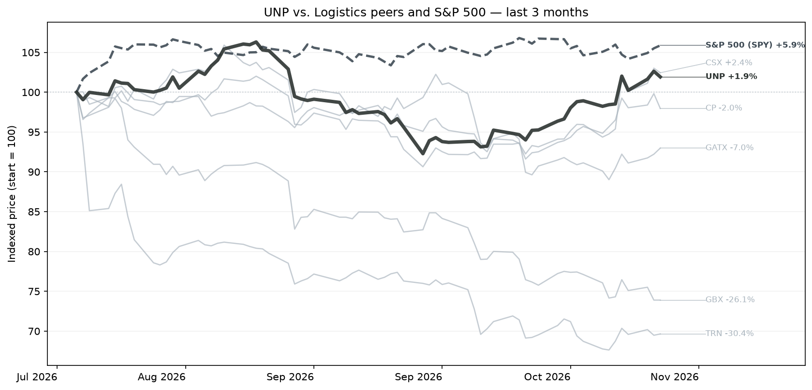

#### Earnings Call Summary

Union Pacific reported record Q3 2026 results, with adjusted EPS increasing 15% year-over-year to $3.53 and net income reaching $2.1 billion. The company handled 6% volume growth efficiently, resulting in a core operating ratio improvement of 110 basis points when excluding the impacts of fuel prices and merger costs.

#### At a Glance

- **Union Pacific Tops Consensus Estimates:** Union Pacific reported Q3 2026 adjusted EPS of $3.49 and revenue of $7.20 billion ($7,197,000,000), surpassing the estimated adjusted EPS of $3.476 and estimated revenue of $7.13 billion ($7,132,904,120).
- **Strong Volumes Fuel KPI Growth:** The railroad delivered 6% volume growth in revenue carloads, heavily driven by record domestic intermodal activity which grew 13% and saw a 21% increase in premium revenue.
- **Management Reaffirms Full Year Outlook:** Union Pacific reaffirmed its full-year 2026 guidance for high-single-digit reported EPS growth and updated its full-year capital expenditure forecast to $3.5 billion.
- **Efficiency Offsets Surging Diesel Expenses:** Despite a core operating ratio improvement of 110 basis points excluding fuel and merger costs, a 69% surge in fuel expenses due to high diesel prices created a 140 basis point drag on overall operating efficiency.
- **Norfolk Southern Merger Progresses Steadily:** Management highlighted ongoing procedural momentum with the Surface Transportation Board regarding its proposed merger with Norfolk Southern, which is currently on track to close in the second half of 2027.

#### Key Moments from the Call

- **17m — Full-Year Capital Expenditure Guidance Increase:** Union Pacific raised its 2026 capital spend guidance to $3.5 billion to accelerate multi-year locomotive modernization contracts and infrastructure projects, signaling strong network health and positioning the company to capture future volume upside.
- **17m — Norfolk Southern Merger Status and Timeline:** Management projected closing the Norfolk Southern merger in the second half of 2027 based on the STB procedural schedule. CEO Jim Vena expressed 99.999% confidence in approval, emphasizing structural supply chain benefits and downplaying requested regulatory concessions.
- **19m — Intermodal Volume Surge and Profitability:** Domestic intermodal delivered its fifth consecutive record quarter with 13% volume growth. While driving top-line freight revenue up 15%, this rapid volume surge from lower-yielding traffic compressed core pricing margins and elevated third-party terminal handling and drayage costs.
- **26m — CFO Jennifer Hamann Retirement Announcement:** Union Pacific announced that Chief Financial Officer Jennifer Hamann will retire in early 2027 after extending her tenure by an additional year. A formal transition plan is underway to fill the role following her extensive service.
<h3 id="earnings-vlo">Valero Energy (<a href="#company-vlo">VLO</a>) +28.9%</h3>

**Reported:** October 22, 2026 · [Google Finance earnings page](https://www.google.com/finance/quote/VLO:NYSE?tab=earnings&hl=en)

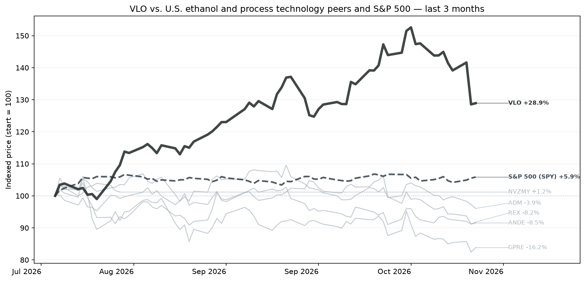

#### Earnings Call Summary

Valero delivered strong financial results for Q3 2026, reporting adjusted net income of $6.8 billion, or $23.90 per share, compared to $1.1 billion, or $3.66 per share, in Q3 2025. Financial outperformance was driven by a robust refining segment, which reported operating income of $8.8 billion versus $1.6 billion in the prior-year period.

#### At a Glance

- **Valero Beats EPS and Revenue Estimates:** Valero Energy reported a Adjusted EPS of $23.89, comfortably beating the estimated $21.235, while reported revenue of $46.10 billion also outperformed projections of $41.71 billion.
- **Refining Dominates Key Performance Metrics:** The refining segment led performance with $8.8 billion in operating income, driven by near-record utilization levels and a dramatic widening of the 3-2-1 crack spread compared to the prior year.
- **Valero Provides Strong Production Guidance:** Management projected fourth-quarter refining throughput to remain high at between 2.88 and 2.98 million barrels per day, supported by a light seasonal maintenance schedule.
- **Renewable Diesel Swings to Profitability:** The Renewable Diesel segment turned a profit of $353 million, representing a substantial operational turnaround from the $28 million loss recorded in the third quarter of 2025.
- **Optimization Project Completed On Budget:** Valero completed its $230 million St. Charles fluid catalytic cracking (FCC) unit optimization project on schedule, which is already lifting the yield of high-value gasoline and alkylate.
- **Market Cools Despite Blockbuster Results:** Despite blowing past top- and bottom-line consensus forecasts, Valero&#x27;s stock experienced a minor sell-off as investors locking in profits questioned the long-term sustainability of peak refining margins.

#### Key Moments from the Call

- **4m — Massive Q3 Earnings Beat:** Valero substantially beat market expectations for Q3 2026, reporting an EPS of $23.90 against the $21.235 estimate, and revenues of $46.10 billion against the estimated $41.71 billion. This dramatic year-over-year surge from an EPS of $3.66 in Q3 2025 will strongly please investors, underscoring excellent asset utilization and highly supportive refining macro tailwinds.
- **15m — Elevated Cash Position and Shareholder Returns:** Ending the quarter with $9.8 billion in cash, well above its long-term $4B-$5B target, will please investors looking for aggressive buybacks. Management reassured the market that the cash build protects shareholder payouts against commodity volatility and working capital draws, noting excess cash will ultimately be returned to shareholders rather than spent on undisciplined projects.
- **18m — Global Refining Bifurcation Favors U.S.:** Management highlighted a highly favorable, structural bifurcation in global refining. High dirty freight rates and spiking natural gas costs are crushing international peer margins down to $2-$3/bbl, creating a sustainable high floor for global crack spreads. This structure leaves Valero's low-cost, flexible U.S. Gulf Coast system uniquely positioned to capture outsized export economics.
- **19m — Resilient Demand Counters Destruction Fears:** Addressing investor concerns over high product pricing, executives stated they see zero evidence of demand destruction. U.S. wholesale gasoline sales grew 4% year-over-year, while diesel sales rose 2%. Persistent prompt market backwardation in October further validates tight fuel supplies, supporting management's constructive long-term outlook on refining fundamentals.
<h3 id="earnings-psx">Phillips 66 (<a href="#company-psx">PSX</a>) +32.4%</h3>

**Reported:** October 28, 2026 · [Google Finance earnings page](https://www.google.com/finance/quote/PSX:NYSE?tab=earnings&hl=en)

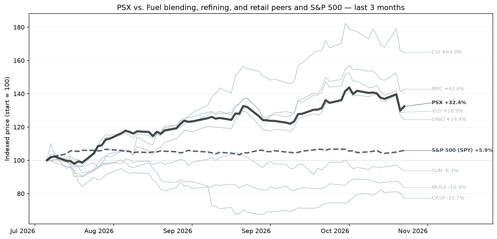

#### Earnings Call Summary

Phillips 66 reported robust third-quarter 2026 financial and operating results, with reported and adjusted earnings reaching $5.6 billion, or $14.08 per share, significantly beating expectations. The company generated $7.3 billion in operating cash flow, or $6.2 billion excluding working capital benefits, while maintaining a strong capital discipline framework.

#### At a Glance

- **Earnings Beat Estimates Handily:** Phillips 66 reported an adjusted EPS of $14.08, significantly beating the estimated $11.793, while quarterly revenue reached $51.51 billion, surpassing the estimated $43.23 billion.
- **Refining Units Deliver Record Performance:** The company achieved a high refining crude capacity utilization rate of 98% and recorded a third-quarter record distillate yield of 41%.
- **Strong Operational Forward Guidance Provided:** For the fourth quarter of 2026, Phillips 66 projects crude utilization in the mid-90% range and anticipates refining turnaround expenses to be between $140 million and $170 million.
- **Substantial Capital Returns to Shareholders:** Phillips 66 returned $2.8 billion to its shareholders through share repurchases and dividends, supported by a 10.8% increase in its dividend versus late 2025.
- **Deleveraging Targets Achieved Ahead of Schedule:** The company reduced its total debt by $2.0 billion to $18.5 billion, effectively meeting its 2027 net debt-to-capital ratio target of 26% early.

#### Key Moments from the Call

- **7m — Significant Earnings Beat and Target Acceleration:** Phillips 66 dramatically exceeded Q3 2026 expectations with an EPS of $14.08 versus the $11.79 estimated, and revenue of $51.5B versus the $43.2B estimated. This performance allowed the company to achieve its 2027 net debt-to-capital ratio target of 26% ahead of schedule, pleasing investors with rapid balance sheet deleveraging.
- **13m — Robust Dividend Growth Visibility:** Following a second dividend increase in 2026, management projected reliable high-single-digit per-share dividend growth. This path is secured by a steady 5% CAGR in midstream EBITDA and a shrinking share count from aggressive buybacks, providing investors with strong, highly visible cash return metrics.
- **24m — Insulated Freight Strategy Via Time-Charters:** With global shipping rates reaching bearish peaks, Phillips 66 revealed that its 40 time-chartered vessels cover 40% of its asset-based demand at favorable historic rates. Lock-ins on these ships and an additional 40 arriving soon protect refining capture margins from macro headwinds, surprising the market positively.
- **54m — Permian Downstream Bottleneck Mitigation:** Despite running at 100% capacity on current Gulf Coast fractionation and export docks, management reassured analysts that third-party contracts prevent any midstream growth constraints. Combined with upcoming Permian line expansions and a 2028 Corpus Christi fractionator, the company remains fully positioned to capture rising NGL volumes.
<h3 id="earnings-bg">Bunge (<a href="#company-bg">BG</a>) -6.5%</h3>

**Reported:** October 29, 2026 · [Google Finance earnings page](https://www.google.com/finance/quote/BG:NYSE?tab=earnings&hl=en)

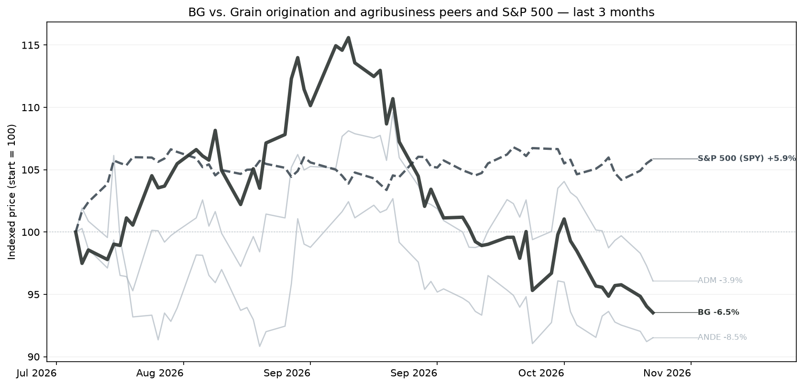

#### Earnings Call Summary

Bunge's multi-year investment cycle is reaching an inflection point as three of four major greenfield projects are now online, including the Morristown soy protein plant and Destrehan processing facility. Regular course commissioning costs will give way to an expected $0.50 per share earnings growth contribution in 2027.

#### At a Glance

- **Bunge Beats Earnings and Revenue Estimates:** Bunge reported reported revenue of $23,804,000,000, beating the estimated $22,786,577,860, and achieved an adjusted EPS of $2.56, outperforming the consensus estimate of 2.419.
- **Processing and Refining Volume Drives Growth:** Bunge demonstrated continued strong performance in its Soybean and Softseed Processing and Refining segments, highlighted by a notable 15.2% year-over-year increase in softseed processing volumes supported by favorable margins.
- **Full Year Adjusted EPS Outlook Maintained:** The company maintained its full-year 2026 adjusted EPS guidance range of $9.25 to $9.75, while expecting capital expenditures to sit toward the higher end of its $1.5 to $1.7 billion target.
- **Viterra Integration Delivers Core Synergies:** Bunge continues to make operational headway with its transformational Viterra combination, projecting a commercial and cost synergy boost of $0.50 per share each for fiscal year 2027.
- **Rising Costs Impact Market Reaction:** Despite the top- and bottom-line beats, Bunge&#x27;s shares edged lower in premarket trading as investors reacted to elevated working capital requirements and higher net interest expenses.

#### Key Moments from the Call

- **3m — Greenfield Projects Inflection Point:** Investors will appreciate the completion of three major greenfield projects, shifting from a cost drag to a projected $0.50 per share earnings accretion in 2027, signaling clear visibility on deployed capital returns.
- **18m — Elevated Working Capital Outflow:** The substantial cash outflow for working capital might temporarily disappoint investors tracking free cash flow, though management minimized concerns by linking it to commodity price increases and future processing opportunities.
- **37m — Accelerated Viterra Synergy Targets:** The upward revision of Viterra synergy benefits to over $200 million for 2026, alongside a combined $1.00 EPS incremental target for 2027, reinforces structural margin expansion confidence.
- **46m — Vegetable Oil and Energy Decoupling:** Management reassured investors that global vegetable oil demand and crush margins are fundamentally driven by structural renewable diesel mandates rather than crude oil price volatility, mitigating energy-sector downside risks.
<h3 id="earnings-dino">HF Sinclair (<a href="#company-dino">DINO</a>) +24.4%</h3>

**Reported:** October 28, 2026 · [Google Finance earnings page](https://www.google.com/finance/quote/DINO:NYSE?tab=earnings&hl=en)

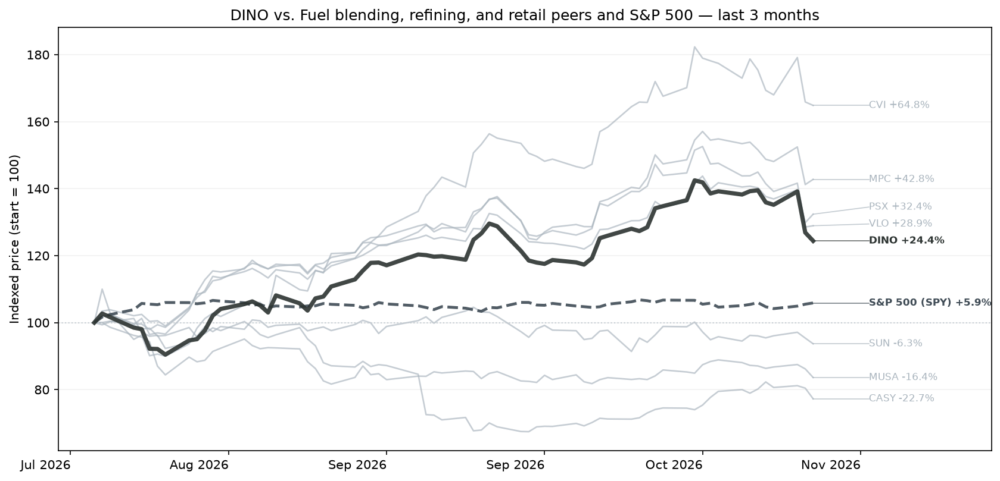

#### Earnings Call Summary

CEO Franklin Myers reported a strong Q3 2026, citing strong performance across all business segments. On geopolitics, management expects shortages in product and lube markets to extend through 2028, driven by ongoing constraints in the Middle East and Russia, alongside Chinese export curtailments for strategic reserves.

#### At a Glance

- **HF Sinclair Smashes Q3 Expectations:** HF Sinclair reported a reported revenue of $10,857,000,000, which surpassed estimates of $8,885,763,700, alongside an adjusted EPS of $11.75 that significantly beat the expected $7.83.
- **Refining Margins Boost Segment KPIs:** The company&#x27;s adjusted refinery gross margin surged to $54.22 per produced barrel sold compared to $19.16 in the third quarter of 2025, driven by tight global refining capacity and elevated crack spreads.
- **Capital Spending Guidance Revised Upward:** HF Sinclair raised its full-year 2026 capital guidance to approximately $875 million, which allocates $725 million for sustaining capital and turnarounds and $150 million for growth projects.
- **Major Leadership Transition Announced:** Current President and COO Steve Ledbetter is scheduled to succeed Franklin Myers as CEO effective January 1, 2027, while Myers transitions to Executive Chair to oversee strategic initiatives.
- **Aggressive Shareholder Return Execution Continues:** The company returned $572 million to stockholders during the quarter, comprising $93 million in dividends and $479 million in share repurchases, while maintaining a regular quarterly dividend of $0.525 per share.
- **Strategic Lubricants Spin-Off Progresses:** Management confirmed that the planned spin-off of its lubricants and specialties business is on track to be completed in the second half of 2027.

#### Key Moments from the Call

- **3m — CEO Succession Plan Announced:** Steve Ledbetter will assume the CEO role on January 1, 2027, succeeding Franklin Myers. This internal promotion provides leadership stability and continuity, assuring investors that the company's current capital allocation, organic growth strategies, and execution priorities will remain firmly intact.
- **8m — Significant Q3 Earnings Beat:** HF Sinclair reported Q3 2026 adjusted EPS of $11.75, substantially outpacing the consensus estimate of $7.83. This extreme outperformance will please investors, as it highlights robust refining margins and structural capture improvements that reached 105% when excluding one-time EPA small refinery exemptions.
- **16m — WCS Crude Differential Strategy:** Management plans to exploit widening Western Canadian Select differentials, which have expanded up to $25–$30 due to production outpacing transportation egress. The upcoming vacuum furnace completion at El Dorado will allow HF Sinclair to process an additional 10,000 bpd of discounted heavy crude, structurally enhancing future product yields.
- **26m — EPA Small Refinery Exemptions:** A $600 million earnings tailwind from recently granted EPA small refinery waivers boosted profitability but created cash flow confusion. Executives clarified the non-cash mechanism, noting it reverses previously recognized obligations and leaves incremental RINs in inventory for future compliance, delaying tangible cash realization.
<h3 id="earnings-dar">Darling Ingredients (<a href="#company-dar">DAR</a>) -5.4%</h3>

**Reported:** October 29, 2026 · [Google Finance earnings page](https://www.google.com/finance/quote/DAR:NYSE?tab=earnings&hl=en)

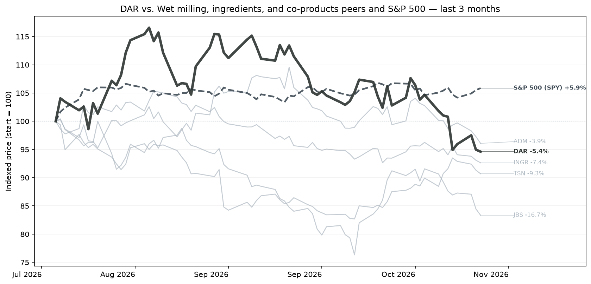

#### Earnings Call Summary

Darling Ingredients delivered a resilient Q3 2026 performance, showcasing global ingredients capabilities despite modest sequential impacts from sales timing, global compensation, and accounting treatments. Robust cash flow from Diamond Green Diesel (DGD) powered a $420 million reduction in net debt during the quarter. Combined adjusted EBITDA reached $514 million, with $310 million from Global Ingredients and $204 million from DGD.

#### At a Glance

- **Mixed Performance Relative to Targets:** Darling Ingredients reported an adjusted EPS of $1.67, beating the internal context estimate of $0.00 but trailing various analyst consensus projections, while its reported revenue of $1.79 billion comfortably exceeded the expected $1.78 billion.
- **Strong Improvement in Key KPIs:** The company&#x27;s core operations demonstrated significant progress, with combined adjusted EBITDA soaring by 110% year-over-year to $514.3 million and the trailing net margin expanding to 12.5% from 1.8% in the prior year&#x27;s quarter.
- **Guidance Reaffirmed with Deleveraging Focus:** Management reaffirmed its full-year 2026 combined adjusted EBITDA guidance of $2.2 billion to $2.3 billion, highlighting an expected net debt reduction to or below $3.0 billion by year-end.
- **DGD Turnaround Fuels Cash Distributions:** Performance was significantly bolstered by a major operational turnaround at Diamond Green Diesel, which yielded $171.0 million in cash distributions and helped lower the company&#x27;s net debt by roughly $420 million during the quarter.
- **Positive Initial Market Reaction Seen:** Shares rose by more than 3% in subsequent trading following the announcement, indicating that investors prioritized balance-sheet improvements and robust cash flows over bottom-line consensus misses.

#### Key Moments from the Call

- **1m — Substantial Debt Reduction and Capital Returns:** Investors will be pleased by Darling's aggressive de-leveraging and shareholder returns. Backed by strong cash distributions from DGD and non-core asset sales, the company reduced net debt by $420 million and repurchased $76 million in shares, driving its leverage ratio down sharply to 1.7x from 2.9x at the end of last year.
- **7m — Unfavorable Q3 DGD Capture and Hedging Dynamics:** Investors may note that Q3 DGD margins of $1.30 per gallon fell short of replacement margins due to non-mark-to-market accounting lags and localized weather disruptions. However, because these underlying feedstock hedging losses are structural timing disconnects, they are expected to flow back favorably through the P&L as realized gains in the fourth quarter.
- **12m — Full-Year 2026 EBITDA Guidance Reaffirmed:** The confirmation of full-year combined adjusted EBITDA guidance at $2.2 billion to $2.3 billion provides market reassurance. This outlook accounts for a core business tracking around $1.25 billion and solid DGD margins, signaling confidence that transient Q3 headwinds, including hedging disconnects and temporary operational outages, are resolved moving into the final quarter.
- **19m — Shifting Capital Allocation Strategy for 2027:** Management signaled a pivotal shift in financial policy that could bolster valuation. With net debt targeted below $3 billion by year-end and nearing $2.5 billion in early 2027, the board is actively discussing capital redistribution via a potential baseline dividend or more robust buyback programs, highlighting Darling's transition into a mature cash engine.
<h3 id="earnings-musa">Murphy USA (<a href="#company-musa">MUSA</a>) -16.4%</h3>

**Reported:** October 29, 2026 · [Google Finance earnings page](https://www.google.com/finance/quote/MUSA:NYSE?tab=earnings&hl=en)

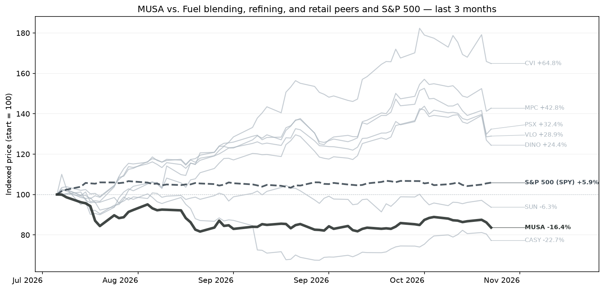

#### Earnings Call Summary

CEO Mindy West affirmed Murphy USA's 2026 store opening guidance of 45 to 50 locations, supported by 18 year-to-date openings and 55 currently under construction. The company intends to maintain a reliable pipeline pace of 50 annual store openings for 2027 and aims for more rateable, less end-of-year concentrated openings by 2028.

#### At a Glance

- **Murphy USA Beats Earnings Expectations:** Murphy USA reported a third-quarter revenue of $6.89 billion and a GAAP diluted EPS of $9.59, outperforming the estimated revenue of $6.25 billion and the estimated EPS of 8.60.
- **Strong Wholesale Fuel Contribution Margin:** The company achieved a total fuel contribution of 37.0 cents per gallon, a significant step up from 30.7 cents per gallon in Q3 2025, while total retail fuel volume expanded by 3.3%.
- **Reiterated Growth Targets and Outlook:** Management reiterated its full-year guidance of opening 45 to 50 new stores and projected that macro fuel market volatility and tight supply will persist into 2027.
- **Merchandise Contribution Faces High Comparisons:** Merchandise contribution dollars fell 2.8% to $234.5 million with unit margins narrowing to 20.3%, primarily due to difficult prior-year promotional comparisons in nicotine products.
- **Stock Rallies on Profitability Performance:** Shares of Murphy USA surged approximately 4.8% to around $540 following the earnings announcement, as investors cheered the strong wholesale fuel trading profits and near-term earnings power.
- **Accelerated Shareholder Returns and Expansion:** The board authorized a $0.72 quarterly dividend, representing an 11% increase from the previous rate, alongside $157.7 million allocated for share repurchases during the quarter.

#### Key Moments from the Call

- **2m — Robust Store Pipeline Restores Growth Confidence:** Management confirmed its 45 to 50 store opening target for 2026, backed by 55 units under construction. This resolves multi-year opening deficits from 2021-2024 that held back EBITDA generation. Securing a steady run-rate of 50 new locations annually will cheer investors tracking long-term structural earnings expansion.
- **8m — Structural Fuel Margins Defy Macro Headwinds:** Murphy USA maintained retail margins within a penny of last year's favorable environment despite Q3's rising price backdrop. Competitor volume losses continue to force marginal retailers to hold higher margins. This market share capture, combined with structural margin tailwinds, reinforces the company's profitability during macro disruptions.
- **16m — Persistent Volatility Extended Into 2027:** Executives anticipate tight supply conditions and fuel market volatility to persist deep into 2027, citing deferred global infrastructure maintenance and strategic reserve replenishment. This backdrop benefits Murphy USA's flexible supply-chain sourcing and wholesale operations, signaling stronger-for-longer earnings potential that outpaces normalized market expectations.
- **34m — Core Merchandise Performance Mitigates Discretionary Headwinds:** While industry-wide declines in beer and lottery dragged down overall non-nicotine same-store numbers, core merchandise categories increased margins by 1% year-over-year. Resilient consumer spend via Murphy Drive Rewards and trade-down traffic into regular fuel types underscore the strength of the company's everyday low price value proposition.
<h3 id="earnings-agco">AGCO (<a href="#company-agco">AGCO</a>) -12.1%</h3>

**Reported:** October 29, 2026 · [Google Finance earnings page](https://www.google.com/finance/quote/AGCO:NYSE?tab=earnings&hl=en)

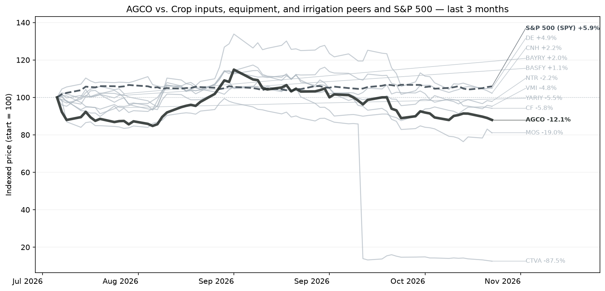

#### Earnings Call Summary

AGCO reported a challenging third quarter with net sales down 8.6% year-over-year to approximately $2.3 billion. Adjusted EPS declined to $1.05 from $1.35, while reported EPS fell sharply to $0.75 from $4.09. Operating income dropped 23% to $116.1 million, leading to a 140-basis-point contraction in adjusted operating margin to 6.1%.

#### At a Glance

- **AGCO Beats EPS But Misses Revenue:** AGCO reported a Q3 2026 adjusted EPS of $1.05, significantly beating the estimated $0.864, while its reported revenue of $2.26 billion slightly missed the estimated $2.32 billion due to a decade-low decline in global farm equipment demand.
- **Regional Divergence Shapes Net Sales Performance:** North American net sales surged by 26.7% year-over-year to $485.3 million driven by large equipment market share gains, which helped offset a steep 19.1% drop in Europe/Middle East net sales caused by severe drought conditions.
- **Full-Year Guidance Trimmed on Macro Pressures:** AGCO lowered its full-year 2026 guidance, now expecting net sales between $9.8 billion and $10.0 billion down from its previous $10.1 billion to $10.2 billion range, alongside a revised adjusted EPS outlook of approximately $5.50.
- **Cost Initiatives Support Operating Resilience:** The company&#x27;s &#x27;Project Reimagine&#x27; is on track to deliver $60 million to $70 million in cost and productivity benefits for 2026, helping maintain a 6.1% adjusted operating margin despite severe global cyclical headwinds.
- **Positive Stock Reaction Triggers Post-Earnings Jump:** AGCO&#x27;s stock responded favorably to the substantial profit surprise, closing up more than 7% to $109.58 as investors focused on production alignment and structural cost execution over top-line weakness.

#### Key Moments from the Call

- **8m — Latin America Dealer Inventory Deterioration:** Dealer inventory supply in Latin America jumped from 3.5 months to just under 5 months, moving further above the company's 3-month target. Although actual unit inventory increases were nominal, the metric suffered from a rapidly deteriorating forward 12-month retail outlook driven by high interest rates, limited credit availability, and political uncertainty.
- **13m — North America Large Ag Performance and Share Gains:** North America delivered a robust 35.1% sales increase on a constant currency basis, driving operating income to $13.8 million compared to a $42 million loss in the prior year period. Market share gains exceeded 200 basis points in the large ag sector, buoyed by expanding on-farm service coverage via the FarmerCore initiative.
- **25m — Full Year Financial Guidance Downgrade:** Management lowered its global demand expectations, guiding full-year 2026 net sales down to between $9.8 billion and $10 billion and adjusted EPS to approximately $5.50. Demand expectations were cut across Western Europe, Latin America, and small North American ag equipment due to severe drought conditions, elevated farm input costs, and constrained credit markets.
- **31m — North America 2027 Early Orders Surge:** Early order programs for 2027 seasonal products in North America surged in the high teens to 20% compared to the prior year. While covering 20% to 25% of regional sales, this volume growth indicates strong brand momentum and resilience in high-horsepower equipment lines despite the wider macroeconomic cycle downturn.
<h3 id="earnings-gatx">GATX (<a href="#company-gatx">GATX</a>) -7.0%</h3>

**Reported:** October 29, 2026 · [Google Finance earnings page](https://www.google.com/finance/quote/GATX:NYSE?tab=earnings&hl=en)

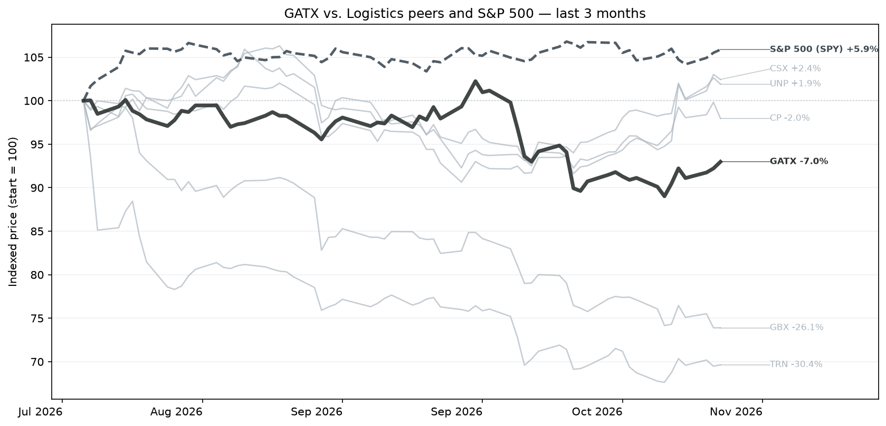

#### Earnings Call Summary

GATX reported strong Q3 2026 results with diluted EPS of $2.92, up 29.8% year-over-year from $2.25 in Q3 2025. Nine-month EPS reached $8.11 compared to $6.46 in the prior year. Rail North America experienced positive market fundamentals, supported by a favorable supply-demand environment and strong fleet asset interest.

#### At a Glance

- **GATX Beats on Top and Bottom Lines:** GATX Corporation reported a reported revenue of $598 million, beating the estimated revenue of $592.66 million, and delivered an EPS of $2.92, significantly outperforming the $2.46 estimate.
- **Fleet Performance Hits Key Operational Thresholds:** Rail North America reached a fleet utilization rate of 98.4% and an 86.1% renewal success rate, sustained by a positive renewal rate change of 12.4%.
- **Full-Year 2026 Earnings Guidance Raised:** Management increased its full-year earnings outlook and now expects diluted EPS to modestly exceed the upper end of its previous $9.90 to $10.30 guidance range.
- **Wells Fargo Acquisition Outperforms Original Expectations:** The integration of the acquired Wells Fargo rail assets progressed ahead of schedule, contributing $0.50 per diluted share year-to-date and doubling the company&#x27;s initial forecasts.
- **Strong Secondary Asset Disposition Gains Continued:** Net gains on Rail North America asset dispositions reached $50.3 million for the quarter, buoyed by highly liquid secondary market conditions and a broad institutional buyer pool.
- **Aircraft Engine Segment Maintains Structural Demand:** The Rolls-Royce and Partners Finance joint venture grew its portfolio to 475 engines, pushing year-to-date total investment volume near $1 billion amid strong global spare engine demand.

#### Key Moments from the Call

- **4m — Full-Year Guidance Increase:** GATX revised upward its full-year 2026 guidance description to modestly exceed the previous $9.90 to $10.30 EPS range, a positive surprise driven by lumpier but highly lucrative secondary market asset sales and elevated Brookfield management fee income.
- **6m — LPI Compression Explanation:** Management successfully alleviated analyst concerns regarding a softer sequential Lease Price Index of 12.4% by explaining it represents a de minimis annualized revenue impact under $5 million, while sequential pricing remains flat to upward trend.
- **25m — Wells Fargo JV Outperformance:** The Wells Fargo acquisition is substantially outperforming early expectations, with its financial contribution hitting $0.50 EPS year-to-date, confirming the prior projection that it would double its initial annual guidance of $0.20 to $0.30.
- **25m — Increased Share Buyback Activity:** GATX stepped up opportunistic share buybacks, deploying $78.5 million for 442,000 shares in Q3, capitalizing on excess capital resulting from a strong but slightly lower-volume asset investment year outside of the Wells Fargo acquisition.
<h3 id="earnings-trn">Trinity Industries (<a href="#company-trn">TRN</a>) -30.4%</h3>

**Reported:** October 29, 2026 · [Google Finance earnings page](https://www.google.com/finance/quote/TRN:NYSE?tab=earnings&hl=en)

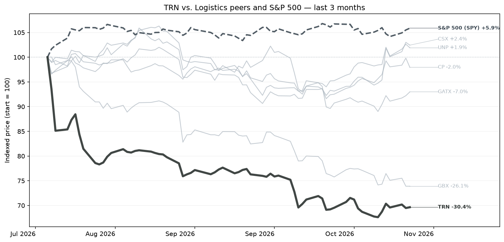

#### Earnings Call Summary

Trinity Industries reported Q2 2026 EPS of $1.25, up sequentially and year-over-year, driven by a $132 million pre-tax gain from the Napier Park transaction. Revenue was $485 million, down slightly due to fleet deconsolidation. The leasing segment achieved a 79.8% operating margin (33% excluding the gain), while utilization held steady at 97.3%.

#### At a Glance

- **Trinity Beats Revenue and EPS Estimates:** Trinity Industries reported a Q3 2026 adjusted EPS of $0.27, beating the estimated $0.265, and recorded revenue of $535.1 million, which surpassed the estimated $498.4 million.
- **Lease Fleet Utilization Remains High:** The company sustained solid operational momentum with a lease fleet utilization rate of 97.0% at quarter-end, remaining steady compared to recent quarters.
- **Full-Year EPS Guidance Reiterated:** Trinity maintained its full-year 2026 EPS guidance range of $2.20 to $2.40, while raising its forecast for secondary market railcar gains to between $180 million and $200 million.
- **Railcar Backlog and Orders Robust:** The company received orders for 2,190 railcars and delivered 2,030 units during the quarter, closing the period with a strong backlog valued at $1.6 billion.
- **Strong Revenue Growth but Lower Profits:** While quarterly revenue grew 17.8% year-over-year, operating profit declined 19% to $96 million due to lower gains on lease portfolio sales and elevated SG&amp;A expenses.
- **Positive Initial Market Reaction:** Following the earnings release, Trinity&#x27;s shares saw positive momentum, trading up significantly in early Thursday trading sessions.

#### Key Moments from the Call

- **12m — Napier Park Fleet Deconsolidation and Gain:** Trinity unlocked substantial embedded asset value by contributing its remaining interest in the Tribute fleet for an 11.2% interest in Napier Park SPE Holdings. This generated a $132 million pre-tax gain, driving EPS growth while shifting the assets to the managed fleet and simplifying the balance sheet.
- **19m — Section 232 Tariff Exemption and Market Impact:** Management clarified its unique legal standing regarding Section 232 tank car tariff investigations, citing direct North American production exemptions under USMCA. While regulatory uncertainty has temporarily depressed broader industry tank car orders, Trinity has introduced contract escalation clauses and flexible manufacturing footprints to protect future margins.
- **22m — Rail Products Margin Miss and Recovery Plan:** Rail Products operating margin fell to 1.3% due to a tragic workplace fatality at the Longview facility and Mexico realignment. Despite lowering full-year segment expectations to the bottom of the 5%-6% range, management maintained full-year EPS guidance, relying on a steep second-half delivery ramp to provide needed operating leverage.
- **32m — 2027 Volume Outlook and Industry Growth:** Management projects a significant cyclical turnaround for the railcar market, anticipating total industry deliveries to climb from 25,000 units in 2026 to approximately 35,000 units in 2027. This recovery is supported by improving rail traffic, sub-20% fleet storage levels, and a visible order rebound entering Q3.
<h3 id="earnings-gbx">Greenbrier (<a href="#company-gbx">GBX</a>) -26.1%</h3>

**Reported:** October 26, 2026 · [Google Finance earnings page](https://www.google.com/finance/quote/GBX:NYSE?tab=earnings&hl=en)

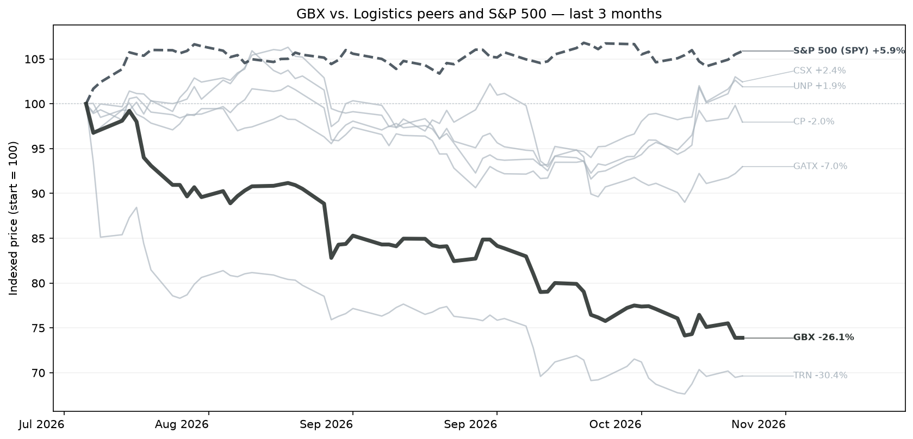

#### Earnings Call Summary

In fiscal 2026, Greenbrier delivered 15,400 railcars and generated $2.5 billion in revenue, with core EPS at $2.60 and an aggregate gross margin of 13.6%. Performance remained resilient against macroeconomic and geopolitical headwinds compared to the downturn in fiscal 2022, achieving 330 basis points higher gross margin, 30% higher core EBITDA, and 76% higher core net earnings.

#### At a Glance

- **Greenbrier Misses EPS and Revenue:** The Greenbrier Companies reported a Core EPS of $0.39, missing the estimated adjusted EPS of $0.803, while revenue came in at $591 million, falling short of the estimated $605.1 million.
- **Backlog Rebounds Sequentially on Orders:** Greenbrier secured Q4 new railcar orders of 3,400 units valued at $600 million and made 3,600 deliveries, driving its total railcar backlog to 14,000 units valued at $2.1 billion for its first sequential increase since FY2024.
- **Positive Guidance for Fiscal 2027:** Management issued optimistic full-year fiscal 2027 guidance with expected revenue between $2.8 billion and $3.2 billion and EPS forecasted at $2.75 to $3.75, projecting stronger delivery volumes in the second half of the year.
- **Owned Lease Fleet Expands Rapidly:** The company&#x27;s owned lease fleet expanded by 23% during fiscal 2026 to reach 20,900 units, maintaining a strong utilization rate of 98% and driving recurring revenue to $175 million.
- **Operational Inefficiencies Squeeze Gross Margins:** Fourth-quarter margins suffered a severe squeeze, with aggregate gross margin dipping to 13.5% as operational inefficiencies from lower production volumes, higher financing costs, and acquisition timing took a heavy toll.
- **Shares Decline on Earnings Shortfall:** Disappointed by the significant bottom-line miss, investors drove Greenbrier&#x27;s stock down by over 3% in post-earnings trading, extending a challenging multi-month stretch for the equity.

#### Key Moments from the Call

- **3m — Trade and Tariff Litigation:** Greenbrier faces ongoing trade policy friction, actively defending against freight rail coupler duty determinations and new petitions targeting tank cars. While management emphasizes it is an industry-wide challenge, adverse outcomes could force higher customer pricing, though long-term domestic profitability is not expected to be materially disrupted.
- **9m — Back-Half Loaded 2027 Outlook:** Fiscal 2027 performance is expected to be significantly back-half loaded due to the timing of complex engineering for specialized railcars. While this temporary volume gap may pressure near-term fixed-overhead absorption, the high-margin nature of these units is expected to drive meaningful margin expansion later in the year.
- **17m — Shift in Guidance Metric:** Management eliminated company-specific delivery forecasts in favor of an industry-wide model. Because growing lease retentions and restoration programs distort traditional delivery correlations, this shift aims to align reported figures with underlying financial growth, though it initially complicates direct volume comparisons for analytical tracking.
- **39m — Executive Transition Strategy:** Incoming CEO Brian Comstock intends to tightly preserve the existing corporate strategy established during his 30-year tenure alongside retiring CEO Lorie Tekorius. However, he intends to introduce a newfound urgency regarding operational accountability, aggressive cost structure refinements, and accelerated lease fleet asset growth.

## Company Overviews

<h3 id="company-ctva">Corteva (CTVA)</h3>

*Crop inputs, equipment, and irrigation · $52.4B · 3m -87.5% · 12m -82.1% · 24m -81.4%*

[Google Finance](https://www.google.com/finance/quote/CTVA:NYSE?tab=earnings&hl=en)

Largest U.S. corn-seed franchise (Pioneer) and a primary input cost for Corn Belt acres.

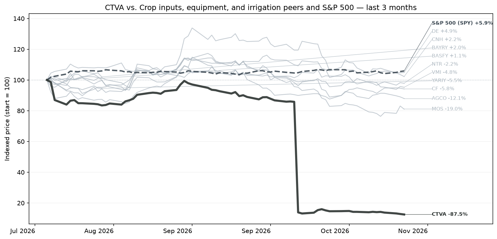

Corteva is an agricultural inputs pure play that was formed in 2019 when it was spun off from DowDuPont. The company is a leader in the development of new seed and crop protection products. Seeds generate the majority of profits with the remainder coming from crop protection products. Corteva plans to spin off its seeds business in late 2026. The seeds business will be named Vylor, while the crop protection business will retain the Corteva name and be a pure-play crop protection company following the divestiture. Corteva operates globally, but around half of revenue comes from North America.

<h3 id="company-bayry">Bayer (BAYRY)</h3>

*Crop inputs, equipment, and irrigation · n/a · 3m +2.0% · 12m +75.4% · 24m +100.1%*

[Google Finance](https://www.google.com/finance/quote/BAYRY:NYSE?tab=earnings&hl=en)

Dekalb and former Monsanto corn-seed brands; together with Corteva dominates U.S. corn seed.

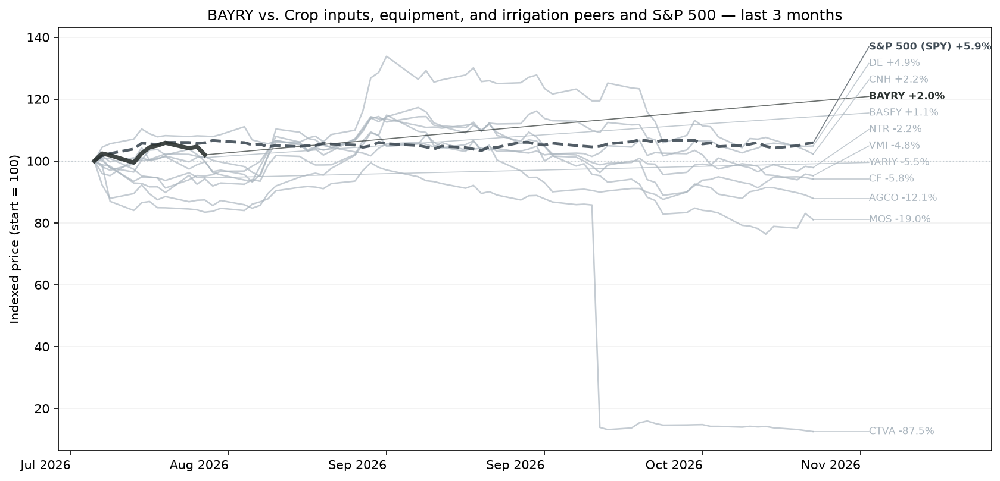

BAYER AG S/ADR

<h3 id="company-basfy">BASF (BASFY)</h3>

*Crop inputs, equipment, and irrigation · n/a · 3m +1.1% · 12m +16.7% · 24m +20.8%*

[Google Finance](https://www.google.com/finance/quote/BASFY:NYSE?tab=earnings&hl=en)

Crop-protection chemistry used on U.S. corn acres.

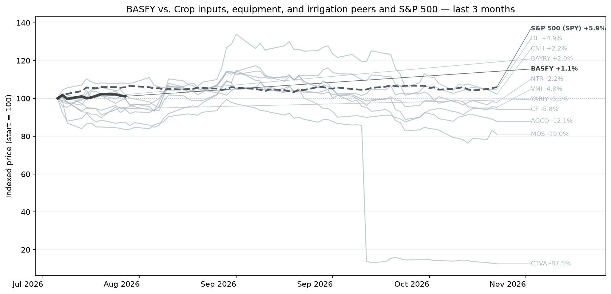

BASF SE S/ADR

<h3 id="company-ntr">Nutrien (NTR)</h3>

*Crop inputs, equipment, and irrigation · $33.6B · 3m -2.2% · 12m +22.4% · 24m +44.9%*

[Google Finance](https://www.google.com/finance/quote/NTR:NYSE?tab=earnings&hl=en)

Largest North American agricultural retailer and a major potash and nitrogen producer.

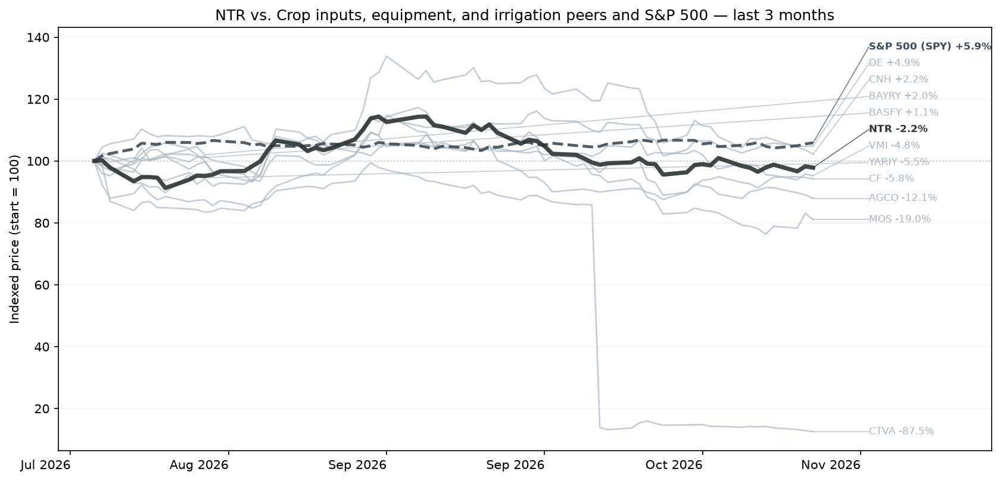

Created in 2018 as a result of the merger between PotashCorp and Agrium, Nutrien is the world's largest fertilizer producer by capacity. Nutrien produces the three main crop nutrients—nitrogen, potash, and phosphate—although its main focus is potash, where it is the global leader in installed capacity with a roughly 20% market share. The company is also the largest agricultural retailer in North America and Australia, selling fertilizers, crop chemicals, seeds, and services directly to farm customers through its brick-and-mortar stores and online platforms.

<h3 id="company-cf">CF Industries (CF)</h3>

*Crop inputs, equipment, and irrigation · $18.0B · 3m -5.8% · 12m +42.5% · 24m +47.4%*

[Google Finance](https://www.google.com/finance/quote/CF:NYSE?tab=earnings&hl=en)

Nitrogen fertilizer producer; corn is the crop that most moves UAN and urea demand.

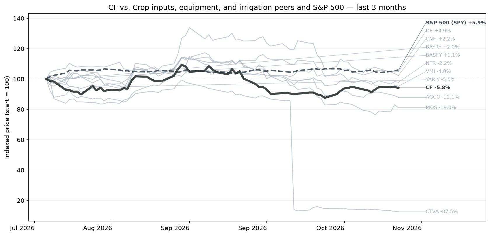

CF Industries is a leading producer and distributor of nitrogen, which is primarily used in fertilizers. The company operates nitrogen manufacturing plants primarily in North America. CF also produces nitrogen in the United Kingdom and holds a joint venture interest in a nitrogen production facility in Trinidad and Tobago. CF makes nitrogen primarily using low-cost US natural gas as its feedstock, making the company one of the lowest-cost nitrogen producers globally. It is also investing in carbon-free blue and green ammonia, which can be used as an alternative fuel to hydrogen or as a means to transport hydrogen.

<h3 id="company-yariy">Yara International (YARIY)</h3>

*Crop inputs, equipment, and irrigation · n/a · 3m -5.5% · 12m +19.9% · 24m +46.7%*

[Google Finance](https://www.google.com/finance/quote/YARIY:NYSE?tab=earnings&hl=en)

Global nitrogen producer that sets the international urea and ammonia reference.

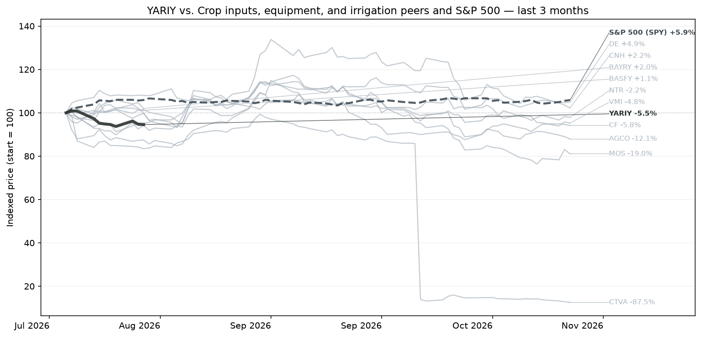

YARA INTL ASA S/ADR

<h3 id="company-mos">Mosaic (MOS)</h3>

*Crop inputs, equipment, and irrigation · $7.1B · 3m -19.0% · 12m -36.0% · 24m -31.3%*

[Google Finance](https://www.google.com/finance/quote/MOS:NYSE?tab=earnings&hl=en)

Phosphate and potash producer that completes corn production budgets.

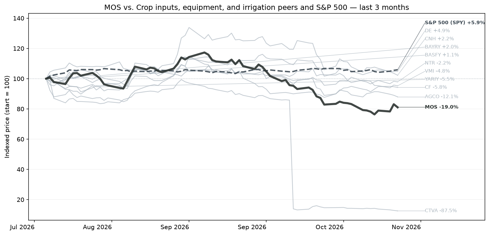

Mosaic is one of the largest phosphate and potash producers in the world. The company's assets include phosphate rock mines in the US and potash mines in Canada. Mosaic also runs a large fertilizer distribution operation in Brazil through its Mosaic Fertilizantes business.

<h3 id="company-de">Deere (DE)</h3>

*Crop inputs, equipment, and irrigation · $156.7B · 3m +4.9% · 12m +35.3% · 24m +57.8%*

[Google Finance](https://www.google.com/finance/quote/DE:NYSE?tab=earnings&hl=en)

Dominant North American farm-equipment maker for corn planting, harvest, and grain handling.

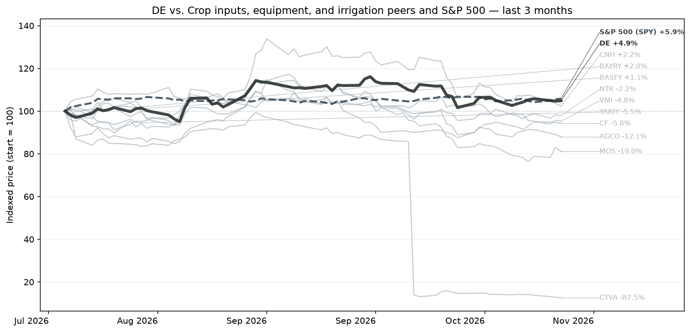

Deere is the world's leading manufacturer of agricultural equipment and a major producer of construction machinery. The company is divided into four reporting segments: production & precision agriculture, or PPA, small agriculture & turf, or SAT, construction & forestry, or CF, and financial services, or FS, its captive finance subsidiary. The core PPA business is the largest contributor to sales and profits by far. Geographically, Deere sales are 60% US/Canada, 17% Europe, 14% Latin America, and 9% rest of the world. Deere goes to market through a robust dealer network that includes over 2,000 dealer locations in North America with reach into over 100 countries. John Deere Financial provides retail financing for machinery to its customers and wholesale financing for dealers.

<h3 id="company-cnh">CNH Industrial (CNH)</h3>

*Crop inputs, equipment, and irrigation · $16.5B · 3m +2.2% · 12m +3.6% · 24m -2.7%*

[Google Finance](https://www.google.com/finance/quote/CNH:NYSE?tab=earnings&hl=en)

Case IH and New Holland farm equipment serving corn growers.

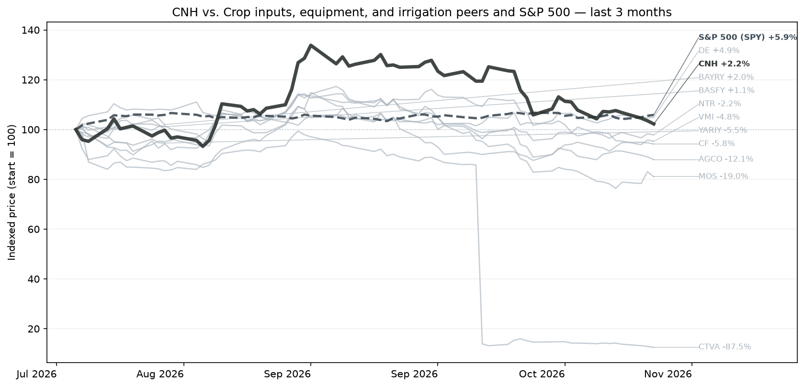

CNH Industrial is the world's second largest manufacturer of agricultural machinery (82% of industrial net sales) as well as a major player in construction equipment (18% of industrial net sales). Its Case and New Holland brands have served farmers for generations. Geographically, agricultural sales are 40% in North America, 32% in Europe, the Middle East, and Africa, 18% in South America, and 10% in Asia-Pacific. CNH's products are available through a robust independent dealer network, which includes over 2,600 dealer and distribution locations and reach into 164 countries. The construction business leverages over 400 dealers. The company's captive finance arm provides retail financing to its customers and wholesale financing to dealers to maintain inventory, thereby supporting sales.

<h3 id="company-agco">AGCO (AGCO)</h3>

*Crop inputs, equipment, and irrigation · $7.0B · 3m -12.1% · 12m -5.7% · 24m +1.9%*

[Google Finance](https://www.google.com/finance/quote/AGCO:NYSE?tab=earnings&hl=en)

Fendt, Massey Ferguson, and Challenger farm equipment with Corn Belt exposure.

Agco is a global manufacturer of agricultural equipment. Its main machine brands are Fendt, Massey Ferguson, and Valtra; its initiatives in precision agriculture have been organized under the PTx umbrella following a series of acquisitions. While a global business, Agco's sales skew heavily toward Europe/Middle East, representing 50%-60% of sales and even more of operating profits. The company is trying to increase its exposure to the larger North and South American markets. Its products are available through a global dealer network, which includes over 3,000 dealers and distribution locations and reaches into over 140 countries. Additionally, Agco offers retail and wholesale financing to customers through its partnership with Rabobank of the Netherlands, having exited their JV in 2026.

<h3 id="company-vmi">Valmont Industries (VMI)</h3>

*Crop inputs, equipment, and irrigation · $9.3B · 3m -4.8% · 12m +3.7% · 24m +35.9%*

[Google Finance](https://www.google.com/finance/quote/VMI:NYSE?tab=earnings&hl=en)

Center-pivot irrigation (Valley) used on irrigated High Plains corn.

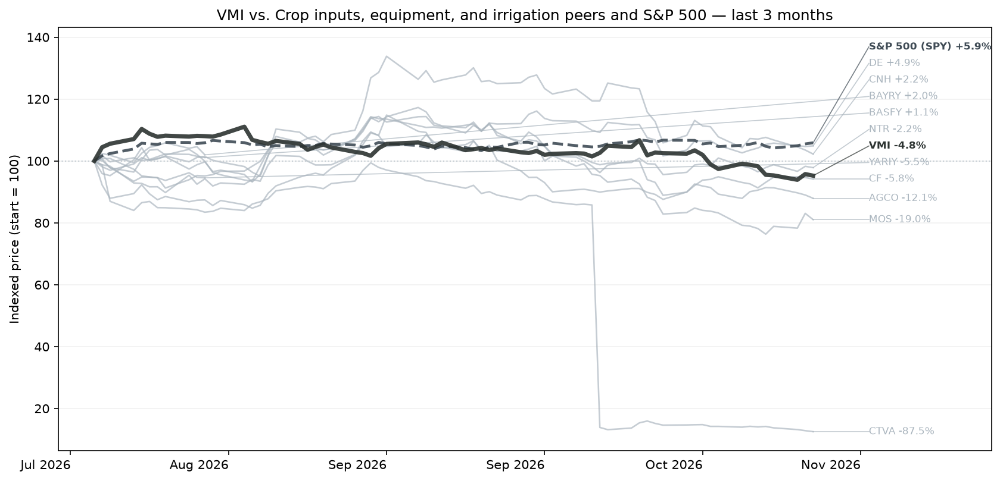

Valmont Industries Inc, along with its subsidiaries, operates as a manufacturer of products and services for infrastructure and agriculture markets. Its reportable segments are Infrastructure and Agriculture. The company generates maximum revenue from the Infrastructure segment, which includes the manufacturing and distribution of products and solutions to serve the infrastructure markets of utility, solar, lighting, transportation, and telecommunications, along with coatings services to protect metal products. The Agriculture segment provides irrigation equipment components, including aftermarket parts and tubular products, and technology solutions for precision agriculture. Geographically, it derives key revenue from the United States, followed by Australia, Brazil, and other regions.

<h3 id="company-adm">Archer Daniels Midland (ADM)</h3>

*Grain origination and agribusiness, Wet milling, ingredients, and co-products, U.S. ethanol and process technology · $38.9B · 3m -3.9% · 12m +27.6% · 24m +37.1%*

[Google Finance](https://www.google.com/finance/quote/ADM:NYSE?tab=earnings&hl=en)

Global grain trader, top U.S. ethanol producer, and major corn wet miller.

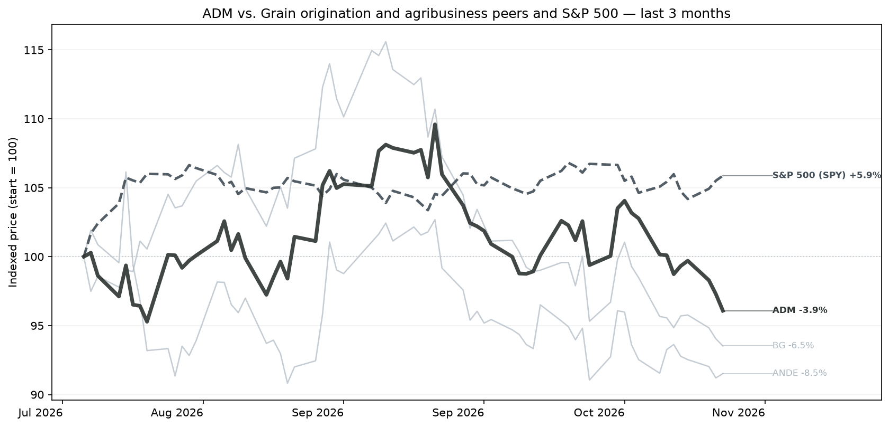

Archer-Daniels-Midland is a major processor of oilseeds, corn, wheat, and other agricultural commodities. The company is also one of the largest grain merchandisers through its extensive network of logistical assets to store and transport crops around the globe. ADM also runs a nutrition business that focuses on both human and animal ingredients and is a large producer of corn-based sweeteners, starches, and ethanol.

<h3 id="company-bg">Bunge (BG)</h3>

*Grain origination and agribusiness · $21.9B · 3m -6.5% · 12m +4.9% · 24m +14.8%*

[Google Finance](https://www.google.com/finance/quote/BG:NYSE?tab=earnings&hl=en)

Global grain and oilseed merchant after the Viterra combination; competitor for corn origination.

Bunge Global SA is an agribusiness solutions company, connecting farmers to consumers and delivering essential food, feed and fuel to the globe. The company segments include Soybean Processing and Refining; Softseed Processing and Refining; Other Oilseeds Processing and Refining; Grain Merchandising and Milling; and Corporate and Other. It generates maximum revenue from the Soybean Processing and Refining segment, which includes integrated business principally involved in the purchase, storage, transportation, processing, distribution, refining, marketing, and sale of soybeans and soybean related products, as well as biodiesel and fertilizer production and distribution. Geographically, the company operates in United States, Switzerland, Netherlands, and Rest of the World.

<h3 id="company-ande">The Andersons (ANDE)</h3>

*Grain origination and agribusiness, U.S. ethanol and process technology · $2.3B · 3m -8.5% · 12m +37.1% · 24m +39.2%*

[Google Finance](https://www.google.com/finance/quote/ANDE:NASDAQ?tab=earnings&hl=en)

Grain elevators plus four wholly owned ethanol plants totaling about 500 million gallons a year.

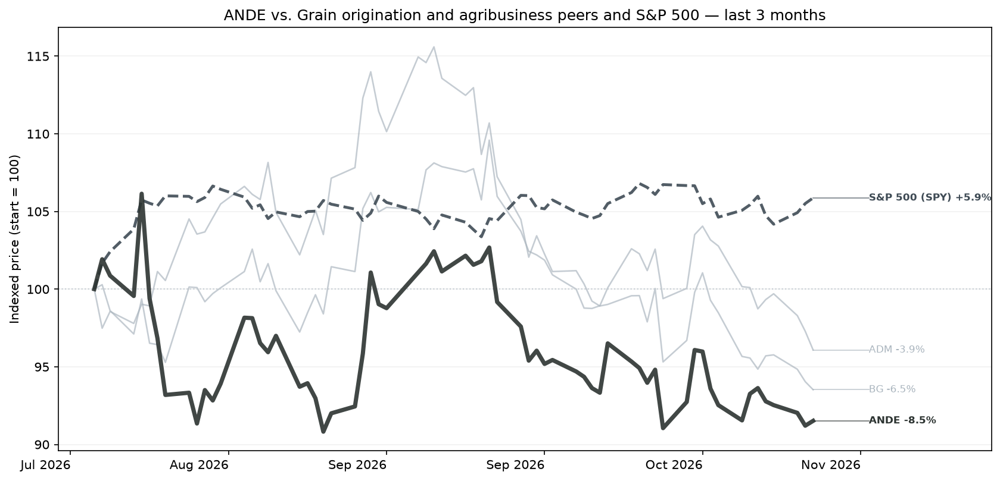

Andersons Inc is an agriculture and renewable fuels company. Its operations are classified into two reportable business segments: Agribusiness, which generates maximum revenue, and Renewables. The Agribusiness segment includes merchandising and managing logistics across various commodities, as well as being a manufacturer, distributor, and retailer of agricultural and related plant nutrients. The segment specializes in the movement of physical commodities such as whole grains, grain products, feed ingredients, and domestic fuel products, among other agricultural commodities. The Renewables segment mainly produces, purchases, and sells ethanol and co-products. Geographically, the company generates maximum revenue from the United States, followed by Canada, Mexico, and other markets.

<h3 id="company-vlo">Valero Energy (VLO)</h3>

*U.S. ethanol and process technology, Fuel blending, refining, and retail · $99.7B · 3m +28.9% · 12m +127.6% · 24m +203.8%*

[Google Finance](https://www.google.com/finance/quote/VLO:NYSE?tab=earnings&hl=en)

World's second-largest corn-ethanol producer with a distinct Ethanol segment and a major blender.

Valero Energy is one of the largest independent refiners in the United States. It operates 15 refineries, with a total throughput capacity of 3.2 million barrels a day in the US, Canada, and the United Kingdom. Valero also owns 12 ethanol plants with capacity of 1.6 billion gallons a year and holds a 50% stake in Diamond Green Diesel, which can produce 1.2 billion gallons per year of renewable diesel.

<h3 id="company-gpre">Green Plains (GPRE)</h3>

*U.S. ethanol and process technology · $1.1B · 3m -16.2% · 12m +33.1% · 24m +22.1%*

[Google Finance](https://www.google.com/finance/quote/GPRE:NASDAQ?tab=earnings&hl=en)

Largest U.S. ethanol pure play, with high-protein feed, corn oil, and Nebraska carbon-capture work.

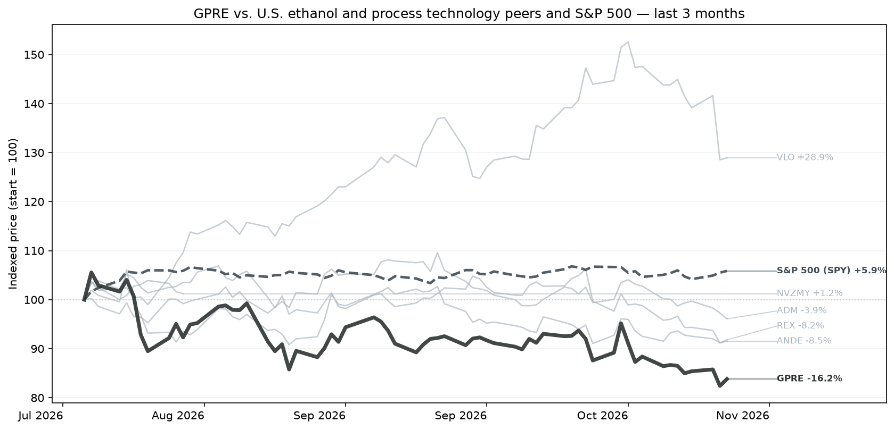

Green Plains Inc manufactures and sells ethanol and ethanol byproducts in two segments based on function. The ethanol production segment, which generates the majority of revenue, includes the production of ethanol, distillers grains, Ultra-High Protein and renewable corn oil. The agribusiness and energy services segment includes grain handling and storage, commodity marketing and merchant trading for company-produced and third-party ethanol, distillers grains, Ultra-High Protein, renewable corn oil, natural gas and other commodities.

<h3 id="company-rex">REX American Resources (REX)</h3>

*U.S. ethanol and process technology · $1.4B · 3m -8.2% · 12m +21.9% · 24m +73.0%*

[Google Finance](https://www.google.com/finance/quote/REX:NYSE?tab=earnings&hl=en)

Holding company with interests in six Corn Belt ethanol plants; cleanest public crush-margin equity.

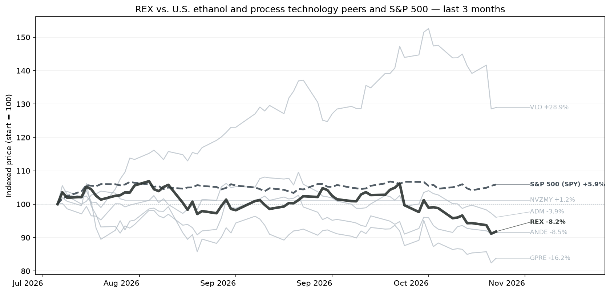

REX American Resources Corp operates as a holding company that engages in investments in alternative energy and ethanol production entities. Its operating segments include Ethanol and By-Products. Its products include Ethanol, dried distillers grains, modified distillers grains, Distillers corn oil, Modified distillers grains, and Other.

<h3 id="company-nvzmy">Novonesis (NVZMY)</h3>

*U.S. ethanol and process technology · n/a · 3m +1.2% · 12m +7.7% · 24m +0.6%*

[Google Finance](https://www.google.com/finance/quote/NVZMY:NYSE?tab=earnings&hl=en)

Dominant supplier of enzymes used in dry-mill ethanol fermentation.

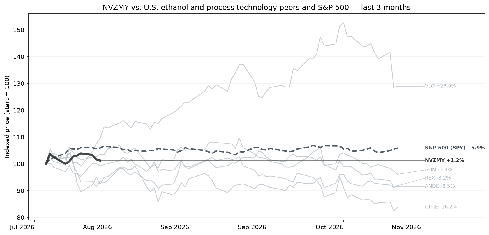

NOVONESIS B UNSP/ADR

<h3 id="company-ingr">Ingredion (INGR)</h3>

*Wet milling, ingredients, and co-products · $6.8B · 3m -7.4% · 12m -18.5% · 24m -29.3%*

[Google Finance](https://www.google.com/finance/quote/INGR:NYSE?tab=earnings&hl=en)

Major corn wet miller producing sweeteners, starches, and specialty ingredients.

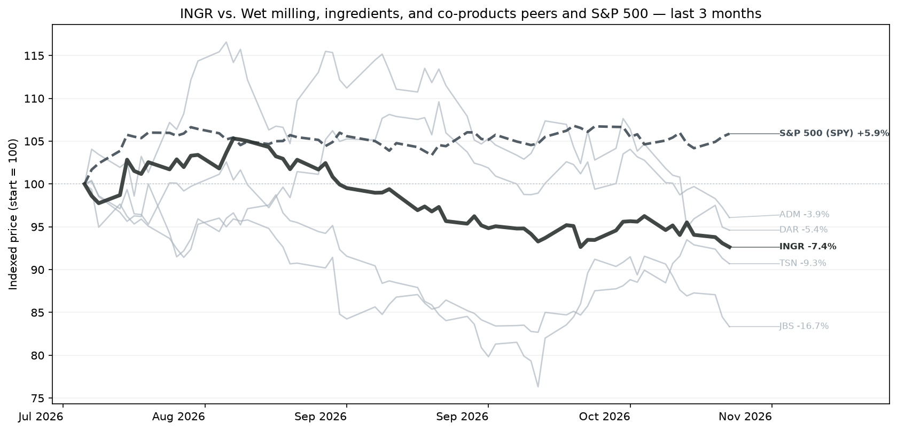

Ingredion is an ingredients provider for the food, beverage, brewing, and animal nutrition industries. The company processes corn, tapioca, potatoes, stevia, grains, fruits, gums, and vegetables into value-added ingredients. The company sells specialty ingredients that include starch-based texturizers and natural alternative sweeteners such as stevia. Ingredion also sells commodity ingredients that include sweeteners, such as high-fructose corn syrup, and starches, such as those used for sustainable packaging, as well as plant-based proteins. The company plans to acquire Tate & Lyle in an all-cash deal that should close in 2027.

<h3 id="company-dar">Darling Ingredients (DAR)</h3>

*Wet milling, ingredients, and co-products · $10.6B · 3m -5.4% · 12m +65.7% · 24m +42.0%*

[Google Finance](https://www.google.com/finance/quote/DAR:NYSE?tab=earnings&hl=en)

Rendering and used cooking oil; 50/50 owner of Diamond Green Diesel with Valero.

Darling Ingredients Inc is a developer and producer of sustainable natural ingredients from edible and inedible bio-nutrients, creating a wide range of ingredients and customized specialty solutions for customers in the pharmaceutical, food, pet food, animal feed, industrial, fuel, bioenergy and fertilizer industries. It processes by-products from the animal agriculture and food industries into ingredients and products for human nutrition, animal feed, crop inputs, and renewable energy applications. The company operates processing facilities across multiple countries and produces collagen, including gelatin and hydrolyzed collagen, as well as renewable energy products.

<h3 id="company-tsn">Tyson Foods (TSN)</h3>

*Wet milling, ingredients, and co-products · $20.6B · 3m -9.3% · 12m +9.1% · 24m -5.2%*

[Google Finance](https://www.google.com/finance/quote/TSN:NYSE?tab=earnings&hl=en)

Largest U.S. protein company and a primary domestic sink for distillers grains.

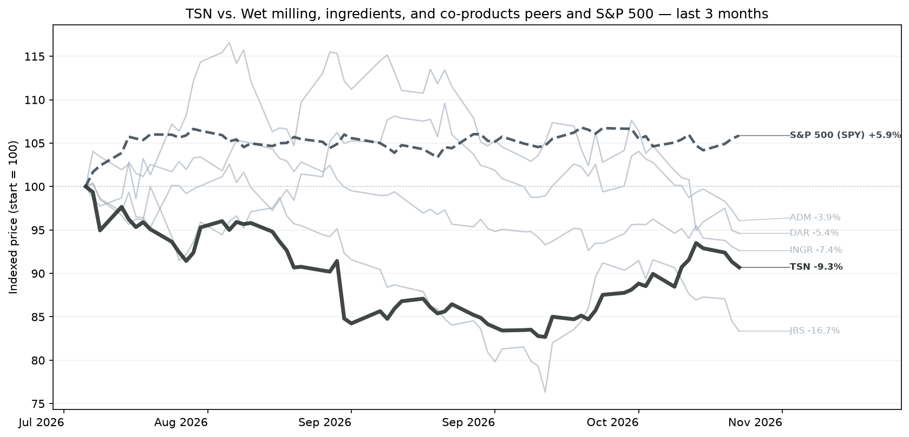

Tyson Foods is a protein-focused food producer, selling raw chicken, beef, pork, and prepared foods. Chicken and beef are its two largest segments, composing about 40% and 30% of sales, respectively. Prepared foods constituted 18% of fiscal 2025 sales and include brands like Tyson, Jimmy Dean, Hillshire Farm, Ball Park, and Sara Lee. However, most of these are in product categories rife with competition where Tyson does not have a massive market share lead. Tyson sells some products overseas, but the international segment accounts for just 4% of total revenue. The company is an active acquirer, with more recent years' purchases focused on international and food-service markets.

<h3 id="company-jbs">JBS (JBS)</h3>

*Wet milling, ingredients, and co-products · $45.2B · 3m -16.7% · 12m -8.9% · 24m n/a*

[Google Finance](https://www.google.com/finance/quote/JBS:NYSE?tab=earnings&hl=en)

World's largest protein company and a major DDGS buyer in the U.S. and Brazil.

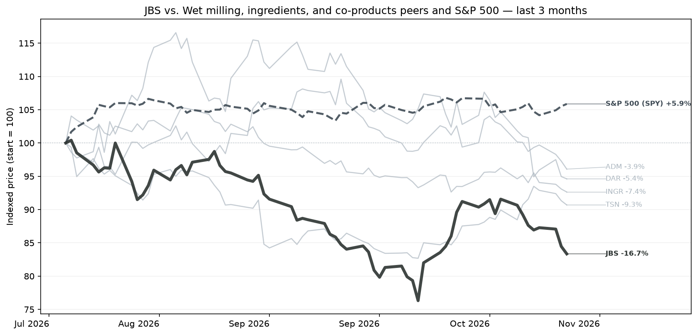

JBS NV is a protein food company, selling protein products, which include fresh and frozen cuts of beef, pork, lamb, fish, whole chickens, and chicken parts, to retailers, and foodservice companies. The food products are marketed under different brands such as Swift, Just Bare, Pilgrim's Pride, Sunnyvalley, Reserva Friboi, Great Southern, etc., globally. The company's reportable segments are Beef North America, which generates maximum revenue, Brazil, Seara, Pork USA, Pilgrim's Pride, Australia, and Others. Geographically, it derives majority of its revenue from United States of America.

<h3 id="company-mpc">Marathon Petroleum (MPC)</h3>

*Fuel blending, refining, and retail · $101.3B · 3m +42.8% · 12m +125.2% · 24m +203.4%*

[Google Finance](https://www.google.com/finance/quote/MPC:NYSE?tab=earnings&hl=en)

Largest U.S. independent refiner and a major Midwest ethanol blender.

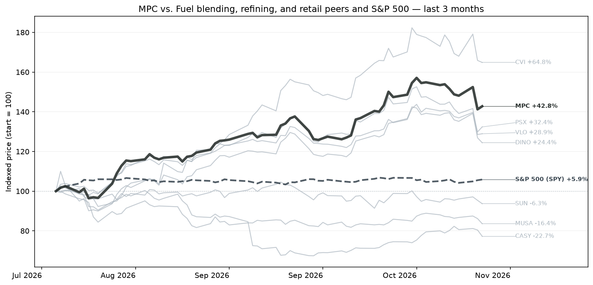

Marathon Petroleum is a leading integrated downstream and midstream energy company that operates 13 refineries in the Gulf Coast, Mid-Continent, and West Coast regions of the United States with an aggregate crude oil refining capacity of 3.0 million barrels per day. The company is one of the largest producers of renewable diesel in the US; its Dickinson, North Dakota facility has the capacity to produce 184 million gallons per year, and its Martinez, California, joint venture facility (a 50/50 partnership with Neste) reached its full capacity of 730 million gallons per year in late 2024. Marathon also owns the general partner and approximately 64% of MPLX LP, a large-cap master limited partnership that owns and operates midstream energy infrastructure and logistics assets.

<h3 id="company-psx">Phillips 66 (PSX)</h3>

*Fuel blending, refining, and retail · $96.7B · 3m +32.4% · 12m +98.4% · 24m +122.1%*

[Google Finance](https://www.google.com/finance/quote/PSX:NYSE?tab=earnings&hl=en)

Large blender and marketer with West Coast renewable-diesel capacity.

Phillips 66 is an independent refiner that owns or holds interest in 10 refineries with a total crude throughput capacity of 2.0 million barrels per day, or mmb/d, at the end of 2025. The midstream segment comprises extensive transportation and NGL processing assets. It includes 70,000 miles of crude oil, refined petroleum product, NGL and natural gas pipeline systems, and a comprehensive set of refined petroleum product, NGL and crude oil terminals, gathering and processing plants and fractionation facilities and various other storage and loading facilities. Its CPChem chemical joint venture operates facilities primarily in the United States and the Middle East and produces olefins and polyolefins.

<h3 id="company-dino">HF Sinclair (DINO)</h3>

*Fuel blending, refining, and retail · $16.8B · 3m +24.4% · 12m +107.5% · 24m +174.4%*

[Google Finance](https://www.google.com/finance/quote/DINO:NYSE?tab=earnings&hl=en)

Independent Mid-Continent and Rockies refiner with renewable diesel and RFS blending obligations.

HF Sinclair is an integrated petroleum refiner that owns and operates seven refineries serving the Rockies, midcontinent, Southwest, and Pacific Northwest, with a total crude oil throughput capacity of 678,000 barrels per day. It can produce 380 million gallons of renewable diesel annually. It operates a marketing business with over 350 distributors and 1,700 branded wholesale sites across 30 states. It also owns and operates 4,500 miles of petroleum product pipelines and terminals principally in the Southwestern United States.

<h3 id="company-cvi">CVR Energy (CVI)</h3>

*Fuel blending, refining, and retail · $3.7B · 3m +64.8% · 12m +45.7% · 24m +216.0%*

[Google Finance](https://www.google.com/finance/quote/CVI:NYSE?tab=earnings&hl=en)

Coffeyville, Kansas refiner in the corn complex with renewable diesel and a nitrogen affiliate.

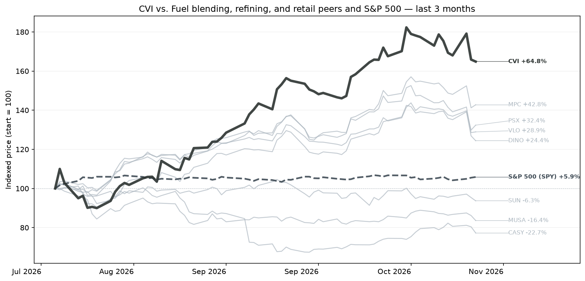

CVR Energy Inc is a holding company that engages in petroleum refining and nitrogen fertilizer manufacturing through its subsidiaries. Subsidiaries include several complex, full-coking crude oil refineries, along with a crude oil gathering system, pipelines, storage tanks, and marketing and supply. The company's refineries can process blends of a variety of crude oil ranging from heavy sour to light sweet crude oil. Crude oil for CVR's refineries is supplied through its wholly-owned gathering system and pipeline. From its refineries, CVR supplies products through tanker trucks directly to customers located in close geographic proximity and customers at throughput terminals. The company's customers include retailers, railroads, and farm cooperatives.

<h3 id="company-sun">Sunoco LP (SUN)</h3>

*Fuel blending, refining, and retail · $14.5B · 3m -6.3% · 12m +34.2% · 24m +38.7%*

[Google Finance](https://www.google.com/finance/quote/SUN:NYSE?tab=earnings&hl=en)

Fuel distributor and terminal operator that moves finished gasoline and ethanol.

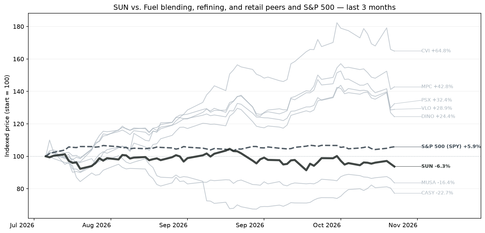

Sunoco LP is engaged in the distribution of motor fuels to independent dealers, distributors, and other commercial customers as well as the distribution of motor fuels to end-use customers at retail sites operated by commission agents. It is a growth-oriented master limited partnership (MLP) that operates as a wholesale and retail fuel distributor in the United States. The firm operates through the Fuel Distribution; Pipeline Systems; Refinery and Terminals segments. It generates the majority of its revenue from the Fuel Distribution segment. It distributes motor fuel to convenience stores, dealers, and commercial customers in various states.

<h3 id="company-casy">Casey&#x27;s General Stores (CASY)</h3>

*Fuel blending, refining, and retail · $30.9B · 3m -22.7% · 12m +26.6% · 24m +68.1%*

[Google Finance](https://www.google.com/finance/quote/CASY:NASDAQ?tab=earnings&hl=en)

Corn Belt convenience-store chain with high E10/E15/E85 exposure.

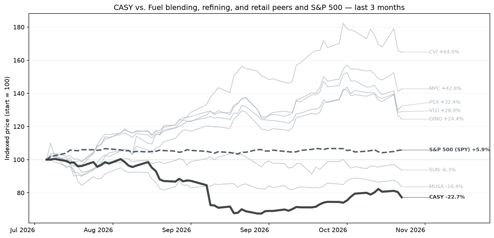

Casey's General Stores Inc, along with its subsidiaries, operates convenience stores mainly under the names Casey's, GoodStop (by Casey's), and Casey's General Store throughout various states in the USA, approximately half of which are located in Iowa, Missouri, and Illinois. These stores offer a broad selection of food items (which includes prepared foods such as regular and breakfast pizza, donuts, hot breakfast items, and hot and cold sandwiches), beverages, tobacco and nicotine products, groceries, health and beauty aids, automotive products, and other non-food items. The majority of the company's revenue is mainly derived from the retail sale of fuel and the products offered inside its stores.

<h3 id="company-musa">Murphy USA (MUSA)</h3>

*Fuel blending, refining, and retail · $10.4B · 3m -16.4% · 12m +31.4% · 24m +8.0%*

[Google Finance](https://www.google.com/finance/quote/MUSA:NYSE?tab=earnings&hl=en)

High-volume fuel retailer and national ethanol blender.

Murphy USA Inc is mainly engaged in the marketing of retail motor fuel products and convenience merchandise through a network of several retail stores in the Southwest, Southeast, Midwest, and Northeast United States. The majority of Murphy USA's stores are located in proximity to Walmart Supercenters, but it also operates standalone stores that market gasoline and other products under the Murphy USA, Murphy Express, and QuickChek brands. In addition, the company also markets fuel to unbranded wholesale customers through a mixture of company-owned and third-party product distribution terminals and pipeline positions. The firm generates maximum revenue through retail sales of petroleum products, and the rest from merchandise sales and wholesale of petroleum products.

<h3 id="company-ntoiy">Neste (NTOIY)</h3>

*Advanced biofuels and SAF · n/a · 3m -2.1% · 12m +55.5% · 24m +110.5%*

[Google Finance](https://www.google.com/finance/quote/NTOIY:NYSE?tab=earnings&hl=en)

Largest global producer of renewable diesel and SAF; sets the price umbrella for corn oil.

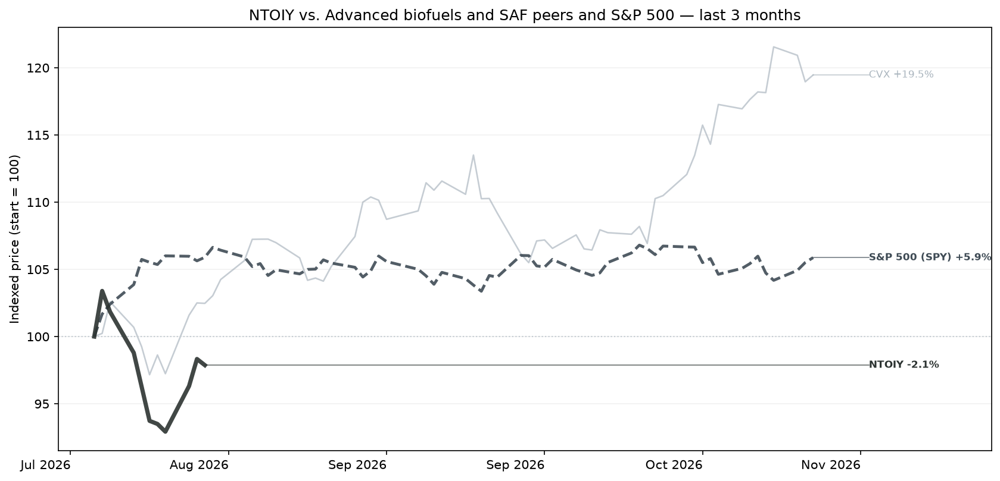

NESTE OYJ UNSP/ADR

<h3 id="company-cvx">Chevron (CVX)</h3>

*Advanced biofuels and SAF · $403.6B · 3m +19.5% · 12m +47.8% · 24m +54.3%*

[Google Finance](https://www.google.com/finance/quote/CVX:NYSE?tab=earnings&hl=en)

Owner of Renewable Energy Group biodiesel and renewable-diesel plants that take corn oil at the margin.

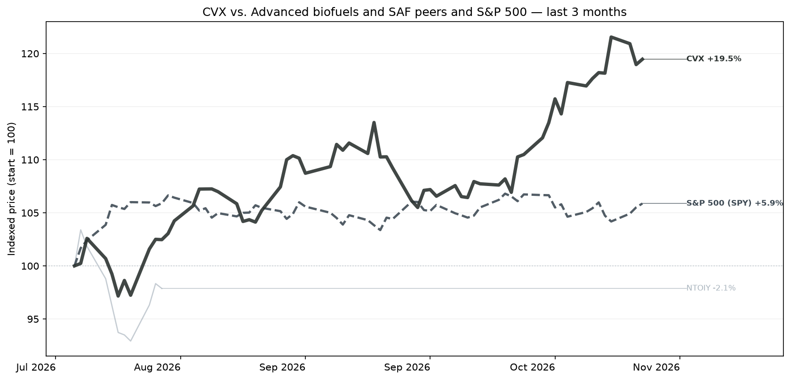

Chevron is an integrated energy company with exploration, production, and refining operations worldwide. It is the second-largest oil company in the United States with 2025 worldwide net oil-equivalent production of 3.7 million barrels per day, including 8.5 billion cubic feet per day of natural gas and 2.3 million barrels of liquids per day. Production takes place in North America, South America, Europe, Africa, Asia, and Australia. The company's refining networks arelocated in the United States and Asia, with a total worldwide refining capacity of 1.8 million barrels of oil a day at year-end 2025. Net proved reserves at year-end 2025 stood at 10.6 billion barrels of oil equivalent, consisting of 5.7 billion barrels of liquids and 29.2 trillion cubic feet of natural gas.

<h3 id="company-csan">Cosan (CSAN)</h3>

*International ethanol · $2.5B · 3m -10.1% · 12m -39.0% · 24m -67.0%*

[Google Finance](https://www.google.com/finance/quote/CSAN:NYSE?tab=earnings&hl=en)

Brazilian holding company and the liquid U.S.-listed proxy for sugarcane ethanol via Raizen.

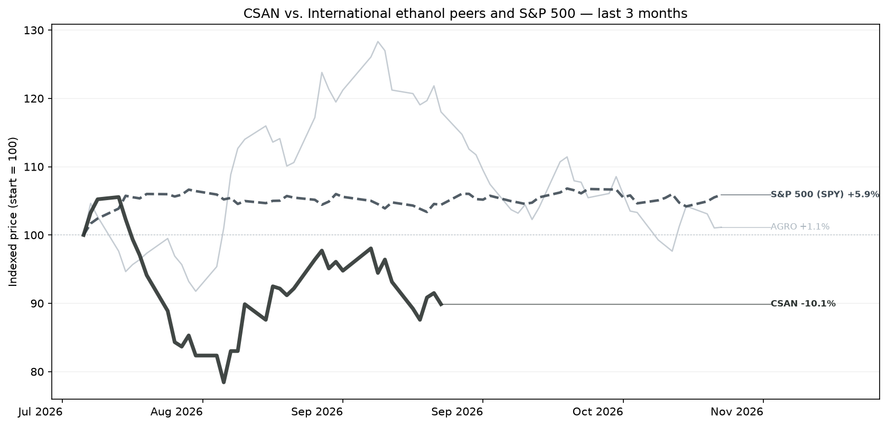

Cosan SA engages in several services throughout the energy and logistics sectors. Its reportable segments are Raizen, Compass, Moove, Rumo, and Radar. It generates the majority of its revenue from Raizen which operates in the production, commercialization, origination, and trading of ethanol, bioenergy, resale, and trading of electricity, renewable sources, marketing, origination, and trading of sugar and fuels, and lubricant.

<h3 id="company-agro">Adecoagro (AGRO)</h3>

*International ethanol · $1.5B · 3m +1.1% · 12m +20.3% · 24m -15.1%*

[Google Finance](https://www.google.com/finance/quote/AGRO:NYSE?tab=earnings&hl=en)

South American farmland and sugar/ethanol producer with U.S.-listed equity.

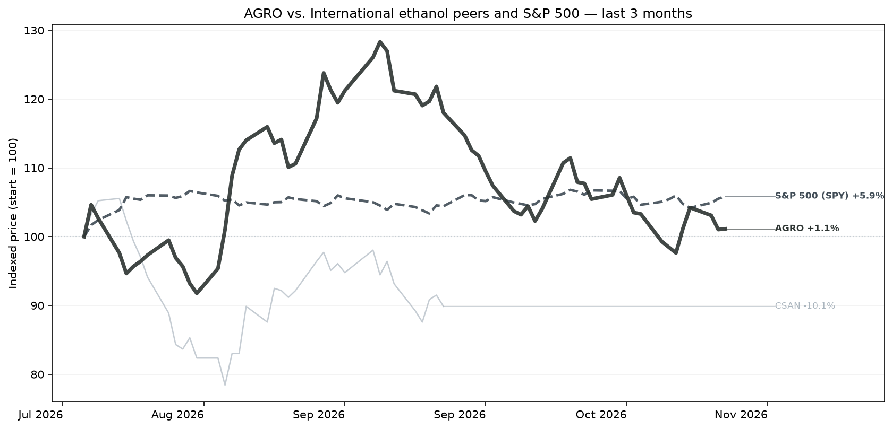

Adecoagro SA is a Luxembourg-based agricultural company. It is involved in a wide range of businesses, including farming crops and other agricultural products, dairy operations sugar, ethanol, energy production, and land transformation. The group operates in two lines of business, namely, Farming and Sugar, Ethanol and Energy. The Farming is further comprised of three reportable segments: Crops, Rice and Dairy. Sugar, Ethanol and Energy Segment, consists of cultivating sugarcane, which is processed in owned sugar mills, transformed into ethanol, sugar and electricity, in addition to biomethane and then marketed.

<h3 id="company-unp">Union Pacific (UNP)</h3>

*Logistics · $179.3B · 3m +1.9% · 12m +37.6% · 24m +28.4%*

[Google Finance](https://www.google.com/finance/quote/UNP:NYSE?tab=earnings&hl=en)

Primary western Class I for Corn Belt corn, ethanol unit trains, DDGS, and corn oil.

Omaha, Nebraska-based Union Pacific is the largest public railroad in North America. Operating on more than 30,000 miles of track in the western two-thirds of the US, Union Pacific generated $24.5 billion of revenue in 2025 by hauling coal, industrial products, intermodal containers, agricultural goods, chemicals, fertilizers, and automotive goods. Union Pacific owns about one-fourth of Mexican railroad Ferromex and historically derives roughly 10% of its revenue hauling freight to and from Mexico.

<h3 id="company-csx">CSX (CSX)</h3>

*Logistics · $93.9B · 3m +2.4% · 12m +47.3% · 24m +56.3%*

[Google Finance](https://www.google.com/finance/quote/CSX:NASDAQ?tab=earnings&hl=en)

Primary eastern Class I into Northeast and Southeast gasoline markets for ethanol unit trains.

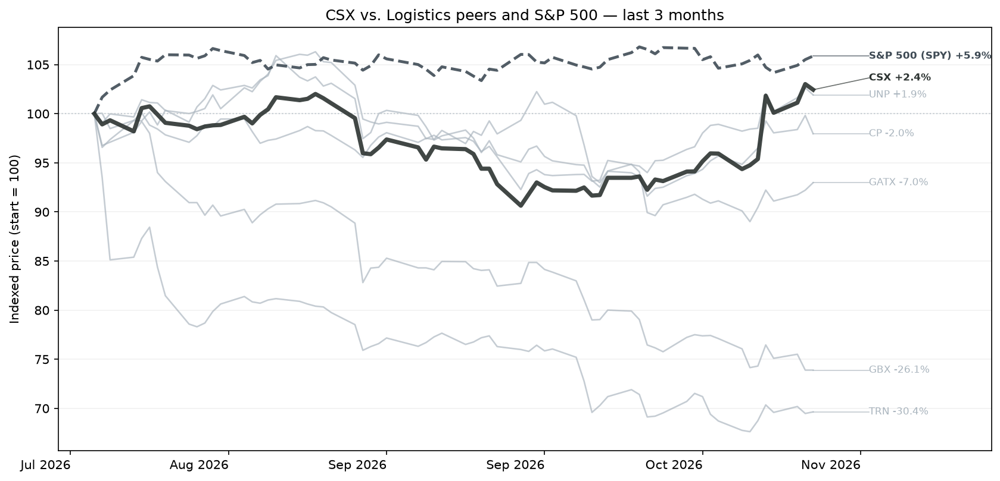

Operating in the Eastern United States, Class I railroad CSX generated revenue of nearly $14 billion in 2025. On its more than 21,000 miles of track, CSX hauls shipments of coal (16% of consolidated revenue), chemicals (17%), intermodal containers (16%), automotive cargo (7%), and a diverse mix of other bulk and industrial merchandise.

<h3 id="company-cp">Canadian Pacific Kansas City (CP)</h3>

*Logistics · $83.0B · 3m -2.0% · 12m +22.2% · 24m +14.7%*

[Google Finance](https://www.google.com/finance/quote/CP:NYSE?tab=earnings&hl=en)

North-south railroad for Midwest corn and ethanol to the Gulf and Mexico.

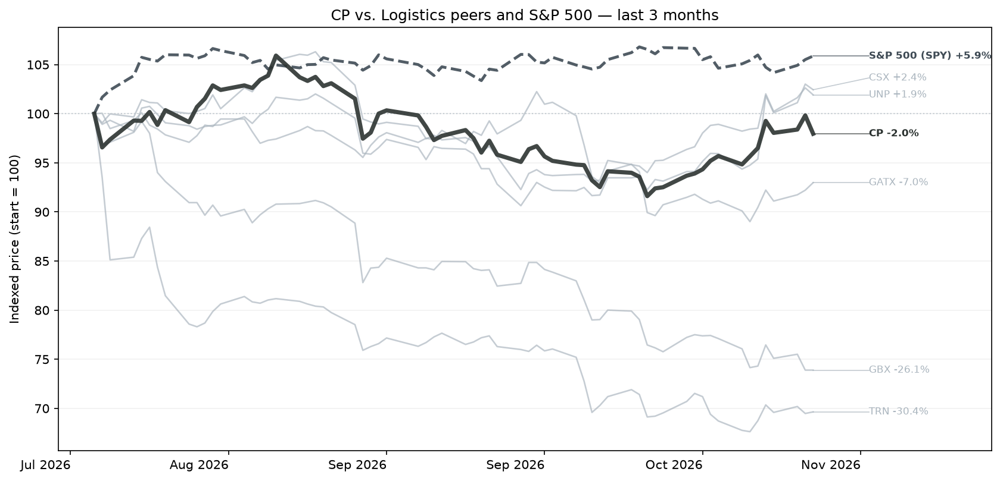

Canadian Pacific Kansas City is a Class I railroad operating on tracks that span most of Canada and into parts of the Midwestern and Northeastern United States. Following the April 2023 Kansas City Southern merger, CPKC operates new single-linehaul services from Canada and the Upper Midwest down through Texas, the Gulf of Mexico, and into Mexico. It also hauls cross-border and intra-Mexico freight via operating concessions on more than 3,000 miles of rail in Mexico. CPKC hauls shipments of grain, intermodal containers, energy products (like crude and frac sand), chemicals, plastics, coal, fertilizer and potash, automotive products, and a diverse mix of other merchandise.

<h3 id="company-gatx">GATX (GATX)</h3>

*Logistics · $6.2B · 3m -7.0% · 12m +6.6% · 24m +21.1%*

[Google Finance](https://www.google.com/finance/quote/GATX:NYSE?tab=earnings&hl=en)

Largest public railcar lessor of ethanol tank cars and grain/DDGS hoppers.

GATX Corp leases transportation assets, including railcars, aircraft spare engines, and tank containers, to customers in North America, Europe, and India. The company's reportable business segments are: Rail North America, Rail International, Engine Leasing, and Other. The majority of its revenue is generated from the Rail North America segment, which is composed of the company's operations in the United States, Canada, and Mexico. This segment mainly provides railcars pursuant to full-service leases under which it maintains the railcars, pays ad valorem taxes and insurance, and provides other ancillary services.

<h3 id="company-trn">Trinity Industries (TRN)</h3>

*Logistics · $2.4B · 3m -30.4% · 12m -8.2% · 24m -28.3%*

[Google Finance](https://www.google.com/finance/quote/TRN:NYSE?tab=earnings&hl=en)

Builds and leases covered hoppers and tank cars used for grain, DDGS, and ethanol.

Trinity Industries Inc sells and leases railroad products and railcar maintenance services in North America. The company operates under the name TrinityRail in two main segments: railcar leasing and management services, which owns railcars and provides fleet management and administration services; rail products, which builds, sells, and modifies freight and tank railcars and their components; and all other, which sells highway products such as guardrail and other highway barriers. Customers include railroads, leasing companies, and shipping companies in agriculture, construction, consumer products, energy, and chemicals.

<h3 id="company-gbx">Greenbrier (GBX)</h3>

*Logistics · $1.4B · 3m -26.1% · 12m -10.8% · 24m -38.8%*

[Google Finance](https://www.google.com/finance/quote/GBX:NYSE?tab=earnings&hl=en)

Builds tank cars used for ethanol, renewable fuels, and CO2.

Greenbrier Companies Inc supplies equipment and services to international freight transportation markets, designing and marketing freight railcars in North America, Europe, and Brazil through subsidiaries and joint ventures. It provides railcar wheel services, parts, maintenance, and conversion services in North America. The company owns a lease fleet sourced mainly from its manufacturing operations and offers railcar management, regulatory compliance, and leasing services to railroads and owners. It operates two segments: Manufacturing and Leasing & Fleet Management, with the majority of revenue from Manufacturing. The company operates in the U.S. and internationally, with the majority of revenue from the U.S. market.

