# Weekly Corn and Ethanol Intel Report

<strong>Week of November 5, 2026</strong>Market data through: November 4, 2026Narrative created: November 6, 2026Nearby corn: $4.400/bu (-$0.113 (-2.5%) week)

Weekly review of corn, ethanol, energy, co-product, policy, and related public-company performance for commodities risk managers at U.S. ethanol plants.

## Strategy Narrative

Nearby futures from Yahoo Finance. Nearby corn is the market&#x27;s current perception of yield and demand risk.

<table><thead><tr><th>Contract</th><th>Last</th><th>Week change</th><th>As of</th></tr></thead><tbody><tr><td>Nearby corn</td><td>$4.400/bu</td><td>-$0.113 (-2.5%)</td><td>November 5, 2026</td></tr><tr><td>RBOB gasoline</td><td>$2.763/gal</td><td>-0.422 (-13.2%)</td><td>November 5, 2026</td></tr><tr><td>Henry Hub</td><td>$2.947/MMBtu</td><td>-0.005 (-0.2%)</td><td>November 5, 2026</td></tr></tbody></table>

<nav class="strategy-narrative-links" aria-label="Strategy narrative sections">
<ul>
<li><a href="#strategy-executive-view-1-better-demand-could-not-dislodge-the-larger-corn-supply-regime">1. Better demand could not dislodge the larger corn-supply regime</a></li>
<li><a href="#strategy-executive-view-2-the-gasoline-selloff-became-the-largest-immediate-margin-threat">2. The gasoline selloff became the largest immediate margin threat</a></li>
<li><a href="#strategy-executive-view-3-exports-are-absorbing-record-season-production-but-the-buffer-is-thin">3. Exports are absorbing record-season production—but the buffer is thin</a></li>
<li><a href="#strategy-executive-view-4-45z-is-becoming-a-balance-sheet-and-consolidation-driver">4. 45Z is becoming a balance-sheet and consolidation driver</a></li>
</ul>
</nav>

<h3 id="executive-view">Executive View</h3>

- **USDA’s larger corn balance sheet remains the controlling regime, and the market strengthened that verdict despite better export demand.** October USDA estimates remain **181.2 bushels per acre, 16.034 billion bushels of production and 1.849 billion bushels of 2026/27 carryout**. Harvest advanced to **74% versus a 77% five-year average**. Nearby corn ended November 5 at **$4.400 per bushel, down $0.113, or 2.5%, for the week**—consistent with ample supply and limited concern that delayed harvest will materially reduce national output. (USDA WAOB, *WASDE*, October 9, 2026; USDA NASS, *Crop Progress*, November 2, 2026.) ([esmis.nal.usda.gov](https://esmis.nal.usda.gov/sites/default/release-files/796099/wasde1026.txt))
- **The petroleum side of the representative margin deteriorated much faster than corn costs improved.** RBOB fell **$0.422 to $2.763 per gallon, down 13.2%**, as oil markets reduced the geopolitical risk premium attached to the Iran conflict and recovering Gulf supply. EIA’s physical gasoline balance was not comparably bearish: stocks slipped 222,000 barrels to **208.958 million**, while gasoline supplied rebounded to **8.808 million barrels per day**. The futures move therefore primarily removes ethanol’s petroleum-price umbrella rather than signaling an immediate collapse in U.S. fuel consumption. (Reuters, *Oil Falls for a Fourth Day on Expectations for Lower Risk of Iran War Escalation*, November 5, 2026; EIA, *Weekly Petroleum Status Report*, November 4, 2026.) ([investing.com](https://www.investing.com/news/commodities-news/oil-falls-for-a-fourth-day-on-expectations-for-lower-risk-of-iran-war-escalation-5002042?utm_source=openai))
- **Ethanol clearance held, but only narrowly, as production climbed again.** Output increased **25,000 barrels per day to 1.143 million**, inventories declined just **89,000 barrels to 24.434 million**, and EIA refiner and blender ethanol inputs were unchanged at **899,000 barrels per day**. September exports remained strong at **209.0 million gallons**, taking January–September shipments to **1.83 billion gallons, 14% above 2025**. (EIA, weekly data released November 4, 2026; Renewable Fuels Association, *September U.S. Ethanol and DDGS Exports Dip but Remain Robust*, November 4, 2026.) ([eia.gov](https://www.eia.gov/dnav/pet/pet_pnp_wprode_s1_w.htm))
- **45Z moved further from modeled value toward financeable cash and asset valuation.** Green Plains agreed to transfer at least **$250 million and up to $325 million** of 2026 credits, including **$140 million of fourth-quarter cash** for credits generated through June. The Andersons separately agreed to acquire Harvestone for **$915 million**, attributing approximately half the price to expected 45Z and 45Q cash flows. These are company-specific economics, but they confirm widening margin dispersion between low-CI plants and conventional producers. (Green Plains, *Agreement to Monetize 2026 45Z Credits*, October 30, 2026; The Andersons, *Agreement to Acquire Harvestone*, November 4, 2026.) ([investor.gpreinc.com](https://investor.gpreinc.com/news/news-details/2026/Green-Plains-Enters-into-Agreement-to-Monetize-2026-45Z-Clean-Fuel-Production-Tax-Credits/default.aspx?utm_source=openai))
- **Overall margin and risk conditions deteriorated:** lower corn helped procurement and Henry Hub was nearly unchanged at **$2.947 per MMBtu**, but the 13.2% RBOB decline and continued production growth shifted the larger near-term risk toward ethanol selling, gasoline linkage and utilization discipline.

| Exposure | Current signal | Change from last week | Horizon | Confidence | Main driver |
|---|---|---:|---|---|---|
| Corn procurement | Ample national supply | Improved | Harvest–Q2 2027 | High | Corn −2.5%; 1.849-billion-bushel carryout |
| Ethanol selling | High production; clearance still export-dependent | Deteriorated modestly | 1–4 weeks | High | Output at 1.143 million bpd |
| Petroleum linkage | Geopolitical premium repriced sharply lower | Deteriorated materially | Days–months | Medium-high | RBOB −13.2% |
| Natural gas | Comfortable storage; stable futures | Broadly unchanged | Winter | High | Henry Hub −0.2% |
| 45Z/low-carbon value | Transferability and asset value increasingly demonstrated | Improved selectively | 2026–29 | Medium-high | Credit monetization and M&A |
| Overall plant margin | Input relief overwhelmed by weaker output linkage | Deteriorated | Near term | Medium | Gasoline collapse versus cheaper corn |

The week’s thesis is **a more secure low-corn-cost regime paired with a materially weaker petroleum output signal**. Strong exports are still preventing high ethanol production from creating a major inventory build, while 45Z is increasingly dividing the sector into low-carbon and conventional margin tiers. Regenerative-ag documentation remains strategically important, and EPA’s November 4 SRE hearing did not resolve whether additional obligations will be split between 2026 and 2027; neither is re-narrated below. ([epa.gov](https://www.epa.gov/renewable-fuel-standard/proposed-reallocation-additional-2025-small-refinery-exemptions?utm_source=openai))

<h3 id="strategy-executive-view-1-better-demand-could-not-dislodge-the-larger-corn-supply-regime">1. Better demand could not dislodge the larger corn-supply regime</h3>

**What happened**

Corn harvest advanced 14 points to **74%**, only three points behind normal. Iowa remained 66% complete versus 79% normally, Nebraska 66% versus 75% and South Dakota 63% versus 75%, preserving local basis and moisture risks without creating a national supply scare. ([esmis.nal.usda.gov](https://esmis.nal.usda.gov/sites/default/release-files/796135/prog4426.txt))

Export demand improved. USDA announced **1.730 million metric tons** of corn sales to Mexico on November 2—although 594,360 tons were for 2027/28—and another **451,000 tons** to Mexico and South Korea on November 3. Weekly net sales were **1.29 million tons**, taking current-year commitments to **24.79 million tons**, approximately 30% of USDA’s forecast but still 34% below last year’s exceptional pace. September corn use for fuel alcohol was **438.4 million bushels, up 1% year over year**. (USDA FAS, export announcements November 2–3 and *Weekly Export Sales*, November 5, 2026; USDA NASS, *Grain Crushings and Co-Products Production*, November 2, 2026.) ([fas-prod.azureedge.us](https://fas-prod.azureedge.us/newsroom/export-sales-mexico-south-korea-and-unknown-destinations-0?utm_source=openai))

**Why it matters**

The demand data establish a floor under corn but do not yet invalidate USDA’s 11.3% stocks-to-use cushion. The 2.5% futures decline despite unusually large flash sales shows that the market continues to assign greater weight to supply.

**Risk-manager implication**

National futures procurement risk improved again. Plants in the slower western Corn Belt should still separate futures coverage from basis exposure: approximately one-quarter of the crop remained unharvested nationally, with larger shares outstanding in Iowa, Nebraska and South Dakota.

**Watch next**

Whether USDA’s November 10 survey reduces yield enough to offset recent export bookings and higher weekly ethanol grind.

---

<h3 id="strategy-executive-view-2-the-gasoline-selloff-became-the-largest-immediate-margin-threat">2. The gasoline selloff became the largest immediate margin threat</h3>

**What happened**

RBOB’s **42.2-cent weekly decline** greatly exceeded corn’s 11.3-cent decline, while Henry Hub was essentially unchanged. Reuters reported that oil markets were pricing a lower probability of further Iran-war escalation and recovering Gulf supply. Domestic gasoline stocks, however, declined slightly and refinery utilization rose to 93.6%, indicating that U.S. petroleum fundamentals alone do not explain the scale of the futures move. ([investing.com](https://www.investing.com/news/commodities-news/oil-falls-for-a-fourth-day-on-expectations-for-lower-risk-of-iran-war-escalation-5002042?utm_source=openai))

Natural-gas working inventories increased **77 Bcf to 3,801 Bcf**, 1.4% above the five-year average; Midwest stocks reached **1,111 Bcf**, 2.0% above average. Process-energy availability is therefore not the binding risk. (EIA, *Weekly Natural Gas Storage Report*, November 5, 2026.) ([eia.gov](https://www.eia.gov/dnav/ng/hist/nw2_epg0_swo_r48_bcfw.htm?utm_source=openai))

**Risk-manager implication**

The output hedge requires closer attention than the input hedge. A standardized public spot-crush value is not sufficiently dependable to quote, but the direction is clear: cheaper corn provides partial relief, while sharply lower gasoline reduces ethanol’s blend-value support and increases the risk that high plant utilization is transmitted into weaker ethanol realizations.

---

<h3 id="strategy-executive-view-3-exports-are-absorbing-record-season-production-but-the-buffer-is-thin">3. Exports are absorbing record-season production—but the buffer is thin</h3>

| EIA ethanol balance | Week ended Oct. 23 | Week ended Oct. 30 | Change |
|---|---:|---:|---:|
| Production, million bpd | 1.118 | 1.143 | +0.025 |
| Inventories, million bbl | 24.523 | 24.434 | −0.089 |
| Refiner/blender inputs, million bpd | 0.899 | 0.899 | — |

(EIA, data released November 4, 2026.) ([eia.gov](https://www.eia.gov/dnav/pet/pet_pnp_wprode_s1_w.htm))

September’s 209.0-million-gallon export total was nearly unchanged from August. Canada took a record **93.5 million gallons**, or 45% of shipments, while the European Union received 42.4 million. DDGS exports fell 16% month over month to **1.09 million metric tons**, but remained 12% higher year to date. ([ethanolrfa.org](https://ethanolrfa.org/media-and-news/category/trade-monitor/article/2026/11/september-u-s-ethanol-and-ddgs-exports-dip-but-remain-robust?utm_source=openai))

**Risk-manager implication**

Exports are validating USDA’s ethanol-use assumption and preventing an immediate stock surge, but concentration in Canada and Europe makes clearance vulnerable to policy, currency or freight disruption. With production already at 1.143 million barrels per day, even a modest export slowdown could turn the small inventory draw into a sizable build.

---

<h3 id="strategy-executive-view-4-45z-is-becoming-a-balance-sheet-and-consolidation-driver">4. 45Z is becoming a balance-sheet and consolidation driver</h3>

Green Plains’ third-quarter release attributed **$65.4 million of adjusted EBITDA** to 45Z value net of discounts and costs, versus $52.6 million from its base business, and raised full-year 45Z contribution guidance to $230–250 million. The Andersons recognized **$27 million** of 45Z credits in the quarter before announcing its Harvestone acquisition. ([stocktitan.net](https://www.stocktitan.net/sec-filings/GPRE/8-k-green-plains-inc-reports-material-event-edfa2eef3a12.html?utm_source=openai))

**Risk-manager implication**

Commodity crush alone is becoming an incomplete plant benchmark. Risk reporting should separately track physical crush, co-product realization, CI eligibility, credit-generation timing, monetization discounts and counterparty exposure. The Harvestone transaction changes ownership—not industry capacity—but could intensify corn origination and low-carbon ethanol competition around its North Dakota and Indiana plants.

<h3 id="strategic-synthesis">Strategic synthesis</h3>

Corn is becoming cheaper while ethanol’s petroleum linkage is becoming less valuable. Export demand currently bridges that gap, but it cannot be assumed to absorb continuously rising production. Simultaneously, 45Z is creating a second earnings layer large enough to influence debt capacity and plant ownership. The strategy entering next week is therefore **retain corn-cost relief, avoid extrapolating current utilization into durable ethanol margin, and benchmark low-carbon credit value separately from commodity operations**.

<h3 id="what-i-m-watching-next">What I’m Watching Next</h3>

- **November 10, 2026, 11:00 a.m. CST:** USDA WASDE and Crop Production—the next test of the 181.2-bushel yield and 1.849-billion-bushel carryout. ([nass.usda.gov](https://www.nass.usda.gov/Publications/Calendar/reports_by_date.php?month=11&view=l&year=2026&utm_source=openai))
- **November 12, 2026, 11:00 a.m. CST:** Delayed EIA petroleum and ethanol report for the week ending November 6. ([eia.gov](https://www.eia.gov/petroleum/supply/weekly/schedule.php?utm_source=openai))
- **December 4, 2026:** EPA comment deadline on additional 2025 SRE reallocation. ([epa.gov](https://www.epa.gov/system/files/documents/2026-10/nprm-frn-rfs-2025-sre-rellocation-2026-10_0.pdf?utm_source=openai))

<h3 id="bottom-line">Bottom Line</h3>

The most consequential weekly change was **not the further decline in corn—it was RBOB’s 13.2% collapse**, which shifted plant risk decisively toward ethanol sales and utilization. Corn procurement remains favorable, but the next USDA report will determine whether the supply cushion expands further; until then, export-dependent ethanol clearance is the exposure requiring the closest attention.

## Notable Changes

Comparison with the final report dated October 29, 2026 (market data through October 28, 2026).

### Sectors

#### Top-three comparison

<table class="sortable"><thead><tr><th class="sortable-heading" data-column="0" data-type="text">Entity</th><th class="sortable-heading" data-column="1" data-type="number">Previous</th><th class="sortable-heading" data-column="2" data-type="number">Current</th><th class="sortable-heading" data-column="3" data-type="number">Change</th><th class="sortable-heading" data-column="4" data-type="number">Current return</th></tr></thead><tbody><tr><td class="text" data-sort="fuel blending, refining, and retail" style=""><a href="#category-fuel-blending-refining-and-retail">Fuel blending, refining, and retail</a></td><td class="" data-sort="1" style="">#1</td><td class="" data-sort="1" style="">#1</td><td class="" data-sort="0" style="">— 0</td><td class="" data-sort="0.9297895849743686" style="background:#1a7a3c;color:#ffffff;">+93.0%</td></tr><tr><td class="text" data-sort="u.s. ethanol and process technology" style=""><a href="#category-u-s-ethanol-and-process-technology">U.S. ethanol and process technology</a></td><td class="" data-sort="2" style="">#2</td><td class="" data-sort="2" style="">#2</td><td class="" data-sort="0" style="">— 0</td><td class="" data-sort="0.8734425666921439" style="background:#1a7a3c;color:#ffffff;">+87.3%</td></tr><tr><td class="text" data-sort="advanced biofuels and saf" style=""><a href="#category-advanced-biofuels-and-saf">Advanced biofuels and SAF</a></td><td class="" data-sort="3" style="">#3</td><td class="" data-sort="3" style="">#3</td><td class="" data-sort="0" style="">— 0</td><td class="" data-sort="0.42119743220227956" style="background:#7cc077;color:#111820;">+42.1%</td></tr></tbody></table>

### Stocks

#### Top-three comparison

<table class="sortable"><thead><tr><th class="sortable-heading" data-column="0" data-type="text">Entity</th><th class="sortable-heading" data-column="1" data-type="number">Previous</th><th class="sortable-heading" data-column="2" data-type="number">Current</th><th class="sortable-heading" data-column="3" data-type="number">Change</th><th class="sortable-heading" data-column="4" data-type="number">Current return</th></tr></thead><tbody><tr><td class="text" data-sort="valero energy" style="">Valero Energy (<a href="#company-vlo">VLO</a>)</td><td class="" data-sort="1" style="">#1</td><td class="" data-sort="1" style="">#1</td><td class="" data-sort="0" style="">— 0</td><td class="" data-sort="1.1472904666745034" style="background:#1a7a3c;color:#ffffff;">+114.7%</td></tr><tr><td class="text" data-sort="marathon petroleum" style=""><a href="#earnings-mpc">Marathon Petroleum</a> (<a href="#company-mpc">MPC</a>)</td><td class="" data-sort="2" style="">#2</td><td class="" data-sort="2" style="">#2</td><td class="" data-sort="0" style="">— 0</td><td class="" data-sort="1.1091416908368243" style="background:#1a7a3c;color:#ffffff;">+110.9%</td></tr><tr><td class="text" data-sort="hf sinclair" style="">HF Sinclair (<a href="#company-dino">DINO</a>)</td><td class="" data-sort="3" style="">#3</td><td class="" data-sort="3" style="">#3</td><td class="" data-sort="0" style="">— 0</td><td class="" data-sort="0.9730188679245282" style="background:#1a7a3c;color:#ffffff;">+97.3%</td></tr></tbody></table>

#### Largest rank changes

<table class="sortable"><thead><tr><th class="sortable-heading" data-column="0" data-type="text">Entity</th><th class="sortable-heading" data-column="1" data-type="number">Previous</th><th class="sortable-heading" data-column="2" data-type="number">Current</th><th class="sortable-heading" data-column="3" data-type="number">Change</th><th class="sortable-heading" data-column="4" data-type="number">Current return</th></tr></thead><tbody><tr><td class="text" data-sort="trinity industries" style=""><a href="#earnings-trn">Trinity Industries</a> (<a href="#company-trn">TRN</a>)</td><td class="" data-sort="33" style="">#33</td><td class="" data-sort="22" style="">#22</td><td class="rank-change-up" data-sort="-11" style="">↑ 11</td><td class="" data-sort="0.21515613099771502" style="background:#1a7a3c;color:#ffffff;">+21.5%</td></tr><tr><td class="text" data-sort="cvr energy" style=""><a href="#earnings-cvi">CVR Energy</a> (<a href="#company-cvi">CVI</a>)</td><td class="" data-sort="10" style="">#10</td><td class="" data-sort="25" style="">#25</td><td class="rank-change-down" data-sort="15" style="">↓ 15</td><td class="" data-sort="0.18779342723004677" style="background:#1a7a3c;color:#ffffff;">+18.8%</td></tr><tr><td class="text" data-sort="the andersons" style=""><a href="#earnings-ande">The Andersons</a> (<a href="#company-ande">ANDE</a>)</td><td class="" data-sort="13" style="">#13</td><td class="" data-sort="28" style="">#28</td><td class="rank-change-down" data-sort="15" style="">↓ 15</td><td class="" data-sort="0.14170792079207928" style="background:#2f9e44;color:#111820;">+14.2%</td></tr></tbody></table>

### Subcategory movement since the previous report

<table class="sortable"><thead><tr><th class="sortable-heading" data-column="0" data-type="text">Subcategory</th><th class="sortable-heading" data-column="1" data-type="number">Move</th><th class="sortable-heading" data-column="2" data-type="number">Last Report, 12m Ret</th><th class="sortable-heading" data-column="3" data-type="number">Current Report, 12m Ret</th></tr></thead><tbody><tr><td class="text" data-sort="crop inputs, equipment, and irrigation" style=""><a href="#category-crop-inputs-equipment-and-irrigation">Crop inputs, equipment, and irrigation</a></td><td class="" data-sort="0.053362341354166905" style="background:#2f9e44;color:#111820;">+5.3%</td><td class="" data-sort="0.0847732512164" style="background:#d6ecd4;color:#111820;">+8.5%</td><td class="" data-sort="0.1431364021958974" style="background:#d6ecd4;color:#111820;">+14.3%</td></tr><tr><td class="text" data-sort="logistics" style=""><a href="#category-logistics">Logistics</a></td><td class="" data-sort="0.03508439510989989" style="background:#7cc077;color:#111820;">+3.5%</td><td class="" data-sort="0.355978068766" style="background:#a9d9a4;color:#111820;">+35.6%</td><td class="" data-sort="0.4100093033593655" style="background:#7cc077;color:#111820;">+41.0%</td></tr><tr><td class="text" data-sort="wet milling, ingredients, and co-products" style=""><a href="#category-wet-milling-ingredients-and-co-products">Wet milling, ingredients, and co-products</a></td><td class="" data-sort="0.019112731866293288" style="background:#a9d9a4;color:#111820;">+1.9%</td><td class="" data-sort="0.117052351801" style="background:#d6ecd4;color:#111820;">+11.7%</td><td class="" data-sort="0.1398846597604211" style="background:#d6ecd4;color:#111820;">+14.0%</td></tr><tr><td class="text" data-sort="international ethanol" style=""><a href="#category-international-ethanol">International ethanol</a></td><td class="" data-sort="-0.022740495242631407" style="background:#f5aead;color:#111820;">-2.3%</td><td class="" data-sort="-0.165541168359" style="background:#fbd5d4;color:#111820;">-16.6%</td><td class="" data-sort="-0.18046282720335646" style="background:#fbd5d4;color:#111820;">-18.0%</td></tr><tr><td class="text" data-sort="advanced biofuels and saf" style=""><a href="#category-advanced-biofuels-and-saf">Advanced biofuels and SAF</a></td><td class="" data-sort="-0.053403141361256456" style="background:#e34948;color:#111820;">-5.3%</td><td class="" data-sort="0.477756286267" style="background:#7cc077;color:#111820;">+47.8%</td><td class="" data-sort="0.42119743220227956" style="background:#7cc077;color:#111820;">+42.1%</td></tr><tr><td class="text" data-sort="u.s. ethanol and process technology" style=""><a href="#category-u-s-ethanol-and-process-technology">U.S. ethanol and process technology</a></td><td class="" data-sort="-0.065861233888695" style="background:#c0302f;color:#ffffff;">-6.6%</td><td class="" data-sort="0.972449579878" style="background:#1a7a3c;color:#ffffff;">+97.2%</td><td class="" data-sort="0.8734425666921439" style="background:#1a7a3c;color:#ffffff;">+87.3%</td></tr><tr><td class="text" data-sort="fuel blending, refining, and retail" style=""><a href="#category-fuel-blending-refining-and-retail">Fuel blending, refining, and retail</a></td><td class="" data-sort="-0.06803173592510404" style="background:#c0302f;color:#ffffff;">-6.8%</td><td class="" data-sort="1.03029066971" style="background:#1a7a3c;color:#ffffff;">+103.0%</td><td class="" data-sort="0.9297895849743686" style="background:#1a7a3c;color:#ffffff;">+93.0%</td></tr><tr><td class="text" data-sort="grain origination and agribusiness" style=""><a href="#category-grain-origination-and-agribusiness">Grain origination and agribusiness</a></td><td class="" data-sort="-0.06909702566632309" style="background:#c0302f;color:#ffffff;">-6.9%</td><td class="" data-sort="0.20074087155" style="background:#d6ecd4;color:#111820;">+20.1%</td><td class="" data-sort="0.1697727023597663" style="background:#d6ecd4;color:#111820;">+17.0%</td></tr></tbody></table>

### Largest company moves

<table class="sortable"><thead><tr><th class="sortable-heading" data-column="0" data-type="text">Direction</th><th class="sortable-heading" data-column="1" data-type="text">Company</th><th class="sortable-heading" data-column="2" data-type="text">Ticker</th><th class="sortable-heading" data-column="3" data-type="number">Move</th></tr></thead><tbody><tr><td class="text" data-sort="0" style="">Gain</td><td class="text" data-sort="trinity industries" style=""><a href="#earnings-trn">Trinity Industries</a></td><td class="text text" data-sort="trn" style=""><a href="#company-trn">TRN</a></td><td class="" data-sort="0.24843505477308292" style="background:#1a7a3c;color:#ffffff;">+24.8%</td></tr><tr><td class="text" data-sort="0" style="">Gain</td><td class="text" data-sort="mosaic" style=""><a href="#earnings-mos">Mosaic</a></td><td class="text text" data-sort="mos" style=""><a href="#company-mos">MOS</a></td><td class="" data-sort="0.17948717948717974" style="background:#2f9e44;color:#111820;">+17.9%</td></tr><tr><td class="text" data-sort="0" style="">Gain</td><td class="text" data-sort="greenbrier" style="">Greenbrier</td><td class="text text" data-sort="gbx" style=""><a href="#company-gbx">GBX</a></td><td class="" data-sort="0.17529348986125926" style="background:#2f9e44;color:#111820;">+17.5%</td></tr><tr><td class="text" data-sort="1" style="">Decline</td><td class="text" data-sort="cvr energy" style=""><a href="#earnings-cvi">CVR Energy</a></td><td class="text text" data-sort="cvi" style=""><a href="#company-cvi">CVI</a></td><td class="" data-sort="-0.2463641142456633" style="background:#c0302f;color:#ffffff;">-24.6%</td></tr><tr><td class="text" data-sort="1" style="">Decline</td><td class="text" data-sort="the andersons" style=""><a href="#earnings-ande">The Andersons</a></td><td class="text text" data-sort="ande" style=""><a href="#company-ande">ANDE</a></td><td class="" data-sort="-0.13811896605418872" style="background:#ee8483;color:#111820;">-13.8%</td></tr><tr><td class="text" data-sort="1" style="">Decline</td><td class="text" data-sort="marathon petroleum" style=""><a href="#earnings-mpc">Marathon Petroleum</a></td><td class="text text" data-sort="mpc" style=""><a href="#company-mpc">MPC</a></td><td class="" data-sort="-0.10910452163259743" style="background:#ee8483;color:#111820;">-10.9%</td></tr></tbody></table>

## Subcategory Performance

<table class="sortable"><thead><tr><th class="sortable-heading" data-column="0" data-type="text">Subcategory</th><th class="sortable-heading" data-column="1" data-type="number">Companies</th><th class="sortable-heading" data-column="2" data-type="number">Market cap</th><th class="sortable-heading" data-column="3" data-type="number">3m Return</th><th class="sortable-heading" data-column="4" data-type="number">12m Return</th><th class="sortable-heading" data-column="5" data-type="number">24m Return</th></tr></thead><tbody><tr><td class="text" data-sort="crop inputs, equipment, and irrigation" style=""><a href="#category-crop-inputs-equipment-and-irrigation">Crop inputs, equipment, and irrigation</a></td><td class="" data-sort="11" style="">11</td><td class="" data-sort="300745184478.91" style="">$300.7B</td><td class="" data-sort="-0.08605558619691306" style="background:#ee8483;color:#111820;">-8.6%</td><td class="" data-sort="0.1431364021958974" style="background:#d6ecd4;color:#111820;">+14.3%</td><td class="" data-sort="0.29608495828646736" style="background:#a9d9a4;color:#111820;">+29.6%</td></tr><tr><td class="text" data-sort="grain origination and agribusiness" style=""><a href="#category-grain-origination-and-agribusiness">Grain origination and agribusiness</a></td><td class="" data-sort="3" style="">3</td><td class="" data-sort="63125801301.18" style="">$63.1B</td><td class="" data-sort="-0.0923663216270124" style="background:#ee8483;color:#111820;">-9.2%</td><td class="" data-sort="0.1697727023597663" style="background:#d6ecd4;color:#111820;">+17.0%</td><td class="" data-sort="0.2833798469241992" style="background:#a9d9a4;color:#111820;">+28.3%</td></tr><tr><td class="text" data-sort="u.s. ethanol and process technology" style=""><a href="#category-u-s-ethanol-and-process-technology">U.S. ethanol and process technology</a></td><td class="" data-sort="6" style="">6</td><td class="" data-sort="143490589721.54" style="">$143.5B</td><td class="" data-sort="0.11538981924523417" style="background:#7cc077;color:#111820;">+11.5%</td><td class="" data-sort="0.8734425666921439" style="background:#1a7a3c;color:#ffffff;">+87.3%</td><td class="" data-sort="1.3376832925995907" style="background:#1a7a3c;color:#ffffff;">+133.8%</td></tr><tr><td class="text" data-sort="wet milling, ingredients, and co-products" style=""><a href="#category-wet-milling-ingredients-and-co-products">Wet milling, ingredients, and co-products</a></td><td class="" data-sort="5" style="">5</td><td class="" data-sort="122070417790.07" style="">$122.1B</td><td class="" data-sort="-0.05379156401653515" style="background:#f5aead;color:#111820;">-5.4%</td><td class="" data-sort="0.1398846597604211" style="background:#d6ecd4;color:#111820;">+14.0%</td><td class="" data-sort="0.19649011404971725" style="background:#d6ecd4;color:#111820;">+19.6%</td></tr><tr><td class="text" data-sort="fuel blending, refining, and retail" style=""><a href="#category-fuel-blending-refining-and-retail">Fuel blending, refining, and retail</a></td><td class="" data-sort="8" style="">8</td><td class="" data-sort="374068702481.42" style="">$374.1B</td><td class="" data-sort="0.2044695621414681" style="background:#1a7a3c;color:#ffffff;">+20.4%</td><td class="" data-sort="0.9297895849743686" style="background:#1a7a3c;color:#ffffff;">+93.0%</td><td class="" data-sort="1.358819199658391" style="background:#1a7a3c;color:#ffffff;">+135.9%</td></tr><tr><td class="text" data-sort="advanced biofuels and saf" style=""><a href="#category-advanced-biofuels-and-saf">Advanced biofuels and SAF</a></td><td class="" data-sort="2" style="">2</td><td class="" data-sort="403619489658.24" style="">$403.6B</td><td class="" data-sort="0.1638860576149348" style="background:#1a7a3c;color:#ffffff;">+16.4%</td><td class="" data-sort="0.42119743220227956" style="background:#7cc077;color:#111820;">+42.1%</td><td class="" data-sort="0.41424939704061026" style="background:#a9d9a4;color:#111820;">+41.4%</td></tr><tr><td class="text" data-sort="international ethanol" style=""><a href="#category-international-ethanol">International ethanol</a></td><td class="" data-sort="2" style="">2</td><td class="" data-sort="4030007905.26" style="">$4.0B</td><td class="" data-sort="-0.06173289596912641" style="background:#f5aead;color:#111820;">-6.2%</td><td class="" data-sort="-0.18046282720335646" style="background:#fbd5d4;color:#111820;">-18.0%</td><td class="" data-sort="-0.4865527965621717" style="background:#f5aead;color:#111820;">-48.7%</td></tr><tr><td class="text" data-sort="logistics" style=""><a href="#category-logistics">Logistics</a></td><td class="" data-sort="6" style="">6</td><td class="" data-sort="366182560910.12" style="">$366.2B</td><td class="" data-sort="0.034035938603986605" style="background:#d6ecd4;color:#111820;">+3.4%</td><td class="" data-sort="0.4100093033593655" style="background:#7cc077;color:#111820;">+41.0%</td><td class="" data-sort="0.3395319908932192" style="background:#a9d9a4;color:#111820;">+34.0%</td></tr></tbody></table>

Subcategory returns use the most recently saved market capitalizations as weights.

## Stock Performance vs. SPY

The same selected stocks appear in every chart. Each line is labeled at the right with its ticker and return for the displayed window.
### Last 6 months

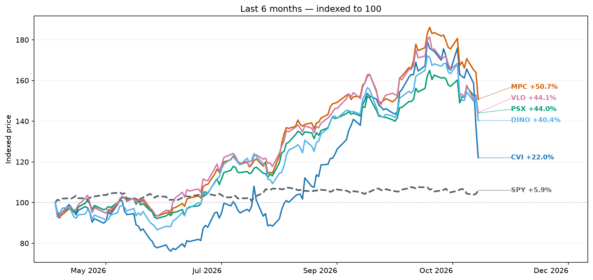

### Last 12 months

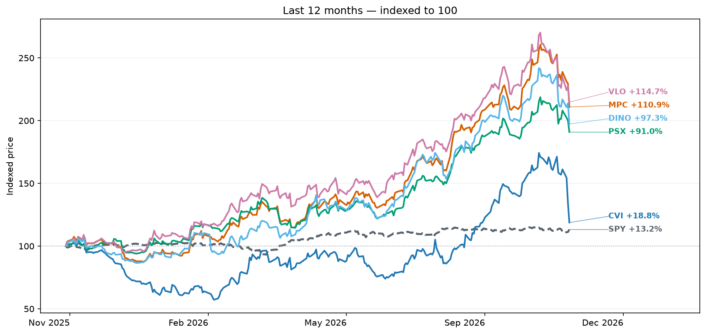

### Last 24 months

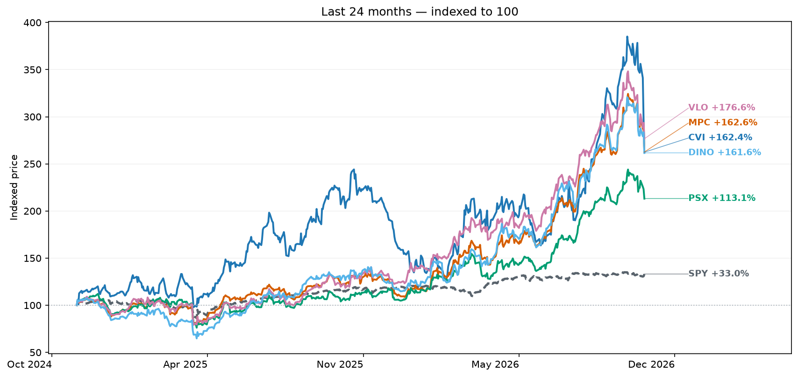

## Current Top Stocks

### Last 3 months

<table class="sortable"><thead><tr><th class="sortable-heading" data-column="0" data-type="number">Rank</th><th class="sortable-heading" data-column="1" data-type="text">Company</th><th class="sortable-heading" data-column="2" data-type="text">Ticker</th><th class="sortable-heading" data-column="3" data-type="number">Market cap</th><th class="sortable-heading" data-column="4" data-type="number">Return</th></tr></thead><tbody><tr><td class="" data-sort="1" style="">1</td><td class="text" data-sort="cvr energy" style=""><a href="#earnings-cvi">CVR Energy</a></td><td class="text text" data-sort="cvi" style=""><a href="#company-cvi">CVI</a></td><td class="" data-sort="3689472983.3" style="">$3.7B</td><td class="" data-sort="0.378525641025641" style="background:#1a7a3c;color:#ffffff;">+37.9%</td></tr><tr><td class="" data-sort="2" style="">2</td><td class="text" data-sort="marathon petroleum" style=""><a href="#earnings-mpc">Marathon Petroleum</a></td><td class="text text" data-sort="mpc" style=""><a href="#company-mpc">MPC</a></td><td class="" data-sort="101307533252.25" style="">$101.3B</td><td class="" data-sort="0.31882451721242666" style="background:#1a7a3c;color:#ffffff;">+31.9%</td></tr><tr><td class="" data-sort="3" style="">3</td><td class="text" data-sort="phillips 66" style="">Phillips 66</td><td class="text text" data-sort="psx" style=""><a href="#company-psx">PSX</a></td><td class="" data-sort="96678777737.64" style="">$96.7B</td><td class="" data-sort="0.2818069612441372" style="background:#2f9e44;color:#111820;">+28.2%</td></tr><tr><td class="" data-sort="4" style="">4</td><td class="text" data-sort="hf sinclair" style="">HF Sinclair</td><td class="text text" data-sort="dino" style=""><a href="#company-dino">DINO</a></td><td class="" data-sort="16821907792.380001" style="">$16.8B</td><td class="" data-sort="0.26018317666907675" style="background:#2f9e44;color:#111820;">+26.0%</td></tr><tr><td class="" data-sort="5" style="">5</td><td class="text" data-sort="valero energy" style="">Valero Energy</td><td class="text text" data-sort="vlo" style=""><a href="#company-vlo">VLO</a></td><td class="" data-sort="99697762645.86" style="">$99.7B</td><td class="" data-sort="0.2081748735077218" style="background:#7cc077;color:#111820;">+20.8%</td></tr></tbody></table>

### Last 12 months

<table class="sortable"><thead><tr><th class="sortable-heading" data-column="0" data-type="number">Rank</th><th class="sortable-heading" data-column="1" data-type="text">Company</th><th class="sortable-heading" data-column="2" data-type="text">Ticker</th><th class="sortable-heading" data-column="3" data-type="number">Market cap</th><th class="sortable-heading" data-column="4" data-type="number">Return</th></tr></thead><tbody><tr><td class="" data-sort="1" style="">1</td><td class="text" data-sort="valero energy" style="">Valero Energy</td><td class="text text" data-sort="vlo" style=""><a href="#company-vlo">VLO</a></td><td class="" data-sort="99697762645.86" style="">$99.7B</td><td class="" data-sort="1.1472904666745034" style="background:#1a7a3c;color:#ffffff;">+114.7%</td></tr><tr><td class="" data-sort="2" style="">2</td><td class="text" data-sort="marathon petroleum" style=""><a href="#earnings-mpc">Marathon Petroleum</a></td><td class="text text" data-sort="mpc" style=""><a href="#company-mpc">MPC</a></td><td class="" data-sort="101307533252.25" style="">$101.3B</td><td class="" data-sort="1.1091416908368243" style="background:#1a7a3c;color:#ffffff;">+110.9%</td></tr><tr><td class="" data-sort="3" style="">3</td><td class="text" data-sort="hf sinclair" style="">HF Sinclair</td><td class="text text" data-sort="dino" style=""><a href="#company-dino">DINO</a></td><td class="" data-sort="16821907792.380001" style="">$16.8B</td><td class="" data-sort="0.9730188679245282" style="background:#1a7a3c;color:#ffffff;">+97.3%</td></tr><tr><td class="" data-sort="4" style="">4</td><td class="text" data-sort="phillips 66" style="">Phillips 66</td><td class="text text" data-sort="psx" style=""><a href="#company-psx">PSX</a></td><td class="" data-sort="96678777737.64" style="">$96.7B</td><td class="" data-sort="0.9100272198925916" style="background:#2f9e44;color:#111820;">+91.0%</td></tr><tr><td class="" data-sort="5" style="">5</td><td class="text" data-sort="bayer" style="">Bayer</td><td class="text text" data-sort="bayry" style=""><a href="#company-bayry">BAYRY</a></td><td class="" data-sort="n/a" style="">n/a</td><td class="" data-sort="0.8350923482849604" style="background:#2f9e44;color:#111820;">+83.5%</td></tr></tbody></table>

### Last 24 months

<table class="sortable"><thead><tr><th class="sortable-heading" data-column="0" data-type="number">Rank</th><th class="sortable-heading" data-column="1" data-type="text">Company</th><th class="sortable-heading" data-column="2" data-type="text">Ticker</th><th class="sortable-heading" data-column="3" data-type="number">Market cap</th><th class="sortable-heading" data-column="4" data-type="number">Return</th></tr></thead><tbody><tr><td class="" data-sort="1" style="">1</td><td class="text" data-sort="valero energy" style="">Valero Energy</td><td class="text text" data-sort="vlo" style=""><a href="#company-vlo">VLO</a></td><td class="" data-sort="99697762645.86" style="">$99.7B</td><td class="" data-sort="1.7664697864606995" style="background:#1a7a3c;color:#ffffff;">+176.6%</td></tr><tr><td class="" data-sort="2" style="">2</td><td class="text" data-sort="marathon petroleum" style=""><a href="#earnings-mpc">Marathon Petroleum</a></td><td class="text text" data-sort="mpc" style=""><a href="#company-mpc">MPC</a></td><td class="" data-sort="101307533252.25" style="">$101.3B</td><td class="" data-sort="1.6255683337790852" style="background:#1a7a3c;color:#ffffff;">+162.6%</td></tr><tr><td class="" data-sort="3" style="">3</td><td class="text" data-sort="cvr energy" style=""><a href="#earnings-cvi">CVR Energy</a></td><td class="text text" data-sort="cvi" style=""><a href="#company-cvi">CVI</a></td><td class="" data-sort="3689472983.3" style="">$3.7B</td><td class="" data-sort="1.624161073825503" style="background:#1a7a3c;color:#ffffff;">+162.4%</td></tr><tr><td class="" data-sort="4" style="">4</td><td class="text" data-sort="hf sinclair" style="">HF Sinclair</td><td class="text text" data-sort="dino" style=""><a href="#company-dino">DINO</a></td><td class="" data-sort="16821907792.380001" style="">$16.8B</td><td class="" data-sort="1.6155577788894449" style="background:#1a7a3c;color:#ffffff;">+161.6%</td></tr><tr><td class="" data-sort="5" style="">5</td><td class="text" data-sort="neste" style="">Neste</td><td class="text text" data-sort="ntoiy" style=""><a href="#company-ntoiy">NTOIY</a></td><td class="" data-sort="n/a" style="">n/a</td><td class="" data-sort="1.2411067193675893" style="background:#2f9e44;color:#111820;">+124.1%</td></tr></tbody></table>

## Companies by Subcategory

<h3 id="category-crop-inputs-equipment-and-irrigation"><a href="#subcategory-performance">Crop inputs, equipment, and irrigation</a>Last 3m: -8.6%</h3>

<table class="sortable"><thead><tr><th class="sortable-heading" data-column="0" data-type="text">Company</th><th class="sortable-heading" data-column="1" data-type="text">Ticker</th><th class="sortable-heading" data-column="2" data-type="number">Market cap</th><th class="sortable-heading" data-column="3" data-type="number">3m Return</th><th class="sortable-heading" data-column="4" data-type="number">12m Return</th><th class="sortable-heading" data-column="5" data-type="number">24m Return</th></tr></thead><tbody><tr><td class="text" data-sort="corteva" style="">Corteva</td><td class="text text" data-sort="ctva" style=""><a href="#company-ctva">CTVA</a></td><td class="" data-sort="52421589719.99999" style="">$52.4B</td><td class="" data-sort="-0.8441591457989068" style="background:#c0302f;color:#ffffff;">-84.4%</td><td class="" data-sort="-0.8074446364064709" style="background:#c0302f;color:#ffffff;">-80.7%</td><td class="" data-sort="-0.8014574898785425" style="background:#e34948;color:#111820;">-80.1%</td></tr><tr><td class="text" data-sort="bayer" style="">Bayer</td><td class="text text" data-sort="bayry" style=""><a href="#company-bayry">BAYRY</a></td><td class="" data-sort="n/a" style="">n/a</td><td class="" data-sort="-0.0231741573033708" style="background:#fbd5d4;color:#111820;">-2.3%</td><td class="" data-sort="0.8350923482849604" style="background:#1a7a3c;color:#ffffff;">+83.5%</td><td class="" data-sort="1.057692307692308" style="background:#1a7a3c;color:#ffffff;">+105.8%</td></tr><tr><td class="text" data-sort="basf" style="">BASF</td><td class="text text" data-sort="basfy" style=""><a href="#company-basfy">BASFY</a></td><td class="" data-sort="n/a" style="">n/a</td><td class="" data-sort="0.006147540983606481" style="background:#d6ecd4;color:#111820;">+0.6%</td><td class="" data-sort="0.194647201946472" style="background:#a9d9a4;color:#111820;">+19.5%</td><td class="" data-sort="0.22852376980817346" style="background:#a9d9a4;color:#111820;">+22.9%</td></tr><tr><td class="text" data-sort="nutrien" style="">Nutrien</td><td class="text text" data-sort="ntr" style=""><a href="#company-ntr">NTR</a></td><td class="" data-sort="33643310217.0" style="">$33.6B</td><td class="" data-sort="0.07695756126718467" style="background:#d6ecd4;color:#111820;">+7.7%</td><td class="" data-sort="0.3346296296296296" style="background:#7cc077;color:#111820;">+33.5%</td><td class="" data-sort="0.4234643492000787" style="background:#7cc077;color:#111820;">+42.3%</td></tr><tr><td class="text" data-sort="cf industries" style=""><a href="#earnings-cf">CF Industries</a></td><td class="text text" data-sort="cf" style=""><a href="#company-cf">CF</a></td><td class="" data-sort="18012264232.6" style="">$18.0B</td><td class="" data-sort="-0.04309827778253783" style="background:#fbd5d4;color:#111820;">-4.3%</td><td class="" data-sort="0.3131099353321576" style="background:#a9d9a4;color:#111820;">+31.3%</td><td class="" data-sort="0.290203327171904" style="background:#a9d9a4;color:#111820;">+29.0%</td></tr><tr><td class="text" data-sort="yara international" style="">Yara International</td><td class="text text" data-sort="yariy" style=""><a href="#company-yariy">YARIY</a></td><td class="" data-sort="n/a" style="">n/a</td><td class="" data-sort="-0.002919380193128318" style="background:#fbd5d4;color:#111820;">-0.3%</td><td class="" data-sort="0.2174389909514669" style="background:#a9d9a4;color:#111820;">+21.7%</td><td class="" data-sort="0.4619690484030292" style="background:#7cc077;color:#111820;">+46.2%</td></tr><tr><td class="text" data-sort="mosaic" style=""><a href="#earnings-mos">Mosaic</a></td><td class="text text" data-sort="mos" style=""><a href="#company-mos">MOS</a></td><td class="" data-sort="7066820210.58" style="">$7.1B</td><td class="" data-sort="-0.07646304997864162" style="background:#fbd5d4;color:#111820;">-7.6%</td><td class="" data-sort="-0.17543859649122795" style="background:#f5aead;color:#111820;">-17.5%</td><td class="" data-sort="-0.23005698005697994" style="background:#f5aead;color:#111820;">-23.0%</td></tr><tr><td class="text" data-sort="deere" style="">Deere</td><td class="text text" data-sort="de" style=""><a href="#company-de">DE</a></td><td class="" data-sort="156733767077.75" style="">$156.7B</td><td class="" data-sort="0.10539215686274517" style="background:#d6ecd4;color:#111820;">+10.5%</td><td class="" data-sort="0.42814921150963703" style="background:#7cc077;color:#111820;">+42.8%</td><td class="" data-sort="0.6896870394884731" style="background:#2f9e44;color:#111820;">+69.0%</td></tr><tr><td class="text" data-sort="cnh industrial" style="">CNH Industrial</td><td class="text text" data-sort="cnh" style=""><a href="#company-cnh">CNH</a></td><td class="" data-sort="16547953475.759998" style="">$16.5B</td><td class="" data-sort="0.08526413345690464" style="background:#d6ecd4;color:#111820;">+8.5%</td><td class="" data-sort="0.11843361986628453" style="background:#d6ecd4;color:#111820;">+11.8%</td><td class="" data-sort="0.040888888888888975" style="background:#d6ecd4;color:#111820;">+4.1%</td></tr><tr><td class="text" data-sort="agco" style=""><a href="#earnings-agco">AGCO</a></td><td class="text text" data-sort="agco" style=""><a href="#company-agco">AGCO</a></td><td class="" data-sort="6969557670.08" style="">$7.0B</td><td class="" data-sort="0.08533179235288446" style="background:#d6ecd4;color:#111820;">+8.5%</td><td class="" data-sort="0.055446286410040235" style="background:#d6ecd4;color:#111820;">+5.5%</td><td class="" data-sort="0.24891942812811685" style="background:#a9d9a4;color:#111820;">+24.9%</td></tr><tr><td class="text" data-sort="valmont industries" style="">Valmont Industries</td><td class="text text" data-sort="vmi" style=""><a href="#company-vmi">VMI</a></td><td class="" data-sort="9349921875.14" style="">$9.3B</td><td class="" data-sort="-0.15243755036261075" style="background:#fbd5d4;color:#111820;">-15.2%</td><td class="" data-sort="0.028377982010168168" style="background:#d6ecd4;color:#111820;">+2.8%</td><td class="" data-sort="0.289080213248361" style="background:#a9d9a4;color:#111820;">+28.9%</td></tr></tbody></table>

<h3 id="category-grain-origination-and-agribusiness"><a href="#subcategory-performance">Grain origination and agribusiness</a>Last 3m: -9.2%</h3>

<table class="sortable"><thead><tr><th class="sortable-heading" data-column="0" data-type="text">Company</th><th class="sortable-heading" data-column="1" data-type="text">Ticker</th><th class="sortable-heading" data-column="2" data-type="number">Market cap</th><th class="sortable-heading" data-column="3" data-type="number">3m Return</th><th class="sortable-heading" data-column="4" data-type="number">12m Return</th><th class="sortable-heading" data-column="5" data-type="number">24m Return</th></tr></thead><tbody><tr><td class="text" data-sort="archer daniels midland" style=""><a href="#earnings-adm">Archer Daniels Midland</a></td><td class="text text" data-sort="adm" style=""><a href="#company-adm">ADM</a></td><td class="" data-sort="38923055923.08" style="">$38.9B</td><td class="" data-sort="-0.0868780613560195" style="background:#ee8483;color:#111820;">-8.7%</td><td class="" data-sort="0.2584828566352817" style="background:#1a7a3c;color:#ffffff;">+25.8%</td><td class="" data-sort="0.36230769230769244" style="background:#1a7a3c;color:#ffffff;">+36.2%</td></tr><tr><td class="text" data-sort="bunge" style=""><a href="#earnings-bg">Bunge</a></td><td class="text text" data-sort="bg" style=""><a href="#company-bg">BG</a></td><td class="" data-sort="21901580022.0" style="">$21.9B</td><td class="" data-sort="-0.0901331832676796" style="background:#ee8483;color:#111820;">-9.0%</td><td class="" data-sort="0.015067489798053835" style="background:#d6ecd4;color:#111820;">+1.5%</td><td class="" data-sort="0.14398584905660394" style="background:#a9d9a4;color:#111820;">+14.4%</td></tr><tr><td class="text" data-sort="the andersons" style=""><a href="#earnings-ande">The Andersons</a></td><td class="text text" data-sort="ande" style=""><a href="#company-ande">ANDE</a></td><td class="" data-sort="2301165356.1" style="">$2.3B</td><td class="" data-sort="-0.20645161290322578" style="background:#c0302f;color:#ffffff;">-20.6%</td><td class="" data-sort="0.14170792079207928" style="background:#7cc077;color:#111820;">+14.2%</td><td class="" data-sort="0.27505183137525924" style="background:#2f9e44;color:#111820;">+27.5%</td></tr></tbody></table>

<h3 id="category-u-s-ethanol-and-process-technology"><a href="#subcategory-performance">U.S. ethanol and process technology</a>Last 3m: +11.5%</h3>

<table class="sortable"><thead><tr><th class="sortable-heading" data-column="0" data-type="text">Company</th><th class="sortable-heading" data-column="1" data-type="text">Ticker</th><th class="sortable-heading" data-column="2" data-type="number">Market cap</th><th class="sortable-heading" data-column="3" data-type="number">3m Return</th><th class="sortable-heading" data-column="4" data-type="number">12m Return</th><th class="sortable-heading" data-column="5" data-type="number">24m Return</th></tr></thead><tbody><tr><td class="text" data-sort="valero energy" style="">Valero Energy</td><td class="text text" data-sort="vlo" style=""><a href="#company-vlo">VLO</a></td><td class="" data-sort="99697762645.86" style="">$99.7B</td><td class="" data-sort="0.2081748735077218" style="background:#1a7a3c;color:#ffffff;">+20.8%</td><td class="" data-sort="1.1472904666745034" style="background:#1a7a3c;color:#ffffff;">+114.7%</td><td class="" data-sort="1.7664697864606995" style="background:#1a7a3c;color:#ffffff;">+176.6%</td></tr><tr><td class="text" data-sort="green plains" style=""><a href="#earnings-gpre">Green Plains</a></td><td class="text text" data-sort="gpre" style=""><a href="#company-gpre">GPRE</a></td><td class="" data-sort="1123628107.8400002" style="">$1.1B</td><td class="" data-sort="-0.17161916312916914" style="background:#c0302f;color:#ffffff;">-17.2%</td><td class="" data-sort="0.21099290780141855" style="background:#d6ecd4;color:#111820;">+21.1%</td><td class="" data-sort="0.06138306138306149" style="background:#d6ecd4;color:#111820;">+6.1%</td></tr><tr><td class="text" data-sort="rex american resources" style="">REX American Resources</td><td class="text text" data-sort="rex" style=""><a href="#company-rex">REX</a></td><td class="" data-sort="1444977688.6599998" style="">$1.4B</td><td class="" data-sort="-0.10224438902743138" style="background:#ee8483;color:#111820;">-10.2%</td><td class="" data-sort="0.22448979591836715" style="background:#d6ecd4;color:#111820;">+22.4%</td><td class="" data-sort="0.7113223854796888" style="background:#7cc077;color:#111820;">+71.1%</td></tr><tr><td class="text" data-sort="novonesis" style="">Novonesis</td><td class="text text" data-sort="nvzmy" style=""><a href="#company-nvzmy">NVZMY</a></td><td class="" data-sort="n/a" style="">n/a</td><td class="" data-sort="-0.014870458378046902" style="background:#fbd5d4;color:#111820;">-1.5%</td><td class="" data-sort="0.08072653884964698" style="background:#d6ecd4;color:#111820;">+8.1%</td><td class="" data-sort="0.02931283037001453" style="background:#d6ecd4;color:#111820;">+2.9%</td></tr><tr><td class="text" data-sort="archer daniels midland" style=""><a href="#earnings-adm">Archer Daniels Midland</a></td><td class="text text" data-sort="adm" style=""><a href="#company-adm">ADM</a></td><td class="" data-sort="38923055923.08" style="">$38.9B</td><td class="" data-sort="-0.0868780613560195" style="background:#ee8483;color:#111820;">-8.7%</td><td class="" data-sort="0.2584828566352817" style="background:#a9d9a4;color:#111820;">+25.8%</td><td class="" data-sort="0.36230769230769244" style="background:#a9d9a4;color:#111820;">+36.2%</td></tr><tr><td class="text" data-sort="the andersons" style=""><a href="#earnings-ande">The Andersons</a></td><td class="text text" data-sort="ande" style=""><a href="#company-ande">ANDE</a></td><td class="" data-sort="2301165356.1" style="">$2.3B</td><td class="" data-sort="-0.20645161290322578" style="background:#c0302f;color:#ffffff;">-20.6%</td><td class="" data-sort="0.14170792079207928" style="background:#d6ecd4;color:#111820;">+14.2%</td><td class="" data-sort="0.27505183137525924" style="background:#d6ecd4;color:#111820;">+27.5%</td></tr></tbody></table>

<h3 id="category-wet-milling-ingredients-and-co-products"><a href="#subcategory-performance">Wet milling, ingredients, and co-products</a>Last 3m: -5.4%</h3>

<table class="sortable"><thead><tr><th class="sortable-heading" data-column="0" data-type="text">Company</th><th class="sortable-heading" data-column="1" data-type="text">Ticker</th><th class="sortable-heading" data-column="2" data-type="number">Market cap</th><th class="sortable-heading" data-column="3" data-type="number">3m Return</th><th class="sortable-heading" data-column="4" data-type="number">12m Return</th><th class="sortable-heading" data-column="5" data-type="number">24m Return</th></tr></thead><tbody><tr><td class="text" data-sort="ingredion" style=""><a href="#earnings-ingr">Ingredion</a></td><td class="text text" data-sort="ingr" style=""><a href="#company-ingr">INGR</a></td><td class="" data-sort="6757305349.85" style="">$6.8B</td><td class="" data-sort="-0.057411172427146884" style="background:#e34948;color:#111820;">-5.7%</td><td class="" data-sort="-0.09600742804085427" style="background:#fbd5d4;color:#111820;">-9.6%</td><td class="" data-sort="-0.3713031124886995" style="background:#c0302f;color:#ffffff;">-37.1%</td></tr><tr><td class="text" data-sort="darling ingredients" style=""><a href="#earnings-dar">Darling Ingredients</a></td><td class="text text" data-sort="dar" style=""><a href="#company-dar">DAR</a></td><td class="" data-sort="10563327197.039999" style="">$10.6B</td><td class="" data-sort="-0.09515570934256057" style="background:#c0302f;color:#ffffff;">-9.5%</td><td class="" data-sort="0.6232153941651148" style="background:#1a7a3c;color:#ffffff;">+62.3%</td><td class="" data-sort="0.3065201099175616" style="background:#1a7a3c;color:#ffffff;">+30.7%</td></tr><tr><td class="text" data-sort="tyson foods" style="">Tyson Foods</td><td class="text text" data-sort="tsn" style=""><a href="#company-tsn">TSN</a></td><td class="" data-sort="20597978527.6" style="">$20.6B</td><td class="" data-sort="0.031620553359683834" style="background:#a9d9a4;color:#111820;">+3.2%</td><td class="" data-sort="0.1449551783330154" style="background:#a9d9a4;color:#111820;">+14.5%</td><td class="" data-sort="0.01299358758015523" style="background:#d6ecd4;color:#111820;">+1.3%</td></tr><tr><td class="text" data-sort="jbs" style="">JBS</td><td class="text text" data-sort="jbs" style=""><a href="#company-jbs">JBS</a></td><td class="" data-sort="45228750792.5" style="">$45.2B</td><td class="" data-sort="-0.0540145985401459" style="background:#ee8483;color:#111820;">-5.4%</td><td class="" data-sort="-0.042128603104212736" style="background:#fbd5d4;color:#111820;">-4.2%</td><td class="missing" data-sort="—" style="background:#f0efec;color:#111820;">—</td></tr><tr><td class="text" data-sort="archer daniels midland" style=""><a href="#earnings-adm">Archer Daniels Midland</a></td><td class="text text" data-sort="adm" style=""><a href="#company-adm">ADM</a></td><td class="" data-sort="38923055923.08" style="">$38.9B</td><td class="" data-sort="-0.0868780613560195" style="background:#c0302f;color:#ffffff;">-8.7%</td><td class="" data-sort="0.2584828566352817" style="background:#7cc077;color:#111820;">+25.8%</td><td class="" data-sort="0.36230769230769244" style="background:#1a7a3c;color:#ffffff;">+36.2%</td></tr></tbody></table>

<h3 id="category-fuel-blending-refining-and-retail"><a href="#subcategory-performance">Fuel blending, refining, and retail</a>Last 3m: +20.4%</h3>

<table class="sortable"><thead><tr><th class="sortable-heading" data-column="0" data-type="text">Company</th><th class="sortable-heading" data-column="1" data-type="text">Ticker</th><th class="sortable-heading" data-column="2" data-type="number">Market cap</th><th class="sortable-heading" data-column="3" data-type="number">3m Return</th><th class="sortable-heading" data-column="4" data-type="number">12m Return</th><th class="sortable-heading" data-column="5" data-type="number">24m Return</th></tr></thead><tbody><tr><td class="text" data-sort="valero energy" style="">Valero Energy</td><td class="text text" data-sort="vlo" style=""><a href="#company-vlo">VLO</a></td><td class="" data-sort="99697762645.86" style="">$99.7B</td><td class="" data-sort="0.2081748735077218" style="background:#7cc077;color:#111820;">+20.8%</td><td class="" data-sort="1.1472904666745034" style="background:#1a7a3c;color:#ffffff;">+114.7%</td><td class="" data-sort="1.7664697864606995" style="background:#1a7a3c;color:#ffffff;">+176.6%</td></tr><tr><td class="text" data-sort="marathon petroleum" style=""><a href="#earnings-mpc">Marathon Petroleum</a></td><td class="text text" data-sort="mpc" style=""><a href="#company-mpc">MPC</a></td><td class="" data-sort="101307533252.25" style="">$101.3B</td><td class="" data-sort="0.31882451721242666" style="background:#1a7a3c;color:#ffffff;">+31.9%</td><td class="" data-sort="1.1091416908368243" style="background:#1a7a3c;color:#ffffff;">+110.9%</td><td class="" data-sort="1.6255683337790852" style="background:#1a7a3c;color:#ffffff;">+162.6%</td></tr><tr><td class="text" data-sort="phillips 66" style="">Phillips 66</td><td class="text text" data-sort="psx" style=""><a href="#company-psx">PSX</a></td><td class="" data-sort="96678777737.64" style="">$96.7B</td><td class="" data-sort="0.2818069612441372" style="background:#2f9e44;color:#111820;">+28.2%</td><td class="" data-sort="0.9100272198925916" style="background:#2f9e44;color:#111820;">+91.0%</td><td class="" data-sort="1.130909389363099" style="background:#2f9e44;color:#111820;">+113.1%</td></tr><tr><td class="text" data-sort="hf sinclair" style="">HF Sinclair</td><td class="text text" data-sort="dino" style=""><a href="#company-dino">DINO</a></td><td class="" data-sort="16821907792.380001" style="">$16.8B</td><td class="" data-sort="0.26018317666907675" style="background:#2f9e44;color:#111820;">+26.0%</td><td class="" data-sort="0.9730188679245282" style="background:#1a7a3c;color:#ffffff;">+97.3%</td><td class="" data-sort="1.6155577788894449" style="background:#1a7a3c;color:#ffffff;">+161.6%</td></tr><tr><td class="text" data-sort="cvr energy" style=""><a href="#earnings-cvi">CVR Energy</a></td><td class="text text" data-sort="cvi" style=""><a href="#company-cvi">CVI</a></td><td class="" data-sort="3689472983.3" style="">$3.7B</td><td class="" data-sort="0.378525641025641" style="background:#1a7a3c;color:#ffffff;">+37.9%</td><td class="" data-sort="0.18779342723004677" style="background:#d6ecd4;color:#111820;">+18.8%</td><td class="" data-sort="1.624161073825503" style="background:#1a7a3c;color:#ffffff;">+162.4%</td></tr><tr><td class="text" data-sort="sunoco lp" style="">Sunoco LP</td><td class="text text" data-sort="sun" style=""><a href="#company-sun">SUN</a></td><td class="" data-sort="14487140849.61" style="">$14.5B</td><td class="" data-sort="-0.11845692475463465" style="background:#f5aead;color:#111820;">-11.8%</td><td class="" data-sort="0.23063748810656537" style="background:#a9d9a4;color:#111820;">+23.1%</td><td class="" data-sort="0.2142320690950057" style="background:#d6ecd4;color:#111820;">+21.4%</td></tr><tr><td class="text" data-sort="casey&#x27;s general stores" style="">Casey&#x27;s General Stores</td><td class="text text" data-sort="casy" style=""><a href="#company-casy">CASY</a></td><td class="" data-sort="30941658841.1" style="">$30.9B</td><td class="" data-sort="-0.20873296906878036" style="background:#ee8483;color:#111820;">-20.9%</td><td class="" data-sort="0.28384445628186605" style="background:#a9d9a4;color:#111820;">+28.4%</td><td class="" data-sort="0.7002771478961958" style="background:#a9d9a4;color:#111820;">+70.0%</td></tr><tr><td class="text" data-sort="murphy usa" style=""><a href="#earnings-musa">Murphy USA</a></td><td class="text text" data-sort="musa" style=""><a href="#company-musa">MUSA</a></td><td class="" data-sort="10444448379.28" style="">$10.4B</td><td class="" data-sort="-0.13516025751368477" style="background:#f5aead;color:#111820;">-13.5%</td><td class="" data-sort="0.3727697478073171" style="background:#a9d9a4;color:#111820;">+37.3%</td><td class="" data-sort="0.021158106542549904" style="background:#d6ecd4;color:#111820;">+2.1%</td></tr></tbody></table>

<h3 id="category-advanced-biofuels-and-saf"><a href="#subcategory-performance">Advanced biofuels and SAF</a>Last 3m: +16.4%</h3>

<table class="sortable"><thead><tr><th class="sortable-heading" data-column="0" data-type="text">Company</th><th class="sortable-heading" data-column="1" data-type="text">Ticker</th><th class="sortable-heading" data-column="2" data-type="number">Market cap</th><th class="sortable-heading" data-column="3" data-type="number">3m Return</th><th class="sortable-heading" data-column="4" data-type="number">12m Return</th><th class="sortable-heading" data-column="5" data-type="number">24m Return</th></tr></thead><tbody><tr><td class="text" data-sort="neste" style="">Neste</td><td class="text text" data-sort="ntoiy" style=""><a href="#company-ntoiy">NTOIY</a></td><td class="" data-sort="n/a" style="">n/a</td><td class="" data-sort="0.04419889502762442" style="background:#a9d9a4;color:#111820;">+4.4%</td><td class="" data-sort="0.7111298889425401" style="background:#1a7a3c;color:#ffffff;">+71.1%</td><td class="" data-sort="1.2411067193675893" style="background:#1a7a3c;color:#ffffff;">+124.1%</td></tr><tr><td class="text" data-sort="chevron" style=""><a href="#earnings-cvx">Chevron</a></td><td class="text text" data-sort="cvx" style=""><a href="#company-cvx">CVX</a></td><td class="" data-sort="403619489658.24" style="">$403.6B</td><td class="" data-sort="0.1638860576149348" style="background:#1a7a3c;color:#ffffff;">+16.4%</td><td class="" data-sort="0.42119743220227956" style="background:#7cc077;color:#111820;">+42.1%</td><td class="" data-sort="0.41424939704061026" style="background:#a9d9a4;color:#111820;">+41.4%</td></tr></tbody></table>

<h3 id="category-international-ethanol"><a href="#subcategory-performance">International ethanol</a>Last 3m: -6.2%</h3>

<table class="sortable"><thead><tr><th class="sortable-heading" data-column="0" data-type="text">Company</th><th class="sortable-heading" data-column="1" data-type="text">Ticker</th><th class="sortable-heading" data-column="2" data-type="number">Market cap</th><th class="sortable-heading" data-column="3" data-type="number">3m Return</th><th class="sortable-heading" data-column="4" data-type="number">12m Return</th><th class="sortable-heading" data-column="5" data-type="number">24m Return</th></tr></thead><tbody><tr><td class="text" data-sort="cosan" style="">Cosan</td><td class="text text" data-sort="csan" style=""><a href="#company-csan">CSAN</a></td><td class="" data-sort="2504672704.64" style="">$2.5B</td><td class="" data-sort="-0.09539473684210531" style="background:#c0302f;color:#ffffff;">-9.5%</td><td class="" data-sort="-0.38752783964365256" style="background:#c0302f;color:#ffffff;">-38.8%</td><td class="" data-sort="-0.6686746987951808" style="background:#c0302f;color:#ffffff;">-66.9%</td></tr><tr><td class="text" data-sort="adecoagro" style="">Adecoagro</td><td class="text text" data-sort="agro" style=""><a href="#company-agro">AGRO</a></td><td class="" data-sort="1525335200.6200001" style="">$1.5B</td><td class="" data-sort="-0.006458557588804981" style="background:#fbd5d4;color:#111820;">-0.6%</td><td class="" data-sort="0.1595477386934674" style="background:#7cc077;color:#111820;">+16.0%</td><td class="" data-sort="-0.1874999999999999" style="background:#f5aead;color:#111820;">-18.7%</td></tr></tbody></table>

<h3 id="category-logistics"><a href="#subcategory-performance">Logistics</a>Last 3m: +3.4%</h3>

<table class="sortable"><thead><tr><th class="sortable-heading" data-column="0" data-type="text">Company</th><th class="sortable-heading" data-column="1" data-type="text">Ticker</th><th class="sortable-heading" data-column="2" data-type="number">Market cap</th><th class="sortable-heading" data-column="3" data-type="number">3m Return</th><th class="sortable-heading" data-column="4" data-type="number">12m Return</th><th class="sortable-heading" data-column="5" data-type="number">24m Return</th></tr></thead><tbody><tr><td class="text" data-sort="union pacific" style="">Union Pacific</td><td class="text text" data-sort="unp" style=""><a href="#company-unp">UNP</a></td><td class="" data-sort="179291985296.4" style="">$179.3B</td><td class="" data-sort="0.04395344115855715" style="background:#a9d9a4;color:#111820;">+4.4%</td><td class="" data-sort="0.4193118042138191" style="background:#1a7a3c;color:#ffffff;">+41.9%</td><td class="" data-sort="0.3192371830504124" style="background:#2f9e44;color:#111820;">+31.9%</td></tr><tr><td class="text" data-sort="csx" style="">CSX</td><td class="text text" data-sort="csx" style=""><a href="#company-csx">CSX</a></td><td class="" data-sort="93883428793.56" style="">$93.9B</td><td class="" data-sort="0.018192488262910755" style="background:#d6ecd4;color:#111820;">+1.8%</td><td class="" data-sort="0.4736693091732729" style="background:#1a7a3c;color:#ffffff;">+47.4%</td><td class="" data-sort="0.5299823633156964" style="background:#1a7a3c;color:#ffffff;">+53.0%</td></tr><tr><td class="text" data-sort="canadian pacific kansas city" style="">Canadian Pacific Kansas City</td><td class="text text" data-sort="cp" style=""><a href="#company-cp">CP</a></td><td class="" data-sort="83020241914.56" style="">$83.0B</td><td class="" data-sort="0.03236741388737019" style="background:#a9d9a4;color:#111820;">+3.2%</td><td class="" data-sort="0.34200426439232423" style="background:#2f9e44;color:#111820;">+34.2%</td><td class="" data-sort="0.19009202067313757" style="background:#a9d9a4;color:#111820;">+19.0%</td></tr><tr><td class="text" data-sort="gatx" style=""><a href="#earnings-gatx">GATX</a></td><td class="text text" data-sort="gatx" style=""><a href="#company-gatx">GATX</a></td><td class="" data-sort="6219339017.28" style="">$6.2B</td><td class="" data-sort="0.062388591800356386" style="background:#7cc077;color:#111820;">+6.2%</td><td class="" data-sort="0.24767761350255113" style="background:#7cc077;color:#111820;">+24.8%</td><td class="" data-sort="0.3371660940896024" style="background:#2f9e44;color:#111820;">+33.7%</td></tr><tr><td class="text" data-sort="trinity industries" style=""><a href="#earnings-trn">Trinity Industries</a></td><td class="text text" data-sort="trn" style=""><a href="#company-trn">TRN</a></td><td class="" data-sort="2359810175.32" style="">$2.4B</td><td class="" data-sort="-0.016943930991990208" style="background:#fbd5d4;color:#111820;">-1.7%</td><td class="" data-sort="0.21515613099771502" style="background:#7cc077;color:#111820;">+21.5%</td><td class="" data-sort="-0.05591715976331357" style="background:#fbd5d4;color:#111820;">-5.6%</td></tr><tr><td class="text" data-sort="greenbrier" style="">Greenbrier</td><td class="text text" data-sort="gbx" style=""><a href="#company-gbx">GBX</a></td><td class="" data-sort="1407755713.0" style="">$1.4B</td><td class="" data-sort="-0.11386039026352857" style="background:#c0302f;color:#ffffff;">-11.4%</td><td class="" data-sort="0.034037558685446" style="background:#d6ecd4;color:#111820;">+3.4%</td><td class="" data-sort="-0.2905459816395556" style="background:#ee8483;color:#111820;">-29.1%</td></tr></tbody></table>

## Upcoming Earnings

### Crop inputs, equipment, and irrigation

<table class="sortable"><thead><tr><th class="sortable-heading" data-column="0" data-type="text">Company</th><th class="sortable-heading" data-column="1" data-type="text">Ticker</th><th class="sortable-heading" data-column="2" data-type="text">Date</th><th class="sortable-heading" data-column="3" data-type="number">Market cap</th><th class="sortable-heading" data-column="4" data-type="number">3m Return</th><th class="sortable-heading" data-column="5" data-type="number">12m Return</th></tr></thead><tbody><tr><td class="text" data-sort="corteva" style="">Corteva</td><td class="text text" data-sort="ctva" style=""><a href="#company-ctva">CTVA</a></td><td class="text" data-sort="2026-11-12" style="">November 12, 2026</td><td class="" data-sort="52421589719.99999" style="">$52.4B</td><td class="" data-sort="-0.8441591457989068" style="background:#c0302f;color:#ffffff;">-84.4%</td><td class="" data-sort="-0.8074446364064709" style="background:#c0302f;color:#ffffff;">-80.7%</td></tr><tr><td class="text" data-sort="nutrien" style="">Nutrien</td><td class="text text" data-sort="ntr" style=""><a href="#company-ntr">NTR</a></td><td class="text" data-sort="2026-11-05" style="">November 5, 2026</td><td class="" data-sort="33643310217.0" style="">$33.6B</td><td class="" data-sort="0.07695756126718467" style="background:#d6ecd4;color:#111820;">+7.7%</td><td class="" data-sort="0.3346296296296296" style="background:#7cc077;color:#111820;">+33.5%</td></tr><tr><td class="text" data-sort="cf industries" style=""><a href="#earnings-cf">CF Industries</a></td><td class="text text" data-sort="cf" style=""><a href="#company-cf">CF</a></td><td class="text" data-sort="2026-11-05" style="">November 5, 2026</td><td class="" data-sort="18012264232.6" style="">$18.0B</td><td class="" data-sort="-0.04309827778253783" style="background:#fbd5d4;color:#111820;">-4.3%</td><td class="" data-sort="0.3131099353321576" style="background:#a9d9a4;color:#111820;">+31.3%</td></tr><tr><td class="text" data-sort="cnh industrial" style="">CNH Industrial</td><td class="text text" data-sort="cnh" style=""><a href="#company-cnh">CNH</a></td><td class="text" data-sort="2026-11-09" style="">November 9, 2026</td><td class="" data-sort="16547953475.759998" style="">$16.5B</td><td class="" data-sort="0.08526413345690464" style="background:#d6ecd4;color:#111820;">+8.5%</td><td class="" data-sort="0.11843361986628453" style="background:#d6ecd4;color:#111820;">+11.8%</td></tr></tbody></table>

### U.S. ethanol and process technology

<table class="sortable"><thead><tr><th class="sortable-heading" data-column="0" data-type="text">Company</th><th class="sortable-heading" data-column="1" data-type="text">Ticker</th><th class="sortable-heading" data-column="2" data-type="text">Date</th><th class="sortable-heading" data-column="3" data-type="number">Market cap</th><th class="sortable-heading" data-column="4" data-type="number">3m Return</th><th class="sortable-heading" data-column="5" data-type="number">12m Return</th></tr></thead><tbody><tr><td class="text" data-sort="green plains" style=""><a href="#earnings-gpre">Green Plains</a></td><td class="text text" data-sort="gpre" style=""><a href="#company-gpre">GPRE</a></td><td class="text" data-sort="2026-11-05" style="">November 5, 2026</td><td class="" data-sort="1123628107.8400002" style="">$1.1B</td><td class="" data-sort="-0.17161916312916914" style="background:#c0302f;color:#ffffff;">-17.2%</td><td class="" data-sort="0.21099290780141855" style="background:#1a7a3c;color:#ffffff;">+21.1%</td></tr></tbody></table>

### Wet milling, ingredients, and co-products

<table class="sortable"><thead><tr><th class="sortable-heading" data-column="0" data-type="text">Company</th><th class="sortable-heading" data-column="1" data-type="text">Ticker</th><th class="sortable-heading" data-column="2" data-type="text">Date</th><th class="sortable-heading" data-column="3" data-type="number">Market cap</th><th class="sortable-heading" data-column="4" data-type="number">3m Return</th><th class="sortable-heading" data-column="5" data-type="number">12m Return</th></tr></thead><tbody><tr><td class="text" data-sort="jbs" style="">JBS</td><td class="text text" data-sort="jbs" style=""><a href="#company-jbs">JBS</a></td><td class="text" data-sort="2026-11-10" style="">November 10, 2026</td><td class="" data-sort="45228750792.5" style="">$45.2B</td><td class="" data-sort="-0.0540145985401459" style="background:#c0302f;color:#ffffff;">-5.4%</td><td class="" data-sort="-0.042128603104212736" style="background:#ee8483;color:#111820;">-4.2%</td></tr><tr><td class="text" data-sort="ingredion" style=""><a href="#earnings-ingr">Ingredion</a></td><td class="text text" data-sort="ingr" style=""><a href="#company-ingr">INGR</a></td><td class="text" data-sort="2026-11-05" style="">November 5, 2026</td><td class="" data-sort="6757305349.85" style="">$6.8B</td><td class="" data-sort="-0.057411172427146884" style="background:#c0302f;color:#ffffff;">-5.7%</td><td class="" data-sort="-0.09600742804085427" style="background:#c0302f;color:#ffffff;">-9.6%</td></tr></tbody></table>

### International ethanol

<table class="sortable"><thead><tr><th class="sortable-heading" data-column="0" data-type="text">Company</th><th class="sortable-heading" data-column="1" data-type="text">Ticker</th><th class="sortable-heading" data-column="2" data-type="text">Date</th><th class="sortable-heading" data-column="3" data-type="number">Market cap</th><th class="sortable-heading" data-column="4" data-type="number">3m Return</th><th class="sortable-heading" data-column="5" data-type="number">12m Return</th></tr></thead><tbody><tr><td class="text" data-sort="adecoagro" style="">Adecoagro</td><td class="text text" data-sort="agro" style=""><a href="#company-agro">AGRO</a></td><td class="text" data-sort="2026-11-10" style="">November 10, 2026</td><td class="" data-sort="1525335200.6200001" style="">$1.5B</td><td class="" data-sort="-0.006458557588804981" style="background:#c0302f;color:#ffffff;">-0.6%</td><td class="" data-sort="0.1595477386934674" style="background:#1a7a3c;color:#ffffff;">+16.0%</td></tr></tbody></table>

## Recent Earnings Highlights — 3m Ret

Companies covered in this section:
<ul class="section-jump-list">
<li><a href="#earnings-cvx">Chevron (CVX)</a></li>
<li><a href="#earnings-mpc">Marathon Petroleum (MPC)</a></li>
<li><a href="#earnings-adm">Archer Daniels Midland (ADM)</a></li>
<li><a href="#earnings-bg">Bunge (BG)</a></li>
<li><a href="#earnings-cf">CF Industries (CF)</a></li>
<li><a href="#earnings-dar">Darling Ingredients (DAR)</a></li>
<li><a href="#earnings-musa">Murphy USA (MUSA)</a></li>
<li><a href="#earnings-mos">Mosaic (MOS)</a></li>
<li><a href="#earnings-agco">AGCO (AGCO)</a></li>
<li><a href="#earnings-ingr">Ingredion (INGR)</a></li>
<li><a href="#earnings-gatx">GATX (GATX)</a></li>
<li><a href="#earnings-cvi">CVR Energy (CVI)</a></li>
<li><a href="#earnings-trn">Trinity Industries (TRN)</a></li>
<li><a href="#earnings-ande">The Andersons (ANDE)</a></li>
<li><a href="#earnings-gpre">Green Plains (GPRE)</a></li>
</ul>
<h3 id="earnings-cvx">Chevron (<a href="#company-cvx">CVX</a>) +16.4%</h3>

**Reported:** October 30, 2026 · [Google Finance earnings page](https://www.google.com/finance/quote/CVX:NYSE?tab=earnings&hl=en)

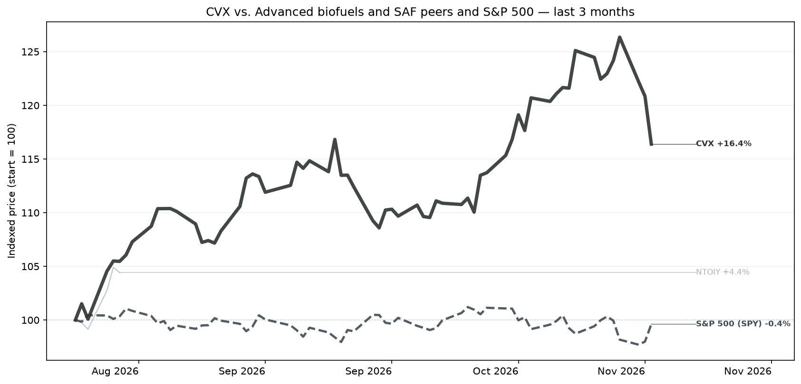

#### Earnings Call Summary

Chevron delivered strong Q3 2026 operational performance, maintaining upstream production above 2 million barrels per day in the U.S. for the fifth consecutive quarter. Record crude throughput in refining helped meet supply-constrained market demand. The company expanded its asset footprint with a discovery in Angola, new terms in Venezuela, and a 50% Bakken tariff reduction.

#### At a Glance

- **Chevron Outperforms Top-Line Estimates Comfortably:** Chevron reported Q3 2026 adjusted EPS of $5.06, beating the estimated adjusted EPS of 4.868, while reported revenue reached $65.70 billion, outperforming expectations of $62.01 billion.
- **Refineries and Production Reach Benchmarks:** U.S. upstream production exceeded 2 million barrels of oil equivalent per day for the fifth consecutive quarter, while U.S. refineries achieved record crude throughput operating at a 98% utilization rate.
- **Capital Spending Trends Near Guidance Lows:** Management projected that full-year organic capital expenditures are expected to finish at the low end of their long-term guidance range, driven by lower spending in the Permian Basin.
- **International Upstream Driven by Expansion:** Chevron expanded its footprint in Venezuela with immediately accretive fiscal terms, planning a $7 billion investment over five years to double gross production to 600,000 barrels per day by 2031.
- **Record Output Hits Natural Gas Portfolio:** The company established a new quarterly natural gas production record by generating more than 9 billion cubic feet per day, led by exceptional asset performance in Australia and the Eastern Mediterranean.
- **Refining Strength Cushions Upstream Softness:** Downstream refining margins and volumes successfully offset weaker upstream earnings resulting from lower global commodity realizations and planned asset turnarounds.

#### Key Moments from the Call

- **15m — Self-Funding Venezuela Expansion:** Management revealed that the planned doubling of production to 600,000 bpd by 2031 in Venezuela will be completely self-funding through venture revenues without requiring external capital. This mitigates investor concerns regarding capital exposure, while costs below $20 per barrel offer high-return, factory-like operational efficiency.
- **21m — Bakken Structural Optimization:** Chevron's 50% tariff reduction in the Bakken optimizes development, allowing a rig count reduction from three to two while sustaining 180,000 boed. It expands economic inventory and shifts long lateral composition to over 85% by 2027, boosting corporate ROCE by 0.5% and structurally improving future cash flows.
- **29m — AI Integration Drives Value:** Chevron characterized 2026 as an inflection year for artificial intelligence, delivering over $100 million in value year-to-date. Proprietary tools like ApEx and ScoutAI have compressed basin assessment times from months to hours, contributing to 15 infrastructure-led exploration discoveries and a superior 40% success rate.
- **56m — Exploration Capital Increase:** Driven by an expanded footprint of 22 million acres across 12 new basins, Chevron announced a 50% increase in its exploration budget relative to 2025. This pivot leverages high-confidence prospects in frontier and infrastructure-led regions, planning a steady drilling campaign of roughly 20 wells annually.
<h3 id="earnings-mpc">Marathon Petroleum (<a href="#company-mpc">MPC</a>) +31.9%</h3>

**Reported:** November 3, 2026 · [Google Finance earnings page](https://www.google.com/finance/quote/MPC:NYSE?tab=earnings&hl=en)

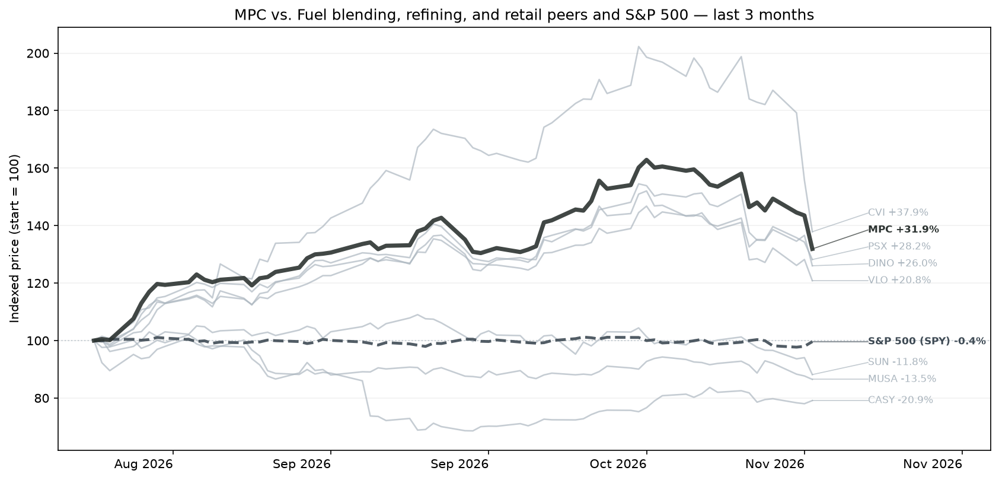

#### Earnings Call Summary

MPC announced a definitive agreement to sell its St. Paul Park and Mandan refineries, alongside associated MPLX midstream assets, to CVR Energy for $4.2 billion. MPC will net $3.4 billion from the sale and plans to redeploy the cash proceeds into high-return strategic opportunities primarily located across the structurally advantaged U.S. Gulf Coast region.

#### At a Glance

- **Marathon Outperforms on Top-Line Metrics:** Marathon Petroleum reported a solid beat for Q3 2026, posting a reported revenue of $56,487,000,000 against an estimated $43,812,588,800, alongside a reported adjusted EPS of $26.93 compared to the consensus estimate of $26.004.
- **Refining Capacity Hits Maximum Utilization:** The company achieved a record refinery capacity utilization rate of 100% during the quarter, showing a strong increase from the 95% utilization recorded in the prior-year period.
- **Strategic Divestiture Shifts Regional Focus:** Management announced a major agreement to sell its St. Paul Park and Mandan refineries to CVR Energy for $4.2 billion, intending to reinvest the proceeds primarily into growth opportunities across the U.S. Gulf Coast.
- **Shareholder Capital Returns Trend Upward:** Marathon Petroleum returned $3.3 billion to shareholders in Q3, approved an incremental $5 billion share buyback plan, and announced a 10% increase to its quarterly dividend.
- **Macro Environment Supports Ongoing Margins:** Management maintains a highly constructive refining outlook, projecting elevated market crack spreads and refining margins to persist through at least mid-2027 due to tight domestic inventories.

#### Key Moments from the Call

- **2m — $4.2 Billion MidCon Asset Divestiture:** Marathon's sale of the St. Paul Park and Mandan refining assets to CVR Energy marks a major strategic shift toward high-potential Gulf Coast operations, optimizing their portfolio and unlocking substantial cash proceeds for targeted reinvestment.
- **9m — Record 100% Refinery Utilization Rates:** Running at a record 100% utilization during Q3 surprised the market positively by demonstrating peer-leading system reliability and operational planning, allowing Marathon to fully capture elevated regional margin spreads despite concurrent turnaround events.
- **10m — Severe Secondary Product Capture Headwinds:** A drop in gross capture to 93% highlights unexpected absolute headwinds from secondary products, as benchmark clean products outpaced secondary values. While offset by wider diesel-to-gasoline spreads, this underperformance serves as an analytical focus for near-term profitability dynamics.
- **21m — Leaning into Record Heavy Canadian Crudes:** Management revealed that Western Canadian Select (WCS) differentials have widened dramatically beyond expectations, reaching prints of $32 under WTI. Marathon is leveraging its minimal freight exposure to run record amounts of heavy Canadian crude in Q4, boosting margins.
<h3 id="earnings-adm">Archer Daniels Midland (<a href="#company-adm">ADM</a>) -8.7%</h3>

**Reported:** November 3, 2026 · [Google Finance earnings page](https://www.google.com/finance/quote/ADM:NYSE?tab=earnings&hl=en)

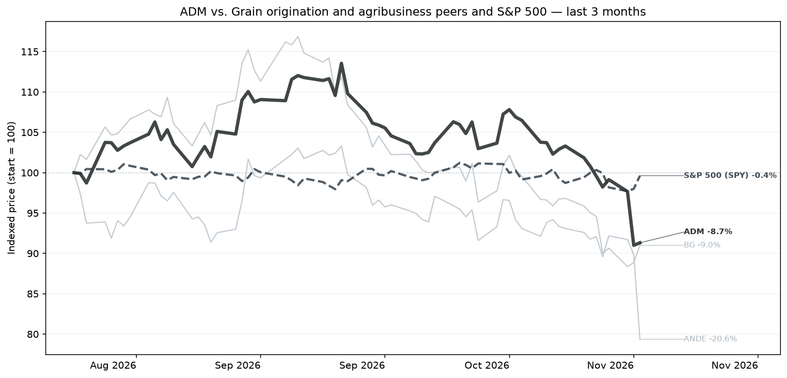

#### Earnings Call Summary

ADM reported adjusted Q2 2026 EPS of $1.84 and total segment operating profit of $1.5 billion, driven by robust commercial execution, supportive biofuel margins, elevated global energy prices, and Nutrition momentum.

#### At a Glance

- **ADM Earnings Beat Despite Revenue Miss:** Archer Daniels Midland reported a Q3 2026 adjusted EPS of $1.77, beating the estimated $1.603, while revenue came in at $22.335 billion, missing the consensus estimate of $23.489 billion.
- **Biofuels Drive Strong Processing KPIs:** Total segment operating profit jumped 64% year-over-year to $1.4 billion, highlighted by crushing operating profit surging to $311 million from $11 million in the prior-year period due to robust biofuel margins.
- **Full Year Earnings Guidance Raised:** The company increased its full-year 2026 adjusted EPS guidance range to $5.50–$5.80, up from the prior forecast of $5.15–$5.60, marking its third upward revision of the year.
- **Capital Expenditure Outlook Scaled Back:** ADM lowered its projected 2026 capital expenditures to a range of $1.2–$1.3 billion from its prior range of $1.3–$1.5 billion, reflecting disciplined sequencing and high-return project prioritization.
- **Unplanned Downtime Hits Nutrition Unit:** Nutrition segment operating profit edged up only 3% to $134 million, as healthy growth in Animal Nutrition and Flavors was severely restricted by unexpected plant downtime and softer biotics demand.
- **Mixed Market Reaction to Results:** Despite the strong earnings beat and raised guidance, the stock fell 5.5% in premarket trading as investors worried over the top-line revenue shortfall and sustainability of biofuels tailwinds.

#### Key Moments from the Call

- **2m — Substantial Guidance Increase:** ADM substantially raised its full-year 2026 adjusted EPS outlook to $5.15-$5.60 from the prior $4.15-$4.70. This massive upward revision will strongly please investors, signaling sustained strength in crush and ethanol margins alongside operational momentum in Nutrition.
- **17m — Potential Share Repurchases Restored:** Backed by strong cash flow, a disciplined 1.6x net leverage ratio, and robust balance sheet health, management announced it is evaluating a return to opportunistic share repurchases later this year, providing a direct catalyst to boost shareholder returns.
- **19m — Increased Clean Energy Incentives:** ADM raised its 2026 net financial benefit forecast from the 45Z clean fuel tax credit to $250 million, up from the prior estimate of $150 million. This $100 million increase underscores rapid progress in carbon intensity verification and operational enhancements.
- **26m — Cost-Efficient Brownfield Expansions:** Management revealed that capital intensity for its phase-one brownfield crush expansions across four U.S. facilities is only one-fourth the cost of building greenfield plants. This capital-disciplined approach ensures significantly higher returns on investment, pleasing shareholders focused on efficient capital allocation.
<h3 id="earnings-bg">Bunge (<a href="#company-bg">BG</a>) -9.0%</h3>

**Reported:** October 29, 2026 · [Google Finance earnings page](https://www.google.com/finance/quote/BG:NYSE?tab=earnings&hl=en)

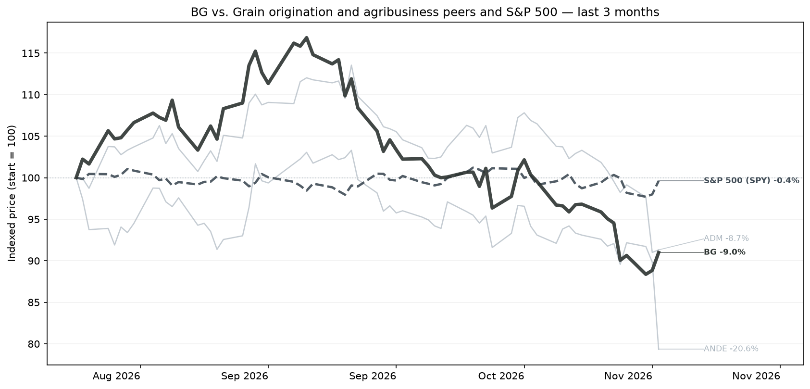

#### Earnings Call Summary

Bunge reported Q3 2026 adjusted EPS of $2.56 versus $2.27 in the prior year, beating estimates of $2.425. Reported revenue was $23.80B against expectations of $22.79B. Performance was driven by improved market conditions in soybean and softseed processing and benefits from Viterra synergy capture.

#### At a Glance

- **Bunge Global Beats Financial Expectations:** Bunge Global SA reported Q3 2026 adjusted revenue of $23,804,000,000, topping the estimated $22,786,577,860, while reported adjusted EPS came in at $1.64 compared to the 2.425 estimate.
- **Strong Processing Segment Performance:** The company saw continued strength in its Soybean and Softseed Processing and Refining segments, processing 11.7 million metric tons of soybeans and increasing softseed volumes to 3.6 million metric tons.
- **Full-Year 2026 Guidance Maintained:** Bunge Global reiterated its full-year 2026 adjusted EPS guidance range of $9.25 to $9.75, keeping the midpoint firmly at $9.50.
- **Accelerated Integration of Viterra Combination:** Management reported that cost synergies from the transformational $8.2 billion Viterra combination are tracking ahead of plan as the business shifts to its value-creation phase.
- **Strategic Portfolio Pruning in Brazil:** The quarter&#x27;s GAAP earnings were impacted by a $0.43 per share charge related to the announced sale of two non-core sugarcane mills acquired through the Viterra transaction.
- **Muted Premarket Investor Stock Reaction:** Bunge shares edged down 0.11% in premarket trading following the release, as investors balanced the positive headline results against rising interest costs and higher working capital needs.

#### Key Moments from the Call

- **6m — Strong Core Execution Drives Q3 Beat:** Bunge delivered solid Q3 2026 adjusted EPS of $2.56, outperforming consensus estimates. The strong performance was led by robust soybean processing results in North and South America, alongside favorable softseed margins that offset lower destination value chain results and regional refining weaknesses.
- **21m — Full-Year Guidance Maintained Despite Q4 Headwinds:** Bunge reiterated its full-year 2026 adjusted EPS guidance of $9.25 to $9.75. However, the implied flat operating profit for Q4 coupled with sequential EPS headwinds from higher interest expenses and elevated effective tax rates might disappoint short-term investor expectations.
- **23m — Substantial 2027 Synergy and Project Ramps:** Investors will be pleased by concrete 2027 growth targets. Management expects a $0.50 per share earnings boost from finishing core greenfield projects, an additional $0.50 per share from commercial synergies, and another $0.50 per share from accelerating Viterra cost savings.
- **46m — Decoupling From Energy Secures Vegetable Oil S&Ds:** Management reassured investors that vegetable oil demand remains insulated from broader energy price downturns. Structural drivers, such as domestic mandate increases and renewable diesel compliance needs, are sustaining tight global supplies, keeping crush margins secure into 2027.
<h3 id="earnings-cf">CF Industries (<a href="#company-cf">CF</a>) -4.3%</h3>

**Reported:** November 5, 2026 · [Google Finance earnings page](https://www.google.com/finance/quote/CF:NYSE?tab=earnings&hl=en)

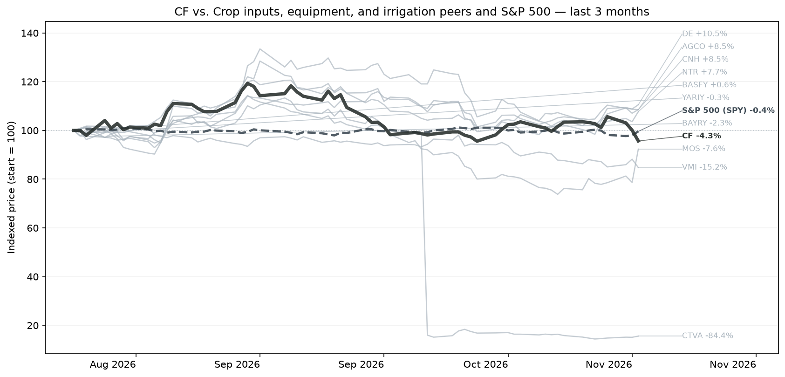

#### Earnings Call Summary

CF Industries reported Q3 2026 net earnings of $436 million, or $2.87 per diluted share, with adjusted EBITDA reaching $833 million. For the first nine months of 2026, the company generated adjusted EBITDA of approximately $3 billion, driven by operational strength, safety excellence, and 97% available ammonia capacity utilization.

#### At a Glance

- **Mixed Results With Revenue Beat:** CF Industries reported Q3 2026 revenue of $1.86 billion, beating the estimated $1.77 billion, but reported an EPS of $2.87, slightly missing the Wall Street estimate of $2.955.
- **Strong Operational Utilization Metrics Achieved:** The company demonstrated high operational reliability with a 97% ammonia plant utilization rate, bolstering its performance amid a tight global nitrogen market.
- **Constructive Outlook Sustained Into 2027:** Management highlighted a favorable global nitrogen supply-demand balance extending into 2027, driven by strategic growth initiatives like Blue Point One and the Yazoo City CCS project.
- **Elevated Operational Costs Trim Margins:** Despite lower natural gas input costs, the company&#x27;s ultimate profit margins were pressured by rising purchased product, freight, and maintenance expenses during the quarter.
- **Aggressive Capital Returns to Shareholders:** CF Industries sustained strong cash flows, utilizing its capital to repurchase 3 million shares for approximately $367 million during the third quarter.

#### Key Moments from the Call

- **8m — Robust Free Cash Flow and Capital Returns:** CF Industries achieved $2 billion in free cash flow over the trailing 12 months despite a $306 million tax deposit hindrance, supporting $1.3 billion in shareholder returns through opportunistic share buybacks and dividends, emphasizing that the company's long-term valuation is understated by the market.
- **13m — Global Nitrogen Supply Tightness Accelerating:** European ammonia capacity curtailments have reached approximately 40% due to high energy costs. Management expects these structural shutdowns to accelerate 12 to 18 months ahead of the original 2030 expectation, further tightening global supply-demand balances to CF's financial benefit.
- **15m — Strong Demands and Pricing Outlook for 2027:** North American fall ammonia application demand is tracking among the highest in 10 years, pointing toward healthy 2027 corn acreage of 95 million to 96 million acres. Deferred purchasing and global inventory depletion are expected to sustain positive nitrogen pricing trajectories through the first half of 2027.
- **24m — Yazoo City Plant Reconstruction Status:** The Yazoo City plant is slated to begin component startups in the first half of 2027, with a ramp to full ammonium nitrate production scheduled for the second half of the year. Financial impacts from capital builds and insurance inflows are expected to fully offset over the long term.
<h3 id="earnings-dar">Darling Ingredients (<a href="#company-dar">DAR</a>) -9.5%</h3>

**Reported:** October 29, 2026 · [Google Finance earnings page](https://www.google.com/finance/quote/DAR:NYSE?tab=earnings&hl=en)

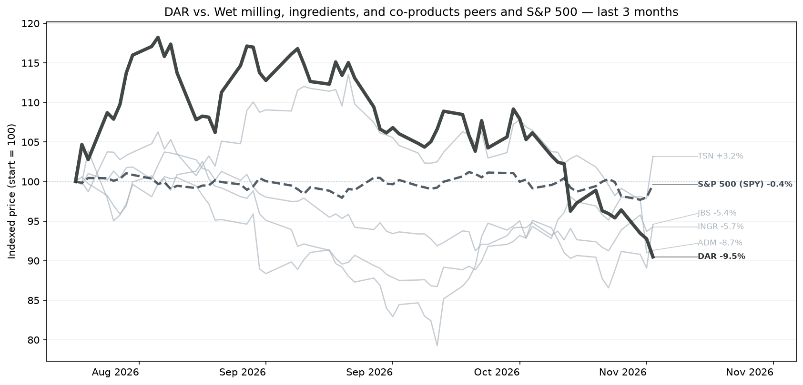

#### Earnings Call Summary

Darling Ingredients delivered a robust Q3 2026, generating $1.8 billion in net sales and $267 million in net income ($1.67 per GAAP diluted share). Combined adjusted EBITDA reached $514 million, with $310 million from Global Ingredients and $204 million from Diamond Green Diesel (DGD), enabling a $420 million net debt reduction.

#### At a Glance

- **Darling Surpasses Estimates on Key Numbers:** Darling Ingredients reported a top-line revenue of $1,791,116,000, beating the expected estimate of $1,778,030,740, and posted a reported adjusted EPS of $1.67, which outperformed the estimated adjusted EPS of 1.656.
- **Surging Operations Fuel EBITDA Rebound:** The company&#x27;s Combined Adjusted EBITDA surged to $514.3 million for the quarter, compared to $244.9 million in the third quarter of 2025, driven by strong core segment contributions from Global Ingredients and Diamond Green Diesel.
- **Full-Year Guidance Reaffirmed with Deleveraging Focus:** Darling Ingredients reaffirmed its full-year 2026 combined adjusted EBITDA guidance of $2.2 billion to $2.3 billion, highlighting its primary financial objective to reduce net debt to $3.0 billion or below by year-end.
- **Diamond Green Diesel Yields Massive Cash:** The Diamond Green Diesel joint venture proved to be a powerful cash engine, shipping 314.9 million gallons of renewable fuels and distributing $171.0 million in cash to Darling during the quarter.
- **Positive Initial Market Reaction to Momentum:** Shares of the company initially ticked upward by over 3% following the announcement, as investors chose to emphasize strong operational cash generation and aggressive balance sheet improvements.

#### Key Moments from the Call

- **6m — Core EBITDA Impacted by DGD Accounting:** Core ingredients EBITDA of $340 million was suppressed by $30 million from a negative lower-of-cost-or-market adjustment and deferred profit rules on joint venture feedstocks. This technical lag disappointed near-term baseline expectations but is expected to flow back in Q4.
- **10m — Substantial De-leveraging and Debt Targets:** Management reduced net debt by $420 million during the quarter, bringing its leverage ratio down to 1.7x from 2.9x at the end of last year. Darling remains on track to lower net debt below $3 billion by year-end, strengthening its balance sheet.
- **12m — Full-Year 2026 EBITDA Guidance Reaffirmed:** Darling Ingredients reaffirmed its full-year combined adjusted EBITDA guidance of $2.2 billion to $2.3 billion. Investors will be pleased by this continuity, indicating that Q3 operational noise and hedging headwinds have stabilized moving into the final quarter.
- **19m — Potential Post-Deleveraging Shareholder Returns:** With net debt rapidly approaching target levels, management signaled that the board is actively debating a forward financial policy for 2027. This includes evaluating a potential baseline dividend or an accelerated, robust stock buyback program.
<h3 id="earnings-musa">Murphy USA (<a href="#company-musa">MUSA</a>) -13.5%</h3>

**Reported:** October 29, 2026 · [Google Finance earnings page](https://www.google.com/finance/quote/MUSA:NYSE?tab=earnings&hl=en)

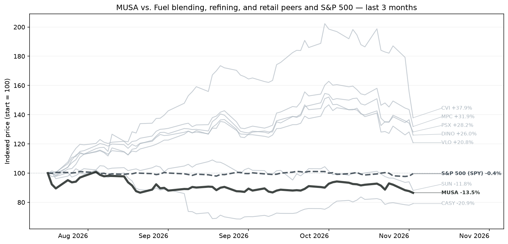

#### Earnings Call Summary

Murphy USA reaffirmed its unit growth pipeline, reporting 18 stores open year-to-date and 55 under construction. Management remains confident in achieving its 2026 guidance of 45 to 50 store openings and is on track to maintain a steady pace of 50 new store openings per year for 2027.

#### At a Glance

- **Earnings Beat Across Both Lines:** Murphy USA Inc. reported a Q3 2026 Adjusted EPS of $9.59, outperforming the estimated $8.537, while reported revenue reached $6,261.4 million compared to the estimated $6,247.6 million.
- **Strong Same-Store Fuel Volumes Performance:** The company&#x27;s same-store fuel volume increased 6% compared to OPIS benchmarks, reflecting notable market share gains despite operating within a challenging rising price environment.
- **Store Expansion Pipeline Targets 2028 Consistency:** Management reiterated its 2026 store opening guidance of 45-50 new units and highlighted long-term plans to achieve a steady opening pace of roughly 50 units annually by 2028.
- **Consumers Trade Down Amid Volatility:** Elevated absolute fuel prices prompted heightened consumer price sensitivity, driving a nearly 2.5% increase in regular unleaded sales as customers actively traded down from premium tiers.
- **Inside-Store Segments Face Divergent Results:** While non-nicotine and non-lottery core store categories experienced resilient margins, the food-forward QuickChek brand continued to face margin compression due to its high-cost operational structure.

#### Key Moments from the Call

- **16m — Fuel Supply Volatility as an Advantage:** Management highlighted that prolonged international conflicts and supply constraints will extend fuel market volatility into 2027. While complex for the industry, Murphy USA's diversified sourcing capabilities and flexible supply options position the company to capture stronger product supply margins and take market share from vulnerable, marginal retailers.
- **21m — Expanded Store Format Strategy:** To overcome historic store-opening pace constraints that limited past EBITDA growth, Murphy USA is diversifying its development playbook. Alongside its standard 2,800-square-foot model, the company is introducing smaller and larger formats, while pivoting toward heavy store refreshes and remodels rather than full raze-and-rebuild projects to increase structural flexibility.
- **25m — Resilient Consumer Trading Down to Value:** Low-income consumer dynamics reveal strict budget discipline but overall spending resilience. Regular unleaded fuel volumes climbed 2.5% in Q3—and doubled that rate in September—confirming that motorists are actively trading down from premium grades and shifting away from higher-priced competitors to leverage Murphy USA's value pricing.
- **34m — Discretionary Merchandise Headwinds:** Non-nicotine same-store sales declines were driven entirely by lottery and beer underperformance, which suffered from tough prior-year multi-billion dollar jackpot comparisons and reduced discretionary spend. Excluding lottery and beer, non-nicotine same-store merchandise margins grew 1% year-over-year, supported by strong performance in packed beverages.
<h3 id="earnings-mos">Mosaic (<a href="#company-mos">MOS</a>) -7.6%</h3>

**Reported:** November 4, 2026 · [Google Finance earnings page](https://www.google.com/finance/quote/MOS:NYSE?tab=earnings&hl=en)

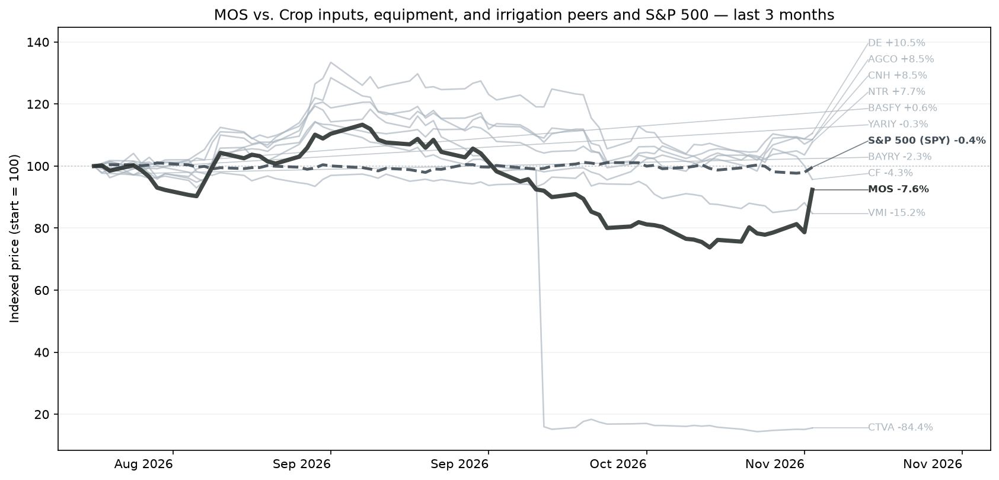

#### Earnings Call Summary

Mosaic is managing a difficult phosphate market through production curtailments at Bartow, Louisiana, and Brazil to match affordable sulfur availability. Mining was also idled at South Fort Meade and Miski Mayo to control rock inventory. Despite lower operating rates, cash conversion costs declined sequentially, and the company expects positive free cash flow in late 2026.

#### At a Glance

- **Mosaic Beats Revenue But Misses EPS:** The Mosaic Company reported a revenue of $3.10 billion, beating the estimated $3.05 billion, while its reported adjusted EPS of $0.00 missed the analyst expectation of a profit due to elevated raw material costs.
- **Sales Volumes Drop Across Key Segments:** Third-quarter sales volumes reached 1.4 million tonnes for Phosphates and 2.1 million tonnes for Potash, down from 1.6 million tonnes and 2.3 million tonnes respectively in the prior year due to deliberate production curtailments and turnaround disruptions.
- **Sustained Capital and Cost Guidance Reduced:** Mosaic lowered its 2026 capital expenditure guidance to $1.2 billion and outlined a aggressive 2027 plan targeting under $1 billion in CapEx alongside corporate SG&amp;A expenses below $500 million.
- **Sulfur Contract Offers Structural Cost Advantage:** The company settled a fourth-quarter sulfur contract at $615 per ton, a substantial discount compared to the market average of $1,100 per ton, which is expected to cushion cash flows despite near-term inventory headwinds.
- **Market Rallies Despite Net Quarterly Loss:** Despite recording a consolidated net loss of $72 million for the quarter, Mosaic&#x27;s stock surged over 9% in subsequent trading as investors reacted positively to the company&#x27;s stringent cost-cutting and positive free cash flow outlook.

#### Key Moments from the Call

- **22m — Potash Guidance Reduced Amid Supply Drag:** Potash sales hit third-quarter targets, but total segment production fell short due to unmapped salt domes at Esterhazy and heavy turnarounds. Limited inventories prevented building stock for upcoming shipments, forcing a reduction in near-term sales guidance, which may disappoint short-term investor growth expectations.
- **28m — CapEx Deferrals Underpin Balance Sheet Safety:** Management slashed 2026 capital spending to $1.2 billion and guided 2027 CapEx below $1 billion. Delaying gypsum stack expansions and leveraging idled asset capacities relieves near-term cash burdens, reassuring investors of financial flexibility and structural cost discipline during severe supply-chain shocks.
- **38m — Eastern European Logistic Constraints Support Potash:** Russian and Belarusian government interventions prioritized alternative commodity rail shipments over potash, disrupting 1.5 million tons of Baltic Sea shipments in Q4. These permanently lost export volumes tighten global supply, establishing a fundamentally supportive backdrop for Mosaic's competitive pricing into 2027.
- **57m — Phosphate EBITDA Trough Projected for Q4:** While Mosaic secured an advantageous $615 per ton sulfur contract for Q4 cash flows, high-cost inventory flow-through will delay earnings benefits. Realized sulfur accounting costs will spike to $800-$850 per ton, marking Q4 as a definitive EBITDA trough for the phosphate division before recovering.
<h3 id="earnings-agco">AGCO (<a href="#company-agco">AGCO</a>) +8.5%</h3>

**Reported:** October 29, 2026 · [Google Finance earnings page](https://www.google.com/finance/quote/AGCO:NYSE?tab=earnings&hl=en)

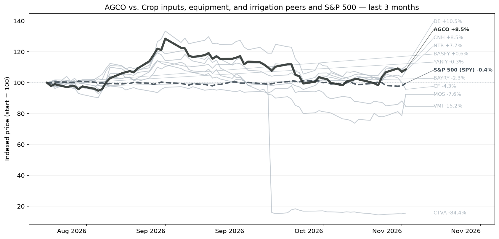

#### Earnings Call Summary

AGCO Corporation reported net sales of approximately $2.3 billion for Q3 2026, down 8.6% year-over-year. Adjusted EPS fell to $1.05 from $1.35 in Q3 2025, while reported EPS dropped to $0.75 from $4.09 last year. Operating income fell 23% to $116.1 million, with adjusted operating margin contracting 140 basis points to 6.1%.

#### At a Glance

- **AGCO Beats EPS But Misses Revenue:** AGCO Corporation reported Q3 2026 adjusted EPS of $0.75, which missed the estimated adjusted EPS of $0.864, while reported revenue of $2,262,500,000 also fell short of the estimated $2,320,572,850.
- **Regional Performance Exhibits Mixed Demand Trends:** North American net sales surged by 35.1% on a constant-currency basis due to major market share gains, while Europe/Middle East net sales plummeted 18.1% amidst weakening farm economics.
- **Full-Year 2026 Forward Guidance Lowered:** AGCO revised its full-year 2026 net sales outlook downward to a range of $9.8 billion to $10.0 billion, and trimmed its adjusted EPS guidance midpoint to approximately $5.50.
- **Severe Cyclical Agriculture Trough Reached:** Management noted that global farm equipment demand has dropped to its weakest level in over a decade, functioning at roughly 83% of mid-cycle levels.
- **Cost Management Offsets Macro Headwinds:** The company&#x27;s Project Reimagine efficiency program remains on track to deliver $60 million to $70 million in productivity benefits to mitigate soft retail conditions.

#### Key Moments from the Call

- **8m — Latin American Inventory Surge and Deterioration:** Latin American dealer inventory climbed rapidly to nearly 5 months of supply, exceeding the 3-month target. While unit increases were minimal, a rapid deterioration in the forward 12-month retail outlook inflated the metric, forcing AGCO to aggressively cut South American factory production hours in Q4.
- **13m — North American Outperformance and Early Order Surge:** North American net sales grew a robust 35.1% on a constant currency basis, defying global downturns. Furthermore, management disclosed that volume for the 2027 early order program in North America is up high teens to 20% year-over-year, showcasing resilient brand demand and market share gains.
- **25m — Full-Year Guidance Cut on Global Weakness:** AGCO reduced its full-year 2026 outlook to net sales of $9.8B-$10.0B and adjusted EPS to ~$5.50. This acknowledges a deeper-than-expected cyclical trough where global industry demand is tracking at 83% of historical mid-cycle levels, pressured by input costs, interest rates, and dry European weather.
- **60m — Trough Resilience Over Prior Cycles:** Management highlighted structural improvements, noting that during the current cycle trough (operating at 83% of mid-cycle levels), AGCO expects a 7% adjusted operating margin. This compares favorably to a 4% margin during the previous trough, despite carrying $100 million in tariff burdens and higher R&D investments.
<h3 id="earnings-ingr">Ingredion (<a href="#company-ingr">INGR</a>) -5.7%</h3>

**Reported:** November 5, 2026 · [Google Finance earnings page](https://www.google.com/finance/quote/INGR:NYSE?tab=earnings&hl=en)

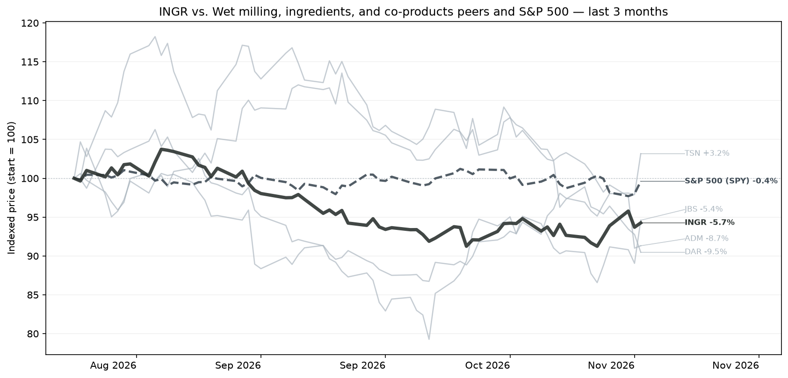

#### Earnings Call Summary

Ingredion reported Q3 2026 net sales of $1.8 billion, down 1% year-over-year (up 2% excluding the Pakistan divestiture). Adjusted operating income fell 19% to $206 million due to higher manufacturing costs and lower volumes in U.S./Canada Food & Industrial Ingredients, record-high tapioca costs, and transactional headwinds from a stronger Mexican peso.

#### At a Glance

- **Ingredion Misses Q3 Financial Expectations:** Ingredion reported a Q3 2026 adjusted EPS of $2.28, missing the estimated $2.596, while its reported revenue of $1.79 billion fell slightly short of the projected $1.80 billion.
- **Clean Label Demand Remains Positive:** The Texture &amp; Healthful Solutions segment achieved its 10th consecutive quarter of net sales volume growth, driven by continued global demand for clean label products.
- **Management Slashes Full-Year EPS Guidance:** Ingredion significantly lowered its full-year 2026 adjusted EPS outlook to a range of $9.25 to $9.70, down from its previous guidance of $10.30 to $10.90.
- **Argo Facility Costs Depress Income:** The company&#x27;s adjusted operating income fell 19% year-over-year to $206 million, heavily impacted by a slower-than-anticipated financial recovery and higher manufacturing expenses at its Argo facility.
- **Macroeconomic Pressures Squeeze Operating Margin:** Operating margin fell to 11.2% from 13.7% in the prior year due to a stronger Mexican peso, softer demand in the U.S. and Canada, and record-high tapioca ingredient costs.

#### Key Moments from the Call

- **7m — Argo Plant Operational Disconnect:** Management revealed that while Argo's production and inventories have stabilized, financial recovery lags. Higher operational outlays and below-industry extraction yields accounted for two-thirds of the profit shortfall, with soft customer volume making up the rest. This will frustrate investors hoping for a swift margins rebound following extended reliability issues.
- **10m — Tate & Lyle Acquisition Timeline:** The planned acquisition of Tate & Lyle is progressing on schedule through regulatory and antitrust reviews after gaining shareholder approval in July. Management reaffirmed a targeted closing window in the second half of 2027, maintaining long-term optimism regarding complex product reformulation capabilities and synergy potentials across combined global plant networks.
- **15m — Severe Tapioca Cost Pressures:** An industry-wide root shortage in Thailand pushed tapioca prices up 45% since January, resulting in a 65% year-over-year cost spike for Ingredion. Because of a one-quarter lag in passing these expenses through to customers via pricing, Texture & Healthful Solutions segment margins suffered a 10% operating income hit despite positive volume growth.
- **21m — Full-Year Guidance Cut:** Ingredion lowered its full-year 2026 outlook, predicting flat net sales, a mid-teens decline in adjusted operating income, and lower adjusted EPS of $9.25–$9.70. This revision disappoints investors as it reflects protracted operational inefficiencies at the Argo facility and a broader slowdown in consumer demand across the packaged foods, confectionery, and soft drink sectors.
<h3 id="earnings-gatx">GATX (<a href="#company-gatx">GATX</a>) +6.2%</h3>

**Reported:** October 29, 2026 · [Google Finance earnings page](https://www.google.com/finance/quote/GATX:NYSE?tab=earnings&hl=en)

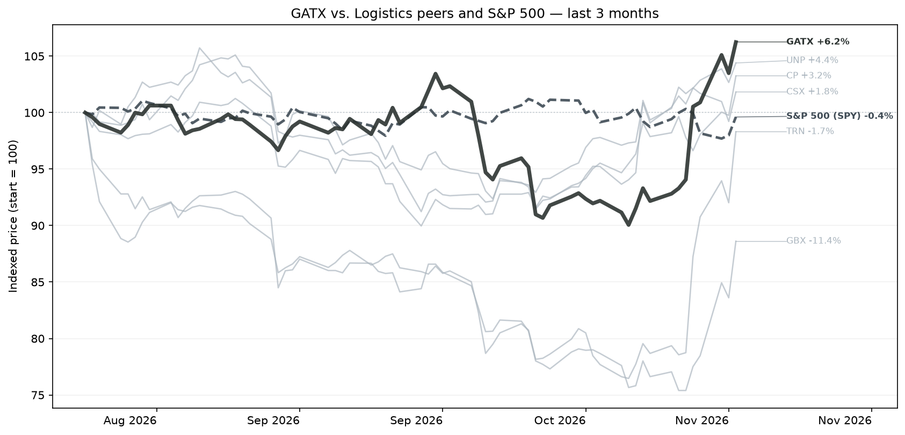

#### Earnings Call Summary

GATX reported strong Q3 2026 results with diluted EPS of $2.92, up 29.8% year-over-year from $2.25 in Q3 2025. Nine-month EPS reached $8.11 compared to $6.46 in the prior year. Positive market dynamics and solid leasing fundamentals across fleets supported the performance, with Rail North America achieving a 98.4% fleet utilization rate.

#### At a Glance

- **GATX Beats EPS and Revenue Estimates:** GATX Corporation reported a reported adjusted EPS of $2.92, outperforming the estimated $2.46, while reported revenue reached $598,000,000 against expectations of $592,657,200.
- **High Fleet Utilization Drives Operational Strength:** Rail North America fleet utilization increased to 98.4% at quarter end, supported by a strong renewal success rate of 86.1% and a positive lease price index change of 12.4%.
- **Full-Year Guidance Shifted Above Initial Range:** Management raised its full-year 2026 outlook, now expecting diluted earnings to modestly exceed the upper end of its previous guidance range of $9.90 to $10.30 per share.
- **Asset Dispositions Capitalize on Secondary Market:** Net gains on asset dispositions in Rail North America reached $50.3 million for the quarter, driven by limited railcar supply and robust institution-led secondary market demand.
- **Wells Fargo Asset Integration Beats Expectations:** The integration of the acquired Wells Fargo rail assets is tracking ahead of schedule, contributing approximately $0.50 per diluted share year-to-date, which double original expectations.
- **Strong Market Reaction Sends Stock Soaring:** Following the earnings release and guidance boost, GATX shares jumped 7.27% during regular trading to close at $181.14.

#### Key Moments from the Call

- **4m — Full-Year Guidance Increased Beyond Target:** Management increased full-year 2026 EPS guidance to modestly exceed the high end of the prior $9.90 to $10.30 range. This positive shift will please investors as it highlights robust secondary market demand and stronger-than-expected management fees from the Brookfield-owned portfolio, reflecting excellent operational execution despite broader macroeconomic uncertainties.
- **6m — Favorable Pricing Trend Defies LPI Index Dip:** While the Lease Price Index (LPI) sequentially stepped down to +12.4%, management reassured investors that sequential pricing across most of the fleet is actually flat to slightly up. The index reflects trailing composition math, meaning core market pricing remains strong and healthy supply-demand conditions continue to support high long-term asset values.
- **9m — Surge in Brookfield Portfolio Management Fees:** Management fees from the Brookfield long-term lease portfolio jumped to $15 million in Q3 from $2.8 million in previous quarters. This significant surge, driven by transaction-specific asset sale execution fees, provides clear validation of the Wells Fargo acquisition's financial synergies and immediate accretive power, surpassing initial investor expectations.
- **35m — Insulated Financial Structure Combats Interest Hikes:** With less than 10% floating debt and a reliance on long-term fixed capital markets, GATX is highly insulated from interest rate hikes. This strategic asset liability structure reassures investors that sentiment-driven rate fears are unfounded, as rising rates historically improve renewal lease prices for their expansive 200,000-car installed fleet over time.
<h3 id="earnings-cvi">CVR Energy (<a href="#company-cvi">CVI</a>) +37.9%</h3>

**Reported:** November 3, 2026 · [Google Finance earnings page](https://www.google.com/finance/quote/CVI:NYSE?tab=earnings&hl=en)

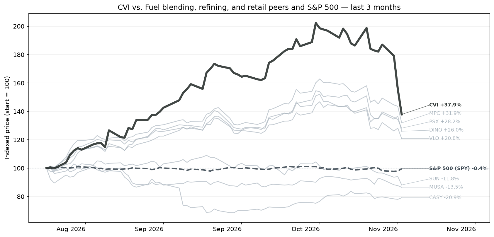

#### Earnings Call Summary

CVR Energy announced a definitive agreement to acquire Marathon Petroleum's St. Paul Park and Mandan refineries, plus marketing and logistics assets, for approximately $4.2 billion. The transaction nearly doubles crude capacity to 384,000 bpd, expanding geographic reach across the Upper Midwest and Northern Great Plains.

#### At a Glance

- **CVR Energy Beats Financial Estimates:** CVR Energy reported Q3 2026 adjusted EPS of $4.00, beating the consensus estimate of $2.91, while reported revenue of $3.281 billion also surpassed expectations of $2.350 billion.
- **Refining Capacity and Spreads Surge:** The petroleum segment achieved record results driven by 105% crude utilization and a strong Group 3 2-1-1 crack spread averaging $68.50 per barrel, compared to $25.94 in Q3 2025.
- **Transformative Marathon Asset Acquisition Announced:** The company entered into a definitive agreement to acquire Marathon Petroleum&#x27;s St. Paul Park and Mandan refineries for $4.2 billion, which will nearly double its total crude capacity to 384,000 barrels per day by year-end 2026.
- **EPA Decision Relieves Balance Sheet:** CVR Energy removed a $253 million liability from its balance sheet following the EPA&#x27;s August 2026 decision to grant a full Renewable Fuel Standard waiver for the Wynnewood refinery&#x27;s 2025 compliance period.
- **Fertilizer Segment Experiences Turnaround Headwinds:** The Nitrogen Fertilizer segment posted an adjusted EBITDA decline to $20 million from $71 million in the prior-year period due to lower ammonia utilization caused by a planned maintenance turnaround at the East Dubuque facility.
- **Market Reacts Sharply Describing Leverage:** Despite posting record results and beating Wall Street expectations, CVR Energy&#x27;s stock fell 11.48% to $49.50 as investors digested the increased leverage from the massive $4.2 billion acquisition.

#### Key Moments from the Call

- **2m — Transformative $4.2 Billion Refining Acquisition:** CVR Energy announced the acquisition of Marathon's St. Paul Park and Mandan refineries, nearly doubling its throughput capacity. Underwritten on historical mid-cycle economics at a compelling multiple below 3.5x 2026 EBITDA, the deal expands geographical reach and distribution while boosting pro forma 2026 9-month EPS from $3.73 to $7.67.
- **9m — Record Corporate Earnings Beat Expectations:** The company delivered record Q3 results, generating $4 adjusted EPS against consensus expectations of $2.913, and reporting revenue of $3.28 billion vs. the $2.35 billion estimate. Strong Group 3 crack spreads averaging $68.50 per barrel and high 105% crude utilization drove the outperformance.
- **11m — RFS Liability Relief and Strategic RIN Reduction:** Financial results were boosted by a $314 million favorable change in RFS liability, highlighted by an EPA Small Refinery Exemption for Wynnewood. Management noted that the acquired Marathon assets bring high blending capacities that will structurally reduce CVR’s consolidated open RIN exposure going forward.
- **22m — Temporary Leverage Increase for Strategic Growth:** Analysts focused on CVR's shift from a aggressive deleveraging path to taking on debt for expansion. Management justified the leverage increase (targeting sub-2x pro forma 2026 EBITDA) by citing structural downstream advantages, a favorable multi-year crack spread outlook, and clear accretion over standalone operations.
<h3 id="earnings-trn">Trinity Industries (<a href="#company-trn">TRN</a>) -1.7%</h3>

**Reported:** October 29, 2026 · [Google Finance earnings page](https://www.google.com/finance/quote/TRN:NYSE?tab=earnings&hl=en)

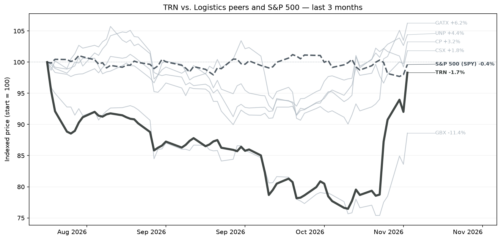

#### Earnings Call Summary

Trinity Industries delivered strong Q3 2026 results, with revenue up 18% year-over-year to $535.1M, exceeding estimates. EPS reached $0.27, beating estimates. Performance was driven by higher external deliveries and repair activity, despite lower consolidated fleet leasing revenue following recent partnership transactions. Operating profit declined 19% to $96M due to lower gains on lease sales.

#### At a Glance

- **Revenue Beats, Adjusted EPS Misses:** Trinity Industries reported Q3 2026 revenue of $535.1 million, beating the estimated $498.36 million, while its reported adjusted EPS of $0.22 missed the estimated $0.265.
- **Strong Operational Fleet Utilization Maintained:** The company&#x27;s lease fleet utilization rate reached 97.0% at quarter-end, demonstrating consistent leasing fundamentals despite a broader contracting industry fleet.
- **Full-Year 2026 Guidance Maintained:** Management reiterated its full-year 2026 EPS guidance range of $2.20 to $2.40, supported by an upgraded expectations for secondary market railcar sales gains.
- **Railcar Orders Outpace External Deliveries:** Trinity achieved a positive book-to-bill ratio with 2,190 new railcar orders compared to 2,030 deliveries, showing a sequential order increase of 40%.
- **Macroeconomic Headwinds and Cost Pressures:** The company faced an anti-dumping petition on tank cars from Mexico along with rising steel prices and elevated interest rates that delayed some client ordering decisions.

#### Key Moments from the Call

- **16m — Maintained 2026 Guidance and Raised Asset Gains:** Trinity maintained its full-year EPS guidance of $2.20-$2.40 and raised its secondary market railcar gains expectations to $180M-$200M. Investors will appreciate achieving three-year cash generation and net fleet investment targets early, reinforcing financial stability at the cyclical low point for industry deliveries.
- **19m — Longview Facility Sale Benefits Q3 Earnings:** A $13.4M gain ($0.12 EPS impact) from selling an inefficient manufacturing facility boosted Rail Products margins to 9.0%. Investors will look past the one-time lift to focus on the 5.1% normalized margin, which still represents a significant sequential improvement from Q2.
- **22m — Inflation and Tariffs Create Mixed Order Signals:** Order momentum is up 40% sequentially, but headwinds from a 63% YoY increase in steel prices, rising interest rates, and tariff uncertainties are delaying some customer decisions. Trinity is passing a 10% tariff cost placeholder into new quotes to protect contract pricing.
- **31m — Future Lease Rate Differential Flatlines:** The future lease rate differential was essentially flat due to higher expiring comparisons after repricing nearly the entire fleet. While this indicates plateauing near-term momentum, management reassures investors that low market storage and widespread railcar scrapping will continue pushing lease rates upward.
<h3 id="earnings-ande">The Andersons (<a href="#company-ande">ANDE</a>) -20.6%</h3>

**Reported:** November 4, 2026 · [Google Finance earnings page](https://www.google.com/finance/quote/ANDE:NASDAQ?tab=earnings&hl=en)

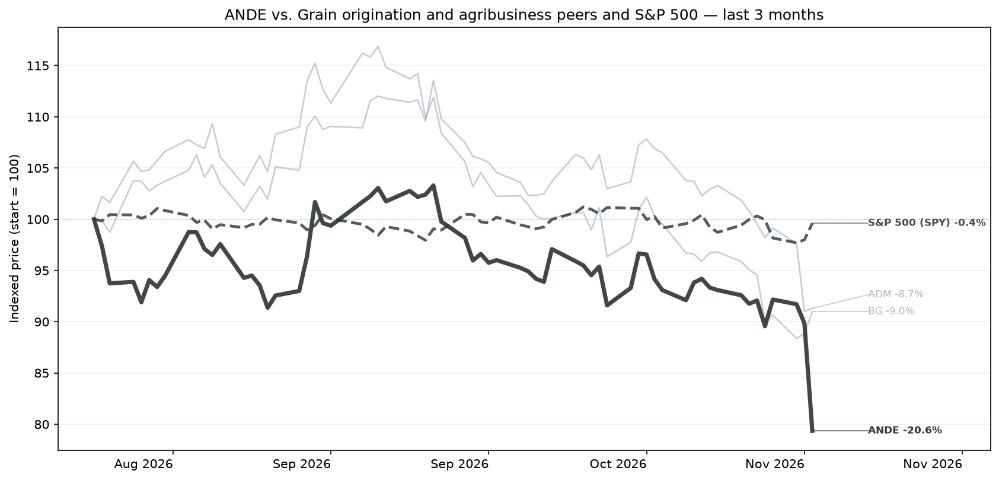

#### Earnings Call Summary

The Andersons reported record Q3 2026 adjusted EPS of $1.38, up from $0.84 in Q3 2025, driven by improved fundamentals across business groups. Trailing 12-month adjusted EPS rose to $6.67 from $2.56, aligning with the company's $7.00 EPS target for 2028. Adjusted pre-tax earnings reached $54 million, and adjusted EBITDA grew to $101 million.

#### At a Glance

- **Strong EPS Beat Despite Revenue Miss:** The Andersons reported a record third-quarter adjusted EPS of $1.38, comfortably beating the consensus estimate of $1.107, though reported revenue of $2,833,715,000 fell short of the estimated $2,897,666,670.
- **Renewables Drive Record Segment Income:** The Renewables segment achieved record third-quarter pretax income of $63 million due to efficient operations and improved co-product values, overcoming a $0.10 per gallon decline in board crush margins compared to the prior year.
- **Transformative Acquisition and Growth Guidance:** The company announced a $915 million agreement to acquire Harvestone Low Carbon Partners, which is expected to immediately accrete to EPS and add $225 million to $250 million in annual EBITDA over the next three years.
- **Agribusiness Boosted by Market Volatility:** The Agribusiness segment benefited from increased market volatility and improved merchandising execution, resulting in an adjusted pretax income of $9 million and a segment adjusted EBITDA increase to $40 million.
- **Strategic Sale of 45Z Tax Credits:** Management secured an agreement to sell the majority of its 2026 45Z low-carbon tax credits, with most of the cash proceeds anticipated to be received before the end of the calendar year.

#### Key Moments from the Call

- **4m — Record Third Quarter Financial Results:** The Andersons delivered record Q3 adjusted EPS of $1.38 and adjusted EBITDA of $101 million, beating estimates and prior year results. Investors will be pleased by the significant trailing 12-month EPS expansion to $6.67, validating the company's clear line of sight toward its $7.00 long-term target.
- **15m — Major Low-Carbon Ethanol Acquisition:** The company announced a $915 million acquisition of Harvestone Low Carbon Partners, scaling annual production capacity to 730 million gallons. This strategic pivot provides immediate, on-site carbon sequestration exposure and low-carbon fuel market access, promising immediate EPS accretion and $225 million–$250 million in projected annual EBITDA.
- **37m — Delayed Harvest Income Shifting:** Management signaled that post-harvest market dynamics and a late harvest across core regions will alter income timing, precluding the pulling forward of Q1 profits into Q4 2026. This dynamic may slightly disappoint short-term Q4 expectations but will maximize merchandising capture and space income into early 2027.
- **40m — Resilient Renewable Merchandising Outlook:** Despite volatile D6 RIN pricing and lower near-term renewable feedstock merchandising results from foreign competition, executives reassured analysts that domestic blend margins remain sufficiently high. Expected bio-based diesel mandates and strong global demand provide clear tailwinds for operational volumes heading into late 2026 and 2027.
<h3 id="earnings-gpre">Green Plains (<a href="#company-gpre">GPRE</a>) -17.2%</h3>

**Reported:** November 5, 2026 · [Google Finance earnings page](https://www.google.com/finance/quote/GPRE:NASDAQ?tab=earnings&hl=en)

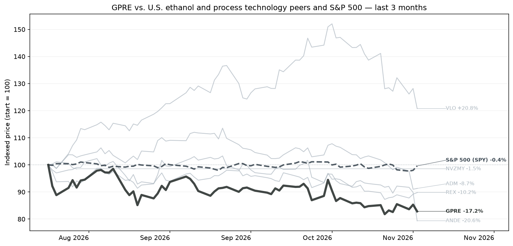

#### Earnings Call Summary

Green Plains reported third-quarter 2026 adjusted EBITDA of $118 million, more than doubling from $53 million in the prior year period, driven by operational excellence, record ethanol and corn oil yields, and platform utilization recovering to 95%. The results included $65 million from 45Z clean fuel production tax credits.

#### At a Glance

- **EPS Surpasses Expectations Despite Revenue Miss:** Green Plains reported a Q3 2026 GAAP EPS of $1.03, significantly beating the estimated adjusted EPS of 0.617, while its reported revenue of $495.99 million fell short of the estimated $530.43 million.
- **EBITDA and Operating Margins Improve Significantly:** Adjusted EBITDA rose to a record $118 million from $53 million a year ago, while the operating margin expanded to 18.7% compared to 6.7% in Q3 2025.
- **Management Sets Ambitious Carbon EBITDA Forecast:** Green Plains expects to maintain strong profitability, highlighting a forward guidance forecast for 2027 carbon-related EBITDA to reach at least $250 million.
- **Tax Credits Lift Quarterly Profitability:** Earnings performance was substantially driven by the successful monetization of 2026 Section 45Z clean fuel production tax credits, which provided a $65.4 million boost to adjusted EBITDA.
- **Ethanol Volumes Decline Post Asset Disposition:** Total ethanol volume sold decreased 11.3% year over year to 174.9 million gallons, primarily due to the recent disposition of the Obion, Tennessee plant.

#### Key Moments from the Call

- **3m — Full-Year Carbon EBITDA Guidance Raised:** Green Plains increased its 2026 carbon adjusted EBITDA outlook to $230 million–$250 million (up from $188 million) due to stronger plant operational performance and improved carbon capture, reassuring investors of the massive near-term earnings potential of its low-carbon platform.
- **6m — EPS Guidance Beat on Margin Expansion:** Reported EPS of $1.03 significantly beat analyst estimates of $0.617. This surge pleased investors as consolidated ethanol crush margins expanded to $0.70 per gallon from $0.30 last year, driven heavily by internal plant efficiencies rather than purely favorable commodity environments.
- **8m — 45Z Tax Credit Monetization Secured:** The execution of a 2026 tax credit monetization agreement will turn $210 million in paper receivables into immediate cash, significantly boosting liquidity and giving management the financial flexibility to pursue share buybacks, debt reduction, and higher capital expenditures in 2027.
- **14m — Q4 Seasonal Headwinds and Grain Constraints:** Management flagged typical Q4 seasonal demand softening and a potential tightening of corn basis because low prices make farmers reluctant sellers. However, robust export momentum and low natural gas costs are expected to keep margins above historical averages.

## Company Overviews

<h3 id="company-ctva">Corteva (CTVA)</h3>

*Crop inputs, equipment, and irrigation · $52.4B · 3m -84.4% · 12m -80.7% · 24m -80.1%*

[Google Finance](https://www.google.com/finance/quote/CTVA:NYSE?tab=earnings&hl=en)

Largest U.S. corn-seed franchise (Pioneer) and a primary input cost for Corn Belt acres.

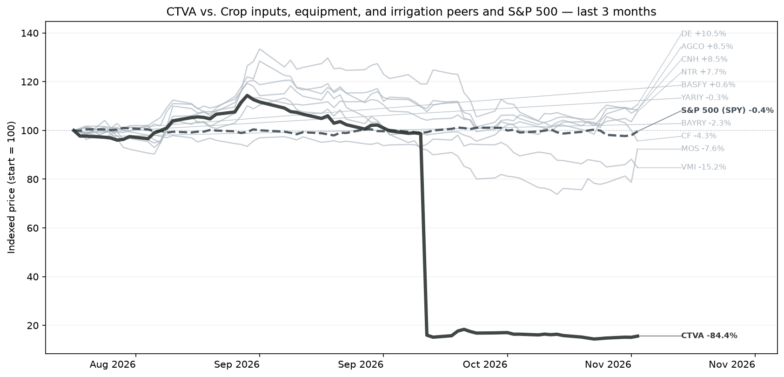

Corteva is an agricultural inputs pure play that was formed in 2019 when it was spun off from DowDuPont. The company is a leader in the development of new seed and crop protection products. Seeds generate the majority of profits with the remainder coming from crop protection products. Corteva plans to spin off its seeds business in late 2026. The seeds business will be named Vylor, while the crop protection business will retain the Corteva name and be a pure-play crop protection company following the divestiture. Corteva operates globally, but around half of revenue comes from North America.

<h3 id="company-bayry">Bayer (BAYRY)</h3>

*Crop inputs, equipment, and irrigation · n/a · 3m -2.3% · 12m +83.5% · 24m +105.8%*

[Google Finance](https://www.google.com/finance/quote/BAYRY:NYSE?tab=earnings&hl=en)

Dekalb and former Monsanto corn-seed brands; together with Corteva dominates U.S. corn seed.

BAYER AG S/ADR

<h3 id="company-basfy">BASF (BASFY)</h3>

*Crop inputs, equipment, and irrigation · n/a · 3m +0.6% · 12m +19.5% · 24m +22.9%*

[Google Finance](https://www.google.com/finance/quote/BASFY:NYSE?tab=earnings&hl=en)

Crop-protection chemistry used on U.S. corn acres.

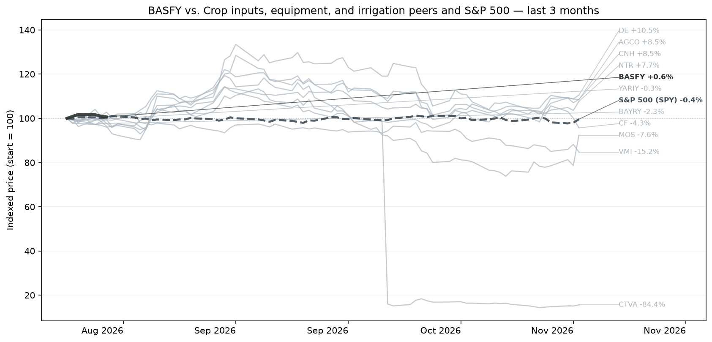

BASF SE S/ADR

<h3 id="company-ntr">Nutrien (NTR)</h3>

*Crop inputs, equipment, and irrigation · $33.6B · 3m +7.7% · 12m +33.5% · 24m +42.3%*

[Google Finance](https://www.google.com/finance/quote/NTR:NYSE?tab=earnings&hl=en)

Largest North American agricultural retailer and a major potash and nitrogen producer.

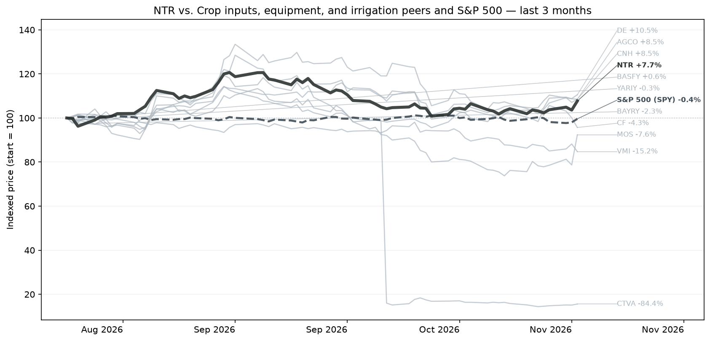

Created in 2018 as a result of the merger between PotashCorp and Agrium, Nutrien is the world's largest fertilizer producer by capacity. Nutrien produces the three main crop nutrients—nitrogen, potash, and phosphate—although its main focus is potash, where it is the global leader in installed capacity with a roughly 20% market share. The company is also the largest agricultural retailer in North America and Australia, selling fertilizers, crop chemicals, seeds, and services directly to farm customers through its brick-and-mortar stores and online platforms.

<h3 id="company-cf">CF Industries (CF)</h3>

*Crop inputs, equipment, and irrigation · $18.0B · 3m -4.3% · 12m +31.3% · 24m +29.0%*

[Google Finance](https://www.google.com/finance/quote/CF:NYSE?tab=earnings&hl=en)

Nitrogen fertilizer producer; corn is the crop that most moves UAN and urea demand.

CF Industries is a leading producer and distributor of nitrogen, which is primarily used in fertilizers. The company operates nitrogen manufacturing plants primarily in North America. CF also produces nitrogen in the United Kingdom and holds a joint venture interest in a nitrogen production facility in Trinidad and Tobago. CF makes nitrogen primarily using low-cost US natural gas as its feedstock, making the company one of the lowest-cost nitrogen producers globally. It is also investing in carbon-free blue and green ammonia, which can be used as an alternative fuel to hydrogen or as a means to transport hydrogen.

<h3 id="company-yariy">Yara International (YARIY)</h3>

*Crop inputs, equipment, and irrigation · n/a · 3m -0.3% · 12m +21.7% · 24m +46.2%*

[Google Finance](https://www.google.com/finance/quote/YARIY:NYSE?tab=earnings&hl=en)

Global nitrogen producer that sets the international urea and ammonia reference.

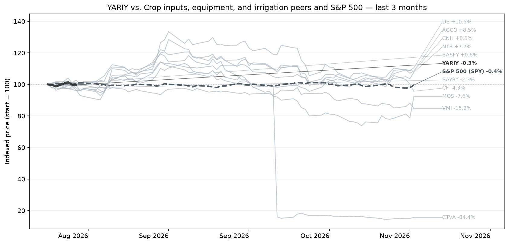

YARA INTL ASA S/ADR

<h3 id="company-mos">Mosaic (MOS)</h3>

*Crop inputs, equipment, and irrigation · $7.1B · 3m -7.6% · 12m -17.5% · 24m -23.0%*

[Google Finance](https://www.google.com/finance/quote/MOS:NYSE?tab=earnings&hl=en)

Phosphate and potash producer that completes corn production budgets.

Mosaic is one of the largest phosphate and potash producers in the world. The company's assets include phosphate rock mines in the US and potash mines in Canada. Mosaic also runs a large fertilizer distribution operation in Brazil through its Mosaic Fertilizantes business.

<h3 id="company-de">Deere (DE)</h3>

*Crop inputs, equipment, and irrigation · $156.7B · 3m +10.5% · 12m +42.8% · 24m +69.0%*

[Google Finance](https://www.google.com/finance/quote/DE:NYSE?tab=earnings&hl=en)

Dominant North American farm-equipment maker for corn planting, harvest, and grain handling.

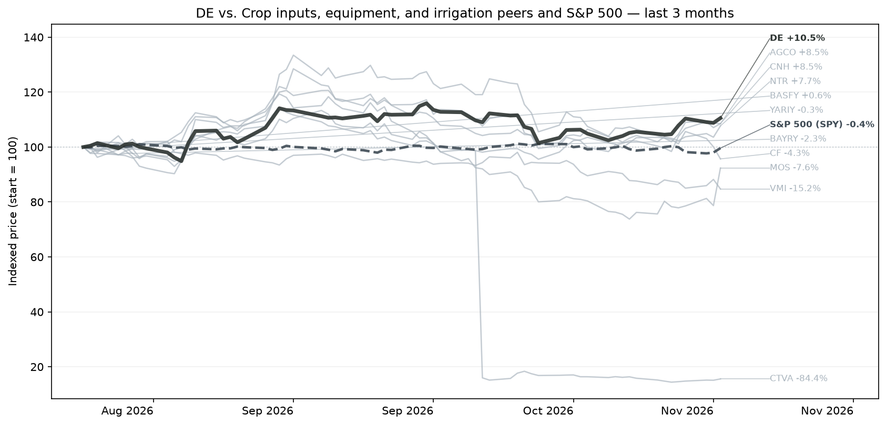

Deere is the world's leading manufacturer of agricultural equipment and a major producer of construction machinery. The company is divided into four reporting segments: production & precision agriculture, or PPA, small agriculture & turf, or SAT, construction & forestry, or CF, and financial services, or FS, its captive finance subsidiary. The core PPA business is the largest contributor to sales and profits by far. Geographically, Deere sales are 60% US/Canada, 17% Europe, 14% Latin America, and 9% rest of the world. Deere goes to market through a robust dealer network that includes over 2,000 dealer locations in North America with reach into over 100 countries. John Deere Financial provides retail financing for machinery to its customers and wholesale financing for dealers.

<h3 id="company-cnh">CNH Industrial (CNH)</h3>

*Crop inputs, equipment, and irrigation · $16.5B · 3m +8.5% · 12m +11.8% · 24m +4.1%*

[Google Finance](https://www.google.com/finance/quote/CNH:NYSE?tab=earnings&hl=en)

Case IH and New Holland farm equipment serving corn growers.

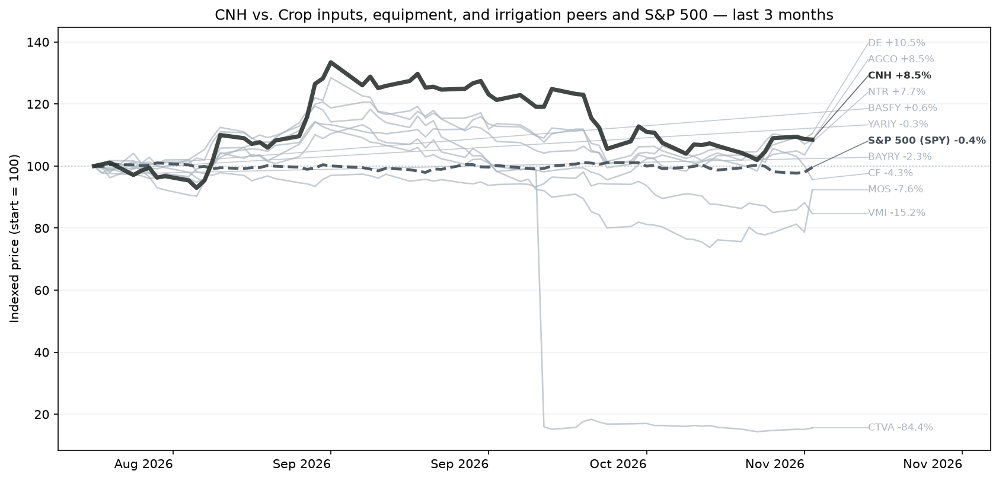

CNH Industrial is the world's second largest manufacturer of agricultural machinery (82% of industrial net sales) as well as a major player in construction equipment (18% of industrial net sales). Its Case and New Holland brands have served farmers for generations. Geographically, agricultural sales are 40% in North America, 32% in Europe, the Middle East, and Africa, 18% in South America, and 10% in Asia-Pacific. CNH's products are available through a robust independent dealer network, which includes over 2,600 dealer and distribution locations and reach into 164 countries. The construction business leverages over 400 dealers. The company's captive finance arm provides retail financing to its customers and wholesale financing to dealers to maintain inventory, thereby supporting sales.

<h3 id="company-agco">AGCO (AGCO)</h3>

*Crop inputs, equipment, and irrigation · $7.0B · 3m +8.5% · 12m +5.5% · 24m +24.9%*

[Google Finance](https://www.google.com/finance/quote/AGCO:NYSE?tab=earnings&hl=en)

Fendt, Massey Ferguson, and Challenger farm equipment with Corn Belt exposure.

Agco is a global manufacturer of agricultural equipment. Its main machine brands are Fendt, Massey Ferguson, and Valtra; its initiatives in precision agriculture have been organized under the PTx umbrella following a series of acquisitions. While a global business, Agco's sales skew heavily toward Europe/Middle East, representing 50%-60% of sales and even more of operating profits. The company is trying to increase its exposure to the larger North and South American markets. Its products are available through a global dealer network, which includes over 3,000 dealers and distribution locations and reaches into over 140 countries. Additionally, Agco offers retail and wholesale financing to customers through its partnership with Rabobank of the Netherlands, having exited their JV in 2026.

<h3 id="company-vmi">Valmont Industries (VMI)</h3>

*Crop inputs, equipment, and irrigation · $9.3B · 3m -15.2% · 12m +2.8% · 24m +28.9%*

[Google Finance](https://www.google.com/finance/quote/VMI:NYSE?tab=earnings&hl=en)

Center-pivot irrigation (Valley) used on irrigated High Plains corn.

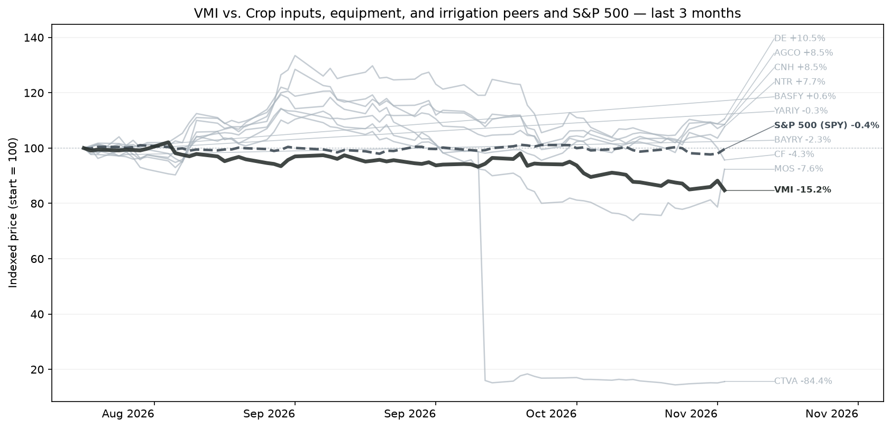

Valmont Industries Inc, along with its subsidiaries, operates as a manufacturer of products and services for infrastructure and agriculture markets. Its reportable segments are Infrastructure and Agriculture. The company generates maximum revenue from the Infrastructure segment, which includes the manufacturing and distribution of products and solutions to serve the infrastructure markets of utility, solar, lighting, transportation, and telecommunications, along with coatings services to protect metal products. The Agriculture segment provides irrigation equipment components, including aftermarket parts and tubular products, and technology solutions for precision agriculture. Geographically, it derives key revenue from the United States, followed by Australia, Brazil, and other regions.

<h3 id="company-adm">Archer Daniels Midland (ADM)</h3>

*Grain origination and agribusiness, U.S. ethanol and process technology, Wet milling, ingredients, and co-products · $38.9B · 3m -8.7% · 12m +25.8% · 24m +36.2%*

[Google Finance](https://www.google.com/finance/quote/ADM:NYSE?tab=earnings&hl=en)

Global grain trader, top U.S. ethanol producer, and major corn wet miller.

Archer-Daniels-Midland is a major processor of oilseeds, corn, wheat, and other agricultural commodities. The company is also one of the largest grain merchandisers through its extensive network of logistical assets to store and transport crops around the globe. ADM also runs a nutrition business that focuses on both human and animal ingredients and is a large producer of corn-based sweeteners, starches, and ethanol.

<h3 id="company-bg">Bunge (BG)</h3>

*Grain origination and agribusiness · $21.9B · 3m -9.0% · 12m +1.5% · 24m +14.4%*

[Google Finance](https://www.google.com/finance/quote/BG:NYSE?tab=earnings&hl=en)

Global grain and oilseed merchant after the Viterra combination; competitor for corn origination.

Bunge Global SA is an agribusiness solutions company, connecting farmers to consumers and delivering essential food, feed and fuel to the globe. The company segments include Soybean Processing and Refining; Softseed Processing and Refining; Other Oilseeds Processing and Refining; Grain Merchandising and Milling; and Corporate and Other. It generates maximum revenue from the Soybean Processing and Refining segment, which includes integrated business principally involved in the purchase, storage, transportation, processing, distribution, refining, marketing, and sale of soybeans and soybean related products, as well as biodiesel and fertilizer production and distribution. Geographically, the company operates in United States, Switzerland, Netherlands, and Rest of the World.

<h3 id="company-ande">The Andersons (ANDE)</h3>

*Grain origination and agribusiness, U.S. ethanol and process technology · $2.3B · 3m -20.6% · 12m +14.2% · 24m +27.5%*

[Google Finance](https://www.google.com/finance/quote/ANDE:NASDAQ?tab=earnings&hl=en)

Grain elevators plus four wholly owned ethanol plants totaling about 500 million gallons a year.

Andersons Inc is an agriculture and renewable fuels company. Its operations are classified into two reportable business segments: Agribusiness, which generates maximum revenue, and Renewables. The Agribusiness segment includes merchandising and managing logistics across various commodities, as well as being a manufacturer, distributor, and retailer of agricultural and related plant nutrients. The segment specializes in the movement of physical commodities such as whole grains, grain products, feed ingredients, and domestic fuel products, among other agricultural commodities. The Renewables segment mainly produces, purchases, and sells ethanol and co-products. Geographically, the company generates maximum revenue from the United States, followed by Canada, Mexico, and other markets.

<h3 id="company-vlo">Valero Energy (VLO)</h3>

*U.S. ethanol and process technology, Fuel blending, refining, and retail · $99.7B · 3m +20.8% · 12m +114.7% · 24m +176.6%*

[Google Finance](https://www.google.com/finance/quote/VLO:NYSE?tab=earnings&hl=en)

World's second-largest corn-ethanol producer with a distinct Ethanol segment and a major blender.

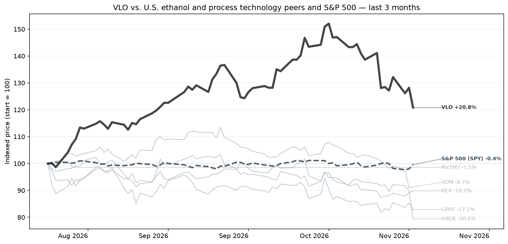

Valero Energy is one of the largest independent refiners in the United States. It operates 15 refineries, with a total throughput capacity of 3.2 million barrels a day in the US, Canada, and the United Kingdom. Valero also owns 12 ethanol plants with capacity of 1.6 billion gallons a year and holds a 50% stake in Diamond Green Diesel, which can produce 1.2 billion gallons per year of renewable diesel.

<h3 id="company-gpre">Green Plains (GPRE)</h3>

*U.S. ethanol and process technology · $1.1B · 3m -17.2% · 12m +21.1% · 24m +6.1%*

[Google Finance](https://www.google.com/finance/quote/GPRE:NASDAQ?tab=earnings&hl=en)

Largest U.S. ethanol pure play, with high-protein feed, corn oil, and Nebraska carbon-capture work.

Green Plains Inc manufactures and sells ethanol and ethanol byproducts in two segments based on function. The ethanol production segment, which generates the majority of revenue, includes the production of ethanol, distillers grains, Ultra-High Protein and renewable corn oil. The agribusiness and energy services segment includes grain handling and storage, commodity marketing and merchant trading for company-produced and third-party ethanol, distillers grains, Ultra-High Protein, renewable corn oil, natural gas and other commodities.

<h3 id="company-rex">REX American Resources (REX)</h3>

*U.S. ethanol and process technology · $1.4B · 3m -10.2% · 12m +22.4% · 24m +71.1%*

[Google Finance](https://www.google.com/finance/quote/REX:NYSE?tab=earnings&hl=en)

Holding company with interests in six Corn Belt ethanol plants; cleanest public crush-margin equity.

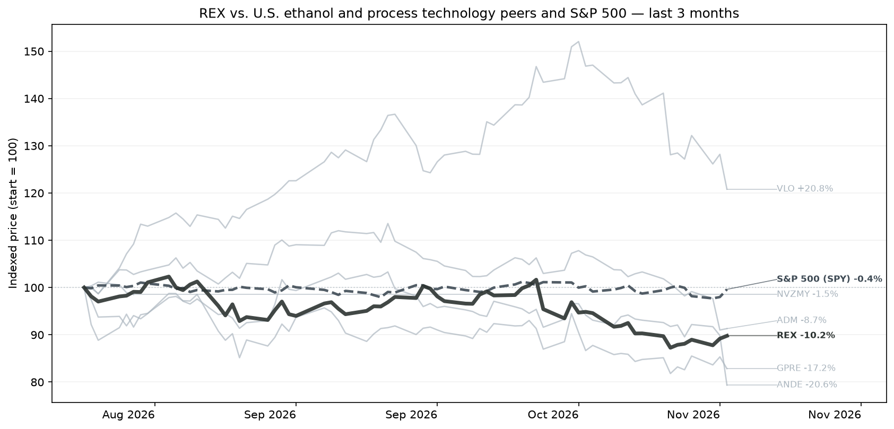

REX American Resources Corp operates as a holding company that engages in investments in alternative energy and ethanol production entities. Its operating segments include Ethanol and By-Products. Its products include Ethanol, dried distillers grains, modified distillers grains, Distillers corn oil, Modified distillers grains, and Other.

<h3 id="company-nvzmy">Novonesis (NVZMY)</h3>

*U.S. ethanol and process technology · n/a · 3m -1.5% · 12m +8.1% · 24m +2.9%*

[Google Finance](https://www.google.com/finance/quote/NVZMY:NYSE?tab=earnings&hl=en)

Dominant supplier of enzymes used in dry-mill ethanol fermentation.

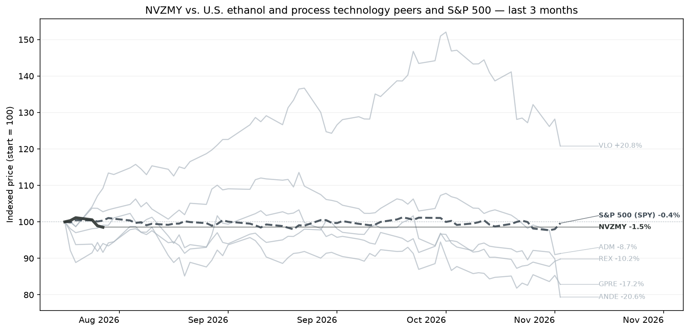

NOVONESIS B UNSP/ADR

<h3 id="company-ingr">Ingredion (INGR)</h3>

*Wet milling, ingredients, and co-products · $6.8B · 3m -5.7% · 12m -9.6% · 24m -37.1%*

[Google Finance](https://www.google.com/finance/quote/INGR:NYSE?tab=earnings&hl=en)

Major corn wet miller producing sweeteners, starches, and specialty ingredients.

Ingredion is an ingredients provider for the food, beverage, brewing, and animal nutrition industries. The company processes corn, tapioca, potatoes, stevia, grains, fruits, gums, and vegetables into value-added ingredients. The company sells specialty ingredients that include starch-based texturizers and natural alternative sweeteners such as stevia. Ingredion also sells commodity ingredients that include sweeteners, such as high-fructose corn syrup, and starches, such as those used for sustainable packaging, as well as plant-based proteins. The company plans to acquire Tate & Lyle in an all-cash deal that should close in 2027.

<h3 id="company-dar">Darling Ingredients (DAR)</h3>

*Wet milling, ingredients, and co-products · $10.6B · 3m -9.5% · 12m +62.3% · 24m +30.7%*

[Google Finance](https://www.google.com/finance/quote/DAR:NYSE?tab=earnings&hl=en)

Rendering and used cooking oil; 50/50 owner of Diamond Green Diesel with Valero.

Darling Ingredients Inc is a developer and producer of sustainable natural ingredients from edible and inedible bio-nutrients, creating a wide range of ingredients and customized specialty solutions for customers in the pharmaceutical, food, pet food, animal feed, industrial, fuel, bioenergy and fertilizer industries. It processes by-products from the animal agriculture and food industries into ingredients and products for human nutrition, animal feed, crop inputs, and renewable energy applications. The company operates processing facilities across multiple countries and produces collagen, including gelatin and hydrolyzed collagen, as well as renewable energy products.

<h3 id="company-tsn">Tyson Foods (TSN)</h3>

*Wet milling, ingredients, and co-products · $20.6B · 3m +3.2% · 12m +14.5% · 24m +1.3%*

[Google Finance](https://www.google.com/finance/quote/TSN:NYSE?tab=earnings&hl=en)

Largest U.S. protein company and a primary domestic sink for distillers grains.

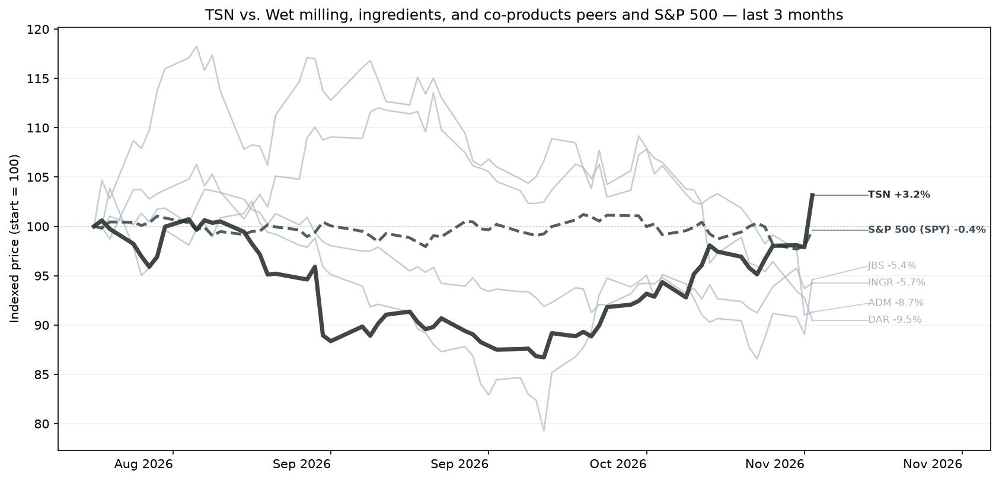

Tyson Foods is a protein-focused food producer, selling raw chicken, beef, pork, and prepared foods. Chicken and beef are its two largest segments, composing about 40% and 30% of sales, respectively. Prepared foods constituted 18% of fiscal 2025 sales and include brands like Tyson, Jimmy Dean, Hillshire Farm, Ball Park, and Sara Lee. However, most of these are in product categories rife with competition where Tyson does not have a massive market share lead. Tyson sells some products overseas, but the international segment accounts for just 4% of total revenue. The company is an active acquirer, with more recent years' purchases focused on international and food-service markets.

<h3 id="company-jbs">JBS (JBS)</h3>

*Wet milling, ingredients, and co-products · $45.2B · 3m -5.4% · 12m -4.2% · 24m n/a*

[Google Finance](https://www.google.com/finance/quote/JBS:NYSE?tab=earnings&hl=en)

World's largest protein company and a major DDGS buyer in the U.S. and Brazil.

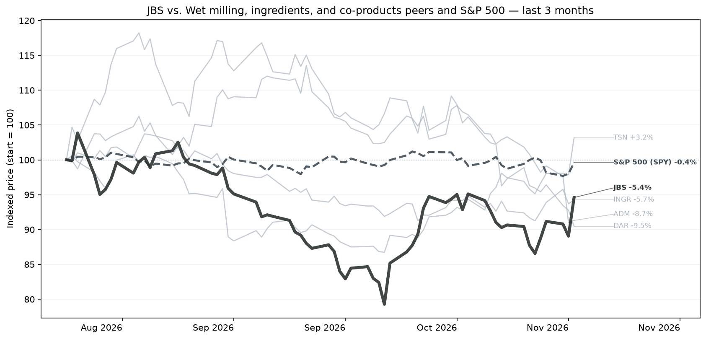

JBS NV is a protein food company, selling protein products, which include fresh and frozen cuts of beef, pork, lamb, fish, whole chickens, and chicken parts, to retailers, and foodservice companies. The food products are marketed under different brands such as Swift, Just Bare, Pilgrim's Pride, Sunnyvalley, Reserva Friboi, Great Southern, etc., globally. The company's reportable segments are Beef North America, which generates maximum revenue, Brazil, Seara, Pork USA, Pilgrim's Pride, Australia, and Others. Geographically, it derives majority of its revenue from United States of America.

<h3 id="company-mpc">Marathon Petroleum (MPC)</h3>

*Fuel blending, refining, and retail · $101.3B · 3m +31.9% · 12m +110.9% · 24m +162.6%*

[Google Finance](https://www.google.com/finance/quote/MPC:NYSE?tab=earnings&hl=en)

Largest U.S. independent refiner and a major Midwest ethanol blender.

Marathon Petroleum is a leading integrated downstream and midstream energy company that operates 13 refineries in the Gulf Coast, Mid-Continent, and West Coast regions of the United States with an aggregate crude oil refining capacity of 3.0 million barrels per day. The company is one of the largest producers of renewable diesel in the US; its Dickinson, North Dakota facility has the capacity to produce 184 million gallons per year, and its Martinez, California, joint venture facility (a 50/50 partnership with Neste) reached its full capacity of 730 million gallons per year in late 2024. Marathon also owns the general partner and approximately 64% of MPLX LP, a large-cap master limited partnership that owns and operates midstream energy infrastructure and logistics assets.

<h3 id="company-psx">Phillips 66 (PSX)</h3>

*Fuel blending, refining, and retail · $96.7B · 3m +28.2% · 12m +91.0% · 24m +113.1%*

[Google Finance](https://www.google.com/finance/quote/PSX:NYSE?tab=earnings&hl=en)

Large blender and marketer with West Coast renewable-diesel capacity.

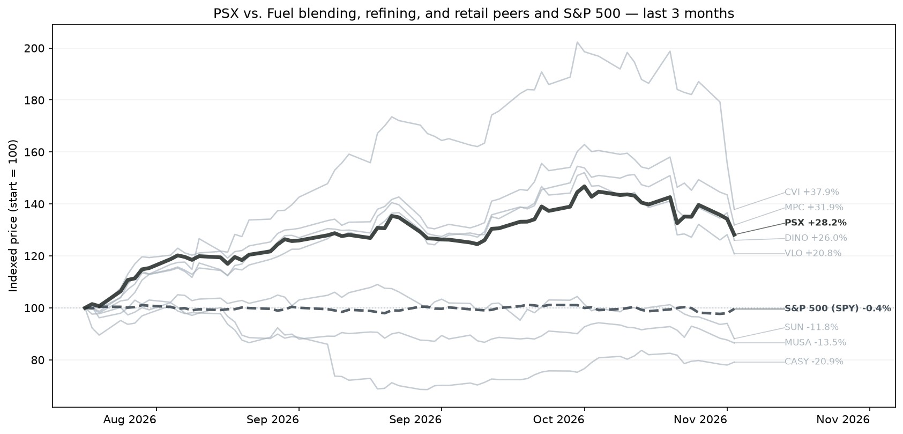

Phillips 66 is an independent refiner that owns or holds interest in 10 refineries with a total crude throughput capacity of 2.0 million barrels per day, or mmb/d, at the end of 2025. The midstream segment comprises extensive transportation and NGL processing assets. It includes 70,000 miles of crude oil, refined petroleum product, NGL and natural gas pipeline systems, and a comprehensive set of refined petroleum product, NGL and crude oil terminals, gathering and processing plants and fractionation facilities and various other storage and loading facilities. Its CPChem chemical joint venture operates facilities primarily in the United States and the Middle East and produces olefins and polyolefins.

<h3 id="company-dino">HF Sinclair (DINO)</h3>

*Fuel blending, refining, and retail · $16.8B · 3m +26.0% · 12m +97.3% · 24m +161.6%*

[Google Finance](https://www.google.com/finance/quote/DINO:NYSE?tab=earnings&hl=en)

Independent Mid-Continent and Rockies refiner with renewable diesel and RFS blending obligations.

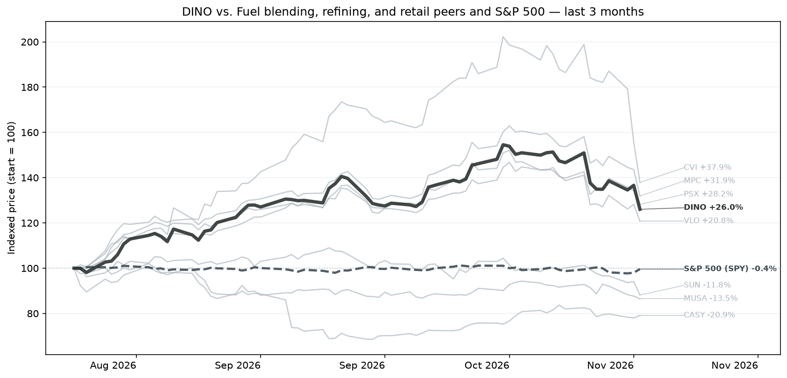

HF Sinclair is an integrated petroleum refiner that owns and operates seven refineries serving the Rockies, midcontinent, Southwest, and Pacific Northwest, with a total crude oil throughput capacity of 678,000 barrels per day. It can produce 380 million gallons of renewable diesel annually. It operates a marketing business with over 350 distributors and 1,700 branded wholesale sites across 30 states. It also owns and operates 4,500 miles of petroleum product pipelines and terminals principally in the Southwestern United States.

<h3 id="company-cvi">CVR Energy (CVI)</h3>

*Fuel blending, refining, and retail · $3.7B · 3m +37.9% · 12m +18.8% · 24m +162.4%*

[Google Finance](https://www.google.com/finance/quote/CVI:NYSE?tab=earnings&hl=en)

Coffeyville, Kansas refiner in the corn complex with renewable diesel and a nitrogen affiliate.

CVR Energy Inc is a holding company that engages in petroleum refining and nitrogen fertilizer manufacturing through its subsidiaries. Subsidiaries include several complex, full-coking crude oil refineries, along with a crude oil gathering system, pipelines, storage tanks, and marketing and supply. The company's refineries can process blends of a variety of crude oil ranging from heavy sour to light sweet crude oil. Crude oil for CVR's refineries is supplied through its wholly-owned gathering system and pipeline. From its refineries, CVR supplies products through tanker trucks directly to customers located in close geographic proximity and customers at throughput terminals. The company's customers include retailers, railroads, and farm cooperatives.

<h3 id="company-sun">Sunoco LP (SUN)</h3>

*Fuel blending, refining, and retail · $14.5B · 3m -11.8% · 12m +23.1% · 24m +21.4%*

[Google Finance](https://www.google.com/finance/quote/SUN:NYSE?tab=earnings&hl=en)

Fuel distributor and terminal operator that moves finished gasoline and ethanol.

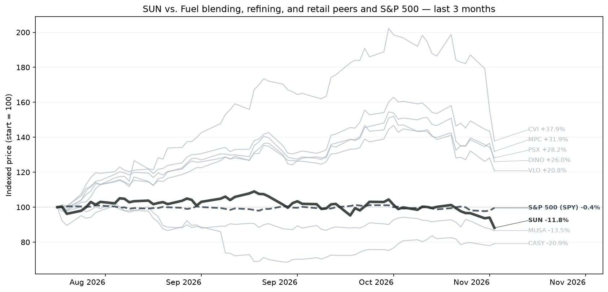

Sunoco LP is engaged in the distribution of motor fuels to independent dealers, distributors, and other commercial customers as well as the distribution of motor fuels to end-use customers at retail sites operated by commission agents. It is a growth-oriented master limited partnership (MLP) that operates as a wholesale and retail fuel distributor in the United States. The firm operates through the Fuel Distribution; Pipeline Systems; Refinery and Terminals segments. It generates the majority of its revenue from the Fuel Distribution segment. It distributes motor fuel to convenience stores, dealers, and commercial customers in various states.

<h3 id="company-casy">Casey&#x27;s General Stores (CASY)</h3>

*Fuel blending, refining, and retail · $30.9B · 3m -20.9% · 12m +28.4% · 24m +70.0%*

[Google Finance](https://www.google.com/finance/quote/CASY:NASDAQ?tab=earnings&hl=en)

Corn Belt convenience-store chain with high E10/E15/E85 exposure.

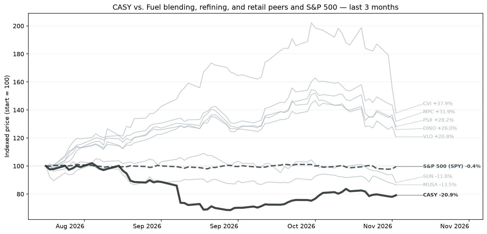

Casey's General Stores Inc, along with its subsidiaries, operates convenience stores mainly under the names Casey's, GoodStop (by Casey's), and Casey's General Store throughout various states in the USA, approximately half of which are located in Iowa, Missouri, and Illinois. These stores offer a broad selection of food items (which includes prepared foods such as regular and breakfast pizza, donuts, hot breakfast items, and hot and cold sandwiches), beverages, tobacco and nicotine products, groceries, health and beauty aids, automotive products, and other non-food items. The majority of the company's revenue is mainly derived from the retail sale of fuel and the products offered inside its stores.

<h3 id="company-musa">Murphy USA (MUSA)</h3>

*Fuel blending, refining, and retail · $10.4B · 3m -13.5% · 12m +37.3% · 24m +2.1%*

[Google Finance](https://www.google.com/finance/quote/MUSA:NYSE?tab=earnings&hl=en)

High-volume fuel retailer and national ethanol blender.

Murphy USA Inc is mainly engaged in the marketing of retail motor fuel products and convenience merchandise through a network of several retail stores in the Southwest, Southeast, Midwest, and Northeast United States. The majority of Murphy USA's stores are located in proximity to Walmart Supercenters, but it also operates standalone stores that market gasoline and other products under the Murphy USA, Murphy Express, and QuickChek brands. In addition, the company also markets fuel to unbranded wholesale customers through a mixture of company-owned and third-party product distribution terminals and pipeline positions. The firm generates maximum revenue through retail sales of petroleum products, and the rest from merchandise sales and wholesale of petroleum products.

<h3 id="company-ntoiy">Neste (NTOIY)</h3>

*Advanced biofuels and SAF · n/a · 3m +4.4% · 12m +71.1% · 24m +124.1%*

[Google Finance](https://www.google.com/finance/quote/NTOIY:NYSE?tab=earnings&hl=en)

Largest global producer of renewable diesel and SAF; sets the price umbrella for corn oil.

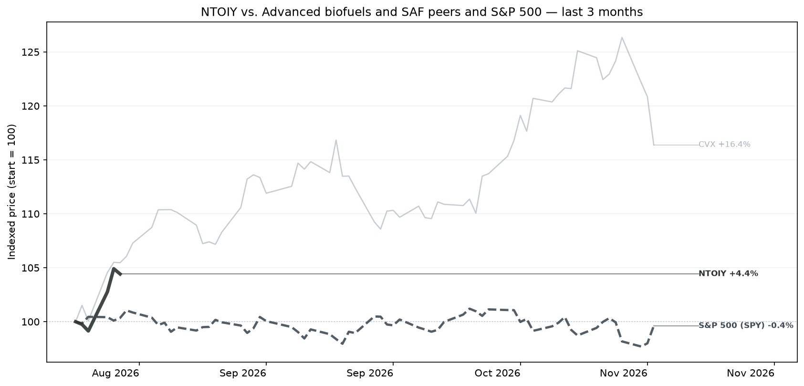

NESTE OYJ UNSP/ADR

<h3 id="company-cvx">Chevron (CVX)</h3>

*Advanced biofuels and SAF · $403.6B · 3m +16.4% · 12m +42.1% · 24m +41.4%*

[Google Finance](https://www.google.com/finance/quote/CVX:NYSE?tab=earnings&hl=en)

Owner of Renewable Energy Group biodiesel and renewable-diesel plants that take corn oil at the margin.

Chevron is an integrated energy company with exploration, production, and refining operations worldwide. It is the second-largest oil company in the United States with 2025 worldwide net oil-equivalent production of 3.7 million barrels per day, including 8.5 billion cubic feet per day of natural gas and 2.3 million barrels of liquids per day. Production takes place in North America, South America, Europe, Africa, Asia, and Australia. The company's refining networks arelocated in the United States and Asia, with a total worldwide refining capacity of 1.8 million barrels of oil a day at year-end 2025. Net proved reserves at year-end 2025 stood at 10.6 billion barrels of oil equivalent, consisting of 5.7 billion barrels of liquids and 29.2 trillion cubic feet of natural gas.

<h3 id="company-csan">Cosan (CSAN)</h3>

*International ethanol · $2.5B · 3m -9.5% · 12m -38.8% · 24m -66.9%*

[Google Finance](https://www.google.com/finance/quote/CSAN:NYSE?tab=earnings&hl=en)

Brazilian holding company and the liquid U.S.-listed proxy for sugarcane ethanol via Raizen.

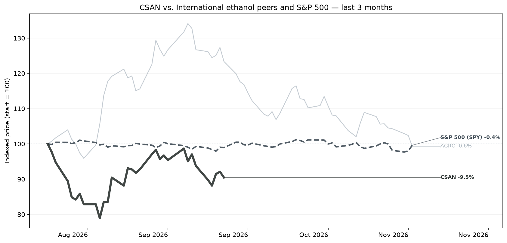

Cosan SA engages in several services throughout the energy and logistics sectors. Its reportable segments are Raizen, Compass, Moove, Rumo, and Radar. It generates the majority of its revenue from Raizen which operates in the production, commercialization, origination, and trading of ethanol, bioenergy, resale, and trading of electricity, renewable sources, marketing, origination, and trading of sugar and fuels, and lubricant.

<h3 id="company-agro">Adecoagro (AGRO)</h3>

*International ethanol · $1.5B · 3m -0.6% · 12m +16.0% · 24m -18.7%*

[Google Finance](https://www.google.com/finance/quote/AGRO:NYSE?tab=earnings&hl=en)

South American farmland and sugar/ethanol producer with U.S.-listed equity.

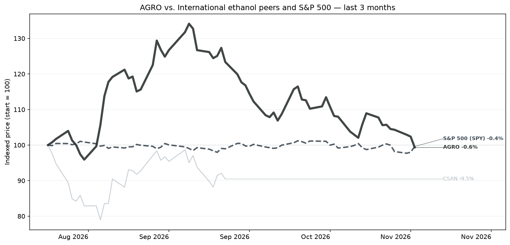

Adecoagro SA is a Luxembourg-based agricultural company. It is involved in a wide range of businesses, including farming crops and other agricultural products, dairy operations sugar, ethanol, energy production, and land transformation. The group operates in two lines of business, namely, Farming and Sugar, Ethanol and Energy. The Farming is further comprised of three reportable segments: Crops, Rice and Dairy. Sugar, Ethanol and Energy Segment, consists of cultivating sugarcane, which is processed in owned sugar mills, transformed into ethanol, sugar and electricity, in addition to biomethane and then marketed.

<h3 id="company-unp">Union Pacific (UNP)</h3>

*Logistics · $179.3B · 3m +4.4% · 12m +41.9% · 24m +31.9%*

[Google Finance](https://www.google.com/finance/quote/UNP:NYSE?tab=earnings&hl=en)

Primary western Class I for Corn Belt corn, ethanol unit trains, DDGS, and corn oil.

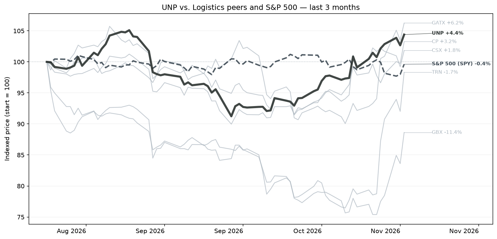

Omaha, Nebraska-based Union Pacific is the largest public railroad in North America. Operating on more than 30,000 miles of track in the western two-thirds of the US, Union Pacific generated $24.5 billion of revenue in 2025 by hauling coal, industrial products, intermodal containers, agricultural goods, chemicals, fertilizers, and automotive goods. Union Pacific owns about one-fourth of Mexican railroad Ferromex and historically derives roughly 10% of its revenue hauling freight to and from Mexico.

<h3 id="company-csx">CSX (CSX)</h3>

*Logistics · $93.9B · 3m +1.8% · 12m +47.4% · 24m +53.0%*

[Google Finance](https://www.google.com/finance/quote/CSX:NASDAQ?tab=earnings&hl=en)

Primary eastern Class I into Northeast and Southeast gasoline markets for ethanol unit trains.

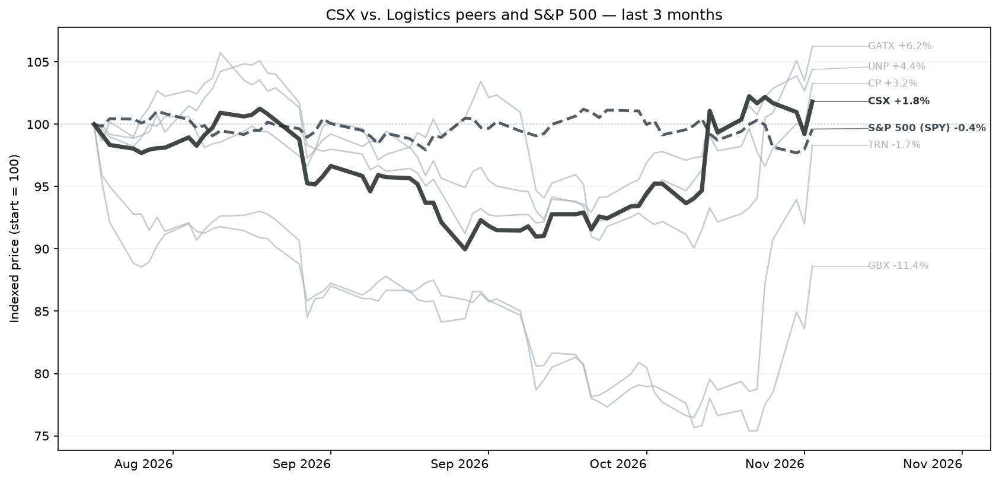

Operating in the Eastern United States, Class I railroad CSX generated revenue of nearly $14 billion in 2025. On its more than 21,000 miles of track, CSX hauls shipments of coal (16% of consolidated revenue), chemicals (17%), intermodal containers (16%), automotive cargo (7%), and a diverse mix of other bulk and industrial merchandise.

<h3 id="company-cp">Canadian Pacific Kansas City (CP)</h3>

*Logistics · $83.0B · 3m +3.2% · 12m +34.2% · 24m +19.0%*

[Google Finance](https://www.google.com/finance/quote/CP:NYSE?tab=earnings&hl=en)

North-south railroad for Midwest corn and ethanol to the Gulf and Mexico.

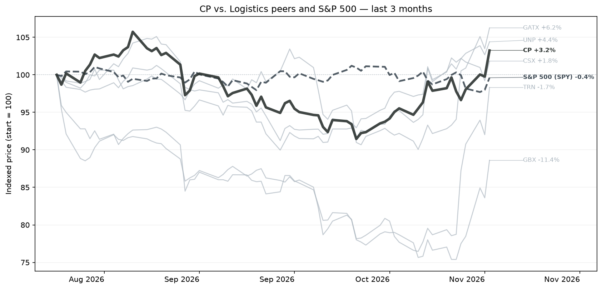

Canadian Pacific Kansas City is a Class I railroad operating on tracks that span most of Canada and into parts of the Midwestern and Northeastern United States. Following the April 2023 Kansas City Southern merger, CPKC operates new single-linehaul services from Canada and the Upper Midwest down through Texas, the Gulf of Mexico, and into Mexico. It also hauls cross-border and intra-Mexico freight via operating concessions on more than 3,000 miles of rail in Mexico. CPKC hauls shipments of grain, intermodal containers, energy products (like crude and frac sand), chemicals, plastics, coal, fertilizer and potash, automotive products, and a diverse mix of other merchandise.

<h3 id="company-gatx">GATX (GATX)</h3>

*Logistics · $6.2B · 3m +6.2% · 12m +24.8% · 24m +33.7%*

[Google Finance](https://www.google.com/finance/quote/GATX:NYSE?tab=earnings&hl=en)

Largest public railcar lessor of ethanol tank cars and grain/DDGS hoppers.

GATX Corp leases transportation assets, including railcars, aircraft spare engines, and tank containers, to customers in North America, Europe, and India. The company's reportable business segments are: Rail North America, Rail International, Engine Leasing, and Other. The majority of its revenue is generated from the Rail North America segment, which is composed of the company's operations in the United States, Canada, and Mexico. This segment mainly provides railcars pursuant to full-service leases under which it maintains the railcars, pays ad valorem taxes and insurance, and provides other ancillary services.

<h3 id="company-trn">Trinity Industries (TRN)</h3>

*Logistics · $2.4B · 3m -1.7% · 12m +21.5% · 24m -5.6%*

[Google Finance](https://www.google.com/finance/quote/TRN:NYSE?tab=earnings&hl=en)

Builds and leases covered hoppers and tank cars used for grain, DDGS, and ethanol.

Trinity Industries Inc sells and leases railroad products and railcar maintenance services in North America. The company operates under the name TrinityRail in two main segments: railcar leasing and management services, which owns railcars and provides fleet management and administration services; rail products, which builds, sells, and modifies freight and tank railcars and their components; and all other, which sells highway products such as guardrail and other highway barriers. Customers include railroads, leasing companies, and shipping companies in agriculture, construction, consumer products, energy, and chemicals.

<h3 id="company-gbx">Greenbrier (GBX)</h3>

*Logistics · $1.4B · 3m -11.4% · 12m +3.4% · 24m -29.1%*

[Google Finance](https://www.google.com/finance/quote/GBX:NYSE?tab=earnings&hl=en)

Builds tank cars used for ethanol, renewable fuels, and CO2.

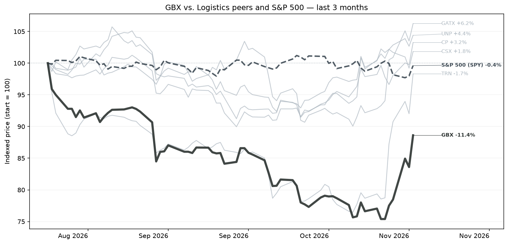

Greenbrier Companies Inc supplies equipment and services to international freight transportation markets, designing and marketing freight railcars in North America, Europe, and Brazil through subsidiaries and joint ventures. It provides railcar wheel services, parts, maintenance, and conversion services in North America. The company owns a lease fleet sourced mainly from its manufacturing operations and offers railcar management, regulatory compliance, and leasing services to railroads and owners. It operates two segments: Manufacturing and Leasing & Fleet Management, with the majority of revenue from Manufacturing. The company operates in the U.S. and internationally, with the majority of revenue from the U.S. market.

