# Weekly Corn and Ethanol Intel Report

<strong>Week of November 12, 2026</strong>Market data through: November 11, 2026Narrative created: November 13, 2026Nearby corn: $4.425/bu (+$0.025 (+0.6%) week)

Weekly review of corn, ethanol, energy, co-product, policy, and related public-company performance for commodities risk managers at U.S. ethanol plants.

## Strategy Narrative

Nearby futures from Yahoo Finance. Nearby corn is the market&#x27;s current perception of yield and demand risk.

<table><thead><tr><th>Contract</th><th>Last</th><th>Week change</th><th>As of</th></tr></thead><tbody><tr><td>Nearby corn</td><td>$4.425/bu</td><td>+$0.025 (+0.6%)</td><td>November 12, 2026</td></tr><tr><td>RBOB gasoline</td><td>$2.671/gal</td><td>-0.093 (-3.4%)</td><td>November 12, 2026</td></tr><tr><td>Henry Hub</td><td>$3.340/MMBtu</td><td>+0.393 (+13.3%)</td><td>November 12, 2026</td></tr></tbody></table>

<nav class="strategy-narrative-links" aria-label="Strategy narrative sections">
<ul>
<li><a href="#strategy-executive-view-1-usda-reduced-supply-risk-relief-but-demand-cuts-absorbed-one-third-of-the-crop-loss">1. USDA reduced supply risk relief—but demand cuts absorbed one-third of the crop loss</a></li>
<li><a href="#strategy-executive-view-2-weak-gasoline-overwhelmed-a-stable-weekly-ethanol-balance">2. Weak gasoline overwhelmed a stable weekly ethanol balance</a></li>
<li><a href="#strategy-executive-view-3-the-gas-rally-raised-winter-cost-volatility-more-than-winter-scarcity">3. The gas rally raised winter cost volatility more than winter scarcity</a></li>
<li><a href="#strategy-executive-view-4-brazil-s-anhydrous-shortage-reopened-a-meaningful-export-outlet">4. Brazil’s anhydrous shortage reopened a meaningful export outlet</a></li>
</ul>
</nav>

<h3 id="executive-view">Executive View</h3>

- **USDA partially reversed October’s supply expansion, but did not restore a tight-corn regime.** USDA reduced 2026 yield **1.6 bushels to 179.6 bushels per acre**, production **141 million bushels to 15.893 billion**, and 2026/27 carryout **91 million bushels to 1.758 billion**, or 10.8% of use. Feed and residual use fell 25 million bushels and exports fell 25 million, while ethanol use remained **5.650 billion bushels**. Nearby corn ended November 12 at **$4.425 per bushel, up $0.025, or 0.6%, for the week**. That restrained rally is consistent with modestly tighter supply—not a return to scarcity. (USDA WAOB, [*World Agricultural Supply and Demand Estimates—November 2026*](https://esmis.nal.usda.gov/sites/default/release-files/796142/wasde1126.pdf), November 10, 2026.) ([esmis.nal.usda.gov](https://esmis.nal.usda.gov/sites/default/release-files/796142/wasde1126.pdf))
- **The petroleum side remained the largest immediate margin headwind.** RBOB declined another **$0.093 to $2.671 per gallon, down 3.4%**, while EIA reported a **1.799-million-barrel gasoline-stock build to 210.757 million** and gasoline supplied easing to **8.767 million barrels per day**, 2.9% below the year-earlier week. The print reinforces last week’s loss of ethanol’s petroleum-price umbrella. (EIA, [*Weekly Petroleum Status Report*](https://ir.eia.gov/secure/wpsr/overview.pdf), November 12, 2026.) ([eia.gov](https://www.eia.gov/dnav/pet/pet_stoc_wstk_a_epm0_sae_mbbl_w.htm?utm_source=openai))
- **Ethanol avoided a product build, but the improvement was narrow.** Production declined **13,000 barrels per day to 1.130 million**, inventories drew **89,000 barrels to 24.345 million**, and EIA refiner and blender ethanol inputs fell **11,000 barrels per day to 888,000**. Estimated exports also declined to 140,000 barrels per day. The physical balance is stable rather than tight, leaving high utilization dependent on continued export clearance. ([eia.gov](https://www.eia.gov/dnav/pet/pet_stoc_wstk_a_epooxe_sae_mbbl_w.htm))
- **Natural gas became a larger near-term cost exposure, although the structural winter balance remains comfortable.** Henry Hub rose **$0.393 to $3.340 per MMBtu, up 13.3%**, as colder forecasts added prompt risk. In contrast, EIA raised its end-November storage projection to **3,840 Bcf** and cut its November–March Henry Hub spot-price forecast 16% from October to **$2.87 per MMBtu**. The tape reflects weather volatility, not yet a sustained shortage. (EIA, [*November 2026 Short-Term Energy Outlook*](https://www.eia.gov/outlooks/steo/report/natgas.php), November 10, 2026.) ([eia.gov](https://www.eia.gov/pressroom/releases/press594.php?utm_source=openai))
- **Overall plant-margin and risk conditions deteriorated.** Corn became modestly more expensive, natural gas rose sharply and gasoline weakened further. The ethanol-stock draw and emerging Brazilian import demand provide offsets, but not enough to reverse the deterioration in representative commodity economics.

| Exposure | Current signal | Change from last week | Horizon | Confidence | Main driver |
|---|---|---:|---|---|---|
| Corn procurement | 1.758-billion-bushel carryout remains adequate | Deteriorated modestly | Winter–Q2 2027 | High | Lower yield; corn +0.6% |
| Ethanol selling | Stable stocks, weaker petroleum linkage | Deteriorated | 1–8 weeks | High | RBOB −3.4% |
| Natural gas | Prompt weather premium; ample projected storage | Deteriorated near term | Days–winter | Medium-high | Henry Hub +13.3% |
| Ethanol exports | Brazil re-entering for contracted anhydrous supply | Improved selectively | 1–4 months | Medium | U.S. Gulf-linked cargoes |
| 45Z/RFS | Material margin divider; no operative weekly change | Unchanged | 2026–29 | High | Credit execution; SRE rule pending |
| Overall plant margin | Higher inputs and weaker gasoline | Deteriorated | Near term | High | Corn/gas higher, RBOB lower |

The week’s thesis is a **modest tightening of the still-adequate corn balance combined with further deterioration in output and process-energy pricing**. USDA’s revision removes part of October’s procurement cushion, but demand cuts and the small futures response prevent a bullish scarcity call. Existing 45Z margin dispersion, regenerative-ag feedstock documentation and EPA’s pending SRE reallocation remain strategically important but are not re-narrated.

<h3 id="strategy-executive-view-1-usda-reduced-supply-risk-relief-but-demand-cuts-absorbed-one-third-of-the-crop-loss">1. USDA reduced supply risk relief—but demand cuts absorbed one-third of the crop loss</h3>

**What happened**

USDA lowered the crop to **15.893 billion bushels**, still the second largest on record. The 141-million-bushel production reduction translated into only a 91-million-bushel carryout decline because feed use and exports were reduced by a combined 50 million bushels. USDA also lowered its season-average farm-price forecast by $0.10 to **$4.60**, despite the smaller crop. ([esmis.nal.usda.gov](https://esmis.nal.usda.gov/sites/default/release-files/796142/wasde1126.pdf))

The export reduction reflects weaker commitments versus last year and increasing competition. USDA raised projected Argentine corn exports 2 million metric tons to 43 million while lowering U.S. exports 1 million tons to 82 million. U.S. Gulf corn was quoted at **$216 per metric ton on November 5**, versus $201 for Argentina and $213 for Brazil. (USDA FAS, [*Grain: World Markets and Trade—November 2026*](https://apps.fas.usda.gov/psdonline/circulars/grain.pdf), November 10, 2026.) ([apps.fas.usda.gov](https://apps.fas.usda.gov/psdonline/circulars/grain.pdf?v=1766401997340))

Harvest reached **81% by November 8**, five points behind normal, preserving local basis and drying exposure even after the national yield adjustment. (USDA NASS, [*Crop Progress*](https://esmis.nal.usda.gov/sites/default/release-files/796141/prog4526.pdf), November 9, 2026.) ([esmis.nal.usda.gov](https://esmis.nal.usda.gov/sites/default/release-files/796141/prog4526.pdf?utm_source=openai))

**Why it matters**

The report weakens the prior “continuously expanding supply cushion” thesis but does not refute the broader adequate-supply regime. The 10.8% stocks-to-use ratio and unchanged ethanol-use forecast still support aggressive industry grind, while slower exports reduce the probability that demand forces material rationing.

**Risk-manager implication**

Futures procurement risk deteriorated modestly, consistent with the 0.6% corn rally. Local plants in late-harvest areas face greater basis risk than the national balance suggests, but the data do not justify treating the remaining crop as scarce. The more important margin risk remains whether higher corn costs can be passed through to ethanol.

---

<h3 id="strategy-executive-view-2-weak-gasoline-overwhelmed-a-stable-weekly-ethanol-balance">2. Weak gasoline overwhelmed a stable weekly ethanol balance</h3>

| EIA ethanol balance | Week ended Oct. 30 | Week ended Nov. 6 | Change |
|---|---:|---:|---:|
| Production, million bpd | 1.143 | 1.130 | −0.013 |
| Inventories, million bbl | 24.434 | 24.345 | −0.089 |
| Refiner/blender inputs, million bpd | 0.899 | 0.888 | −0.011 |
| Estimated exports, million bpd | 0.147 | 0.140 | −0.007 |

(EIA, [*Weekly Petroleum Status Report*](https://www.eia.gov/petroleum/supply/weekly/), November 12, 2026.) ([ir.eia.gov](https://ir.eia.gov/secure/wpsr/overview.pdf?Key-Pair-Id=K2VXJV40BAK2ID&Policy=eyJTdGF0ZW1lbnQiOlt7IlJlc291cmNlIjoiaHR0cHM6Ly9pci5laWEuZ292L3NlY3VyZS93cHNyLyoiLCJDb25kaXRpb24iOnsiRGF0ZUxlc3NUaGFuIjp7IkFXUzpFcG9jaFRpbWUiOjE3OTUwMTE2MDB9LCJEYXRlR3JlYXRlclRoYW4iOnsiQVdTOkVwb2NoVGltZSI6MTc5NDUwMjgwMH19fV19&Signature=K0h20FLsJsmHc7em5SY0LyTk~3J~X4yXmUuiXxtGYufwnnjFb3iJtkwDPzRZCrEXqcfsQV8JtnRipe9H8DtcX1Nd-s59Hw0A~tZEm4kop7CszMCuP~E0lOgBvxBBKt3MfGFx5Jk15GoL0vRRFI08uPd1SJo4rGWrn1To1OUBjSYiq6H4inUZeaDm5SW30ZCBBghshpHcBEiWxBD4KyMvzi1JwFwGXhFMxBdQXUDTI5xFJSphFiasIxdlMFYQLkcjsuxsBI7r0HuA8VaStnkCa2G9xobh5uJHKgpwvU-1sxRpfadBApZ41s7w7CdiMriXsDASf2mOW4xZoiljiBq~5Q))

**Why it matters**

The inventory draw shows that current exports and domestic disappearance can still clear production near 1.13 million barrels per day. However, all three flow measures—production, inputs and exports—declined. Meanwhile, gasoline stocks increased and RBOB extended its selloff. Ethanol avoided an immediate physical overhang, but its replacement and blend-value environment deteriorated.

**Risk-manager implication**

Prompt ethanol selling and utilization discipline remain the binding exposures. The weekly stock draw is constructive but too small to offset weaker gasoline or validate another production increase. Plants should separate the absence of an inventory build from evidence of stronger underlying demand.

---

<h3 id="strategy-executive-view-3-the-gas-rally-raised-winter-cost-volatility-more-than-winter-scarcity">3. The gas rally raised winter cost volatility more than winter scarcity</h3>

**What happened**

Henry Hub’s 13.3% weekly gain followed colder near-term forecasts and lower-production expectations. Yet EIA’s November outlook moved in the opposite direction fundamentally: higher projected storage and production led the agency to lower its winter price forecast materially. ([eia.gov](https://www.eia.gov/pressroom/releases/press594.php?utm_source=openai))

**Why it matters**

Natural gas had been a meaningful offset to weak gasoline and heavy ethanol production. This week removed part of that benefit. However, EIA’s revised balance argues against extrapolating a one-week weather rally into a season-long availability problem.

**Risk-manager implication**

Prompt and early-winter process-cost exposure deteriorated, particularly for plants with uncovered gas or adverse regional basis. The main risk is forecast-driven volatility rather than physical shortage. The November 13 storage report will test whether the rally is consistent with actual inventory flows.

---

<h3 id="strategy-executive-view-4-brazil-s-anhydrous-shortage-reopened-a-meaningful-export-outlet">4. Brazil’s anhydrous shortage reopened a meaningful export outlet</h3>

**What happened**

Brazilian buyers reportedly negotiated approximately **320,000 cubic meters—about 84.5 million gallons—of imported ethanol**, with three identified vessels linked to the U.S. Gulf and one to Argentina. Center-South anhydrous inventories were nearly 20% below last year by mid-October after Brazil increased its mandatory gasoline blend to 32% from 30%. (S&P Global Energy, [*Tight Brazil Anhydrous Ethanol Drives Import Interest Despite Unfavorable Economics*](https://www.spglobal.com/energy/en/news-research/latest-news/refined-products/111126-tight-brazil-anhydrous-ethanol-drives-import-interest-despite-unfavorable-economics), November 11, 2026.) ([spglobal.com](https://www.spglobal.com/energy/en/news-research/latest-news/refined-products/111126-tight-brazil-anhydrous-ethanol-drives-import-interest-despite-unfavorable-economics))

Current U.S. import parity was still approximately 381 reais per cubic meter above Brazilian domestic delivered value, implying that hedges, prior contracting or supply security—not an open spot arbitrage—drove the bookings.

**Risk-manager implication**

The development improves Gulf export optionality into Brazil’s intercrop period and partially offsets concentration in Canada and Europe. Confidence is medium because not all contracted volume is U.S.-origin and the current spot arbitrage remains closed. It supports ethanol clearance, but not unrestricted utilization.

<h3 id="strategic-synthesis">Strategic Synthesis</h3>

November USDA data shifted corn from “increasingly comfortable” to “adequate but less forgiving.” At the same time, weaker gasoline and higher natural gas compressed both sides of the representative plant margin. Brazil offers a credible new clearance channel, while the domestic ethanol balance remains orderly. The strategy thesis entering next week is therefore **protect against output-price erosion and gas volatility without overreacting to a modest corn-balance tightening**.

<h3 id="what-i-m-watching-next">What I’m Watching Next</h3>

- **December 4, 2026:** EPA comment deadline on additional 2025 SRE reallocation. ([EPA, proposal page](https://www.epa.gov/renewable-fuel-standard/proposed-reallocation-additional-2025-small-refinery-exemptions).) ([epa.gov](https://www.epa.gov/newsreleases/while-iowa-administrator-zeldin-proposes-100-reallocation-additional-2025-small?utm_source=openai))
- **December 10, 2026:** USDA WASDE and Crop Production—the next national test of the 179.6-bushel yield and 1.758-billion-bushel carryout. ([nass.usda.gov](https://www.nass.usda.gov/Publications/Calendar/reports_by_date.php?month=12&view=l&year=2026&utm_source=openai))
- **November 13, 2026:** EIA natural-gas storage and delayed USDA Weekly Export Sales—tests of the gas rally and USDA’s corn-export reduction. ([ir.eia.gov](https://ir.eia.gov/ngs/schedule.html?src=email&utm_source=openai))
- **November 18, 2026:** EIA petroleum and ethanol balance—whether the modest ethanol-stock draw persists. ([eia.gov](https://www.eia.gov/dnav/pet/pet_stoc_wstk_a_epooxe_sae_mbbl_w.htm))

<h3 id="bottom-line">Bottom Line</h3>

USDA’s crop reduction modestly increased corn procurement risk, but the larger weekly margin change was the combination of **RBOB down 3.4% and Henry Hub up 13.3%**. Ethanol selling and process-energy exposure require the closest attention. The November 13 gas-storage report is the next immediate test, while the December 10 USDA report is the next event capable of materially changing the corn regime.

## Notable Changes

Comparison with the final report dated November 5, 2026 (market data through November 4, 2026).

### Sectors

#### Top-three comparison

<table class="sortable"><thead><tr><th class="sortable-heading" data-column="0" data-type="text">Entity</th><th class="sortable-heading" data-column="1" data-type="number">Previous</th><th class="sortable-heading" data-column="2" data-type="number">Current</th><th class="sortable-heading" data-column="3" data-type="number">Change</th><th class="sortable-heading" data-column="4" data-type="number">Current return</th></tr></thead><tbody><tr><td class="text" data-sort="fuel blending, refining, and retail" style=""><a href="#category-fuel-blending-refining-and-retail">Fuel blending, refining, and retail</a></td><td class="" data-sort="1" style="">#1</td><td class="" data-sort="1" style="">#1</td><td class="" data-sort="0" style="">— 0</td><td class="" data-sort="0.88052415297994" style="background:#1a7a3c;color:#ffffff;">+88.1%</td></tr><tr><td class="text" data-sort="u.s. ethanol and process technology" style=""><a href="#category-u-s-ethanol-and-process-technology">U.S. ethanol and process technology</a></td><td class="" data-sort="2" style="">#2</td><td class="" data-sort="2" style="">#2</td><td class="" data-sort="0" style="">— 0</td><td class="" data-sort="0.7970722172908891" style="background:#1a7a3c;color:#ffffff;">+79.7%</td></tr><tr><td class="text" data-sort="advanced biofuels and saf" style=""><a href="#category-advanced-biofuels-and-saf">Advanced biofuels and SAF</a></td><td class="" data-sort="3" style="">#3</td><td class="" data-sort="3" style="">#3</td><td class="" data-sort="0" style="">— 0</td><td class="" data-sort="0.39107748499869555" style="background:#7cc077;color:#111820;">+39.1%</td></tr></tbody></table>

### Stocks

#### Top-three comparison

<table class="sortable"><thead><tr><th class="sortable-heading" data-column="0" data-type="text">Entity</th><th class="sortable-heading" data-column="1" data-type="number">Previous</th><th class="sortable-heading" data-column="2" data-type="number">Current</th><th class="sortable-heading" data-column="3" data-type="number">Change</th><th class="sortable-heading" data-column="4" data-type="number">Current return</th></tr></thead><tbody><tr><td class="text" data-sort="valero energy" style="">Valero Energy (<a href="#company-vlo">VLO</a>)</td><td class="" data-sort="1" style="">#1</td><td class="" data-sort="1" style="">#1</td><td class="" data-sort="0" style="">— 0</td><td class="" data-sort="1.048608764222147" style="background:#1a7a3c;color:#ffffff;">+104.9%</td></tr><tr><td class="text" data-sort="marathon petroleum" style="">Marathon Petroleum (<a href="#company-mpc">MPC</a>)</td><td class="" data-sort="2" style="">#2</td><td class="" data-sort="2" style="">#2</td><td class="" data-sort="0" style="">— 0</td><td class="" data-sort="1.0459116302691718" style="background:#1a7a3c;color:#ffffff;">+104.6%</td></tr><tr><td class="text" data-sort="phillips 66" style="">Phillips 66 (<a href="#company-psx">PSX</a>)</td><td class="" data-sort="4" style="">#4</td><td class="" data-sort="3" style="">#3</td><td class="rank-change-up" data-sort="-1" style="">↑ 1</td><td class="" data-sort="0.8742211273728444" style="background:#1a7a3c;color:#ffffff;">+87.4%</td></tr><tr><td class="text" data-sort="hf sinclair" style="">HF Sinclair (<a href="#company-dino">DINO</a>)</td><td class="" data-sort="3" style="">#3</td><td class="" data-sort="4" style="">#4</td><td class="rank-change-down" data-sort="1" style="">↓ 1</td><td class="" data-sort="0.8710686040095643" style="background:#1a7a3c;color:#ffffff;">+87.1%</td></tr></tbody></table>

#### Largest rank changes

<table class="sortable"><thead><tr><th class="sortable-heading" data-column="0" data-type="text">Entity</th><th class="sortable-heading" data-column="1" data-type="number">Previous</th><th class="sortable-heading" data-column="2" data-type="number">Current</th><th class="sortable-heading" data-column="3" data-type="number">Change</th><th class="sortable-heading" data-column="4" data-type="number">Current return</th></tr></thead><tbody><tr><td class="text" data-sort="green plains" style=""><a href="#earnings-gpre">Green Plains</a> (<a href="#company-gpre">GPRE</a>)</td><td class="" data-sort="23" style="">#23</td><td class="" data-sort="13" style="">#13</td><td class="rank-change-up" data-sort="-10" style="">↑ 10</td><td class="" data-sort="0.390992835209826" style="background:#1a7a3c;color:#ffffff;">+39.1%</td></tr><tr><td class="text" data-sort="cnh industrial" style=""><a href="#earnings-cnh">CNH Industrial</a> (<a href="#company-cnh">CNH</a>)</td><td class="" data-sort="29" style="">#29</td><td class="" data-sort="19" style="">#19</td><td class="rank-change-up" data-sort="-10" style="">↑ 10</td><td class="" data-sort="0.2090997095837368" style="background:#7cc077;color:#111820;">+20.9%</td></tr><tr><td class="text" data-sort="nutrien" style="">Nutrien (<a href="#company-ntr">NTR</a>)</td><td class="" data-sort="14" style="">#14</td><td class="" data-sort="23" style="">#23</td><td class="rank-change-down" data-sort="9" style="">↓ 9</td><td class="" data-sort="0.1915848993846665" style="background:#7cc077;color:#111820;">+19.2%</td></tr></tbody></table>

### Subcategory movement since the previous report

<table class="sortable"><thead><tr><th class="sortable-heading" data-column="0" data-type="text">Subcategory</th><th class="sortable-heading" data-column="1" data-type="number">Move</th><th class="sortable-heading" data-column="2" data-type="number">Last Report, 12m Ret</th><th class="sortable-heading" data-column="3" data-type="number">Current Report, 12m Ret</th></tr></thead><tbody><tr><td class="text" data-sort="crop inputs, equipment, and irrigation" style=""><a href="#category-crop-inputs-equipment-and-irrigation">Crop inputs, equipment, and irrigation</a></td><td class="" data-sort="0.021271858594711417" style="background:#1a7a3c;color:#ffffff;">+2.1%</td><td class="" data-sort="0.143136402196" style="background:#d6ecd4;color:#111820;">+14.3%</td><td class="" data-sort="0.14632981949674037" style="background:#d6ecd4;color:#111820;">+14.6%</td></tr><tr><td class="text" data-sort="grain origination and agribusiness" style=""><a href="#category-grain-origination-and-agribusiness">Grain origination and agribusiness</a></td><td class="" data-sort="0.011963220885372588" style="background:#7cc077;color:#111820;">+1.2%</td><td class="" data-sort="0.16977270236" style="background:#d6ecd4;color:#111820;">+17.0%</td><td class="" data-sort="0.15850958215622227" style="background:#d6ecd4;color:#111820;">+15.9%</td></tr><tr><td class="text" data-sort="fuel blending, refining, and retail" style=""><a href="#category-fuel-blending-refining-and-retail">Fuel blending, refining, and retail</a></td><td class="" data-sort="0.009724686026033245" style="background:#7cc077;color:#111820;">+1.0%</td><td class="" data-sort="0.929789584974" style="background:#1a7a3c;color:#ffffff;">+93.0%</td><td class="" data-sort="0.88052415297994" style="background:#1a7a3c;color:#ffffff;">+88.1%</td></tr><tr><td class="text" data-sort="u.s. ethanol and process technology" style=""><a href="#category-u-s-ethanol-and-process-technology">U.S. ethanol and process technology</a></td><td class="" data-sort="-0.002938139561942994" style="background:#fbd5d4;color:#111820;">-0.3%</td><td class="" data-sort="0.873442566692" style="background:#1a7a3c;color:#ffffff;">+87.3%</td><td class="" data-sort="0.7970722172908891" style="background:#1a7a3c;color:#ffffff;">+79.7%</td></tr><tr><td class="text" data-sort="international ethanol" style=""><a href="#category-international-ethanol">International ethanol</a></td><td class="" data-sort="-0.007381254823232147" style="background:#f5aead;color:#111820;">-0.7%</td><td class="" data-sort="-0.180462827203" style="background:#fbd5d4;color:#111820;">-18.0%</td><td class="" data-sort="-0.23709420548491725" style="background:#f5aead;color:#111820;">-23.7%</td></tr><tr><td class="text" data-sort="logistics" style=""><a href="#category-logistics">Logistics</a></td><td class="" data-sort="-0.013226374667629116" style="background:#e34948;color:#111820;">-1.3%</td><td class="" data-sort="0.410009303359" style="background:#7cc077;color:#111820;">+41.0%</td><td class="" data-sort="0.3629676381381929" style="background:#7cc077;color:#111820;">+36.3%</td></tr><tr><td class="text" data-sort="wet milling, ingredients, and co-products" style=""><a href="#category-wet-milling-ingredients-and-co-products">Wet milling, ingredients, and co-products</a></td><td class="" data-sort="-0.014135051017545919" style="background:#e34948;color:#111820;">-1.4%</td><td class="" data-sort="0.13988465976" style="background:#d6ecd4;color:#111820;">+14.0%</td><td class="" data-sort="0.11221600512317464" style="background:#d6ecd4;color:#111820;">+11.2%</td></tr><tr><td class="text" data-sort="advanced biofuels and saf" style=""><a href="#category-advanced-biofuels-and-saf">Advanced biofuels and SAF</a></td><td class="" data-sort="-0.016961651917404175" style="background:#e34948;color:#111820;">-1.7%</td><td class="" data-sort="0.421197432202" style="background:#7cc077;color:#111820;">+42.1%</td><td class="" data-sort="0.39107748499869555" style="background:#7cc077;color:#111820;">+39.1%</td></tr></tbody></table>

### Largest company moves

<table class="sortable"><thead><tr><th class="sortable-heading" data-column="0" data-type="text">Direction</th><th class="sortable-heading" data-column="1" data-type="text">Company</th><th class="sortable-heading" data-column="2" data-type="text">Ticker</th><th class="sortable-heading" data-column="3" data-type="number">Move</th></tr></thead><tbody><tr><td class="text" data-sort="0" style="">Gain</td><td class="text" data-sort="cf industries" style=""><a href="#earnings-cf">CF Industries</a></td><td class="text text" data-sort="cf" style=""><a href="#company-cf">CF</a></td><td class="" data-sort="0.10351002865329506" style="background:#1a7a3c;color:#ffffff;">+10.4%</td></tr><tr><td class="text" data-sort="0" style="">Gain</td><td class="text" data-sort="cnh industrial" style=""><a href="#earnings-cnh">CNH Industrial</a></td><td class="text text" data-sort="cnh" style=""><a href="#company-cnh">CNH</a></td><td class="" data-sort="0.06660973526900071" style="background:#2f9e44;color:#111820;">+6.7%</td></tr><tr><td class="text" data-sort="0" style="">Gain</td><td class="text" data-sort="casey&#x27;s general stores" style="">Casey&#x27;s General Stores</td><td class="text text" data-sort="casy" style=""><a href="#company-casy">CASY</a></td><td class="" data-sort="0.05819157133542752" style="background:#7cc077;color:#111820;">+5.8%</td></tr><tr><td class="text" data-sort="1" style="">Decline</td><td class="text" data-sort="cvr energy" style="">CVR Energy</td><td class="text text" data-sort="cvi" style=""><a href="#company-cvi">CVI</a></td><td class="" data-sort="-0.05580097651708904" style="background:#ee8483;color:#111820;">-5.6%</td></tr><tr><td class="text" data-sort="1" style="">Decline</td><td class="text" data-sort="trinity industries" style="">Trinity Industries</td><td class="text text" data-sort="trn" style=""><a href="#company-trn">TRN</a></td><td class="" data-sort="-0.05515512378564713" style="background:#ee8483;color:#111820;">-5.5%</td></tr><tr><td class="text" data-sort="1" style="">Decline</td><td class="text" data-sort="ingredion" style=""><a href="#earnings-ingr">Ingredion</a></td><td class="text text" data-sort="ingr" style=""><a href="#company-ingr">INGR</a></td><td class="" data-sort="-0.04652834839769926" style="background:#ee8483;color:#111820;">-4.7%</td></tr></tbody></table>

## Subcategory Performance

<table class="sortable"><thead><tr><th class="sortable-heading" data-column="0" data-type="text">Subcategory</th><th class="sortable-heading" data-column="1" data-type="number">Companies</th><th class="sortable-heading" data-column="2" data-type="number">Market cap</th><th class="sortable-heading" data-column="3" data-type="number">3m Return</th><th class="sortable-heading" data-column="4" data-type="number">12m Return</th><th class="sortable-heading" data-column="5" data-type="number">24m Return</th></tr></thead><tbody><tr><td class="text" data-sort="crop inputs, equipment, and irrigation" style=""><a href="#category-crop-inputs-equipment-and-irrigation">Crop inputs, equipment, and irrigation</a></td><td class="" data-sort="11" style="">11</td><td class="" data-sort="300745184478.91" style="">$300.7B</td><td class="" data-sort="-0.06874699465404649" style="background:#e34948;color:#111820;">-6.9%</td><td class="" data-sort="0.14632981949674037" style="background:#d6ecd4;color:#111820;">+14.6%</td><td class="" data-sort="0.3662321082814648" style="background:#a9d9a4;color:#111820;">+36.6%</td></tr><tr><td class="text" data-sort="grain origination and agribusiness" style=""><a href="#category-grain-origination-and-agribusiness">Grain origination and agribusiness</a></td><td class="" data-sort="3" style="">3</td><td class="" data-sort="63125801301.18" style="">$63.1B</td><td class="" data-sort="-0.10980521378238567" style="background:#c0302f;color:#ffffff;">-11.0%</td><td class="" data-sort="0.15850958215622227" style="background:#d6ecd4;color:#111820;">+15.9%</td><td class="" data-sort="0.2904495813594094" style="background:#a9d9a4;color:#111820;">+29.0%</td></tr><tr><td class="text" data-sort="u.s. ethanol and process technology" style=""><a href="#category-u-s-ethanol-and-process-technology">U.S. ethanol and process technology</a></td><td class="" data-sort="6" style="">6</td><td class="" data-sort="143490589721.54" style="">$143.5B</td><td class="" data-sort="0.03618938915469714" style="background:#a9d9a4;color:#111820;">+3.6%</td><td class="" data-sort="0.7970722172908891" style="background:#1a7a3c;color:#ffffff;">+79.7%</td><td class="" data-sort="1.2635737854244868" style="background:#1a7a3c;color:#ffffff;">+126.4%</td></tr><tr><td class="text" data-sort="wet milling, ingredients, and co-products" style=""><a href="#category-wet-milling-ingredients-and-co-products">Wet milling, ingredients, and co-products</a></td><td class="" data-sort="5" style="">5</td><td class="" data-sort="122070417790.07" style="">$122.1B</td><td class="" data-sort="-0.06032466361399099" style="background:#ee8483;color:#111820;">-6.0%</td><td class="" data-sort="0.11221600512317464" style="background:#d6ecd4;color:#111820;">+11.2%</td><td class="" data-sort="0.18354506487970818" style="background:#d6ecd4;color:#111820;">+18.4%</td></tr><tr><td class="text" data-sort="fuel blending, refining, and retail" style=""><a href="#category-fuel-blending-refining-and-retail">Fuel blending, refining, and retail</a></td><td class="" data-sort="8" style="">8</td><td class="" data-sort="374068702481.42" style="">$374.1B</td><td class="" data-sort="0.097514409417867" style="background:#1a7a3c;color:#ffffff;">+9.8%</td><td class="" data-sort="0.88052415297994" style="background:#1a7a3c;color:#ffffff;">+88.1%</td><td class="" data-sort="1.2827687721870273" style="background:#1a7a3c;color:#ffffff;">+128.3%</td></tr><tr><td class="text" data-sort="advanced biofuels and saf" style=""><a href="#category-advanced-biofuels-and-saf">Advanced biofuels and SAF</a></td><td class="" data-sort="2" style="">2</td><td class="" data-sort="403619489658.24" style="">$403.6B</td><td class="" data-sort="0.0848423194303154" style="background:#2f9e44;color:#111820;">+8.5%</td><td class="" data-sort="0.39107748499869555" style="background:#7cc077;color:#111820;">+39.1%</td><td class="" data-sort="0.37343035610792713" style="background:#a9d9a4;color:#111820;">+37.3%</td></tr><tr><td class="text" data-sort="international ethanol" style=""><a href="#category-international-ethanol">International ethanol</a></td><td class="" data-sort="2" style="">2</td><td class="" data-sort="4030007905.26" style="">$4.0B</td><td class="" data-sort="0.03634926278049215" style="background:#a9d9a4;color:#111820;">+3.6%</td><td class="" data-sort="-0.23709420548491725" style="background:#f5aead;color:#111820;">-23.7%</td><td class="" data-sort="-0.4802335320525562" style="background:#f5aead;color:#111820;">-48.0%</td></tr><tr><td class="text" data-sort="logistics" style=""><a href="#category-logistics">Logistics</a></td><td class="" data-sort="6" style="">6</td><td class="" data-sort="366182560910.12" style="">$366.2B</td><td class="" data-sort="0.026731481108622522" style="background:#a9d9a4;color:#111820;">+2.7%</td><td class="" data-sort="0.3629676381381929" style="background:#7cc077;color:#111820;">+36.3%</td><td class="" data-sort="0.29231188429313926" style="background:#a9d9a4;color:#111820;">+29.2%</td></tr></tbody></table>

Subcategory returns use the most recently saved market capitalizations as weights.

## Stock Performance vs. SPY

The same selected stocks appear in every chart. Each line is labeled at the right with its ticker and return for the displayed window.
### Last 6 months

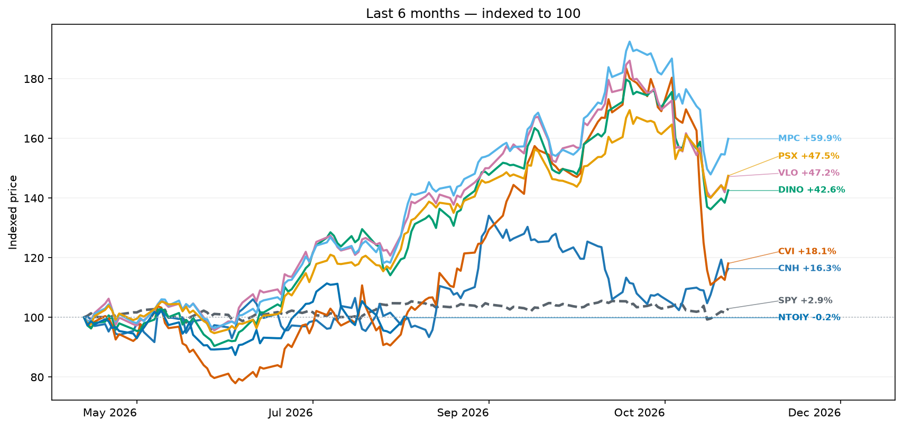

### Last 12 months

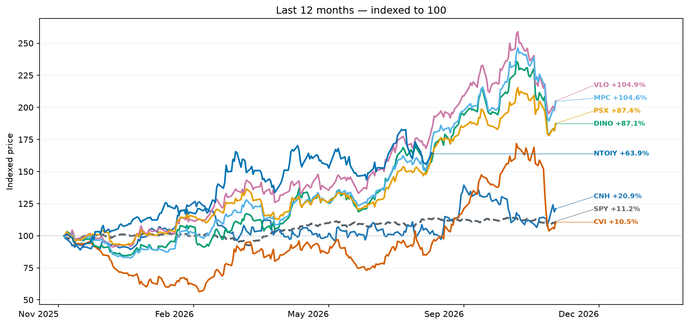

### Last 24 months

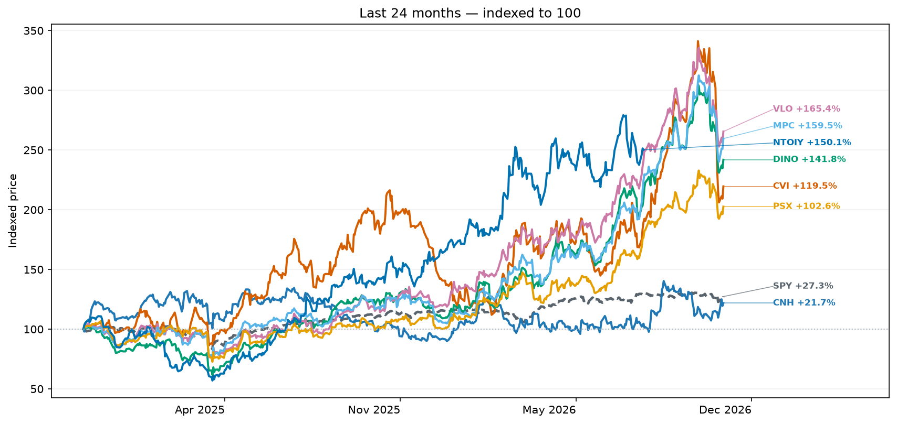

## Current Top Stocks

### Last 3 months

<table class="sortable"><thead><tr><th class="sortable-heading" data-column="0" data-type="number">Rank</th><th class="sortable-heading" data-column="1" data-type="text">Company</th><th class="sortable-heading" data-column="2" data-type="text">Ticker</th><th class="sortable-heading" data-column="3" data-type="number">Market cap</th><th class="sortable-heading" data-column="4" data-type="number">Return</th></tr></thead><tbody><tr><td class="" data-sort="1" style="">1</td><td class="text" data-sort="cnh industrial" style=""><a href="#earnings-cnh">CNH Industrial</a></td><td class="text text" data-sort="cnh" style=""><a href="#company-cnh">CNH</a></td><td class="" data-sort="16547953475.759998" style="">$16.5B</td><td class="" data-sort="0.16402609506057786" style="background:#1a7a3c;color:#ffffff;">+16.4%</td></tr><tr><td class="" data-sort="2" style="">2</td><td class="text" data-sort="cvr energy" style="">CVR Energy</td><td class="text text" data-sort="cvi" style=""><a href="#company-cvi">CVI</a></td><td class="" data-sort="3689472983.3" style="">$3.7B</td><td class="" data-sort="0.15896118721461194" style="background:#1a7a3c;color:#ffffff;">+15.9%</td></tr><tr><td class="" data-sort="3" style="">3</td><td class="text" data-sort="hf sinclair" style="">HF Sinclair</td><td class="text text" data-sort="dino" style=""><a href="#company-dino">DINO</a></td><td class="" data-sort="16821907792.380001" style="">$16.8B</td><td class="" data-sort="0.15694302285909245" style="background:#1a7a3c;color:#ffffff;">+15.7%</td></tr><tr><td class="" data-sort="4" style="">4</td><td class="text" data-sort="marathon petroleum" style="">Marathon Petroleum</td><td class="text text" data-sort="mpc" style=""><a href="#company-mpc">MPC</a></td><td class="" data-sort="101307533252.25" style="">$101.3B</td><td class="" data-sort="0.1567552045944005" style="background:#1a7a3c;color:#ffffff;">+15.7%</td></tr><tr><td class="" data-sort="5" style="">5</td><td class="text" data-sort="phillips 66" style="">Phillips 66</td><td class="text text" data-sort="psx" style=""><a href="#company-psx">PSX</a></td><td class="" data-sort="96678777737.64" style="">$96.7B</td><td class="" data-sort="0.1467328663888643" style="background:#1a7a3c;color:#ffffff;">+14.7%</td></tr></tbody></table>

### Last 12 months

<table class="sortable"><thead><tr><th class="sortable-heading" data-column="0" data-type="number">Rank</th><th class="sortable-heading" data-column="1" data-type="text">Company</th><th class="sortable-heading" data-column="2" data-type="text">Ticker</th><th class="sortable-heading" data-column="3" data-type="number">Market cap</th><th class="sortable-heading" data-column="4" data-type="number">Return</th></tr></thead><tbody><tr><td class="" data-sort="1" style="">1</td><td class="text" data-sort="valero energy" style="">Valero Energy</td><td class="text text" data-sort="vlo" style=""><a href="#company-vlo">VLO</a></td><td class="" data-sort="99697762645.86" style="">$99.7B</td><td class="" data-sort="1.048608764222147" style="background:#1a7a3c;color:#ffffff;">+104.9%</td></tr><tr><td class="" data-sort="2" style="">2</td><td class="text" data-sort="marathon petroleum" style="">Marathon Petroleum</td><td class="text text" data-sort="mpc" style=""><a href="#company-mpc">MPC</a></td><td class="" data-sort="101307533252.25" style="">$101.3B</td><td class="" data-sort="1.0459116302691718" style="background:#1a7a3c;color:#ffffff;">+104.6%</td></tr><tr><td class="" data-sort="3" style="">3</td><td class="text" data-sort="phillips 66" style="">Phillips 66</td><td class="text text" data-sort="psx" style=""><a href="#company-psx">PSX</a></td><td class="" data-sort="96678777737.64" style="">$96.7B</td><td class="" data-sort="0.8742211273728444" style="background:#1a7a3c;color:#ffffff;">+87.4%</td></tr><tr><td class="" data-sort="4" style="">4</td><td class="text" data-sort="hf sinclair" style="">HF Sinclair</td><td class="text text" data-sort="dino" style=""><a href="#company-dino">DINO</a></td><td class="" data-sort="16821907792.380001" style="">$16.8B</td><td class="" data-sort="0.8710686040095643" style="background:#1a7a3c;color:#ffffff;">+87.1%</td></tr><tr><td class="" data-sort="5" style="">5</td><td class="text" data-sort="bayer" style="">Bayer</td><td class="text text" data-sort="bayry" style=""><a href="#company-bayry">BAYRY</a></td><td class="" data-sort="n/a" style="">n/a</td><td class="" data-sort="0.6618876941457588" style="background:#2f9e44;color:#111820;">+66.2%</td></tr></tbody></table>

### Last 24 months

<table class="sortable"><thead><tr><th class="sortable-heading" data-column="0" data-type="number">Rank</th><th class="sortable-heading" data-column="1" data-type="text">Company</th><th class="sortable-heading" data-column="2" data-type="text">Ticker</th><th class="sortable-heading" data-column="3" data-type="number">Market cap</th><th class="sortable-heading" data-column="4" data-type="number">Return</th></tr></thead><tbody><tr><td class="" data-sort="1" style="">1</td><td class="text" data-sort="valero energy" style="">Valero Energy</td><td class="text text" data-sort="vlo" style=""><a href="#company-vlo">VLO</a></td><td class="" data-sort="99697762645.86" style="">$99.7B</td><td class="" data-sort="1.654430010217486" style="background:#1a7a3c;color:#ffffff;">+165.4%</td></tr><tr><td class="" data-sort="2" style="">2</td><td class="text" data-sort="marathon petroleum" style="">Marathon Petroleum</td><td class="text text" data-sort="mpc" style=""><a href="#company-mpc">MPC</a></td><td class="" data-sort="101307533252.25" style="">$101.3B</td><td class="" data-sort="1.5954513240126276" style="background:#1a7a3c;color:#ffffff;">+159.5%</td></tr><tr><td class="" data-sort="3" style="">3</td><td class="text" data-sort="neste" style="">Neste</td><td class="text text" data-sort="ntoiy" style=""><a href="#company-ntoiy">NTOIY</a></td><td class="" data-sort="n/a" style="">n/a</td><td class="" data-sort="1.5014705882352946" style="background:#1a7a3c;color:#ffffff;">+150.1%</td></tr><tr><td class="" data-sort="4" style="">4</td><td class="text" data-sort="bayer" style="">Bayer</td><td class="text text" data-sort="bayry" style=""><a href="#company-bayry">BAYRY</a></td><td class="" data-sort="n/a" style="">n/a</td><td class="" data-sort="1.4928315412186381" style="background:#1a7a3c;color:#ffffff;">+149.3%</td></tr><tr><td class="" data-sort="5" style="">5</td><td class="text" data-sort="hf sinclair" style="">HF Sinclair</td><td class="text text" data-sort="dino" style=""><a href="#company-dino">DINO</a></td><td class="" data-sort="16821907792.380001" style="">$16.8B</td><td class="" data-sort="1.4181126693605894" style="background:#1a7a3c;color:#ffffff;">+141.8%</td></tr></tbody></table>

## Companies by Subcategory

<h3 id="category-crop-inputs-equipment-and-irrigation"><a href="#subcategory-performance">Crop inputs, equipment, and irrigation</a>Last 3m: -6.9%</h3>

<table class="sortable"><thead><tr><th class="sortable-heading" data-column="0" data-type="text">Company</th><th class="sortable-heading" data-column="1" data-type="text">Ticker</th><th class="sortable-heading" data-column="2" data-type="number">Market cap</th><th class="sortable-heading" data-column="3" data-type="number">3m Return</th><th class="sortable-heading" data-column="4" data-type="number">12m Return</th><th class="sortable-heading" data-column="5" data-type="number">24m Return</th></tr></thead><tbody><tr><td class="text" data-sort="corteva" style=""><a href="#earnings-ctva">Corteva</a></td><td class="text text" data-sort="ctva" style=""><a href="#company-ctva">CTVA</a></td><td class="" data-sort="52421589719.99999" style="">$52.4B</td><td class="" data-sort="-0.8392691645703694" style="background:#c0302f;color:#ffffff;">-83.9%</td><td class="" data-sort="-0.8173886883273165" style="background:#c0302f;color:#ffffff;">-81.7%</td><td class="" data-sort="-0.7875021879922983" style="background:#ee8483;color:#111820;">-78.8%</td></tr><tr><td class="text" data-sort="bayer" style="">Bayer</td><td class="text text" data-sort="bayry" style=""><a href="#company-bayry">BAYRY</a></td><td class="" data-sort="n/a" style="">n/a</td><td class="" data-sort="0.0" style="background:#f0efec;color:#111820;">+0.0%</td><td class="" data-sort="0.6618876941457588" style="background:#1a7a3c;color:#ffffff;">+66.2%</td><td class="" data-sort="1.4928315412186381" style="background:#1a7a3c;color:#ffffff;">+149.3%</td></tr><tr><td class="text" data-sort="basf" style="">BASF</td><td class="text text" data-sort="basfy" style=""><a href="#company-basfy">BASFY</a></td><td class="" data-sort="n/a" style="">n/a</td><td class="" data-sort="0.0" style="background:#f0efec;color:#111820;">+0.0%</td><td class="" data-sort="0.1658092599920855" style="background:#a9d9a4;color:#111820;">+16.6%</td><td class="" data-sort="0.3104982206405693" style="background:#a9d9a4;color:#111820;">+31.0%</td></tr><tr><td class="text" data-sort="nutrien" style="">Nutrien</td><td class="text text" data-sort="ntr" style=""><a href="#company-ntr">NTR</a></td><td class="" data-sort="33643310217.0" style="">$33.6B</td><td class="" data-sort="0.06653766001786243" style="background:#d6ecd4;color:#111820;">+6.7%</td><td class="" data-sort="0.1915848993846665" style="background:#a9d9a4;color:#111820;">+19.2%</td><td class="" data-sort="0.5247925090444776" style="background:#a9d9a4;color:#111820;">+52.5%</td></tr><tr><td class="text" data-sort="cf industries" style=""><a href="#earnings-cf">CF Industries</a></td><td class="text text" data-sort="cf" style=""><a href="#company-cf">CF</a></td><td class="" data-sort="18012264232.6" style="">$18.0B</td><td class="" data-sort="0.026914423798016784" style="background:#d6ecd4;color:#111820;">+2.7%</td><td class="" data-sort="0.45415929203539807" style="background:#7cc077;color:#111820;">+45.4%</td><td class="" data-sort="0.463310377582522" style="background:#a9d9a4;color:#111820;">+46.3%</td></tr><tr><td class="text" data-sort="yara international" style="">Yara International</td><td class="text text" data-sort="yariy" style=""><a href="#company-yariy">YARIY</a></td><td class="" data-sort="n/a" style="">n/a</td><td class="" data-sort="0.0" style="background:#f0efec;color:#111820;">+0.0%</td><td class="" data-sort="0.19162640901771333" style="background:#a9d9a4;color:#111820;">+19.2%</td><td class="" data-sort="0.563380281690141" style="background:#a9d9a4;color:#111820;">+56.3%</td></tr><tr><td class="text" data-sort="mosaic" style="">Mosaic</td><td class="text text" data-sort="mos" style=""><a href="#company-mos">MOS</a></td><td class="" data-sort="7066820210.58" style="">$7.1B</td><td class="" data-sort="0.008849557522123908" style="background:#d6ecd4;color:#111820;">+0.9%</td><td class="" data-sort="-0.10447761194029848" style="background:#fbd5d4;color:#111820;">-10.4%</td><td class="" data-sort="-0.11832946635730857" style="background:#fbd5d4;color:#111820;">-11.8%</td></tr><tr><td class="text" data-sort="deere" style="">Deere</td><td class="text text" data-sort="de" style=""><a href="#company-de">DE</a></td><td class="" data-sort="156733767077.75" style="">$156.7B</td><td class="" data-sort="0.11613985833454343" style="background:#d6ecd4;color:#111820;">+11.6%</td><td class="" data-sort="0.43880777070593635" style="background:#7cc077;color:#111820;">+43.9%</td><td class="" data-sort="0.7568253968253968" style="background:#7cc077;color:#111820;">+75.7%</td></tr><tr><td class="text" data-sort="cnh industrial" style=""><a href="#earnings-cnh">CNH Industrial</a></td><td class="text text" data-sort="cnh" style=""><a href="#company-cnh">CNH</a></td><td class="" data-sort="16547953475.759998" style="">$16.5B</td><td class="" data-sort="0.16402609506057786" style="background:#d6ecd4;color:#111820;">+16.4%</td><td class="" data-sort="0.2090997095837368" style="background:#a9d9a4;color:#111820;">+20.9%</td><td class="" data-sort="0.21734892787524362" style="background:#d6ecd4;color:#111820;">+21.7%</td></tr><tr><td class="text" data-sort="agco" style="">AGCO</td><td class="text text" data-sort="agco" style=""><a href="#company-agco">AGCO</a></td><td class="" data-sort="6969557670.08" style="">$7.0B</td><td class="" data-sort="0.13037912358444115" style="background:#d6ecd4;color:#111820;">+13.0%</td><td class="" data-sort="0.05816740412979349" style="background:#d6ecd4;color:#111820;">+5.8%</td><td class="" data-sort="0.2707848998118012" style="background:#d6ecd4;color:#111820;">+27.1%</td></tr><tr><td class="text" data-sort="valmont industries" style="">Valmont Industries</td><td class="text text" data-sort="vmi" style=""><a href="#company-vmi">VMI</a></td><td class="" data-sort="9349921875.14" style="">$9.3B</td><td class="" data-sort="-0.13811852062242602" style="background:#fbd5d4;color:#111820;">-13.8%</td><td class="" data-sort="0.035034717992447284" style="background:#d6ecd4;color:#111820;">+3.5%</td><td class="" data-sort="0.2305709237320046" style="background:#d6ecd4;color:#111820;">+23.1%</td></tr></tbody></table>

<h3 id="category-grain-origination-and-agribusiness"><a href="#subcategory-performance">Grain origination and agribusiness</a>Last 3m: -11.0%</h3>

<table class="sortable"><thead><tr><th class="sortable-heading" data-column="0" data-type="text">Company</th><th class="sortable-heading" data-column="1" data-type="text">Ticker</th><th class="sortable-heading" data-column="2" data-type="number">Market cap</th><th class="sortable-heading" data-column="3" data-type="number">3m Return</th><th class="sortable-heading" data-column="4" data-type="number">12m Return</th><th class="sortable-heading" data-column="5" data-type="number">24m Return</th></tr></thead><tbody><tr><td class="text" data-sort="archer daniels midland" style="">Archer Daniels Midland</td><td class="text text" data-sort="adm" style=""><a href="#company-adm">ADM</a></td><td class="" data-sort="38923055923.08" style="">$38.9B</td><td class="" data-sort="-0.11049793051548984" style="background:#e34948;color:#111820;">-11.0%</td><td class="" data-sort="0.22805194805194806" style="background:#1a7a3c;color:#ffffff;">+22.8%</td><td class="" data-sort="0.37896169550845804" style="background:#1a7a3c;color:#ffffff;">+37.9%</td></tr><tr><td class="text" data-sort="bunge" style="">Bunge</td><td class="text text" data-sort="bg" style=""><a href="#company-bg">BG</a></td><td class="" data-sort="21901580022.0" style="">$21.9B</td><td class="" data-sort="-0.10263982102908276" style="background:#e34948;color:#111820;">-10.3%</td><td class="" data-sort="0.04132917964693661" style="background:#d6ecd4;color:#111820;">+4.1%</td><td class="" data-sort="0.14658129430596856" style="background:#a9d9a4;color:#111820;">+14.7%</td></tr><tr><td class="text" data-sort="the andersons" style="">The Andersons</td><td class="text text" data-sort="ande" style=""><a href="#company-ande">ANDE</a></td><td class="" data-sort="2301165356.1" style="">$2.3B</td><td class="" data-sort="-0.16628562719097695" style="background:#c0302f;color:#ffffff;">-16.6%</td><td class="" data-sort="0.09751203852327439" style="background:#7cc077;color:#111820;">+9.8%</td><td class="" data-sort="0.1625929861849098" style="background:#7cc077;color:#111820;">+16.3%</td></tr></tbody></table>

<h3 id="category-u-s-ethanol-and-process-technology"><a href="#subcategory-performance">U.S. ethanol and process technology</a>Last 3m: +3.6%</h3>

<table class="sortable"><thead><tr><th class="sortable-heading" data-column="0" data-type="text">Company</th><th class="sortable-heading" data-column="1" data-type="text">Ticker</th><th class="sortable-heading" data-column="2" data-type="number">Market cap</th><th class="sortable-heading" data-column="3" data-type="number">3m Return</th><th class="sortable-heading" data-column="4" data-type="number">12m Return</th><th class="sortable-heading" data-column="5" data-type="number">24m Return</th></tr></thead><tbody><tr><td class="text" data-sort="valero energy" style="">Valero Energy</td><td class="text text" data-sort="vlo" style=""><a href="#company-vlo">VLO</a></td><td class="" data-sort="99697762645.86" style="">$99.7B</td><td class="" data-sort="0.10145059204748486" style="background:#2f9e44;color:#111820;">+10.1%</td><td class="" data-sort="1.048608764222147" style="background:#1a7a3c;color:#ffffff;">+104.9%</td><td class="" data-sort="1.654430010217486" style="background:#1a7a3c;color:#ffffff;">+165.4%</td></tr><tr><td class="text" data-sort="green plains" style=""><a href="#earnings-gpre">Green Plains</a></td><td class="text text" data-sort="gpre" style=""><a href="#company-gpre">GPRE</a></td><td class="" data-sort="1123628107.8400002" style="">$1.1B</td><td class="" data-sort="-0.10059563203176702" style="background:#e34948;color:#111820;">-10.1%</td><td class="" data-sort="0.390992835209826" style="background:#a9d9a4;color:#111820;">+39.1%</td><td class="" data-sort="0.217741935483871" style="background:#d6ecd4;color:#111820;">+21.8%</td></tr><tr><td class="text" data-sort="rex american resources" style="">REX American Resources</td><td class="text text" data-sort="rex" style=""><a href="#company-rex">REX</a></td><td class="" data-sort="1444977688.6599998" style="">$1.4B</td><td class="" data-sort="-0.08647906657515447" style="background:#ee8483;color:#111820;">-8.6%</td><td class="" data-sort="0.19945929708621213" style="background:#d6ecd4;color:#111820;">+19.9%</td><td class="" data-sort="0.6912325285895806" style="background:#7cc077;color:#111820;">+69.1%</td></tr><tr><td class="text" data-sort="novonesis" style="">Novonesis</td><td class="text text" data-sort="nvzmy" style=""><a href="#company-nvzmy">NVZMY</a></td><td class="" data-sort="n/a" style="">n/a</td><td class="" data-sort="0.0" style="background:#f0efec;color:#111820;">+0.0%</td><td class="" data-sort="-0.021172886519421175" style="background:#fbd5d4;color:#111820;">-2.1%</td><td class="" data-sort="0.09565217391304359" style="background:#d6ecd4;color:#111820;">+9.6%</td></tr><tr><td class="text" data-sort="archer daniels midland" style="">Archer Daniels Midland</td><td class="text text" data-sort="adm" style=""><a href="#company-adm">ADM</a></td><td class="" data-sort="38923055923.08" style="">$38.9B</td><td class="" data-sort="-0.11049793051548984" style="background:#e34948;color:#111820;">-11.0%</td><td class="" data-sort="0.22805194805194806" style="background:#a9d9a4;color:#111820;">+22.8%</td><td class="" data-sort="0.37896169550845804" style="background:#a9d9a4;color:#111820;">+37.9%</td></tr><tr><td class="text" data-sort="the andersons" style="">The Andersons</td><td class="text text" data-sort="ande" style=""><a href="#company-ande">ANDE</a></td><td class="" data-sort="2301165356.1" style="">$2.3B</td><td class="" data-sort="-0.16628562719097695" style="background:#c0302f;color:#ffffff;">-16.6%</td><td class="" data-sort="0.09751203852327439" style="background:#d6ecd4;color:#111820;">+9.8%</td><td class="" data-sort="0.1625929861849098" style="background:#d6ecd4;color:#111820;">+16.3%</td></tr></tbody></table>

<h3 id="category-wet-milling-ingredients-and-co-products"><a href="#subcategory-performance">Wet milling, ingredients, and co-products</a>Last 3m: -6.0%</h3>

<table class="sortable"><thead><tr><th class="sortable-heading" data-column="0" data-type="text">Company</th><th class="sortable-heading" data-column="1" data-type="text">Ticker</th><th class="sortable-heading" data-column="2" data-type="number">Market cap</th><th class="sortable-heading" data-column="3" data-type="number">3m Return</th><th class="sortable-heading" data-column="4" data-type="number">12m Return</th><th class="sortable-heading" data-column="5" data-type="number">24m Return</th></tr></thead><tbody><tr><td class="text" data-sort="ingredion" style=""><a href="#earnings-ingr">Ingredion</a></td><td class="text text" data-sort="ingr" style=""><a href="#company-ingr">INGR</a></td><td class="" data-sort="6757305349.85" style="">$6.8B</td><td class="" data-sort="-0.10525301204819282" style="background:#e34948;color:#111820;">-10.5%</td><td class="" data-sort="-0.1418138115928631" style="background:#f5aead;color:#111820;">-14.2%</td><td class="" data-sort="-0.38208080942554745" style="background:#c0302f;color:#ffffff;">-38.2%</td></tr><tr><td class="text" data-sort="darling ingredients" style="">Darling Ingredients</td><td class="text text" data-sort="dar" style=""><a href="#company-dar">DAR</a></td><td class="" data-sort="10563327197.039999" style="">$10.6B</td><td class="" data-sort="-0.14583004887277318" style="background:#c0302f;color:#ffffff;">-14.6%</td><td class="" data-sort="0.5686160972785177" style="background:#1a7a3c;color:#ffffff;">+56.9%</td><td class="" data-sort="0.27004219409282704" style="background:#2f9e44;color:#111820;">+27.0%</td></tr><tr><td class="text" data-sort="tyson foods" style="">Tyson Foods</td><td class="text text" data-sort="tsn" style=""><a href="#company-tsn">TSN</a></td><td class="" data-sort="20597978527.6" style="">$20.6B</td><td class="" data-sort="0.07274681956638585" style="background:#7cc077;color:#111820;">+7.3%</td><td class="" data-sort="0.10747317795042544" style="background:#d6ecd4;color:#111820;">+10.7%</td><td class="" data-sort="-0.04452601340568141" style="background:#fbd5d4;color:#111820;">-4.5%</td></tr><tr><td class="text" data-sort="jbs" style=""><a href="#earnings-jbs">JBS</a></td><td class="text text" data-sort="jbs" style=""><a href="#company-jbs">JBS</a></td><td class="" data-sort="45228750792.5" style="">$45.2B</td><td class="" data-sort="-0.05106707317073167" style="background:#f5aead;color:#111820;">-5.1%</td><td class="" data-sort="-0.05395136778115506" style="background:#fbd5d4;color:#111820;">-5.4%</td><td class="missing" data-sort="—" style="background:#f0efec;color:#111820;">—</td></tr><tr><td class="text" data-sort="archer daniels midland" style="">Archer Daniels Midland</td><td class="text text" data-sort="adm" style=""><a href="#company-adm">ADM</a></td><td class="" data-sort="38923055923.08" style="">$38.9B</td><td class="" data-sort="-0.11049793051548984" style="background:#e34948;color:#111820;">-11.0%</td><td class="" data-sort="0.22805194805194806" style="background:#7cc077;color:#111820;">+22.8%</td><td class="" data-sort="0.37896169550845804" style="background:#1a7a3c;color:#ffffff;">+37.9%</td></tr></tbody></table>

<h3 id="category-fuel-blending-refining-and-retail"><a href="#subcategory-performance">Fuel blending, refining, and retail</a>Last 3m: +9.8%</h3>

<table class="sortable"><thead><tr><th class="sortable-heading" data-column="0" data-type="text">Company</th><th class="sortable-heading" data-column="1" data-type="text">Ticker</th><th class="sortable-heading" data-column="2" data-type="number">Market cap</th><th class="sortable-heading" data-column="3" data-type="number">3m Return</th><th class="sortable-heading" data-column="4" data-type="number">12m Return</th><th class="sortable-heading" data-column="5" data-type="number">24m Return</th></tr></thead><tbody><tr><td class="text" data-sort="valero energy" style="">Valero Energy</td><td class="text text" data-sort="vlo" style=""><a href="#company-vlo">VLO</a></td><td class="" data-sort="99697762645.86" style="">$99.7B</td><td class="" data-sort="0.10145059204748486" style="background:#2f9e44;color:#111820;">+10.1%</td><td class="" data-sort="1.048608764222147" style="background:#1a7a3c;color:#ffffff;">+104.9%</td><td class="" data-sort="1.654430010217486" style="background:#1a7a3c;color:#ffffff;">+165.4%</td></tr><tr><td class="text" data-sort="marathon petroleum" style="">Marathon Petroleum</td><td class="text text" data-sort="mpc" style=""><a href="#company-mpc">MPC</a></td><td class="" data-sort="101307533252.25" style="">$101.3B</td><td class="" data-sort="0.1567552045944005" style="background:#1a7a3c;color:#ffffff;">+15.7%</td><td class="" data-sort="1.0459116302691718" style="background:#1a7a3c;color:#ffffff;">+104.6%</td><td class="" data-sort="1.5954513240126276" style="background:#1a7a3c;color:#ffffff;">+159.5%</td></tr><tr><td class="text" data-sort="phillips 66" style="">Phillips 66</td><td class="text text" data-sort="psx" style=""><a href="#company-psx">PSX</a></td><td class="" data-sort="96678777737.64" style="">$96.7B</td><td class="" data-sort="0.1467328663888643" style="background:#1a7a3c;color:#ffffff;">+14.7%</td><td class="" data-sort="0.8742211273728444" style="background:#1a7a3c;color:#ffffff;">+87.4%</td><td class="" data-sort="1.025685199686766" style="background:#2f9e44;color:#111820;">+102.6%</td></tr><tr><td class="text" data-sort="hf sinclair" style="">HF Sinclair</td><td class="text text" data-sort="dino" style=""><a href="#company-dino">DINO</a></td><td class="" data-sort="16821907792.380001" style="">$16.8B</td><td class="" data-sort="0.15694302285909245" style="background:#1a7a3c;color:#ffffff;">+15.7%</td><td class="" data-sort="0.8710686040095643" style="background:#1a7a3c;color:#ffffff;">+87.1%</td><td class="" data-sort="1.4181126693605894" style="background:#1a7a3c;color:#ffffff;">+141.8%</td></tr><tr><td class="text" data-sort="cvr energy" style="">CVR Energy</td><td class="text text" data-sort="cvi" style=""><a href="#company-cvi">CVI</a></td><td class="" data-sort="3689472983.3" style="">$3.7B</td><td class="" data-sort="0.15896118721461194" style="background:#1a7a3c;color:#ffffff;">+15.9%</td><td class="" data-sort="0.10503401360544218" style="background:#d6ecd4;color:#111820;">+10.5%</td><td class="" data-sort="1.1951351351351351" style="background:#2f9e44;color:#111820;">+119.5%</td></tr><tr><td class="text" data-sort="sunoco lp" style="">Sunoco LP</td><td class="text text" data-sort="sun" style=""><a href="#company-sun">SUN</a></td><td class="" data-sort="14487140849.61" style="">$14.5B</td><td class="" data-sort="-0.13514228987425536" style="background:#c0302f;color:#ffffff;">-13.5%</td><td class="" data-sort="0.2796709753231492" style="background:#a9d9a4;color:#111820;">+28.0%</td><td class="" data-sort="0.26456357654344886" style="background:#d6ecd4;color:#111820;">+26.5%</td></tr><tr><td class="text" data-sort="casey&#x27;s general stores" style="">Casey&#x27;s General Stores</td><td class="text text" data-sort="casy" style=""><a href="#company-casy">CASY</a></td><td class="" data-sort="30941658841.1" style="">$30.9B</td><td class="" data-sort="-0.14888621384217482" style="background:#c0302f;color:#ffffff;">-14.9%</td><td class="" data-sort="0.33508450493568653" style="background:#a9d9a4;color:#111820;">+33.5%</td><td class="" data-sort="0.7122476382295113" style="background:#7cc077;color:#111820;">+71.2%</td></tr><tr><td class="text" data-sort="murphy usa" style="">Murphy USA</td><td class="text text" data-sort="musa" style=""><a href="#company-musa">MUSA</a></td><td class="" data-sort="10444448379.28" style="">$10.4B</td><td class="" data-sort="-0.03501362148721043" style="background:#f5aead;color:#111820;">-3.5%</td><td class="" data-sort="0.46866651825467476" style="background:#7cc077;color:#111820;">+46.9%</td><td class="" data-sort="-0.0027021409270423513" style="background:#fbd5d4;color:#111820;">-0.3%</td></tr></tbody></table>

<h3 id="category-advanced-biofuels-and-saf"><a href="#subcategory-performance">Advanced biofuels and SAF</a>Last 3m: +8.5%</h3>

<table class="sortable"><thead><tr><th class="sortable-heading" data-column="0" data-type="text">Company</th><th class="sortable-heading" data-column="1" data-type="text">Ticker</th><th class="sortable-heading" data-column="2" data-type="number">Market cap</th><th class="sortable-heading" data-column="3" data-type="number">3m Return</th><th class="sortable-heading" data-column="4" data-type="number">12m Return</th><th class="sortable-heading" data-column="5" data-type="number">24m Return</th></tr></thead><tbody><tr><td class="text" data-sort="neste" style="">Neste</td><td class="text text" data-sort="ntoiy" style=""><a href="#company-ntoiy">NTOIY</a></td><td class="" data-sort="n/a" style="">n/a</td><td class="" data-sort="0.0" style="background:#f0efec;color:#111820;">+0.0%</td><td class="" data-sort="0.6387283236994219" style="background:#1a7a3c;color:#ffffff;">+63.9%</td><td class="" data-sort="1.5014705882352946" style="background:#1a7a3c;color:#ffffff;">+150.1%</td></tr><tr><td class="text" data-sort="chevron" style="">Chevron</td><td class="text text" data-sort="cvx" style=""><a href="#company-cvx">CVX</a></td><td class="" data-sort="403619489658.24" style="">$403.6B</td><td class="" data-sort="0.0848423194303154" style="background:#1a7a3c;color:#ffffff;">+8.5%</td><td class="" data-sort="0.39107748499869555" style="background:#2f9e44;color:#111820;">+39.1%</td><td class="" data-sort="0.3734303561079271" style="background:#a9d9a4;color:#111820;">+37.3%</td></tr></tbody></table>

<h3 id="category-international-ethanol"><a href="#subcategory-performance">International ethanol</a>Last 3m: +3.6%</h3>

<table class="sortable"><thead><tr><th class="sortable-heading" data-column="0" data-type="text">Company</th><th class="sortable-heading" data-column="1" data-type="text">Ticker</th><th class="sortable-heading" data-column="2" data-type="number">Market cap</th><th class="sortable-heading" data-column="3" data-type="number">3m Return</th><th class="sortable-heading" data-column="4" data-type="number">12m Return</th><th class="sortable-heading" data-column="5" data-type="number">24m Return</th></tr></thead><tbody><tr><td class="text" data-sort="cosan" style="">Cosan</td><td class="text text" data-sort="csan" style=""><a href="#company-csan">CSAN</a></td><td class="" data-sort="2504672704.64" style="">$2.5B</td><td class="" data-sort="0.07421875" style="background:#1a7a3c;color:#ffffff;">+7.4%</td><td class="" data-sort="-0.4701348747591523" style="background:#c0302f;color:#ffffff;">-47.0%</td><td class="" data-sort="-0.650571791613723" style="background:#c0302f;color:#ffffff;">-65.1%</td></tr><tr><td class="text" data-sort="adecoagro" style=""><a href="#earnings-agro">Adecoagro</a></td><td class="text text" data-sort="agro" style=""><a href="#company-agro">AGRO</a></td><td class="" data-sort="1525335200.6200001" style="">$1.5B</td><td class="" data-sort="-0.025834230355220478" style="background:#f5aead;color:#111820;">-2.6%</td><td class="" data-sort="0.14556962025316467" style="background:#a9d9a4;color:#111820;">+14.6%</td><td class="" data-sort="-0.20053003533568903" style="background:#f5aead;color:#111820;">-20.1%</td></tr></tbody></table>

<h3 id="category-logistics"><a href="#subcategory-performance">Logistics</a>Last 3m: +2.7%</h3>

<table class="sortable"><thead><tr><th class="sortable-heading" data-column="0" data-type="text">Company</th><th class="sortable-heading" data-column="1" data-type="text">Ticker</th><th class="sortable-heading" data-column="2" data-type="number">Market cap</th><th class="sortable-heading" data-column="3" data-type="number">3m Return</th><th class="sortable-heading" data-column="4" data-type="number">12m Return</th><th class="sortable-heading" data-column="5" data-type="number">24m Return</th></tr></thead><tbody><tr><td class="text" data-sort="union pacific" style="">Union Pacific</td><td class="text text" data-sort="unp" style=""><a href="#company-unp">UNP</a></td><td class="" data-sort="179291985296.4" style="">$179.3B</td><td class="" data-sort="0.0285296020154564" style="background:#7cc077;color:#111820;">+2.9%</td><td class="" data-sort="0.3514202639230597" style="background:#2f9e44;color:#111820;">+35.1%</td><td class="" data-sort="0.2645347620442846" style="background:#2f9e44;color:#111820;">+26.5%</td></tr><tr><td class="text" data-sort="csx" style="">CSX</td><td class="text text" data-sort="csx" style=""><a href="#company-csx">CSX</a></td><td class="" data-sort="93883428793.56" style="">$93.9B</td><td class="" data-sort="0.03634185303514381" style="background:#7cc077;color:#111820;">+3.6%</td><td class="" data-sort="0.46651596496185355" style="background:#1a7a3c;color:#ffffff;">+46.7%</td><td class="" data-sort="0.43647938001660647" style="background:#1a7a3c;color:#ffffff;">+43.6%</td></tr><tr><td class="text" data-sort="canadian pacific kansas city" style="">Canadian Pacific Kansas City</td><td class="text text" data-sort="cp" style=""><a href="#company-cp">CP</a></td><td class="" data-sort="83020241914.56" style="">$83.0B</td><td class="" data-sort="0.011651742367029927" style="background:#d6ecd4;color:#111820;">+1.2%</td><td class="" data-sort="0.2946292972525195" style="background:#2f9e44;color:#111820;">+29.5%</td><td class="" data-sort="0.21953439979191036" style="background:#7cc077;color:#111820;">+22.0%</td></tr><tr><td class="text" data-sort="gatx" style="">GATX</td><td class="text text" data-sort="gatx" style=""><a href="#company-gatx">GATX</a></td><td class="" data-sort="6219339017.28" style="">$6.2B</td><td class="" data-sort="0.04545707760013373" style="background:#2f9e44;color:#111820;">+4.5%</td><td class="" data-sort="0.19360172994975522" style="background:#7cc077;color:#111820;">+19.4%</td><td class="" data-sort="0.22644098810612978" style="background:#7cc077;color:#111820;">+22.6%</td></tr><tr><td class="text" data-sort="trinity industries" style="">Trinity Industries</td><td class="text text" data-sort="trn" style=""><a href="#company-trn">TRN</a></td><td class="" data-sort="2359810175.32" style="">$2.4B</td><td class="" data-sort="0.0439750692520775" style="background:#2f9e44;color:#111820;">+4.4%</td><td class="" data-sort="0.18934911242603536" style="background:#7cc077;color:#111820;">+18.9%</td><td class="" data-sort="-0.21238244514106586" style="background:#ee8483;color:#111820;">-21.2%</td></tr><tr><td class="text" data-sort="greenbrier" style="">Greenbrier</td><td class="text text" data-sort="gbx" style=""><a href="#company-gbx">GBX</a></td><td class="" data-sort="1407755713.0" style="">$1.4B</td><td class="" data-sort="-0.06552330694810904" style="background:#c0302f;color:#ffffff;">-6.6%</td><td class="" data-sort="-0.002581553625909394" style="background:#fbd5d4;color:#111820;">-0.3%</td><td class="" data-sort="-0.3555724033358605" style="background:#c0302f;color:#ffffff;">-35.6%</td></tr></tbody></table>

## Upcoming Earnings

### Crop inputs, equipment, and irrigation

<table class="sortable"><thead><tr><th class="sortable-heading" data-column="0" data-type="text">Company</th><th class="sortable-heading" data-column="1" data-type="text">Ticker</th><th class="sortable-heading" data-column="2" data-type="text">Date</th><th class="sortable-heading" data-column="3" data-type="number">Market cap</th><th class="sortable-heading" data-column="4" data-type="number">3m Return</th><th class="sortable-heading" data-column="5" data-type="number">12m Return</th></tr></thead><tbody><tr><td class="text" data-sort="corteva" style=""><a href="#earnings-ctva">Corteva</a></td><td class="text text" data-sort="ctva" style=""><a href="#company-ctva">CTVA</a></td><td class="text" data-sort="2026-11-12" style="">November 12, 2026</td><td class="" data-sort="52421589719.99999" style="">$52.4B</td><td class="" data-sort="-0.8392691645703694" style="background:#c0302f;color:#ffffff;">-83.9%</td><td class="" data-sort="-0.8173886883273165" style="background:#c0302f;color:#ffffff;">-81.7%</td></tr></tbody></table>

### Wet milling, ingredients, and co-products

<table class="sortable"><thead><tr><th class="sortable-heading" data-column="0" data-type="text">Company</th><th class="sortable-heading" data-column="1" data-type="text">Ticker</th><th class="sortable-heading" data-column="2" data-type="text">Date</th><th class="sortable-heading" data-column="3" data-type="number">Market cap</th><th class="sortable-heading" data-column="4" data-type="number">3m Return</th><th class="sortable-heading" data-column="5" data-type="number">12m Return</th></tr></thead><tbody><tr><td class="text" data-sort="tyson foods" style="">Tyson Foods</td><td class="text text" data-sort="tsn" style=""><a href="#company-tsn">TSN</a></td><td class="text" data-sort="2026-11-16" style="">November 16, 2026</td><td class="" data-sort="20597978527.6" style="">$20.6B</td><td class="" data-sort="0.07274681956638585" style="background:#1a7a3c;color:#ffffff;">+7.3%</td><td class="" data-sort="0.10747317795042544" style="background:#1a7a3c;color:#ffffff;">+10.7%</td></tr></tbody></table>

### International ethanol

<table class="sortable"><thead><tr><th class="sortable-heading" data-column="0" data-type="text">Company</th><th class="sortable-heading" data-column="1" data-type="text">Ticker</th><th class="sortable-heading" data-column="2" data-type="text">Date</th><th class="sortable-heading" data-column="3" data-type="number">Market cap</th><th class="sortable-heading" data-column="4" data-type="number">3m Return</th><th class="sortable-heading" data-column="5" data-type="number">12m Return</th></tr></thead><tbody><tr><td class="text" data-sort="cosan" style="">Cosan</td><td class="text text" data-sort="csan" style=""><a href="#company-csan">CSAN</a></td><td class="text" data-sort="2026-11-15" style="">November 15, 2026</td><td class="" data-sort="2504672704.64" style="">$2.5B</td><td class="" data-sort="0.07421875" style="background:#1a7a3c;color:#ffffff;">+7.4%</td><td class="" data-sort="-0.4701348747591523" style="background:#c0302f;color:#ffffff;">-47.0%</td></tr></tbody></table>

## Recent Earnings Highlights — 3m Ret

Companies covered in this section:
<ul class="section-jump-list">
<li><a href="#earnings-ctva">Corteva (CTVA)</a></li>
<li><a href="#earnings-jbs">JBS (JBS)</a></li>
<li><a href="#earnings-cf">CF Industries (CF)</a></li>
<li><a href="#earnings-cnh">CNH Industrial (CNH)</a></li>
<li><a href="#earnings-ingr">Ingredion (INGR)</a></li>
<li><a href="#earnings-agro">Adecoagro (AGRO)</a></li>
<li><a href="#earnings-gpre">Green Plains (GPRE)</a></li>
</ul>
<h3 id="earnings-ctva">Corteva (<a href="#company-ctva">CTVA</a>) -83.9%</h3>

**Reported:** November 12, 2026 · [Google Finance earnings page](https://www.google.com/finance/quote/CTVA:NYSE?tab=earnings&hl=en)

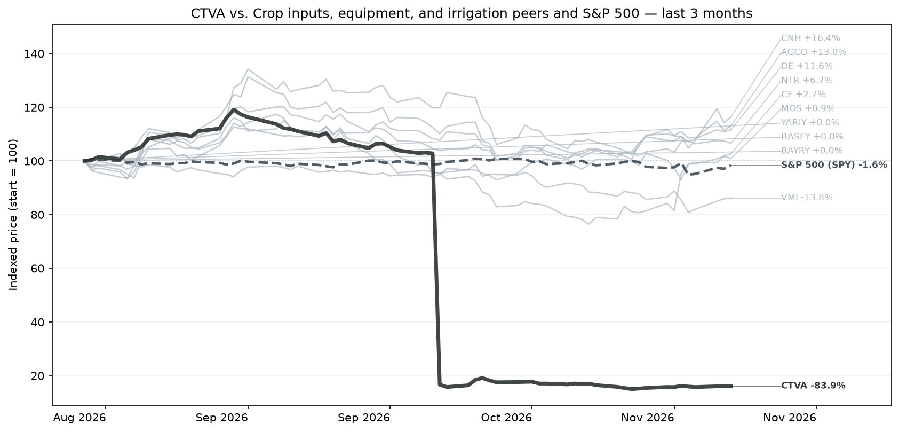

#### Earnings Call Summary

Corteva reported net sales of $1.6B for Q3 2026, a 9% decrease year-over-year on both a reported and organic basis. Operating EBITDA fell 17% to $222M, and operating EBITDA margins compressed by 140 basis points to 14%, heavily impacted by severe pricing headwinds concentrated in U.S. acetochlor and the Brazilian market.

#### At a Glance

- **Corteva Misses EPS and Revenue Estimates:** Corteva Inc. reported a reported revenue of $1,591,000,000, missing the estimated $1,767,904,850, while reported adjusted EPS came in at $0 against the $0.096 estimate.
- **Latin America Challenges Drag Down Performance:** The company&#x27;s Latin America organic sales collapsed by 31% due to weaker market conditions and pricing pressures in Brazil, overshadowing a 20% global volume growth in new product technologies.
- **Full-Year 2026 Guidance Trimmed Downward:** Management lowered its full-year 2026 Adjusted Pro Forma Operating EBITDA guidance to a range of $1.1 billion to $1.125 billion, down from the previous $1.3 billion estimate, to account for severe deterioration in Brazil.
- **Pricing Pressures Impact Core Segments:** Corteva faced severe pricing headwinds of approximately $230 million year-to-date, heavily driven by late-lifecycle product molecules in Brazil and acetochlor in the United States.
- **Market Reacts Negatively to Results:** Shares of Corteva plunged over 20% in post-earnings trading, approaching their 52-week low as investors reacted to the severe top-line miss and cut to full-year guidance.

#### Key Moments from the Call

- **2m — U.S. Acetochlor Pricing Collapse:** North American pricing fell 12% due to intense competitive pricing pressures on acetochlor. Though anticipated, this headwind cost the company $60M in EBITDA during Q3 and will drag into early 2027, highlighting structural compression in aging off-patent crop protection molecules.
- **13m — Severe Guidance Cut on Brazil Overhang:** Management slashed full-year operating EBITDA guidance by roughly 14% at the midpoint due to rapid deterioration in Brazil. Elevated channel inventory, low grower liquidity, and aggressive generic pricing create a severe headwind that will slice Q4 EBITDA to half of prior-year levels, deeply disappointing investors.
- **16m — Aggressive Cost Restructuring Mobilized:** To counteract pricing pressures, the company launched an expansive cost-reduction initiative with a third party. Management implemented a hiring freeze, delayed lower-priority R&D pipelines, and committed to stripping out structural inherited infrastructure costs over the next four to eight quarters.
- **36m — Biological Portfolio Stalled by Regional Mix:** The biologicals segment experienced unexpected volume contractions both in the quarter and year-to-date. Because the business is heavily weighted toward Latin America, the macroeconomic downturn and purchasing freeze in Brazil directly disrupted adoption rates, treating a key growth driver as a 'nice-to-have' by financially strained growers.
<h3 id="earnings-jbs">JBS (<a href="#company-jbs">JBS</a>) -5.1%</h3>

**Reported:** November 10, 2026 · [Google Finance earnings page](https://www.google.com/finance/quote/JBS:NYSE?tab=earnings&hl=en)

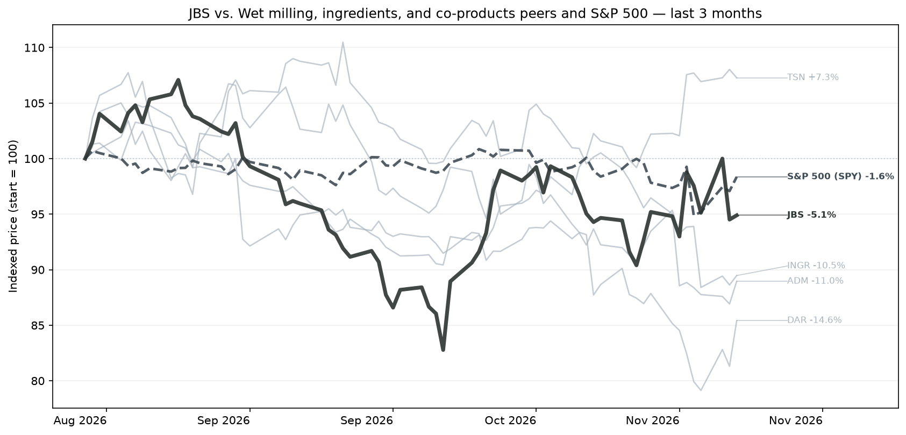

#### Earnings Call Summary

JBS returned to positive EBITDA in its U.S. Beef segment during Q3 2026, marking a key milestone after two challenging years. Global CEO Gilberto Tomazoni and U.S. CEO Wesley Batista Filho credited operational optimization, including restructuring fed, regional, and case-ready units under single management, plus cost discipline and higher focus on yields.

#### At a Glance

- **JBS Misses Q3 Topline Expectations:** JBS reported an Adjusted EPS of $0.00, widely missing the estimated $0.612, while its reported revenue of $125.50 billion came in above the estimated $118.997 billion.
- **US Beef Fares Better Quantifiably:** JBS saw its U.S. beef business segment return to positive adjusted EBITDA after struggling through two difficult years of cyclical headwinds.
- **Capital Spending Trimmed for 2027:** Management announced a planned reduction of $500 million in capital expenditures for fiscal year 2027 to prioritize balance sheet deleveraging.
- **Pork and Poultry Create Pressures:** Overall profit margins were constrained due to a global oversupply of pork and persistent margin pressure within the poultry segment.
- **Leverage Creeps Above Corporate Target:** Challenging market conditions and negative free cash flow of $167 million pushed the company&#x27;s net leverage up to 3.54 times.
- **China Export Quotas Limit Volume:** Lower third-quarter exports were recorded as China reached its initial 2026 import quota limits for Brazilian beef early in the period.

#### Key Moments from the Call

- **9m — U.S. Beef Operational Turnaround Boosts Outlook:** The U.S. Beef business achieved positive sequential momentum, supported by operational integration and the reopening of the U.S. border to Mexican cattle imports, adding ~1 million head annually. Management expects this structural capacity rebalancing to support low single-digit margins and drive a primary EBITDA expansion of over 2 percentage points into 2027.
- **10m — U.S. Pork Headwinds to Persist into 2027:** U.S. Pork metrics deteriorated rapidly due to high global supply and compressed margins, creating a sharp decline in hog production earnings. Executives expect challenging market conditions to extend through the first half of 2027 before global supply adjustments, particularly sow herd reductions in China, trigger a market recovery in the latter half of the year.
- **11m — Flora Acquisition Monetizes Mass Tax Credits:** The Flora transaction provides a strategic B2C health, nutrition, and personal care platform to monetize JBS's byproducts (e.g., tallow). Financially, it serves as an immediate catalyst to absorb and monetize JBS's $800M in accumulated VAT tax credits and $2.2B in income tax credits, dropping the forward 2027 transaction multiple below 4.9x post-synergies.
- **47m — Disciplined CapEx Cuts Anchoring 2027 Deleveraging Target:** With net leverage reaching 3.54x, JBS is implementing a disciplined capital allocation strategy by reducing 2027 CapEx by roughly $500 million, primarily by pausing or postponing new growth projects. Combined with a U.S. Beef segment turnaround and $800 million in expected cash inflows from the Australia equity sale, JBS targets leverage below 3.0x by late 2027.
<h3 id="earnings-cf">CF Industries (<a href="#company-cf">CF</a>) +2.7%</h3>

**Reported:** November 5, 2026 · [Google Finance earnings page](https://www.google.com/finance/quote/CF:NYSE?tab=earnings&hl=en)

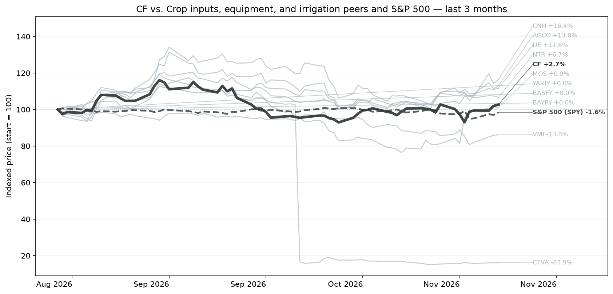

#### Earnings Call Summary

CF Industries reported Q3 2026 adjusted EBITDA of $833M and net earnings of $436M ($2.87 per diluted share). For the first nine months of 2026, the company achieved adjusted EBITDA of approximately $3B, exceeding mid-cycle estimates due to operational strength and high asset utilization.

#### At a Glance

- **Mixed Results on Top and Bottom Lines:** CF Industries reported a reported adjusted EPS of 2.87, missing the estimated adjusted EPS of 2.955, while reported revenue of 1,860,000,000 beat the estimated revenue of 1,774,505,790.
- **Strong Operating KPIs Lift Performance:** The company operated its available ammonia capacity at a 97% utilization rate year-to-date and shipped nearly 2 million tons of UAN, marking its largest quarterly volume for this segment this decade.
- **Persistently Tight Forward Global Supply Guidance:** Management anticipates a highly constructive global supply-demand balance persisting into 2027, driven by widespread Middle Eastern supply disruptions and accelerating European capacity curtailments.
- **Higher Logistics and Operational Costs Weigh:** While lower natural gas costs provided some margin tailwinds, elevated maintenance, freight, distribution, and purchased product costs ultimately pressured bottom-line profitability.
- **Robust Cash Conversion and Shareholder Returns:** CF Industries sustained strong cash generation, converting roughly 60% of EBITDA into free cash flow and returning $1.3 billion to shareholders via repurchases and dividends over the trailing twelve months.

#### Key Moments from the Call

- **4m — Robust North American Demand Volumes:** CF Industries experienced a very strong fall ammonia program, tracking near 10-year highs, and shipped nearly 2 million tons of UAN in Q3, marking their largest quarterly UAN volume this decade.
- **5m — Strong Global Supply Constraints Support Outlook:** Management highlighted that geopolitical disruptions have cut ~9 million metric tons of Middle Eastern urea supply, while ~35% of European ammonia capacity remains curtailed due to high gas costs, structurally tightening global markets.
- **13m — European Industry Shutdowns Accelerating:** CEO Chris Bohn indicated that structural closures of European nitrogen assets are accelerating 12 to 18 months ahead of the previously anticipated 2030 timeframe due to persistent energy volatility and high restart costs.
- **42m — Yazoo City Rebuild Timeline Clarified:** The company expects to begin the operational ramp-up of the idled Yazoo City plant components during the first half of 2027, with full ammonium nitrate production resuming in the second half of the year.
<h3 id="earnings-cnh">CNH Industrial (<a href="#company-cnh">CNH</a>) +16.4%</h3>

**Reported:** November 9, 2026 · [Google Finance earnings page](https://www.google.com/finance/quote/CNH:NYSE?tab=earnings&hl=en)

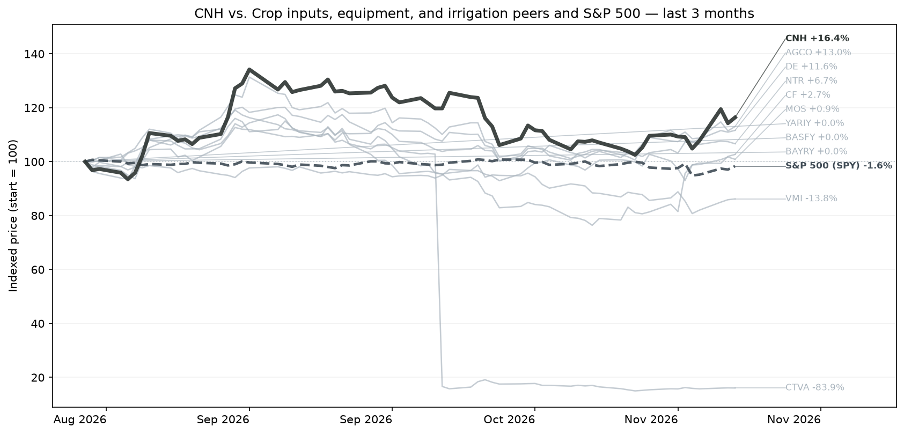

#### Earnings Call Summary

CNH reported Q3 2026 consolidated revenues of $4.4B, down 1% year-over-year, and industrial adjusted EBIT of $202M, up 94% with a 5.5% margin. Adjusted net income reached $205M with an EPS of $0.16. Agriculture segment sales fell 2%, with positive results in North America (+2%) offset by declines in EMEA (-6%) and South America (-22%).

#### At a Glance

- **CNH Industrial Delivers Mixed Q3 Results:** CNH Industrial reported a reported adjusted EPS of $0.02, missing estimates of $0.098, while revenue of $4,354,000,000 also fell short of the estimated $4,517,742,120.
- **Margins Expand Despite Volume Headwinds:** The company&#x27;s agriculture adjusted gross margin improved to 22.3% from 20.6% in the prior year, and the construction segment expanded its adjusted EBIT margin by 650 basis points to 8.4%.
- **Full Year 2026 Guidance Raised:** Management increased its full-year 2026 adjusted diluted EPS outlook to a range of $0.44 to $0.48 and boosted its industrial free cash flow projection to between $300 million and $450 million.
- **Major Strategic Construction Divestiture Announced:** CNH Industrial signed an agreement with Kobelco Construction Machinery to transition its construction business into a $1 billion joint venture, with Kobelco acquiring a 70% stake to enhance focus on agriculture.
- **Regional Agriculture Performance Diverges Sharply:** Agriculture net sales posted mild resilience in North America with a 2% increase, but suffered severe downturns globally, dropping 6% in EMEA and plunging 22% in South America.
- **Brazil Tax Charge Impedes Income:** Reported net income was pressured down to $35 million due to a significant $156 million non-cash valuation allowance charge against Financial Services&#x27; deferred tax assets in Brazil.

#### Key Moments from the Call

- **5m — Kobelco Construction Joint Venture:** CNH announced a joint venture with Kobelco Construction Machinery, selling a 70% stake for $700M in cash. This transaction successfully transitions CNH into a pure-play agricultural equipment company, strips out lower-margin business segments, and delivers an attractive 10x EBITDA transaction multiple that exceeded market expectations.
- **15m — Brazilian Financial Services Impact:** The financial services segment recorded a $156M non-cash valuation allowance due to multi-year elevated delinquencies in Brazil. This unexpected drag highlights ongoing credit and macroeconomic pressures restricting farmer profitability in South America, signaling that recovery in the region will lag behind North America.
- **20m — Full-Year 2026 Guidance Raise:** Management raised full-year 2026 adjusted diluted EPS guidance to $0.44-$0.48 and increased industrial free cash flow expectations to $300M-$450M. This positive revision demonstrates strong pricing realization and operational cost execution, successfully overcoming persistent volume headwinds across South America and the EMEA region.
- **24m — North American Agricultural Cycle Trough:** Management declared 2026 as the cyclical trough for North American agriculture, supported by a 15% to 20% order intake increase for model year 2027 products during early order programs. This positive momentum provides clear demand visibility, reassuring investors that market stabilization is underway.
<h3 id="earnings-ingr">Ingredion (<a href="#company-ingr">INGR</a>) -10.5%</h3>

**Reported:** November 5, 2026 · [Google Finance earnings page](https://www.google.com/finance/quote/INGR:NYSE?tab=earnings&hl=en)

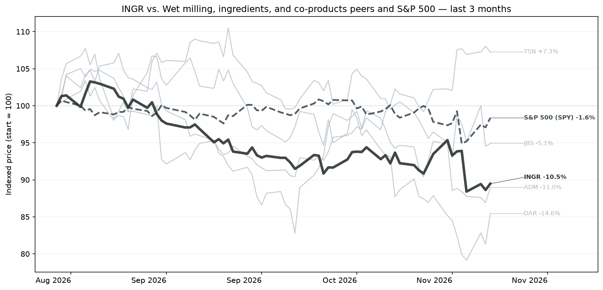

#### Earnings Call Summary

The acquisition of Tate & Lyle is progressing according to plan, following shareholder approval in July. Ingredion is currently working through regulatory and antitrust reviews across relevant jurisdictions and maintains its target to close the transaction in the second half of 2027.

#### At a Glance

- **Ingredion Misses Q3 Expectations:** Ingredion reported a third-quarter adjusted EPS of $2.23 and revenue of $1,792,000,000, missing analyst estimates of $2.596 for adjusted EPS and $1,800,206,360 for revenue.
- **Mixed Segment Volume Performance:** The Texture &amp; Healthful Solutions segment achieved its 10th consecutive quarter of net sales volume growth, though its operating income fell 10% due to a 65% year-over-year spike in tapioca root costs.
- **Full-Year Guidance Cut Significantly:** Management lowered its full-year 2026 adjusted EPS guidance to a range of $9.25 to $9.70 and now expects flat net sales, down from the previous EPS range of $10.30 to $10.90.
- **Argo Facility Limits Recovery:** A slower-than-anticipated financial recovery and persistent operational headwinds at the Argo facility heavily weighed on profitable volume growth and compressed margins.
- **Market Reacts with Selloff:** Following the top-and-bottom-line earnings miss and downbeat outlook, Ingredion shares fell approximately 5.5% in premarket trading as investors priced in the updated risks.

#### Key Moments from the Call

- **8m — Macro Pressures Soften Volumes:** Elevated diesel logistics inflation has driven CPG customers to raise product prices. Consequently, middle- and lower-income consumers are buying fewer units or trading down, triggering a post-August volume step-down in sweeteners and starches across the U.S. and Canada.
- **17m — Severe Tapioca Cost Inflation:** Extreme weather and crop disease in Thailand drove industry tapioca prices up 45%, inflating Ingredion's costs by 65%. While pricing pass-throughs are underway, a one-quarter lag compressed segment margins, though sticky demand prevents customers from substituting the unique texturizer.
- **21m — Full Year 2026 Guidance Lowered:** Ingredion lowered its full-year guidance due to operational cost overruns at its Argo plant and macro-driven consumer demand softness. This revision disappointed investors as adjusted EPS guidance was trimmed to $9.25–$9.70 and adjusted operating income is now expected to decline mid-teens.
- **28m — Argo Plant Operational Shortfall:** The Argo facility faces a disconnect between stable production and weak financial recovery. Sub-optimal extraction yields and elevated maintenance spending to fix reliability issues caused a significant operating income miss, which will continue to impact profitability through the fourth quarter.
<h3 id="earnings-agro">Adecoagro (<a href="#company-agro">AGRO</a>) -2.6%</h3>

**Reported:** November 12, 2026 · [Google Finance earnings page](https://www.google.com/finance/quote/AGRO:NYSE?tab=earnings&hl=en)

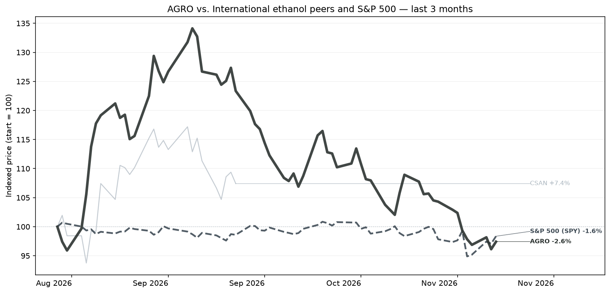

#### Earnings Call Summary

Adecoagro achieved record consolidated adjusted EBITDA of $258 million year-to-date and $173 million for Q2 2026. Higher fertilizer production volumes, pricing, and cost efficiencies supported margin expansion, offsetting softer results in sugar, ethanol, and energy, and food and agriculture. The sugarcane plantation in Brazil is in excellent condition following weather normalization.

#### At a Glance

- **Mixed Results With Revenue Surge:** Adecoagro reported a revenue of $1,129.45 million for Q3 2026, significantly beating the estimated $660.24 million, though adjusted EPS of $0.32 missed the expected $0.479.
- **Fertilizers and Agriculture Drive Strengths:** The company&#x27;s performance was bolstered by record production volumes in its Fertilizers segment and strong yield metrics in Food &amp; Agriculture, offsetting weaker pricing environment headwinds.
- **Forward Volume Targets Reaffirmed:** Management anticipates mid-teens growth in sugarcane crushing volumes for the year-end and reaffirmed its net leverage target of 2.5x.
- **Segment Performance Reveals Divergent Trends:** The Fertilizers segment dominated overall profitability by contributing 49% of quarterly Adjusted EBITDA, whereas the Sugar, Ethanol, and Energy segment faced headwinds from depressed market prices.
- **Market Reaction Triggers Stock Decline:** Following the earnings announcement, Adecoagro shares tumbled 9.5% to $8.19 in after-hours trading due to investor disappointment over the bottom-line earnings miss.

#### Key Moments from the Call

- **3m — Caarapó Mill Acquisition Strategy:** Management highlighted the acquisition of the Caarapó Mill as highly accretive, expanding operations organically by milling surplus cane within their cluster. The transaction will be paid in cash at closing and is not expected to disrupt full-year net leverage or deleveraging targets.
- **8m — Ethanol Inventory Carrying Strategy:** Faced with depressed domestic ethanol prices in June and July due to high supply, Adecoagro chose to store 41% of its year-to-date ethanol production in inventory. This tactical move positions the company to capture stronger commercial margins as demand and pricing recover in Q4 and Q1.
- **9m — Fertilizer Segment Outperformance:** Adecoagro's fertilizer segment generated substantial margin expansion and more than doubled its adjusted EBITDA due to higher production and a surge in international urea prices toward $800 per ton, tracking ahead of the company's initial annual projections.
- **24m — Sugar and Ethanol Cost Reductions:** Despite quarterly FX headwinds from the Brazilian Real, management reiterated that a 10% reduction in full-year local currency production costs remains achievable. This performance is driven by a projected 10% crushing volume expansion, lower leasing costs, and headcount reductions via new harvesting technologies.
<h3 id="earnings-gpre">Green Plains (<a href="#company-gpre">GPRE</a>) -10.1%</h3>

**Reported:** November 5, 2026 · [Google Finance earnings page](https://www.google.com/finance/quote/GPRE:NASDAQ?tab=earnings&hl=en)

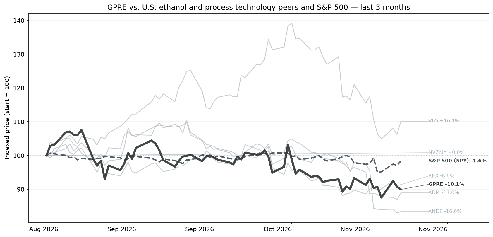

#### Earnings Call Summary

Green Plains reported robust Q3 2026 results, with adjusted EBITDA more than doubling year-over-year to $118 million, driven by strong operational recovery and a $65 million contribution from its 45Z clean fuel production tax credit low-carbon platform. Platform utilization recovered to 95%, with sequential production increases and record ethanol and renewable corn oil yields.

#### At a Glance

- **Green Plains Beats EPS But Misses Revenue:** Green Plains reported a strong Adjusted EPS of $1.03, significantly beating the estimated $0.617, while its reported revenue of $495.99 million missed the estimated $530.43 million.
- **Utilization and Production Reach Records:** The company achieved 95% platform utilization across its facilities and recorded historic production highs, including the Madison plant&#x27;s highest quarterly ethanol output in 15 years.
- **Full-Year Carbon EBITDA Guidance Raised:** Green Plains raised its full-year 2026 carbon-related adjusted EBITDA guidance to a range of $230 million to $250 million, supported by predictable 45Z clean fuel production tax credits.
- **Monetization Agreement Secures Future Cash:** Management executed an agreement to transfer and monetize between $250 million and $325 million in gross face value of its 2026 Section 45Z production tax credits.
- **Revenue Falls on Asset Divestment:** Quarterly revenue declined 2.5% year-over-year primarily because of lower overall ethanol volumes following the strategic sale of the Obion plant.
- **Constructive Market and Margin Reaction:** Shares rose 3.6% to $14.20 after release as the company&#x27;s operating margin expanded sharply to 18.7% from 6.7% in the prior-year quarter.

#### Key Moments from the Call

- **3m — 45Z Tax Credit Outlook Boost:** Green Plains increased its 2026 low-carbon platform EBITDA outlook to $230M–$250M and projected at least $250M for 2027, pleasing investors with clear financial predictability from its 45Z credit monetization agreement.
- **7m — Operational Execution Outpaces Commodities:** Adjusted EBITDA more than doubled to $118 million, driven by record production yields and a 95% utilization rate, proving that structural efficiency improvements can generate material margin upside outside of volatile market factors.
- **8m — Strategic Farm Forward Launch:** The rollout of the Farm Forward incentive program in Nebraska lowers feed carbon intensity scores by giving farmers premiums, laying out an actionable, scalable framework to maximize 45Z credit tier yields.
- **32m — Strong Global Export Support:** Projected 2027 U.S. industry export demand of over 2.6 billion gallons and positive arbitrage over Brazilian ethanol reassure investors that high domestic production volumes will find reliable global buyers.

## Company Overviews

<h3 id="company-ctva">Corteva (CTVA)</h3>

*Crop inputs, equipment, and irrigation · $52.4B · 3m -83.9% · 12m -81.7% · 24m -78.8%*

[Google Finance](https://www.google.com/finance/quote/CTVA:NYSE?tab=earnings&hl=en)

Largest U.S. corn-seed franchise (Pioneer) and a primary input cost for Corn Belt acres.

Corteva is an agricultural inputs pure play that was formed in 2019 when it was spun off from DowDuPont. The company is a leader in the development of new seed and crop protection products. Seeds generate the majority of profits with the remainder coming from crop protection products. Corteva plans to spin off its seeds business in late 2026. The seeds business will be named Vylor, while the crop protection business will retain the Corteva name and be a pure-play crop protection company following the divestiture. Corteva operates globally, but around half of revenue comes from North America.

<h3 id="company-bayry">Bayer (BAYRY)</h3>

*Crop inputs, equipment, and irrigation · n/a · 3m +0.0% · 12m +66.2% · 24m +149.3%*

[Google Finance](https://www.google.com/finance/quote/BAYRY:NYSE?tab=earnings&hl=en)

Dekalb and former Monsanto corn-seed brands; together with Corteva dominates U.S. corn seed.

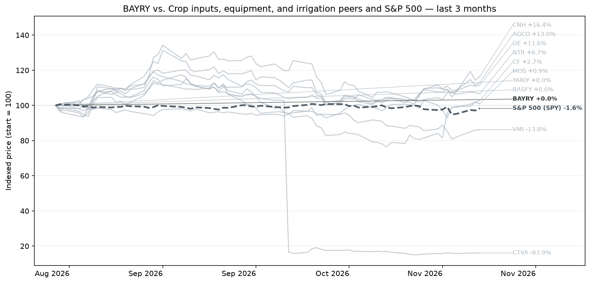

BAYER AG S/ADR

<h3 id="company-basfy">BASF (BASFY)</h3>

*Crop inputs, equipment, and irrigation · n/a · 3m +0.0% · 12m +16.6% · 24m +31.0%*

[Google Finance](https://www.google.com/finance/quote/BASFY:NYSE?tab=earnings&hl=en)

Crop-protection chemistry used on U.S. corn acres.

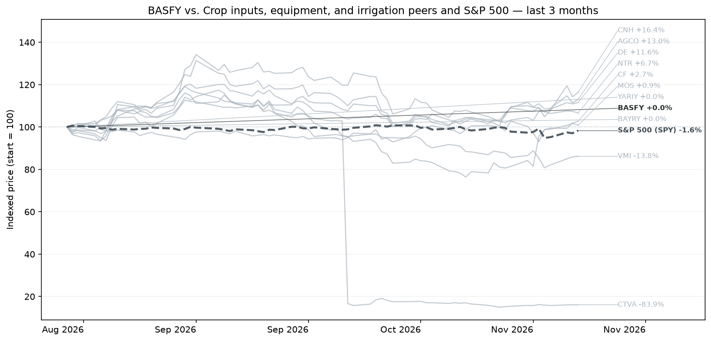

BASF SE S/ADR

<h3 id="company-ntr">Nutrien (NTR)</h3>

*Crop inputs, equipment, and irrigation · $33.6B · 3m +6.7% · 12m +19.2% · 24m +52.5%*

[Google Finance](https://www.google.com/finance/quote/NTR:NYSE?tab=earnings&hl=en)

Largest North American agricultural retailer and a major potash and nitrogen producer.

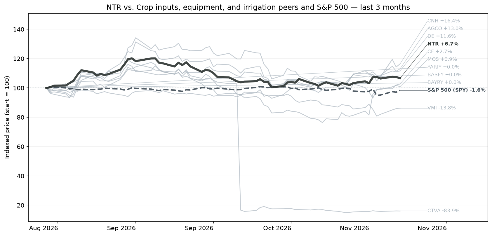

Created in 2018 as a result of the merger between PotashCorp and Agrium, Nutrien is the world's largest fertilizer producer by capacity. Nutrien produces the three main crop nutrients—nitrogen, potash, and phosphate—although its main focus is potash, where it is the global leader in installed capacity with a roughly 20% market share. The company is also the largest agricultural retailer in North America and Australia, selling fertilizers, crop chemicals, seeds, and services directly to farm customers through its brick-and-mortar stores and online platforms.

<h3 id="company-cf">CF Industries (CF)</h3>

*Crop inputs, equipment, and irrigation · $18.0B · 3m +2.7% · 12m +45.4% · 24m +46.3%*

[Google Finance](https://www.google.com/finance/quote/CF:NYSE?tab=earnings&hl=en)

Nitrogen fertilizer producer; corn is the crop that most moves UAN and urea demand.

CF Industries is a leading producer and distributor of nitrogen, which is primarily used in fertilizers. The company operates nitrogen manufacturing plants primarily in North America. CF also produces nitrogen in the United Kingdom and holds a joint venture interest in a nitrogen production facility in Trinidad and Tobago. CF makes nitrogen primarily using low-cost US natural gas as its feedstock, making the company one of the lowest-cost nitrogen producers globally. It is also investing in carbon-free blue and green ammonia, which can be used as an alternative fuel to hydrogen or as a means to transport hydrogen.

<h3 id="company-yariy">Yara International (YARIY)</h3>

*Crop inputs, equipment, and irrigation · n/a · 3m +0.0% · 12m +19.2% · 24m +56.3%*

[Google Finance](https://www.google.com/finance/quote/YARIY:NYSE?tab=earnings&hl=en)

Global nitrogen producer that sets the international urea and ammonia reference.

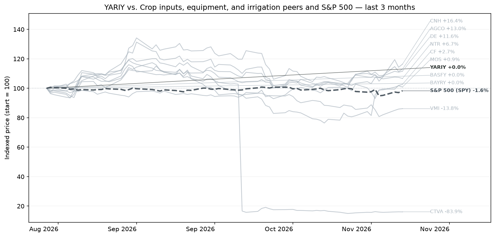

YARA INTL ASA S/ADR

<h3 id="company-mos">Mosaic (MOS)</h3>

*Crop inputs, equipment, and irrigation · $7.1B · 3m +0.9% · 12m -10.4% · 24m -11.8%*

[Google Finance](https://www.google.com/finance/quote/MOS:NYSE?tab=earnings&hl=en)

Phosphate and potash producer that completes corn production budgets.

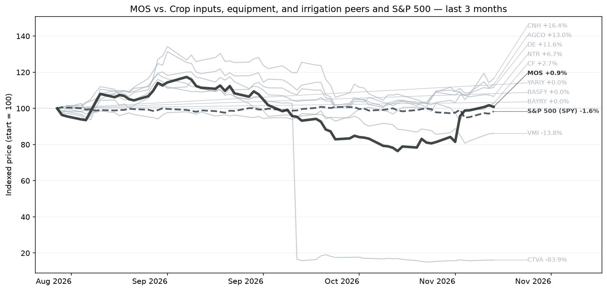

Mosaic is one of the largest phosphate and potash producers in the world. The company's assets include phosphate rock mines in the US and potash mines in Canada. Mosaic also runs a large fertilizer distribution operation in Brazil through its Mosaic Fertilizantes business.

<h3 id="company-de">Deere (DE)</h3>

*Crop inputs, equipment, and irrigation · $156.7B · 3m +11.6% · 12m +43.9% · 24m +75.7%*

[Google Finance](https://www.google.com/finance/quote/DE:NYSE?tab=earnings&hl=en)

Dominant North American farm-equipment maker for corn planting, harvest, and grain handling.

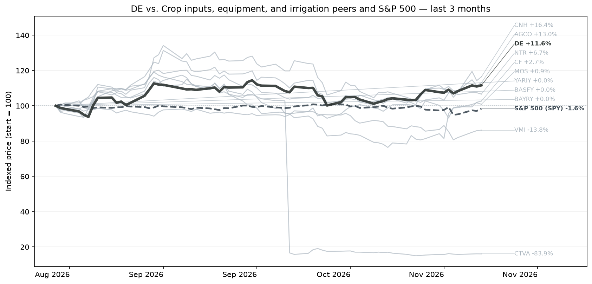

Deere is the world's leading manufacturer of agricultural equipment and a major producer of construction machinery. The company is divided into four reporting segments: production & precision agriculture, or PPA, small agriculture & turf, or SAT, construction & forestry, or CF, and financial services, or FS, its captive finance subsidiary. The core PPA business is the largest contributor to sales and profits by far. Geographically, Deere sales are 60% US/Canada, 17% Europe, 14% Latin America, and 9% rest of the world. Deere goes to market through a robust dealer network that includes over 2,000 dealer locations in North America with reach into over 100 countries. John Deere Financial provides retail financing for machinery to its customers and wholesale financing for dealers.

<h3 id="company-cnh">CNH Industrial (CNH)</h3>

*Crop inputs, equipment, and irrigation · $16.5B · 3m +16.4% · 12m +20.9% · 24m +21.7%*

[Google Finance](https://www.google.com/finance/quote/CNH:NYSE?tab=earnings&hl=en)

Case IH and New Holland farm equipment serving corn growers.

CNH Industrial is the world's second largest manufacturer of agricultural machinery (82% of industrial net sales) as well as a major player in construction equipment (18% of industrial net sales). Its Case and New Holland brands have served farmers for generations. Geographically, agricultural sales are 40% in North America, 32% in Europe, the Middle East, and Africa, 18% in South America, and 10% in Asia-Pacific. CNH's products are available through a robust independent dealer network, which includes over 2,600 dealer and distribution locations and reach into 164 countries. The construction business leverages over 400 dealers. The company's captive finance arm provides retail financing to its customers and wholesale financing to dealers to maintain inventory, thereby supporting sales.

<h3 id="company-agco">AGCO (AGCO)</h3>

*Crop inputs, equipment, and irrigation · $7.0B · 3m +13.0% · 12m +5.8% · 24m +27.1%*

[Google Finance](https://www.google.com/finance/quote/AGCO:NYSE?tab=earnings&hl=en)

Fendt, Massey Ferguson, and Challenger farm equipment with Corn Belt exposure.

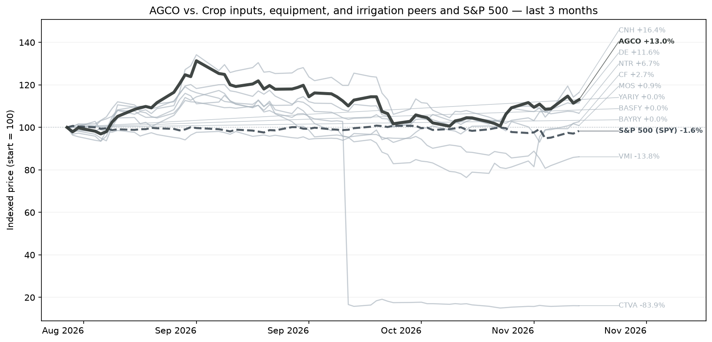

Agco is a global manufacturer of agricultural equipment. Its main machine brands are Fendt, Massey Ferguson, and Valtra; its initiatives in precision agriculture have been organized under the PTx umbrella following a series of acquisitions. While a global business, Agco's sales skew heavily toward Europe/Middle East, representing 50%-60% of sales and even more of operating profits. The company is trying to increase its exposure to the larger North and South American markets. Its products are available through a global dealer network, which includes over 3,000 dealers and distribution locations and reaches into over 140 countries. Additionally, Agco offers retail and wholesale financing to customers through its partnership with Rabobank of the Netherlands, having exited their JV in 2026.

<h3 id="company-vmi">Valmont Industries (VMI)</h3>

*Crop inputs, equipment, and irrigation · $9.3B · 3m -13.8% · 12m +3.5% · 24m +23.1%*

[Google Finance](https://www.google.com/finance/quote/VMI:NYSE?tab=earnings&hl=en)

Center-pivot irrigation (Valley) used on irrigated High Plains corn.

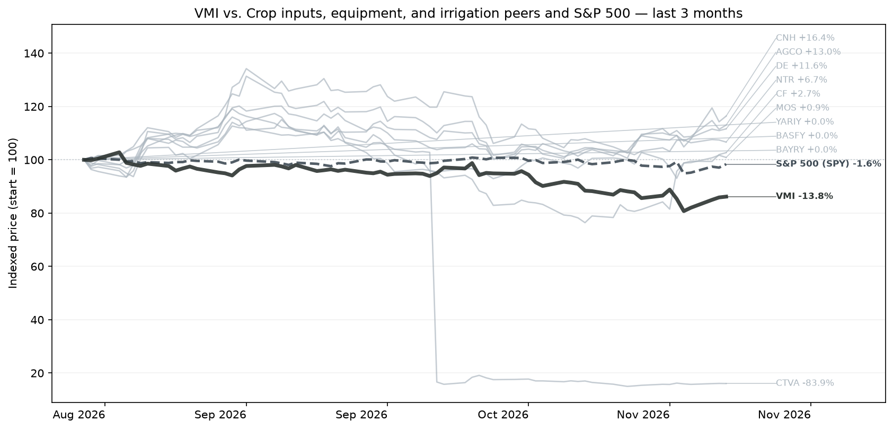

Valmont Industries Inc, along with its subsidiaries, operates as a manufacturer of products and services for infrastructure and agriculture markets. Its reportable segments are Infrastructure and Agriculture. The company generates maximum revenue from the Infrastructure segment, which includes the manufacturing and distribution of products and solutions to serve the infrastructure markets of utility, solar, lighting, transportation, and telecommunications, along with coatings services to protect metal products. The Agriculture segment provides irrigation equipment components, including aftermarket parts and tubular products, and technology solutions for precision agriculture. Geographically, it derives key revenue from the United States, followed by Australia, Brazil, and other regions.

<h3 id="company-adm">Archer Daniels Midland (ADM)</h3>

*Grain origination and agribusiness, Wet milling, ingredients, and co-products, U.S. ethanol and process technology · $38.9B · 3m -11.0% · 12m +22.8% · 24m +37.9%*

[Google Finance](https://www.google.com/finance/quote/ADM:NYSE?tab=earnings&hl=en)

Global grain trader, top U.S. ethanol producer, and major corn wet miller.

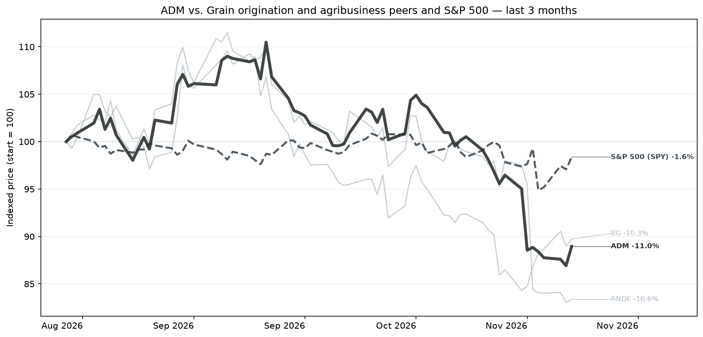

Archer-Daniels-Midland is a major processor of oilseeds, corn, wheat, and other agricultural commodities. The company is also one of the largest grain merchandisers through its extensive network of logistical assets to store and transport crops around the globe. ADM also runs a nutrition business that focuses on both human and animal ingredients and is a large producer of corn-based sweeteners, starches, and ethanol.

<h3 id="company-bg">Bunge (BG)</h3>

*Grain origination and agribusiness · $21.9B · 3m -10.3% · 12m +4.1% · 24m +14.7%*

[Google Finance](https://www.google.com/finance/quote/BG:NYSE?tab=earnings&hl=en)

Global grain and oilseed merchant after the Viterra combination; competitor for corn origination.

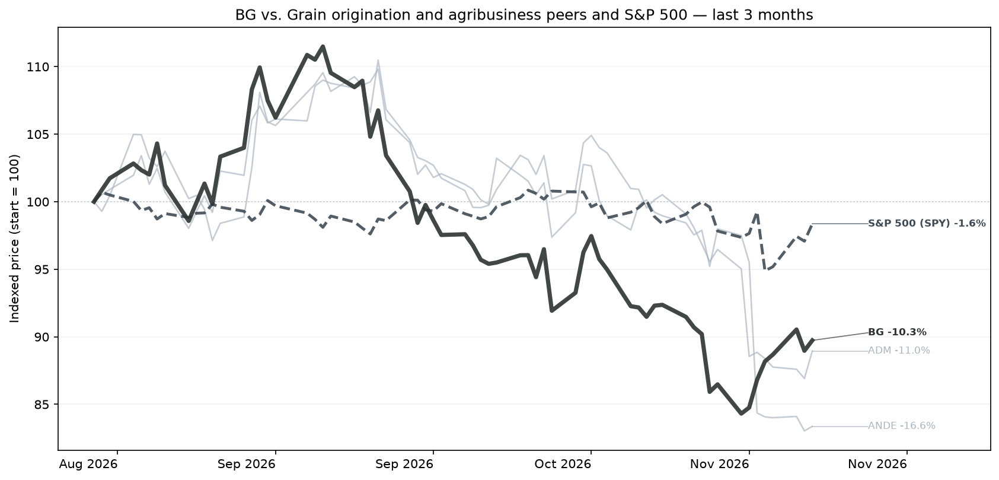

Bunge Global SA is an agribusiness solutions company, connecting farmers to consumers and delivering essential food, feed and fuel to the globe. The company segments include Soybean Processing and Refining; Softseed Processing and Refining; Other Oilseeds Processing and Refining; Grain Merchandising and Milling; and Corporate and Other. It generates maximum revenue from the Soybean Processing and Refining segment, which includes integrated business principally involved in the purchase, storage, transportation, processing, distribution, refining, marketing, and sale of soybeans and soybean related products, as well as biodiesel and fertilizer production and distribution. Geographically, the company operates in United States, Switzerland, Netherlands, and Rest of the World.

<h3 id="company-ande">The Andersons (ANDE)</h3>

*Grain origination and agribusiness, U.S. ethanol and process technology · $2.3B · 3m -16.6% · 12m +9.8% · 24m +16.3%*

[Google Finance](https://www.google.com/finance/quote/ANDE:NASDAQ?tab=earnings&hl=en)

Grain elevators plus four wholly owned ethanol plants totaling about 500 million gallons a year.

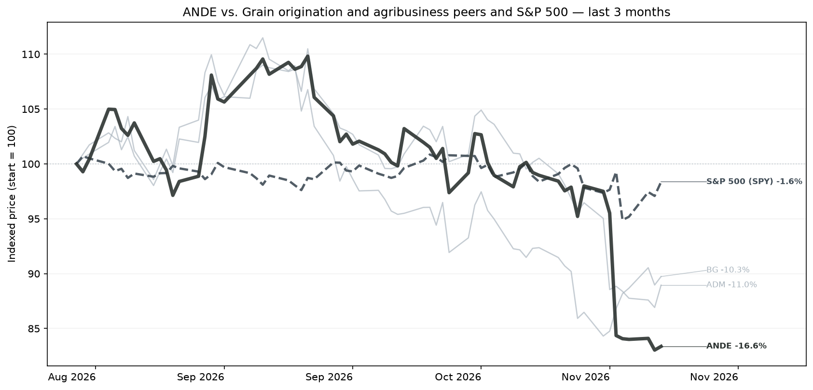

Andersons Inc is an agriculture and renewable fuels company. Its operations are classified into two reportable business segments: Agribusiness, which generates maximum revenue, and Renewables. The Agribusiness segment includes merchandising and managing logistics across various commodities, as well as being a manufacturer, distributor, and retailer of agricultural and related plant nutrients. The segment specializes in the movement of physical commodities such as whole grains, grain products, feed ingredients, and domestic fuel products, among other agricultural commodities. The Renewables segment mainly produces, purchases, and sells ethanol and co-products. Geographically, the company generates maximum revenue from the United States, followed by Canada, Mexico, and other markets.

<h3 id="company-vlo">Valero Energy (VLO)</h3>

*U.S. ethanol and process technology, Fuel blending, refining, and retail · $99.7B · 3m +10.1% · 12m +104.9% · 24m +165.4%*

[Google Finance](https://www.google.com/finance/quote/VLO:NYSE?tab=earnings&hl=en)

World's second-largest corn-ethanol producer with a distinct Ethanol segment and a major blender.

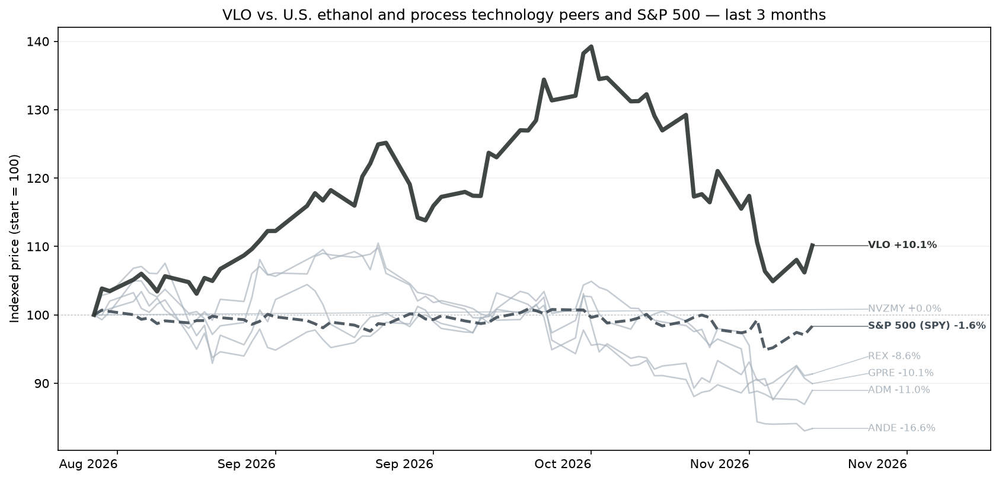

Valero Energy is one of the largest independent refiners in the United States. It operates 15 refineries, with a total throughput capacity of 3.2 million barrels a day in the US, Canada, and the United Kingdom. Valero also owns 12 ethanol plants with capacity of 1.6 billion gallons a year and holds a 50% stake in Diamond Green Diesel, which can produce 1.2 billion gallons per year of renewable diesel.

<h3 id="company-gpre">Green Plains (GPRE)</h3>

*U.S. ethanol and process technology · $1.1B · 3m -10.1% · 12m +39.1% · 24m +21.8%*

[Google Finance](https://www.google.com/finance/quote/GPRE:NASDAQ?tab=earnings&hl=en)

Largest U.S. ethanol pure play, with high-protein feed, corn oil, and Nebraska carbon-capture work.

Green Plains Inc manufactures and sells ethanol and ethanol byproducts in two segments based on function. The ethanol production segment, which generates the majority of revenue, includes the production of ethanol, distillers grains, Ultra-High Protein and renewable corn oil. The agribusiness and energy services segment includes grain handling and storage, commodity marketing and merchant trading for company-produced and third-party ethanol, distillers grains, Ultra-High Protein, renewable corn oil, natural gas and other commodities.

<h3 id="company-rex">REX American Resources (REX)</h3>

*U.S. ethanol and process technology · $1.4B · 3m -8.6% · 12m +19.9% · 24m +69.1%*

[Google Finance](https://www.google.com/finance/quote/REX:NYSE?tab=earnings&hl=en)

Holding company with interests in six Corn Belt ethanol plants; cleanest public crush-margin equity.

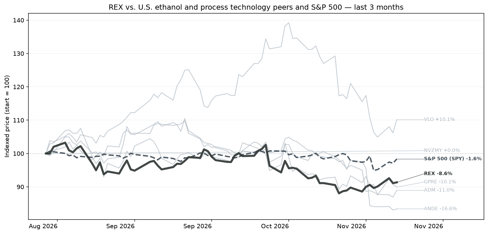

REX American Resources Corp operates as a holding company that engages in investments in alternative energy and ethanol production entities. Its operating segments include Ethanol and By-Products. Its products include Ethanol, dried distillers grains, modified distillers grains, Distillers corn oil, Modified distillers grains, and Other.

<h3 id="company-nvzmy">Novonesis (NVZMY)</h3>

*U.S. ethanol and process technology · n/a · 3m +0.0% · 12m -2.1% · 24m +9.6%*

[Google Finance](https://www.google.com/finance/quote/NVZMY:NYSE?tab=earnings&hl=en)

Dominant supplier of enzymes used in dry-mill ethanol fermentation.

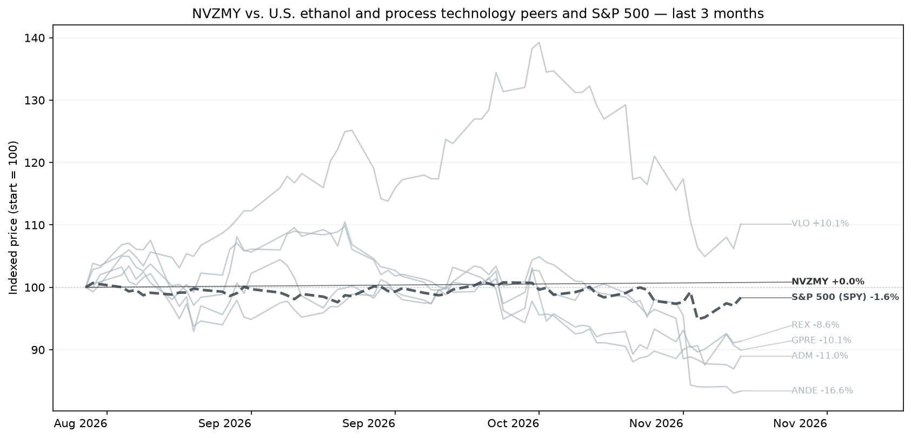

NOVONESIS B UNSP/ADR

<h3 id="company-ingr">Ingredion (INGR)</h3>

*Wet milling, ingredients, and co-products · $6.8B · 3m -10.5% · 12m -14.2% · 24m -38.2%*

[Google Finance](https://www.google.com/finance/quote/INGR:NYSE?tab=earnings&hl=en)

Major corn wet miller producing sweeteners, starches, and specialty ingredients.

Ingredion is an ingredients provider for the food, beverage, brewing, and animal nutrition industries. The company processes corn, tapioca, potatoes, stevia, grains, fruits, gums, and vegetables into value-added ingredients. The company sells specialty ingredients that include starch-based texturizers and natural alternative sweeteners such as stevia. Ingredion also sells commodity ingredients that include sweeteners, such as high-fructose corn syrup, and starches, such as those used for sustainable packaging, as well as plant-based proteins. The company plans to acquire Tate & Lyle in an all-cash deal that should close in 2027.

<h3 id="company-dar">Darling Ingredients (DAR)</h3>

*Wet milling, ingredients, and co-products · $10.6B · 3m -14.6% · 12m +56.9% · 24m +27.0%*

[Google Finance](https://www.google.com/finance/quote/DAR:NYSE?tab=earnings&hl=en)

Rendering and used cooking oil; 50/50 owner of Diamond Green Diesel with Valero.

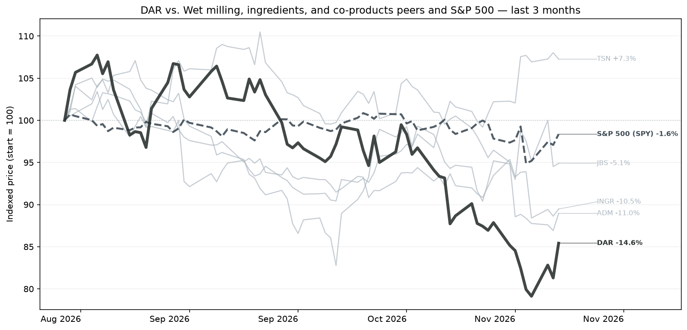

Darling Ingredients Inc is a developer and producer of sustainable natural ingredients from edible and inedible bio-nutrients, creating a wide range of ingredients and customized specialty solutions for customers in the pharmaceutical, food, pet food, animal feed, industrial, fuel, bioenergy and fertilizer industries. It processes by-products from the animal agriculture and food industries into ingredients and products for human nutrition, animal feed, crop inputs, and renewable energy applications. The company operates processing facilities across multiple countries and produces collagen, including gelatin and hydrolyzed collagen, as well as renewable energy products.

<h3 id="company-tsn">Tyson Foods (TSN)</h3>

*Wet milling, ingredients, and co-products · $20.6B · 3m +7.3% · 12m +10.7% · 24m -4.5%*

[Google Finance](https://www.google.com/finance/quote/TSN:NYSE?tab=earnings&hl=en)

Largest U.S. protein company and a primary domestic sink for distillers grains.

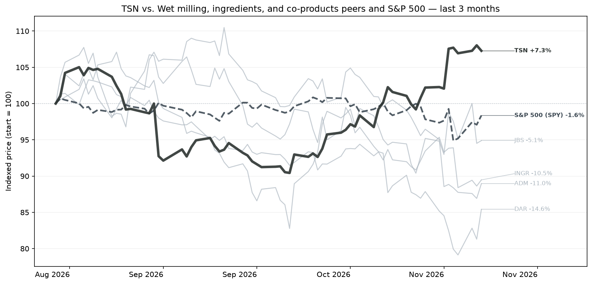

Tyson Foods is a protein-focused food producer, selling raw chicken, beef, pork, and prepared foods. Chicken and beef are its two largest segments, composing about 40% and 30% of sales, respectively. Prepared foods constituted 18% of fiscal 2025 sales and include brands like Tyson, Jimmy Dean, Hillshire Farm, Ball Park, and Sara Lee. However, most of these are in product categories rife with competition where Tyson does not have a massive market share lead. Tyson sells some products overseas, but the international segment accounts for just 4% of total revenue. The company is an active acquirer, with more recent years' purchases focused on international and food-service markets.

<h3 id="company-jbs">JBS (JBS)</h3>

*Wet milling, ingredients, and co-products · $45.2B · 3m -5.1% · 12m -5.4% · 24m n/a*

[Google Finance](https://www.google.com/finance/quote/JBS:NYSE?tab=earnings&hl=en)

World's largest protein company and a major DDGS buyer in the U.S. and Brazil.

JBS NV is a protein food company, selling protein products, which include fresh and frozen cuts of beef, pork, lamb, fish, whole chickens, and chicken parts, to retailers, and foodservice companies. The food products are marketed under different brands such as Swift, Just Bare, Pilgrim's Pride, Sunnyvalley, Reserva Friboi, Great Southern, etc., globally. The company's reportable segments are Beef North America, which generates maximum revenue, Brazil, Seara, Pork USA, Pilgrim's Pride, Australia, and Others. Geographically, it derives majority of its revenue from United States of America.

<h3 id="company-mpc">Marathon Petroleum (MPC)</h3>

*Fuel blending, refining, and retail · $101.3B · 3m +15.7% · 12m +104.6% · 24m +159.5%*

[Google Finance](https://www.google.com/finance/quote/MPC:NYSE?tab=earnings&hl=en)

Largest U.S. independent refiner and a major Midwest ethanol blender.

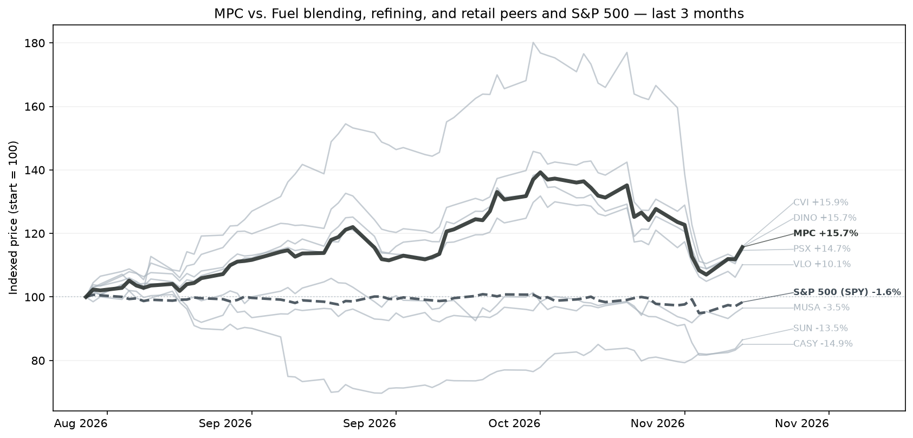

Marathon Petroleum is a leading integrated downstream and midstream energy company that operates 13 refineries in the Gulf Coast, Mid-Continent, and West Coast regions of the United States with an aggregate crude oil refining capacity of 3.0 million barrels per day. The company is one of the largest producers of renewable diesel in the US; its Dickinson, North Dakota facility has the capacity to produce 184 million gallons per year, and its Martinez, California, joint venture facility (a 50/50 partnership with Neste) reached its full capacity of 730 million gallons per year in late 2024. Marathon also owns the general partner and approximately 64% of MPLX LP, a large-cap master limited partnership that owns and operates midstream energy infrastructure and logistics assets.

<h3 id="company-psx">Phillips 66 (PSX)</h3>

*Fuel blending, refining, and retail · $96.7B · 3m +14.7% · 12m +87.4% · 24m +102.6%*

[Google Finance](https://www.google.com/finance/quote/PSX:NYSE?tab=earnings&hl=en)

Large blender and marketer with West Coast renewable-diesel capacity.

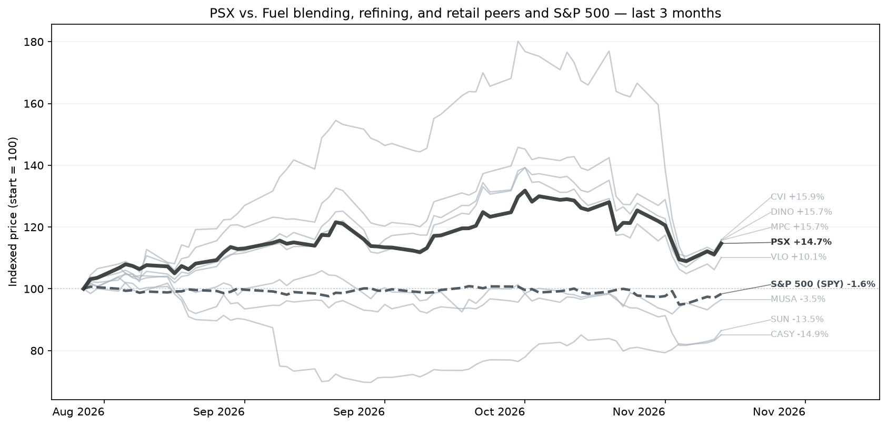

Phillips 66 is an independent refiner that owns or holds interest in 10 refineries with a total crude throughput capacity of 2.0 million barrels per day, or mmb/d, at the end of 2025. The midstream segment comprises extensive transportation and NGL processing assets. It includes 70,000 miles of crude oil, refined petroleum product, NGL and natural gas pipeline systems, and a comprehensive set of refined petroleum product, NGL and crude oil terminals, gathering and processing plants and fractionation facilities and various other storage and loading facilities. Its CPChem chemical joint venture operates facilities primarily in the United States and the Middle East and produces olefins and polyolefins.

<h3 id="company-dino">HF Sinclair (DINO)</h3>

*Fuel blending, refining, and retail · $16.8B · 3m +15.7% · 12m +87.1% · 24m +141.8%*

[Google Finance](https://www.google.com/finance/quote/DINO:NYSE?tab=earnings&hl=en)

Independent Mid-Continent and Rockies refiner with renewable diesel and RFS blending obligations.

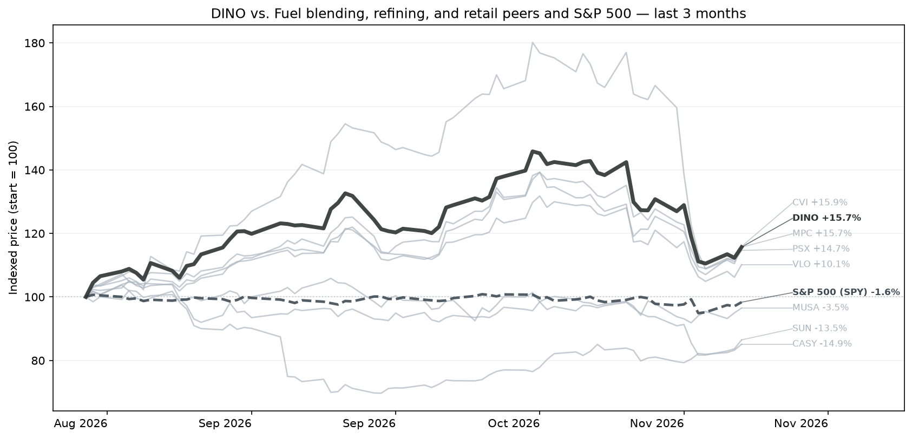

HF Sinclair is an integrated petroleum refiner that owns and operates seven refineries serving the Rockies, midcontinent, Southwest, and Pacific Northwest, with a total crude oil throughput capacity of 678,000 barrels per day. It can produce 380 million gallons of renewable diesel annually. It operates a marketing business with over 350 distributors and 1,700 branded wholesale sites across 30 states. It also owns and operates 4,500 miles of petroleum product pipelines and terminals principally in the Southwestern United States.

<h3 id="company-cvi">CVR Energy (CVI)</h3>

*Fuel blending, refining, and retail · $3.7B · 3m +15.9% · 12m +10.5% · 24m +119.5%*

[Google Finance](https://www.google.com/finance/quote/CVI:NYSE?tab=earnings&hl=en)

Coffeyville, Kansas refiner in the corn complex with renewable diesel and a nitrogen affiliate.

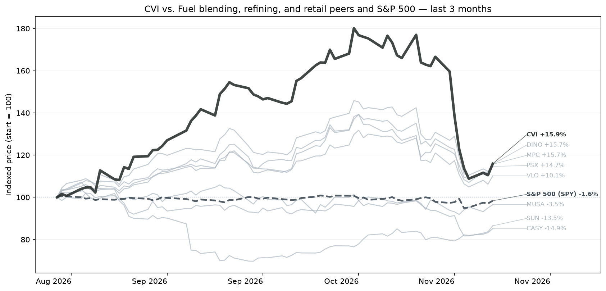

CVR Energy Inc is a holding company that engages in petroleum refining and nitrogen fertilizer manufacturing through its subsidiaries. Subsidiaries include several complex, full-coking crude oil refineries, along with a crude oil gathering system, pipelines, storage tanks, and marketing and supply. The company's refineries can process blends of a variety of crude oil ranging from heavy sour to light sweet crude oil. Crude oil for CVR's refineries is supplied through its wholly-owned gathering system and pipeline. From its refineries, CVR supplies products through tanker trucks directly to customers located in close geographic proximity and customers at throughput terminals. The company's customers include retailers, railroads, and farm cooperatives.

<h3 id="company-sun">Sunoco LP (SUN)</h3>

*Fuel blending, refining, and retail · $14.5B · 3m -13.5% · 12m +28.0% · 24m +26.5%*

[Google Finance](https://www.google.com/finance/quote/SUN:NYSE?tab=earnings&hl=en)

Fuel distributor and terminal operator that moves finished gasoline and ethanol.

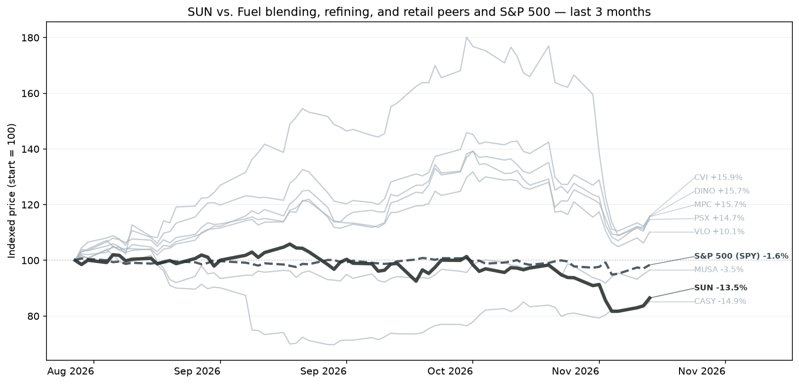

Sunoco LP is engaged in the distribution of motor fuels to independent dealers, distributors, and other commercial customers as well as the distribution of motor fuels to end-use customers at retail sites operated by commission agents. It is a growth-oriented master limited partnership (MLP) that operates as a wholesale and retail fuel distributor in the United States. The firm operates through the Fuel Distribution; Pipeline Systems; Refinery and Terminals segments. It generates the majority of its revenue from the Fuel Distribution segment. It distributes motor fuel to convenience stores, dealers, and commercial customers in various states.

<h3 id="company-casy">Casey&#x27;s General Stores (CASY)</h3>

*Fuel blending, refining, and retail · $30.9B · 3m -14.9% · 12m +33.5% · 24m +71.2%*

[Google Finance](https://www.google.com/finance/quote/CASY:NASDAQ?tab=earnings&hl=en)

Corn Belt convenience-store chain with high E10/E15/E85 exposure.

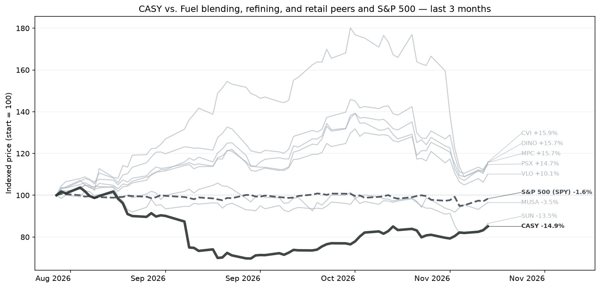

Casey's General Stores Inc, along with its subsidiaries, operates convenience stores mainly under the names Casey's, GoodStop (by Casey's), and Casey's General Store throughout various states in the USA, approximately half of which are located in Iowa, Missouri, and Illinois. These stores offer a broad selection of food items (which includes prepared foods such as regular and breakfast pizza, donuts, hot breakfast items, and hot and cold sandwiches), beverages, tobacco and nicotine products, groceries, health and beauty aids, automotive products, and other non-food items. The majority of the company's revenue is mainly derived from the retail sale of fuel and the products offered inside its stores.

<h3 id="company-musa">Murphy USA (MUSA)</h3>

*Fuel blending, refining, and retail · $10.4B · 3m -3.5% · 12m +46.9% · 24m -0.3%*

[Google Finance](https://www.google.com/finance/quote/MUSA:NYSE?tab=earnings&hl=en)

High-volume fuel retailer and national ethanol blender.

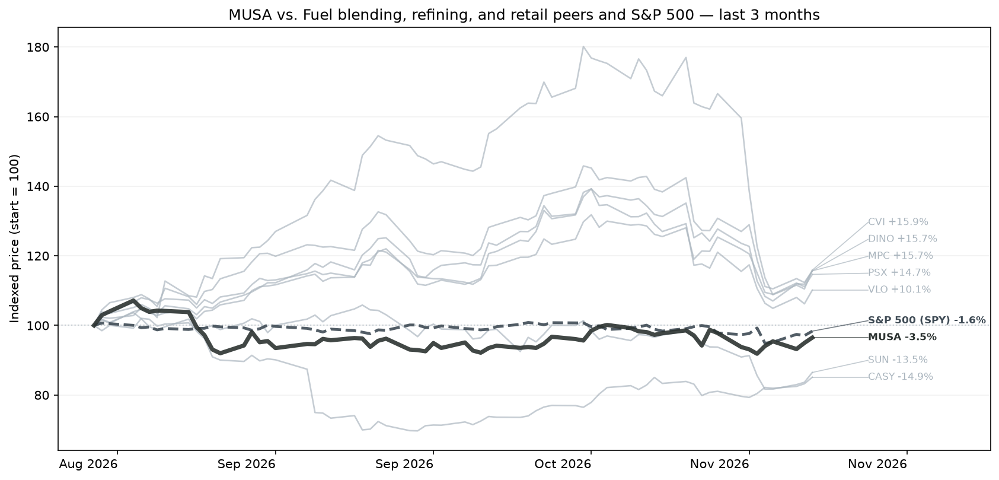

Murphy USA Inc is mainly engaged in the marketing of retail motor fuel products and convenience merchandise through a network of several retail stores in the Southwest, Southeast, Midwest, and Northeast United States. The majority of Murphy USA's stores are located in proximity to Walmart Supercenters, but it also operates standalone stores that market gasoline and other products under the Murphy USA, Murphy Express, and QuickChek brands. In addition, the company also markets fuel to unbranded wholesale customers through a mixture of company-owned and third-party product distribution terminals and pipeline positions. The firm generates maximum revenue through retail sales of petroleum products, and the rest from merchandise sales and wholesale of petroleum products.

<h3 id="company-ntoiy">Neste (NTOIY)</h3>

*Advanced biofuels and SAF · n/a · 3m +0.0% · 12m +63.9% · 24m +150.1%*

[Google Finance](https://www.google.com/finance/quote/NTOIY:NYSE?tab=earnings&hl=en)

Largest global producer of renewable diesel and SAF; sets the price umbrella for corn oil.

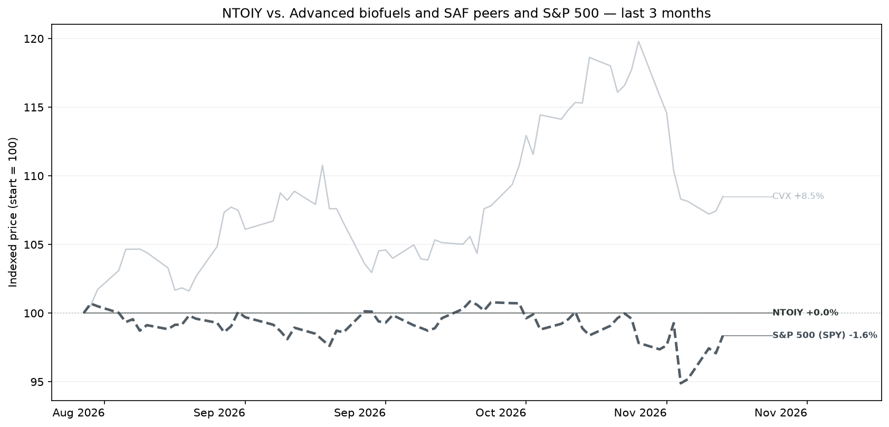

NESTE OYJ UNSP/ADR

<h3 id="company-cvx">Chevron (CVX)</h3>

*Advanced biofuels and SAF · $403.6B · 3m +8.5% · 12m +39.1% · 24m +37.3%*

[Google Finance](https://www.google.com/finance/quote/CVX:NYSE?tab=earnings&hl=en)

Owner of Renewable Energy Group biodiesel and renewable-diesel plants that take corn oil at the margin.

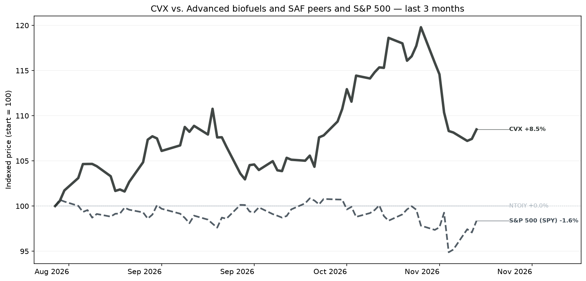

Chevron is an integrated energy company with exploration, production, and refining operations worldwide. It is the second-largest oil company in the United States with 2025 worldwide net oil-equivalent production of 3.7 million barrels per day, including 8.5 billion cubic feet per day of natural gas and 2.3 million barrels of liquids per day. Production takes place in North America, South America, Europe, Africa, Asia, and Australia. The company's refining networks arelocated in the United States and Asia, with a total worldwide refining capacity of 1.8 million barrels of oil a day at year-end 2025. Net proved reserves at year-end 2025 stood at 10.6 billion barrels of oil equivalent, consisting of 5.7 billion barrels of liquids and 29.2 trillion cubic feet of natural gas.

<h3 id="company-csan">Cosan (CSAN)</h3>

*International ethanol · $2.5B · 3m +7.4% · 12m -47.0% · 24m -65.1%*

[Google Finance](https://www.google.com/finance/quote/CSAN:NYSE?tab=earnings&hl=en)

Brazilian holding company and the liquid U.S.-listed proxy for sugarcane ethanol via Raizen.

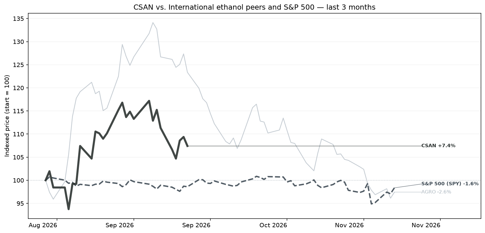

Cosan SA engages in several services throughout the energy and logistics sectors. Its reportable segments are Raizen, Compass, Moove, Rumo, and Radar. It generates the majority of its revenue from Raizen which operates in the production, commercialization, origination, and trading of ethanol, bioenergy, resale, and trading of electricity, renewable sources, marketing, origination, and trading of sugar and fuels, and lubricant.

<h3 id="company-agro">Adecoagro (AGRO)</h3>

*International ethanol · $1.5B · 3m -2.6% · 12m +14.6% · 24m -20.1%*

[Google Finance](https://www.google.com/finance/quote/AGRO:NYSE?tab=earnings&hl=en)

South American farmland and sugar/ethanol producer with U.S.-listed equity.

Adecoagro SA is a Luxembourg-based agricultural company. It is involved in a wide range of businesses, including farming crops and other agricultural products, dairy operations sugar, ethanol, energy production, and land transformation. The group operates in two lines of business, namely, Farming and Sugar, Ethanol and Energy. The Farming is further comprised of three reportable segments: Crops, Rice and Dairy. Sugar, Ethanol and Energy Segment, consists of cultivating sugarcane, which is processed in owned sugar mills, transformed into ethanol, sugar and electricity, in addition to biomethane and then marketed.

<h3 id="company-unp">Union Pacific (UNP)</h3>

*Logistics · $179.3B · 3m +2.9% · 12m +35.1% · 24m +26.5%*

[Google Finance](https://www.google.com/finance/quote/UNP:NYSE?tab=earnings&hl=en)

Primary western Class I for Corn Belt corn, ethanol unit trains, DDGS, and corn oil.

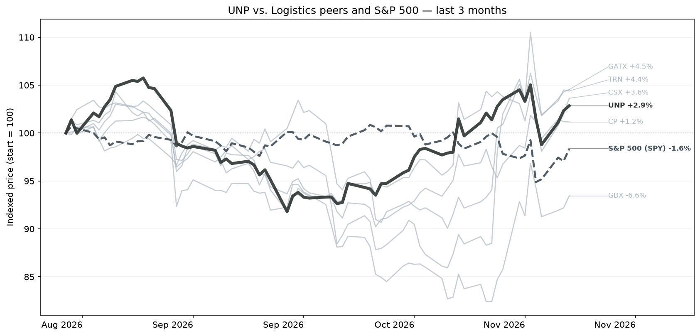

Omaha, Nebraska-based Union Pacific is the largest public railroad in North America. Operating on more than 30,000 miles of track in the western two-thirds of the US, Union Pacific generated $24.5 billion of revenue in 2025 by hauling coal, industrial products, intermodal containers, agricultural goods, chemicals, fertilizers, and automotive goods. Union Pacific owns about one-fourth of Mexican railroad Ferromex and historically derives roughly 10% of its revenue hauling freight to and from Mexico.

<h3 id="company-csx">CSX (CSX)</h3>

*Logistics · $93.9B · 3m +3.6% · 12m +46.7% · 24m +43.6%*

[Google Finance](https://www.google.com/finance/quote/CSX:NASDAQ?tab=earnings&hl=en)

Primary eastern Class I into Northeast and Southeast gasoline markets for ethanol unit trains.

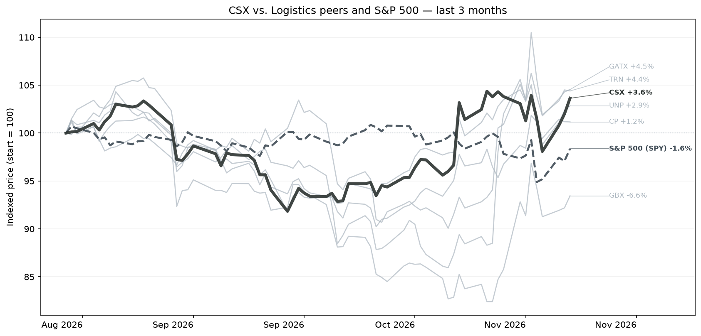

Operating in the Eastern United States, Class I railroad CSX generated revenue of nearly $14 billion in 2025. On its more than 21,000 miles of track, CSX hauls shipments of coal (16% of consolidated revenue), chemicals (17%), intermodal containers (16%), automotive cargo (7%), and a diverse mix of other bulk and industrial merchandise.

<h3 id="company-cp">Canadian Pacific Kansas City (CP)</h3>

*Logistics · $83.0B · 3m +1.2% · 12m +29.5% · 24m +22.0%*

[Google Finance](https://www.google.com/finance/quote/CP:NYSE?tab=earnings&hl=en)

North-south railroad for Midwest corn and ethanol to the Gulf and Mexico.

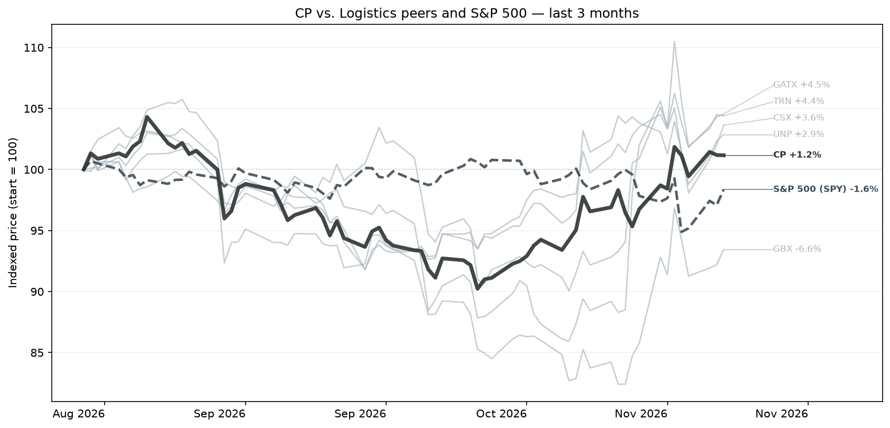

Canadian Pacific Kansas City is a Class I railroad operating on tracks that span most of Canada and into parts of the Midwestern and Northeastern United States. Following the April 2023 Kansas City Southern merger, CPKC operates new single-linehaul services from Canada and the Upper Midwest down through Texas, the Gulf of Mexico, and into Mexico. It also hauls cross-border and intra-Mexico freight via operating concessions on more than 3,000 miles of rail in Mexico. CPKC hauls shipments of grain, intermodal containers, energy products (like crude and frac sand), chemicals, plastics, coal, fertilizer and potash, automotive products, and a diverse mix of other merchandise.

<h3 id="company-gatx">GATX (GATX)</h3>

*Logistics · $6.2B · 3m +4.5% · 12m +19.4% · 24m +22.6%*

[Google Finance](https://www.google.com/finance/quote/GATX:NYSE?tab=earnings&hl=en)

Largest public railcar lessor of ethanol tank cars and grain/DDGS hoppers.

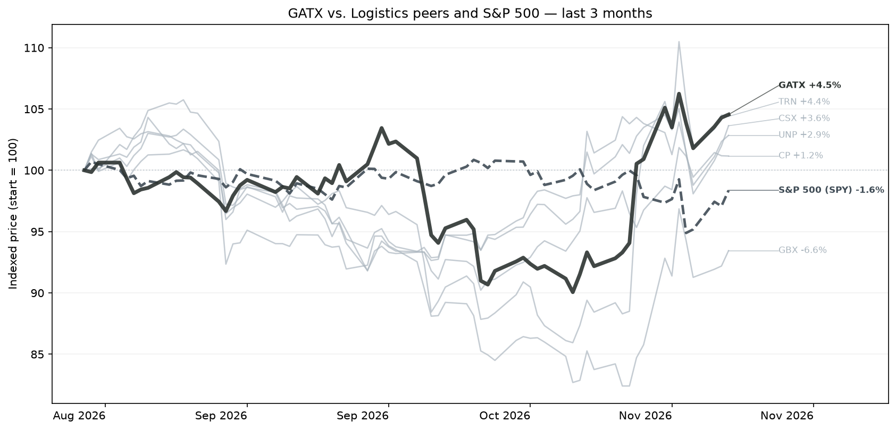

GATX Corp leases transportation assets, including railcars, aircraft spare engines, and tank containers, to customers in North America, Europe, and India. The company's reportable business segments are: Rail North America, Rail International, Engine Leasing, and Other. The majority of its revenue is generated from the Rail North America segment, which is composed of the company's operations in the United States, Canada, and Mexico. This segment mainly provides railcars pursuant to full-service leases under which it maintains the railcars, pays ad valorem taxes and insurance, and provides other ancillary services.

<h3 id="company-trn">Trinity Industries (TRN)</h3>

*Logistics · $2.4B · 3m +4.4% · 12m +18.9% · 24m -21.2%*

[Google Finance](https://www.google.com/finance/quote/TRN:NYSE?tab=earnings&hl=en)

Builds and leases covered hoppers and tank cars used for grain, DDGS, and ethanol.

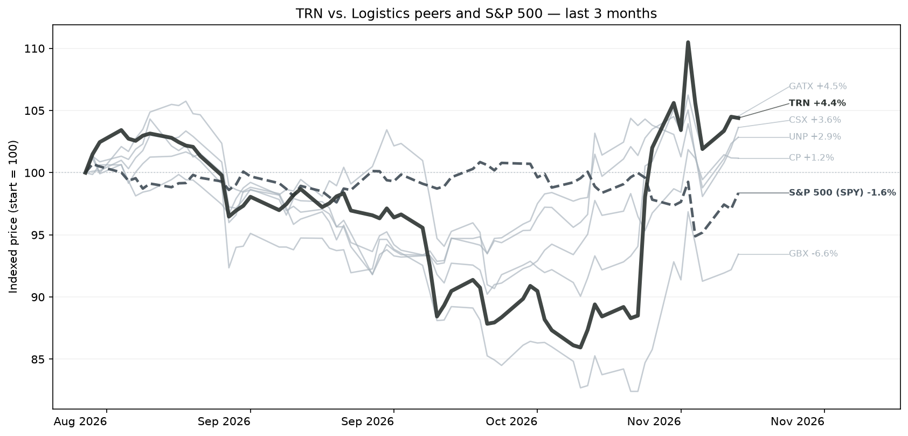

Trinity Industries Inc sells and leases railroad products and railcar maintenance services in North America. The company operates under the name TrinityRail in two main segments: railcar leasing and management services, which owns railcars and provides fleet management and administration services; rail products, which builds, sells, and modifies freight and tank railcars and their components; and all other, which sells highway products such as guardrail and other highway barriers. Customers include railroads, leasing companies, and shipping companies in agriculture, construction, consumer products, energy, and chemicals.

<h3 id="company-gbx">Greenbrier (GBX)</h3>

*Logistics · $1.4B · 3m -6.6% · 12m -0.3% · 24m -35.6%*

[Google Finance](https://www.google.com/finance/quote/GBX:NYSE?tab=earnings&hl=en)

Builds tank cars used for ethanol, renewable fuels, and CO2.

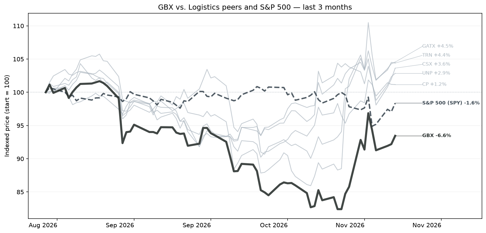

Greenbrier Companies Inc supplies equipment and services to international freight transportation markets, designing and marketing freight railcars in North America, Europe, and Brazil through subsidiaries and joint ventures. It provides railcar wheel services, parts, maintenance, and conversion services in North America. The company owns a lease fleet sourced mainly from its manufacturing operations and offers railcar management, regulatory compliance, and leasing services to railroads and owners. It operates two segments: Manufacturing and Leasing & Fleet Management, with the majority of revenue from Manufacturing. The company operates in the U.S. and internationally, with the majority of revenue from the U.S. market.

