# Weekly Corn and Ethanol Intel Report

<strong>Week of November 19, 2026</strong>Market data through: November 18, 2026Narrative created: November 20, 2026Nearby corn: $4.390/bu (-$0.035 (-0.8%) week)

Weekly review of corn, ethanol, energy, co-product, policy, and related public-company performance for commodities risk managers at U.S. ethanol plants.

## Strategy Narrative

Nearby futures from Yahoo Finance. Nearby corn is the market&#x27;s current perception of yield and demand risk.

<table><thead><tr><th>Contract</th><th>Last</th><th>Week change</th><th>As of</th></tr></thead><tbody><tr><td>Nearby corn</td><td>$4.390/bu</td><td>-$0.035 (-0.8%)</td><td>November 19, 2026</td></tr><tr><td>RBOB gasoline</td><td>$2.495/gal</td><td>-0.176 (-6.6%)</td><td>November 19, 2026</td></tr><tr><td>Henry Hub</td><td>$3.268/MMBtu</td><td>-0.072 (-2.2%)</td><td>November 19, 2026</td></tr></tbody></table>

<nav class="strategy-narrative-links" aria-label="Strategy narrative sections">
<ul>
<li><a href="#strategy-executive-view-1-corn-supply-remained-adequate-despite-late-western-harvest">1. Corn supply remained adequate despite late western harvest</a></li>
<li><a href="#strategy-executive-view-2-the-ethanol-balance-shifted-from-stable-to-visibly-long">2. The ethanol balance shifted from stable to visibly long</a></li>
<li><a href="#strategy-executive-view-3-new-orleans-restrictions-create-a-two-sided-basis-and-export-risk">3. New Orleans restrictions create a two-sided basis and export risk</a></li>
<li><a href="#strategy-executive-view-4-gas-storage-reduced-winter-scarcity-risk-not-weather-volatility">4. Gas storage reduced winter scarcity risk, not weather volatility</a></li>
<li><a href="#strategy-executive-view-5-green-plains-shifted-low-carbon-competition-toward-plant-reinvestment">5. Green Plains shifted low-carbon competition toward plant reinvestment</a></li>
</ul>
</nav>

<h3 id="executive-view">Executive View</h3>

- **USDA’s tighter-but-adequate November corn balance remains the procurement regime, and futures eased rather than extended the post-WASDE rally.** The official framework is **179.6 bushels per acre, 15.893 billion bushels of production and 1.758 billion bushels of 2026/27 carryout**. Nearby corn ended November 19 at **$4.390 per bushel, down $0.035, or 0.8%, for the week**. Harvest reached **88% versus 92% normally**; delays remain material in Iowa and South Dakota, but the tape does not indicate renewed national scarcity. (USDA WAOB, *WASDE*, November 10, 2026; USDA NASS, *Crop Progress*, November 16, 2026.) ([esmis.nal.usda.gov](https://esmis.nal.usda.gov/sites/default/release-files/796142/wasde1126.pdf))
- **Ethanol clearance deteriorated materially.** Production slipped only **4,000 barrels per day to 1.126 million**, while inventories increased **563,000 barrels to 24.908 million**. EIA refiner and blender ethanol inputs rose **6,000 barrels per day to 894,000**, but estimated exports fell to **133,000 barrels per day**. The resulting build reversed more than six weeks of modest inventory improvement. (EIA, weekly ethanol data released November 18, 2026.) ([eia.gov](https://www.eia.gov/dnav/pet/hist/LeafHandler.ashx?f=w&n=pet&s=w_epooxe_yir_nus_mbbld&utm_source=openai))
- **Gasoline compounded the product-side problem.** RBOB fell **$0.176 to $2.495 per gallon, down 6.6%**, while gasoline inventories increased **5.192 million barrels to 215.949 million**. Gasoline supplied was nearly unchanged at 8.790 million barrels per day, indicating that the stock build—not an abrupt consumption collapse—was the clearer bearish signal. (EIA, *Weekly Petroleum Status Report*, November 18, 2026.) ([eia.gov](https://www.eia.gov/dnav/pet/pet_stoc_wstk_a_epm0_sae_mbbl_w.htm?utm_source=openai))
- **A new Lower Mississippi restriction adds near-term Gulf-clearance risk.** Following a November 13 vessel collision, large tows and deep-draft vessels face one-way transit through a New Orleans safety zone that may remain effective through December 11. The river is open, but slower turns could affect corn and ethanol export scheduling. (U.S. Coast Guard, *Safety Zone; Mississippi River, New Orleans, LA*, published November 18, 2026.) ([public-inspection.federalregister.gov](https://public-inspection.federalregister.gov/2026-23452.pdf?utm_source=openai))
- **Natural gas provided only partial relief.** Henry Hub declined **$0.072 to $3.268 per MMBtu, down 2.2%**. Lower-48 storage increased 20 Bcf to **3,882 Bcf**, 80 Bcf above the five-year average; Midwest stocks were also 23 Bcf above average. (EIA, *Weekly Natural Gas Storage Report*, November 19, 2026.) ([eia.gov](https://www.eia.gov/dnav/ng/ng_stor_wkly_s1_w.htm?utm_source=openai))
- **Overall plant-margin and risk conditions deteriorated.** Modestly cheaper corn and gas were outweighed by the ethanol inventory build, RBOB’s 6.6% decline and new Gulf logistics uncertainty. Corn procurement improved slightly; ethanol selling and export clearance deteriorated.

| Exposure | Current signal | Change from last week | Horizon | Confidence | Main driver |
|---|---|---:|---|---|---|
| Corn procurement | Adequate national supply; localized late-harvest risk | Improved slightly | Winter–Q2 2027 | High | Corn −0.8%; 1.758-billion-bushel carryout |
| Ethanol selling | Stocks rebuilt despite nearly flat production | Deteriorated materially | 1–6 weeks | High | 563,000-barrel inventory build |
| Petroleum linkage | Weaker price umbrella; gasoline stocks rising | Deteriorated materially | Days–months | High | RBOB −6.6% |
| Gulf logistics | River open under transit restrictions | Deteriorated selectively | Days–weeks | Medium | New Orleans safety zone |
| Natural gas | Ample storage; modest futures relief | Improved modestly | Winter | High | Storage 2.1% above five-year average |
| Overall plant margin | Output-side weakness dominates input relief | Deteriorated | Near term | High | Ethanol and gasoline stock builds |

The incremental thesis is that **the corn-cost regime remains manageable, but product clearance has weakened at the same time that gasoline support and Gulf logistics have deteriorated**. Corn export bookings, 45Z monetization and regenerative-ag documentation remain strategically important but did not overturn that near-term conclusion. Brazil’s contracted import demand is still supportive rather than an open, unrestricted spot outlet, while EPA’s additional-SRE reallocation remains a proposal with comments due December 4. ([spglobal.com](https://www.spglobal.com/energy/en/news-research/latest-news/refined-products/111126-tight-brazil-anhydrous-ethanol-drives-import-interest-despite-unfavorable-economics?utm_source=openai))

<h3 id="strategy-executive-view-1-corn-supply-remained-adequate-despite-late-western-harvest">1. Corn supply remained adequate despite late western harvest</h3>

**What happened**

Corn harvest advanced seven points to **88%**, four points behind normal. Iowa was **84% complete versus 95% normally**, South Dakota 78% versus 92%, Nebraska 85% versus 90% and Ohio 80% versus 86%. Illinois and Indiana were effectively on or ahead of normal. ([esmis.nal.usda.gov](https://esmis.nal.usda.gov/sites/default/release-files/796149/prog4626.pdf))

USDA reported weekly corn net sales of **1.588 million metric tons** for the week ended November 12. Estimated cumulative commitments are approximately **29.3 million tons**, or 35.2% of USDA’s 3.275-billion-bushel export forecast. That is supportive demand, but nearby corn’s 0.8% decline indicates it was insufficient to tighten the national balance. (USDA FAS, *Weekly Export Sales*, November 19, 2026; USDA WAOB, *WASDE*, November 10, 2026.) ([feedandgrain.com](https://www.feedandgrain.com/grain-supply-chain/grain-trade-export/news/16542196/us-corn-export-sales-drop-45-while-soybean-sales-surge?utm_source=openai))

**Risk-manager implication**

Futures procurement risk improved slightly. Basis remains the larger concern in late-harvest areas, particularly where drying, storage or delivery constraints persist. Plants should continue separating national futures coverage from local origination exposure.

---

<h3 id="strategy-executive-view-2-the-ethanol-balance-shifted-from-stable-to-visibly-long">2. The ethanol balance shifted from stable to visibly long</h3>

| EIA ethanol balance | Week ended Nov. 6 | Week ended Nov. 13 | Change |
|---|---:|---:|---:|
| Production, million bpd | 1.130 | 1.126 | −0.004 |
| Inventories, million bbl | 24.345 | 24.908 | +0.563 |
| Refiner/blender inputs, million bpd | 0.888 | 0.894 | +0.006 |
| Estimated exports, million bpd | 0.140 | 0.133 | −0.007 |

(EIA, weekly data released November 18, 2026.) ([eia.gov](https://www.eia.gov/dnav/pet/hist/LeafHandler.ashx?f=w&n=pet&s=w_epooxe_eex_nus-z00_mbbld&utm_source=openai))

**Why it matters**

The build occurred without a production increase, making it a clearer disappearance warning than the prior week’s small draw. Four-week-average exports remained 134,000 barrels per day, but inventories are now 11.7% above the year-earlier level. Meanwhile, the gasoline stock build and RBOB selloff reduced ethanol’s petroleum-value support. ([eia.gov](https://www.eia.gov/dnav/pet/hist/LeafHandler.ashx?f=4&n=PET&s=W_EPOOXE_EEX_NUS-Z00_MBBLD&utm_source=openai))

**Risk-manager implication**

Prompt ethanol selling, storage and utilization are the binding exposures. A standardized public spot-crush value is not sufficiently dependable to quote, but the direction is unfavorable: small corn and gas savings are unlikely to offset weaker product clearance if inventories continue building.

---

<h3 id="strategy-executive-view-3-new-orleans-restrictions-create-a-two-sided-basis-and-export-risk">3. New Orleans restrictions create a two-sided basis and export risk</h3>

**What happened**

The Coast Guard established a safety zone from Lower Mississippi River mile markers 95.5 to 96.5 following the November 13 collision. Limited two-way traffic is permitted, but deep-draft vessels and towing vessels with ten or more barges are restricted to one-way transit; the alternate channel remains closed. The rule may remain effective through **December 11, 2026**, unless cancelled earlier. ([public-inspection.federalregister.gov](https://public-inspection.federalregister.gov/2026-23452.pdf?utm_source=openai))

**Risk-manager implication**

This is not yet a full export shutdown. However, slower vessel sequencing and barge turnaround could delay Gulf corn and ethanol shipments. For inland plants, the effects are mixed: weaker river bids could improve corn basis in affected tributary markets, while delayed ethanol exports would worsen terminal inventories and prompt product basis.

**Watch next**

Carrier delays, barge-turn times and whether the Coast Guard removes the restrictions before December 11.

---

<h3 id="strategy-executive-view-4-gas-storage-reduced-winter-scarcity-risk-not-weather-volatility">4. Gas storage reduced winter scarcity risk, not weather volatility</h3>

Lower-48 inventories reached **3,882 Bcf**, up 20 Bcf for the week and 2.1% above the five-year average. Midwest inventories slipped 1 Bcf to **1,128 Bcf** but remained 2.1% above average. ([eia.gov](https://www.eia.gov/dnav/ng/ng_stor_wkly_s1_w.htm?utm_source=openai))

**Risk-manager implication**

Process-energy exposure improved modestly after last week’s weather-driven price increase. The storage position argues against a sustained availability premium, although uncovered plants remain exposed to forecast-driven prompt volatility and regional basis.

---

<h3 id="strategy-executive-view-5-green-plains-shifted-low-carbon-competition-toward-plant-reinvestment">5. Green Plains shifted low-carbon competition toward plant reinvestment</h3>

Green Plains approved a 2027–2031 plan including approximately **$140 million of 2027 capital spending**, with $110 million allocated to growth and efficiency projects. Planned investments include grain storage, fermentation and liquefaction capacity, energy efficiency and corn-oil recovery; management estimates 20%–25% base-business returns, which remain company forecasts rather than confirmed outcomes. (Green Plains, *Green Plains Outlines Strategy to Drive Earnings Growth and Long-Term Shareholder Value*, November 18, 2026.) ([streetinsider.com](https://www.streetinsider.com/Business%2BWire/Green%2BPlains%2BOutlines%2BStrategy%2Bto%2BDrive%2BEarnings%2BGrowth%2Band%2BLong-Term%2BShareholder%2BValue/27369469.html?utm_source=openai))

**Risk-manager implication**

The plan reinforces the widening competitive gap between plants able to combine physical efficiency, co-product recovery and lower carbon intensity and those relying primarily on commodity crush. Additional storage may also increase Green Plains’ origination flexibility in local corn markets, although no quantified industry-capacity addition was announced.

<h3 id="strategic-synthesis">Strategic Synthesis</h3>

The November USDA reset remains intact: corn is adequate, not burdensome enough to eliminate basis risk and not tight enough to require national rationing. The weekly change came downstream. Ethanol inventories rebuilt, gasoline stocks surged, RBOB fell sharply and Gulf logistics became less reliable. Risk managers should therefore prioritize **ethanol sales, storage capacity and export execution over extending already-comfortable corn coverage**.

<h3 id="what-i-m-watching-next">What I’m Watching Next</h3>

- **December 10, 2026:** USDA WASDE and Crop Production—the next corn balance-sheet update. ([esmis.nal.usda.gov](https://esmis.nal.usda.gov/sites/default/release-files/795899/wasde0526_0.pdf?utm_source=openai))
- **December 4, 2026:** EPA comment deadline for additional 2025 SRE reallocation. ([epa.gov](https://www.epa.gov/newsreleases/while-iowa-administrator-zeldin-proposes-100-reallocation-additional-2025-small?utm_source=openai))
- **November 25, 2026:** EIA ethanol/petroleum balance and natural-gas storage reports. ([eia.gov](https://www.eia.gov/dnav/pet/PET_STOC_WSTK_A_EPOOXE_SAE_MBBL_W.htm))
- **December 3, 2026:** REX American Resources fiscal third-quarter results, providing a cleaner commodity-crush comparison with credit-heavy producers. ([rexamerican.gcs-web.com](https://rexamerican.gcs-web.com/node/13216/pdf?utm_source=openai))

<h3 id="bottom-line">Bottom Line</h3>

The most important weekly change was the **563,000-barrel ethanol inventory build combined with RBOB’s 6.6% decline**. Corn and natural gas became modestly cheaper, but output-side risk deteriorated more. Ethanol selling and Gulf clearance require the closest attention; the November 25 EIA balance is the next print most capable of changing the near-term margin view.

## Notable Changes

Comparison with the final report dated November 12, 2026 (market data through November 11, 2026).

### Sectors

#### Top-three comparison

<table class="sortable"><thead><tr><th class="sortable-heading" data-column="0" data-type="text">Entity</th><th class="sortable-heading" data-column="1" data-type="number">Previous</th><th class="sortable-heading" data-column="2" data-type="number">Current</th><th class="sortable-heading" data-column="3" data-type="number">Change</th><th class="sortable-heading" data-column="4" data-type="number">Current return</th></tr></thead><tbody><tr><td class="text" data-sort="fuel blending, refining, and retail" style=""><a href="#category-fuel-blending-refining-and-retail">Fuel blending, refining, and retail</a></td><td class="" data-sort="1" style="">#1</td><td class="" data-sort="1" style="">#1</td><td class="" data-sort="0" style="">— 0</td><td class="" data-sort="0.8006026781282195" style="background:#1a7a3c;color:#ffffff;">+80.1%</td></tr><tr><td class="text" data-sort="u.s. ethanol and process technology" style=""><a href="#category-u-s-ethanol-and-process-technology">U.S. ethanol and process technology</a></td><td class="" data-sort="2" style="">#2</td><td class="" data-sort="2" style="">#2</td><td class="" data-sort="0" style="">— 0</td><td class="" data-sort="0.7009397149307596" style="background:#1a7a3c;color:#ffffff;">+70.1%</td></tr><tr><td class="text" data-sort="logistics" style=""><a href="#category-logistics">Logistics</a></td><td class="" data-sort="4" style="">#4</td><td class="" data-sort="3" style="">#3</td><td class="rank-change-up" data-sort="-1" style="">↑ 1</td><td class="" data-sort="0.39144640005222536" style="background:#7cc077;color:#111820;">+39.1%</td></tr><tr><td class="text" data-sort="advanced biofuels and saf" style=""><a href="#category-advanced-biofuels-and-saf">Advanced biofuels and SAF</a></td><td class="" data-sort="3" style="">#3</td><td class="" data-sort="4" style="">#4</td><td class="rank-change-down" data-sort="1" style="">↓ 1</td><td class="" data-sort="0.35715227422544493" style="background:#7cc077;color:#111820;">+35.7%</td></tr></tbody></table>

#### Largest rank changes

<table class="sortable"><thead><tr><th class="sortable-heading" data-column="0" data-type="text">Entity</th><th class="sortable-heading" data-column="1" data-type="number">Previous</th><th class="sortable-heading" data-column="2" data-type="number">Current</th><th class="sortable-heading" data-column="3" data-type="number">Change</th><th class="sortable-heading" data-column="4" data-type="number">Current return</th></tr></thead><tbody><tr><td class="text" data-sort="grain origination and agribusiness" style=""><a href="#category-grain-origination-and-agribusiness">Grain origination and agribusiness</a></td><td class="" data-sort="5" style="">#5</td><td class="" data-sort="7" style="">#7</td><td class="rank-change-down" data-sort="2" style="">↓ 2</td><td class="" data-sort="0.10115339801564921" style="background:#1a7a3c;color:#ffffff;">+10.1%</td></tr></tbody></table>

### Stocks

#### Top-three comparison

<table class="sortable"><thead><tr><th class="sortable-heading" data-column="0" data-type="text">Entity</th><th class="sortable-heading" data-column="1" data-type="number">Previous</th><th class="sortable-heading" data-column="2" data-type="number">Current</th><th class="sortable-heading" data-column="3" data-type="number">Change</th><th class="sortable-heading" data-column="4" data-type="number">Current return</th></tr></thead><tbody><tr><td class="text" data-sort="marathon petroleum" style="">Marathon Petroleum (<a href="#company-mpc">MPC</a>)</td><td class="" data-sort="2" style="">#2</td><td class="" data-sort="1" style="">#1</td><td class="rank-change-up" data-sort="-1" style="">↑ 1</td><td class="" data-sort="0.9121317512274958" style="background:#1a7a3c;color:#ffffff;">+91.2%</td></tr><tr><td class="text" data-sort="valero energy" style="">Valero Energy (<a href="#company-vlo">VLO</a>)</td><td class="" data-sort="1" style="">#1</td><td class="" data-sort="2" style="">#2</td><td class="rank-change-down" data-sort="1" style="">↓ 1</td><td class="" data-sort="0.9059502024066985" style="background:#1a7a3c;color:#ffffff;">+90.6%</td></tr><tr><td class="text" data-sort="phillips 66" style="">Phillips 66 (<a href="#company-psx">PSX</a>)</td><td class="" data-sort="3" style="">#3</td><td class="" data-sort="3" style="">#3</td><td class="" data-sort="0" style="">— 0</td><td class="" data-sort="0.8204327459290652" style="background:#1a7a3c;color:#ffffff;">+82.0%</td></tr></tbody></table>

#### Largest rank changes

<table class="sortable"><thead><tr><th class="sortable-heading" data-column="0" data-type="text">Entity</th><th class="sortable-heading" data-column="1" data-type="number">Previous</th><th class="sortable-heading" data-column="2" data-type="number">Current</th><th class="sortable-heading" data-column="3" data-type="number">Change</th><th class="sortable-heading" data-column="4" data-type="number">Current return</th></tr></thead><tbody><tr><td class="text" data-sort="tyson foods" style=""><a href="#earnings-tsn">Tyson Foods</a> (<a href="#company-tsn">TSN</a>)</td><td class="" data-sort="27" style="">#27</td><td class="" data-sort="18" style="">#18</td><td class="rank-change-up" data-sort="-9" style="">↑ 9</td><td class="" data-sort="0.2111215834118756" style="background:#1a7a3c;color:#ffffff;">+21.1%</td></tr><tr><td class="text" data-sort="basf" style="">BASF (<a href="#company-basfy">BASFY</a>)</td><td class="" data-sort="25" style="">#25</td><td class="" data-sort="19" style="">#19</td><td class="rank-change-up" data-sort="-6" style="">↑ 6</td><td class="" data-sort="0.18503620273531785" style="background:#1a7a3c;color:#ffffff;">+18.5%</td></tr><tr><td class="text" data-sort="green plains" style="">Green Plains (<a href="#company-gpre">GPRE</a>)</td><td class="" data-sort="13" style="">#13</td><td class="" data-sort="25" style="">#25</td><td class="rank-change-down" data-sort="12" style="">↓ 12</td><td class="" data-sort="0.15737051792828693" style="background:#2f9e44;color:#111820;">+15.7%</td></tr></tbody></table>

### Subcategory movement since the previous report

<table class="sortable"><thead><tr><th class="sortable-heading" data-column="0" data-type="text">Subcategory</th><th class="sortable-heading" data-column="1" data-type="number">Move</th><th class="sortable-heading" data-column="2" data-type="number">Last Report, 12m Ret</th><th class="sortable-heading" data-column="3" data-type="number">Current Report, 12m Ret</th></tr></thead><tbody><tr><td class="text" data-sort="logistics" style=""><a href="#category-logistics">Logistics</a></td><td class="" data-sort="-0.006335686277575005" style="background:#fbd5d4;color:#111820;">-0.6%</td><td class="" data-sort="0.362967638138" style="background:#7cc077;color:#111820;">+36.3%</td><td class="" data-sort="0.39144640005222536" style="background:#7cc077;color:#111820;">+39.1%</td></tr><tr><td class="text" data-sort="wet milling, ingredients, and co-products" style=""><a href="#category-wet-milling-ingredients-and-co-products">Wet milling, ingredients, and co-products</a></td><td class="" data-sort="-0.0094347253368316" style="background:#fbd5d4;color:#111820;">-0.9%</td><td class="" data-sort="0.112216005123" style="background:#d6ecd4;color:#111820;">+11.2%</td><td class="" data-sort="0.14501074423223878" style="background:#d6ecd4;color:#111820;">+14.5%</td></tr><tr><td class="text" data-sort="international ethanol" style=""><a href="#category-international-ethanol">International ethanol</a></td><td class="" data-sort="-0.030790124203502717" style="background:#f5aead;color:#111820;">-3.1%</td><td class="" data-sort="-0.237094205485" style="background:#f5aead;color:#111820;">-23.7%</td><td class="" data-sort="-0.2663797725127249" style="background:#f5aead;color:#111820;">-26.6%</td></tr><tr><td class="text" data-sort="advanced biofuels and saf" style=""><a href="#category-advanced-biofuels-and-saf">Advanced biofuels and SAF</a></td><td class="" data-sort="-0.034696174043510886" style="background:#ee8483;color:#111820;">-3.5%</td><td class="" data-sort="0.391077484999" style="background:#7cc077;color:#111820;">+39.1%</td><td class="" data-sort="0.35715227422544493" style="background:#7cc077;color:#111820;">+35.7%</td></tr><tr><td class="text" data-sort="u.s. ethanol and process technology" style=""><a href="#category-u-s-ethanol-and-process-technology">U.S. ethanol and process technology</a></td><td class="" data-sort="-0.05439510378659869" style="background:#e34948;color:#111820;">-5.4%</td><td class="" data-sort="0.797072217291" style="background:#1a7a3c;color:#ffffff;">+79.7%</td><td class="" data-sort="0.7009397149307596" style="background:#1a7a3c;color:#ffffff;">+70.1%</td></tr><tr><td class="text" data-sort="grain origination and agribusiness" style=""><a href="#category-grain-origination-and-agribusiness">Grain origination and agribusiness</a></td><td class="" data-sort="-0.05611004693201321" style="background:#e34948;color:#111820;">-5.6%</td><td class="" data-sort="0.158509582156" style="background:#d6ecd4;color:#111820;">+15.9%</td><td class="" data-sort="0.10115339801564921" style="background:#d6ecd4;color:#111820;">+10.1%</td></tr><tr><td class="text" data-sort="fuel blending, refining, and retail" style=""><a href="#category-fuel-blending-refining-and-retail">Fuel blending, refining, and retail</a></td><td class="" data-sort="-0.05987650662631582" style="background:#e34948;color:#111820;">-6.0%</td><td class="" data-sort="0.88052415298" style="background:#1a7a3c;color:#ffffff;">+88.1%</td><td class="" data-sort="0.8006026781282195" style="background:#1a7a3c;color:#ffffff;">+80.1%</td></tr><tr><td class="text" data-sort="crop inputs, equipment, and irrigation" style=""><a href="#category-crop-inputs-equipment-and-irrigation">Crop inputs, equipment, and irrigation</a></td><td class="" data-sort="-0.07767375537683895" style="background:#c0302f;color:#ffffff;">-7.8%</td><td class="" data-sort="0.146329819497" style="background:#d6ecd4;color:#111820;">+14.6%</td><td class="" data-sort="0.2736947641863329" style="background:#a9d9a4;color:#111820;">+27.4%</td></tr></tbody></table>

### Largest company moves

<table class="sortable"><thead><tr><th class="sortable-heading" data-column="0" data-type="text">Direction</th><th class="sortable-heading" data-column="1" data-type="text">Company</th><th class="sortable-heading" data-column="2" data-type="text">Ticker</th><th class="sortable-heading" data-column="3" data-type="number">Move</th></tr></thead><tbody><tr><td class="text" data-sort="0" style="">Gain</td><td class="text" data-sort="tyson foods" style=""><a href="#earnings-tsn">Tyson Foods</a></td><td class="text text" data-sort="tsn" style=""><a href="#company-tsn">TSN</a></td><td class="" data-sort="0.07315851010522811" style="background:#a9d9a4;color:#111820;">+7.3%</td></tr><tr><td class="text" data-sort="0" style="">Gain</td><td class="text" data-sort="gatx" style="">GATX</td><td class="text text" data-sort="gatx" style=""><a href="#company-gatx">GATX</a></td><td class="" data-sort="0.013534395481430206" style="background:#d6ecd4;color:#111820;">+1.4%</td></tr><tr><td class="text" data-sort="1" style="">Decline</td><td class="text" data-sort="corteva" style=""><a href="#earnings-ctva">Corteva</a></td><td class="text text" data-sort="ctva" style=""><a href="#company-ctva">CTVA</a></td><td class="" data-sort="-0.3113673805601319" style="background:#c0302f;color:#ffffff;">-31.1%</td></tr><tr><td class="text" data-sort="1" style="">Decline</td><td class="text" data-sort="cvr energy" style="">CVR Energy</td><td class="text text" data-sort="cvi" style=""><a href="#company-cvi">CVI</a></td><td class="" data-sort="-0.16867766559960606" style="background:#ee8483;color:#111820;">-16.9%</td></tr><tr><td class="text" data-sort="1" style="">Decline</td><td class="text" data-sort="green plains" style="">Green Plains</td><td class="text text" data-sort="gpre" style=""><a href="#company-gpre">GPRE</a></td><td class="" data-sort="-0.14495952906548937" style="background:#ee8483;color:#111820;">-14.5%</td></tr></tbody></table>

## Subcategory Performance

<table class="sortable"><thead><tr><th class="sortable-heading" data-column="0" data-type="text">Subcategory</th><th class="sortable-heading" data-column="1" data-type="number">Companies</th><th class="sortable-heading" data-column="2" data-type="number">Market cap</th><th class="sortable-heading" data-column="3" data-type="number">3m Return</th><th class="sortable-heading" data-column="4" data-type="number">12m Return</th><th class="sortable-heading" data-column="5" data-type="number">24m Return</th></tr></thead><tbody><tr><td class="text" data-sort="crop inputs, equipment, and irrigation" style=""><a href="#category-crop-inputs-equipment-and-irrigation">Crop inputs, equipment, and irrigation</a></td><td class="" data-sort="11" style="">11</td><td class="" data-sort="266896616444.65" style="">$266.9B</td><td class="" data-sort="0.04408880740789122" style="background:#a9d9a4;color:#111820;">+4.4%</td><td class="" data-sort="0.2736947641863329" style="background:#a9d9a4;color:#111820;">+27.4%</td><td class="" data-sort="0.45787442610830625" style="background:#7cc077;color:#111820;">+45.8%</td></tr><tr><td class="text" data-sort="grain origination and agribusiness" style=""><a href="#category-grain-origination-and-agribusiness">Grain origination and agribusiness</a></td><td class="" data-sort="3" style="">3</td><td class="" data-sort="51762989197.590004" style="">$51.8B</td><td class="" data-sort="-0.17252940653828483" style="background:#c0302f;color:#ffffff;">-17.3%</td><td class="" data-sort="0.10115339801564921" style="background:#d6ecd4;color:#111820;">+10.1%</td><td class="" data-sort="0.18844782048987221" style="background:#d6ecd4;color:#111820;">+18.8%</td></tr><tr><td class="text" data-sort="u.s. ethanol and process technology" style=""><a href="#category-u-s-ethanol-and-process-technology">U.S. ethanol and process technology</a></td><td class="" data-sort="6" style="">6</td><td class="" data-sort="131704694353.19" style="">$131.7B</td><td class="" data-sort="-0.051806768862351735" style="background:#f5aead;color:#111820;">-5.2%</td><td class="" data-sort="0.7009397149307596" style="background:#1a7a3c;color:#ffffff;">+70.1%</td><td class="" data-sort="1.1081595224625862" style="background:#1a7a3c;color:#ffffff;">+110.8%</td></tr><tr><td class="text" data-sort="wet milling, ingredients, and co-products" style=""><a href="#category-wet-milling-ingredients-and-co-products">Wet milling, ingredients, and co-products</a></td><td class="" data-sort="5" style="">5</td><td class="" data-sort="80925691919.43001" style="">$80.9B</td><td class="" data-sort="-0.0908920852523884" style="background:#ee8483;color:#111820;">-9.1%</td><td class="" data-sort="0.14501074423223878" style="background:#d6ecd4;color:#111820;">+14.5%</td><td class="" data-sort="0.13767563982073025" style="background:#d6ecd4;color:#111820;">+13.8%</td></tr><tr><td class="text" data-sort="fuel blending, refining, and retail" style=""><a href="#category-fuel-blending-refining-and-retail">Fuel blending, refining, and retail</a></td><td class="" data-sort="8" style="">8</td><td class="" data-sort="347384051048.79004" style="">$347.4B</td><td class="" data-sort="-0.005970859113170393" style="background:#fbd5d4;color:#111820;">-0.6%</td><td class="" data-sort="0.8006026781282195" style="background:#1a7a3c;color:#ffffff;">+80.1%</td><td class="" data-sort="1.1382922836562956" style="background:#1a7a3c;color:#ffffff;">+113.8%</td></tr><tr><td class="text" data-sort="advanced biofuels and saf" style=""><a href="#category-advanced-biofuels-and-saf">Advanced biofuels and SAF</a></td><td class="" data-sort="2" style="">2</td><td class="" data-sort="401724108873.68" style="">$401.7B</td><td class="" data-sort="0.0005832037325039785" style="background:#d6ecd4;color:#111820;">+0.1%</td><td class="" data-sort="0.35715227422544493" style="background:#7cc077;color:#111820;">+35.7%</td><td class="" data-sort="0.28997493734335844" style="background:#a9d9a4;color:#111820;">+29.0%</td></tr><tr><td class="text" data-sort="international ethanol" style=""><a href="#category-international-ethanol">International ethanol</a></td><td class="" data-sort="2" style="">2</td><td class="" data-sort="3684903276.5199995" style="">$3.7B</td><td class="" data-sort="-0.01622420521079951" style="background:#fbd5d4;color:#111820;">-1.6%</td><td class="" data-sort="-0.2663797725127249" style="background:#f5aead;color:#111820;">-26.6%</td><td class="" data-sort="-0.5164069394510522" style="background:#ee8483;color:#111820;">-51.6%</td></tr><tr><td class="text" data-sort="logistics" style=""><a href="#category-logistics">Logistics</a></td><td class="" data-sort="6" style="">6</td><td class="" data-sort="364623969225.87" style="">$364.6B</td><td class="" data-sort="-0.00010354627894269875" style="background:#fbd5d4;color:#111820;">-0.0%</td><td class="" data-sort="0.39144640005222536" style="background:#7cc077;color:#111820;">+39.1%</td><td class="" data-sort="0.3279389606202686" style="background:#a9d9a4;color:#111820;">+32.8%</td></tr></tbody></table>

Subcategory returns use the most recently saved market capitalizations as weights.

## Stock Performance vs. SPY

The same selected stocks appear in every chart. Each line is labeled at the right with its ticker and return for the displayed window.
### Last 6 months

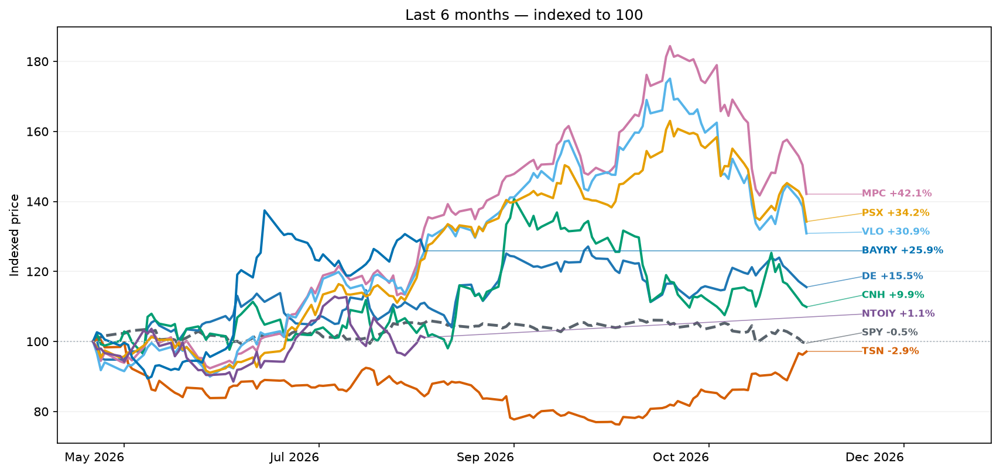

### Last 12 months

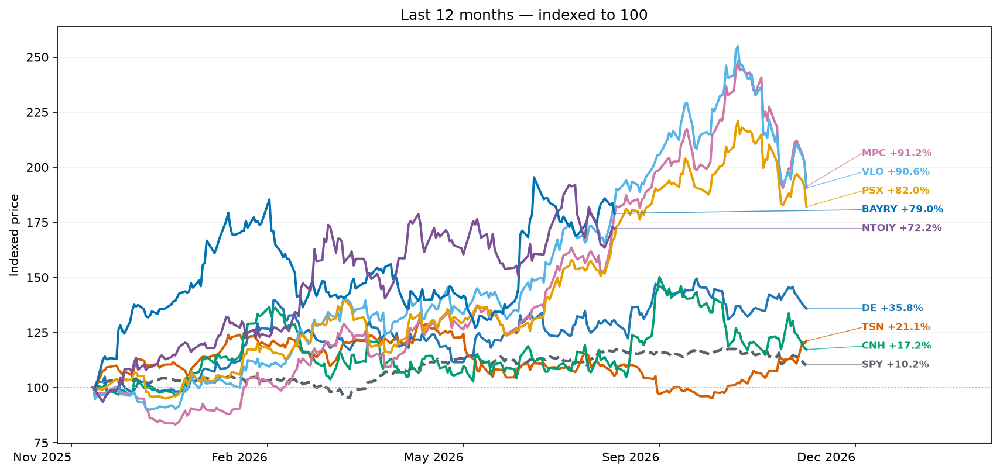

### Last 24 months

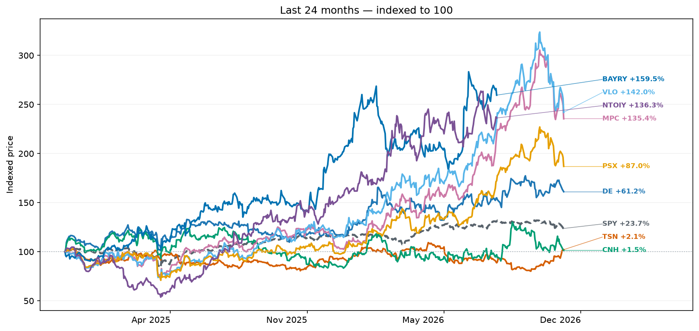

## Current Top Stocks

### Last 3 months

<table class="sortable"><thead><tr><th class="sortable-heading" data-column="0" data-type="number">Rank</th><th class="sortable-heading" data-column="1" data-type="text">Company</th><th class="sortable-heading" data-column="2" data-type="text">Ticker</th><th class="sortable-heading" data-column="3" data-type="number">Market cap</th><th class="sortable-heading" data-column="4" data-type="number">Return</th></tr></thead><tbody><tr><td class="" data-sort="1" style="">1</td><td class="text" data-sort="deere" style="">Deere</td><td class="text text" data-sort="de" style=""><a href="#company-de">DE</a></td><td class="" data-sort="173840984387.0" style="">$173.8B</td><td class="" data-sort="0.11043177238516777" style="background:#1a7a3c;color:#ffffff;">+11.0%</td></tr><tr><td class="" data-sort="2" style="">2</td><td class="text" data-sort="tyson foods" style=""><a href="#earnings-tsn">Tyson Foods</a></td><td class="text text" data-sort="tsn" style=""><a href="#company-tsn">TSN</a></td><td class="" data-sort="22136063165.5" style="">$22.1B</td><td class="" data-sort="0.09735269000853974" style="background:#1a7a3c;color:#ffffff;">+9.7%</td></tr><tr><td class="" data-sort="3" style="">3</td><td class="text" data-sort="cnh industrial" style="">CNH Industrial</td><td class="text text" data-sort="cnh" style=""><a href="#company-cnh">CNH</a></td><td class="" data-sort="18049714300.32" style="">$18.0B</td><td class="" data-sort="0.09232264334305151" style="background:#1a7a3c;color:#ffffff;">+9.2%</td></tr><tr><td class="" data-sort="4" style="">4</td><td class="text" data-sort="cosan" style="">Cosan</td><td class="text text" data-sort="csan" style=""><a href="#company-csan">CSAN</a></td><td class="" data-sort="2504672704.64" style="">$2.5B</td><td class="" data-sort="0.08267716535433078" style="background:#2f9e44;color:#111820;">+8.3%</td></tr><tr><td class="" data-sort="5" style="">5</td><td class="text" data-sort="gatx" style="">GATX</td><td class="text text" data-sort="gatx" style=""><a href="#company-gatx">GATX</a></td><td class="" data-sort="6638178543.89" style="">$6.6B</td><td class="" data-sort="0.07975703905540432" style="background:#2f9e44;color:#111820;">+8.0%</td></tr></tbody></table>

### Last 12 months

<table class="sortable"><thead><tr><th class="sortable-heading" data-column="0" data-type="number">Rank</th><th class="sortable-heading" data-column="1" data-type="text">Company</th><th class="sortable-heading" data-column="2" data-type="text">Ticker</th><th class="sortable-heading" data-column="3" data-type="number">Market cap</th><th class="sortable-heading" data-column="4" data-type="number">Return</th></tr></thead><tbody><tr><td class="" data-sort="1" style="">1</td><td class="text" data-sort="marathon petroleum" style="">Marathon Petroleum</td><td class="text text" data-sort="mpc" style=""><a href="#company-mpc">MPC</a></td><td class="" data-sort="101795453200.8" style="">$101.8B</td><td class="" data-sort="0.9121317512274958" style="background:#1a7a3c;color:#ffffff;">+91.2%</td></tr><tr><td class="" data-sort="2" style="">2</td><td class="text" data-sort="valero energy" style="">Valero Energy</td><td class="text text" data-sort="vlo" style=""><a href="#company-vlo">VLO</a></td><td class="" data-sort="95852568280.0" style="">$95.9B</td><td class="" data-sort="0.9059502024066985" style="background:#1a7a3c;color:#ffffff;">+90.6%</td></tr><tr><td class="" data-sort="3" style="">3</td><td class="text" data-sort="phillips 66" style="">Phillips 66</td><td class="text text" data-sort="psx" style=""><a href="#company-psx">PSX</a></td><td class="" data-sort="95501416388.46" style="">$95.5B</td><td class="" data-sort="0.8204327459290652" style="background:#1a7a3c;color:#ffffff;">+82.0%</td></tr><tr><td class="" data-sort="4" style="">4</td><td class="text" data-sort="bayer" style="">Bayer</td><td class="text text" data-sort="bayry" style=""><a href="#company-bayry">BAYRY</a></td><td class="" data-sort="n/a" style="">n/a</td><td class="" data-sort="0.7902187902187903" style="background:#1a7a3c;color:#ffffff;">+79.0%</td></tr><tr><td class="" data-sort="5" style="">5</td><td class="text" data-sort="neste" style="">Neste</td><td class="text text" data-sort="ntoiy" style=""><a href="#company-ntoiy">NTOIY</a></td><td class="" data-sort="n/a" style="">n/a</td><td class="" data-sort="0.7216599190283401" style="background:#2f9e44;color:#111820;">+72.2%</td></tr></tbody></table>

### Last 24 months

<table class="sortable"><thead><tr><th class="sortable-heading" data-column="0" data-type="number">Rank</th><th class="sortable-heading" data-column="1" data-type="text">Company</th><th class="sortable-heading" data-column="2" data-type="text">Ticker</th><th class="sortable-heading" data-column="3" data-type="number">Market cap</th><th class="sortable-heading" data-column="4" data-type="number">Return</th></tr></thead><tbody><tr><td class="" data-sort="1" style="">1</td><td class="text" data-sort="bayer" style="">Bayer</td><td class="text text" data-sort="bayry" style=""><a href="#company-bayry">BAYRY</a></td><td class="" data-sort="n/a" style="">n/a</td><td class="" data-sort="1.5951492537313432" style="background:#1a7a3c;color:#ffffff;">+159.5%</td></tr><tr><td class="" data-sort="2" style="">2</td><td class="text" data-sort="valero energy" style="">Valero Energy</td><td class="text text" data-sort="vlo" style=""><a href="#company-vlo">VLO</a></td><td class="" data-sort="95852568280.0" style="">$95.9B</td><td class="" data-sort="1.4202520949228927" style="background:#1a7a3c;color:#ffffff;">+142.0%</td></tr><tr><td class="" data-sort="3" style="">3</td><td class="text" data-sort="neste" style="">Neste</td><td class="text text" data-sort="ntoiy" style=""><a href="#company-ntoiy">NTOIY</a></td><td class="" data-sort="n/a" style="">n/a</td><td class="" data-sort="1.3625000000000003" style="background:#1a7a3c;color:#ffffff;">+136.3%</td></tr><tr><td class="" data-sort="4" style="">4</td><td class="text" data-sort="marathon petroleum" style="">Marathon Petroleum</td><td class="text text" data-sort="mpc" style=""><a href="#company-mpc">MPC</a></td><td class="" data-sort="101795453200.8" style="">$101.8B</td><td class="" data-sort="1.3542821158690175" style="background:#1a7a3c;color:#ffffff;">+135.4%</td></tr><tr><td class="" data-sort="5" style="">5</td><td class="text" data-sort="hf sinclair" style="">HF Sinclair</td><td class="text text" data-sort="dino" style=""><a href="#company-dino">DINO</a></td><td class="" data-sort="15342738304.960001" style="">$15.3B</td><td class="" data-sort="1.1432962875384254" style="background:#2f9e44;color:#111820;">+114.3%</td></tr></tbody></table>

## Companies by Subcategory

<h3 id="category-crop-inputs-equipment-and-irrigation"><a href="#subcategory-performance">Crop inputs, equipment, and irrigation</a>Last 3m: +4.4%</h3>

<table class="sortable"><thead><tr><th class="sortable-heading" data-column="0" data-type="text">Company</th><th class="sortable-heading" data-column="1" data-type="text">Ticker</th><th class="sortable-heading" data-column="2" data-type="number">Market cap</th><th class="sortable-heading" data-column="3" data-type="number">3m Return</th><th class="sortable-heading" data-column="4" data-type="number">12m Return</th><th class="sortable-heading" data-column="5" data-type="number">24m Return</th></tr></thead><tbody><tr><td class="text" data-sort="corteva" style=""><a href="#earnings-ctva">Corteva</a></td><td class="text text" data-sort="ctva" style=""><a href="#company-ctva">CTVA</a></td><td class="" data-sort="5578820280.0" style="">$5.6B</td><td class="" data-sort="-0.8935980654193713" style="background:#c0302f;color:#ffffff;">-89.4%</td><td class="" data-sort="-0.870748299319728" style="background:#c0302f;color:#ffffff;">-87.1%</td><td class="" data-sort="-0.856456043956044" style="background:#ee8483;color:#111820;">-85.6%</td></tr><tr><td class="text" data-sort="bayer" style="">Bayer</td><td class="text text" data-sort="bayry" style=""><a href="#company-bayry">BAYRY</a></td><td class="" data-sort="n/a" style="">n/a</td><td class="" data-sort="0.0" style="background:#f0efec;color:#111820;">+0.0%</td><td class="" data-sort="0.7902187902187903" style="background:#1a7a3c;color:#ffffff;">+79.0%</td><td class="" data-sort="1.5951492537313432" style="background:#1a7a3c;color:#ffffff;">+159.5%</td></tr><tr><td class="text" data-sort="basf" style="">BASF</td><td class="text text" data-sort="basfy" style=""><a href="#company-basfy">BASFY</a></td><td class="" data-sort="n/a" style="">n/a</td><td class="" data-sort="0.0" style="background:#f0efec;color:#111820;">+0.0%</td><td class="" data-sort="0.18503620273531785" style="background:#a9d9a4;color:#111820;">+18.5%</td><td class="" data-sort="0.3023872679045092" style="background:#d6ecd4;color:#111820;">+30.2%</td></tr><tr><td class="text" data-sort="nutrien" style="">Nutrien</td><td class="text text" data-sort="ntr" style=""><a href="#company-ntr">NTR</a></td><td class="" data-sort="31254695348.48" style="">$31.3B</td><td class="" data-sort="-0.0649645390070922" style="background:#fbd5d4;color:#111820;">-6.5%</td><td class="" data-sort="0.1784054343939936" style="background:#a9d9a4;color:#111820;">+17.8%</td><td class="" data-sort="0.44688323090430204" style="background:#a9d9a4;color:#111820;">+44.7%</td></tr><tr><td class="text" data-sort="cf industries" style="">CF Industries</td><td class="text text" data-sort="cf" style=""><a href="#company-cf">CF</a></td><td class="" data-sort="16632594380.7" style="">$16.6B</td><td class="" data-sort="-0.04469837002184496" style="background:#fbd5d4;color:#111820;">-4.5%</td><td class="" data-sort="0.44435975609756095" style="background:#7cc077;color:#111820;">+44.4%</td><td class="" data-sort="0.2988348183687457" style="background:#d6ecd4;color:#111820;">+29.9%</td></tr><tr><td class="text" data-sort="yara international" style="">Yara International</td><td class="text text" data-sort="yariy" style=""><a href="#company-yariy">YARIY</a></td><td class="" data-sort="n/a" style="">n/a</td><td class="" data-sort="0.0" style="background:#f0efec;color:#111820;">+0.0%</td><td class="" data-sort="0.247191011235955" style="background:#a9d9a4;color:#111820;">+24.7%</td><td class="" data-sort="0.5438108484005562" style="background:#a9d9a4;color:#111820;">+54.4%</td></tr><tr><td class="text" data-sort="mosaic" style="">Mosaic</td><td class="text text" data-sort="mos" style=""><a href="#company-mos">MOS</a></td><td class="" data-sort="6335819844.15" style="">$6.3B</td><td class="" data-sort="-0.10346378767431397" style="background:#fbd5d4;color:#111820;">-10.3%</td><td class="" data-sort="-0.18653061224489798" style="background:#f5aead;color:#111820;">-18.7%</td><td class="" data-sort="-0.21504529342260736" style="background:#fbd5d4;color:#111820;">-21.5%</td></tr><tr><td class="text" data-sort="deere" style="">Deere</td><td class="text text" data-sort="de" style=""><a href="#company-de">DE</a></td><td class="" data-sort="173840984387.0" style="">$173.8B</td><td class="" data-sort="0.11043177238516777" style="background:#d6ecd4;color:#111820;">+11.0%</td><td class="" data-sort="0.35802599153274217" style="background:#7cc077;color:#111820;">+35.8%</td><td class="" data-sort="0.611512409707816" style="background:#a9d9a4;color:#111820;">+61.2%</td></tr><tr><td class="text" data-sort="cnh industrial" style="">CNH Industrial</td><td class="text text" data-sort="cnh" style=""><a href="#company-cnh">CNH</a></td><td class="" data-sort="18049714300.32" style="">$18.0B</td><td class="" data-sort="0.09232264334305151" style="background:#d6ecd4;color:#111820;">+9.2%</td><td class="" data-sort="0.17205422314911378" style="background:#d6ecd4;color:#111820;">+17.2%</td><td class="" data-sort="0.015356820234869062" style="background:#d6ecd4;color:#111820;">+1.5%</td></tr><tr><td class="text" data-sort="agco" style="">AGCO</td><td class="text text" data-sort="agco" style=""><a href="#company-agco">AGCO</a></td><td class="" data-sort="7338437369.05" style="">$7.3B</td><td class="" data-sort="0.06943327974276547" style="background:#d6ecd4;color:#111820;">+6.9%</td><td class="" data-sort="0.05157593123209181" style="background:#d6ecd4;color:#111820;">+5.2%</td><td class="" data-sort="0.15987358326068013" style="background:#d6ecd4;color:#111820;">+16.0%</td></tr><tr><td class="text" data-sort="valmont industries" style="">Valmont Industries</td><td class="text text" data-sort="vmi" style=""><a href="#company-vmi">VMI</a></td><td class="" data-sort="7865550534.95" style="">$7.9B</td><td class="" data-sort="-0.151508269155328" style="background:#fbd5d4;color:#111820;">-15.2%</td><td class="" data-sort="0.050512538664076345" style="background:#d6ecd4;color:#111820;">+5.1%</td><td class="" data-sort="0.20999322792450603" style="background:#d6ecd4;color:#111820;">+21.0%</td></tr></tbody></table>

<h3 id="category-grain-origination-and-agribusiness"><a href="#subcategory-performance">Grain origination and agribusiness</a>Last 3m: -17.3%</h3>

<table class="sortable"><thead><tr><th class="sortable-heading" data-column="0" data-type="text">Company</th><th class="sortable-heading" data-column="1" data-type="text">Ticker</th><th class="sortable-heading" data-column="2" data-type="number">Market cap</th><th class="sortable-heading" data-column="3" data-type="number">3m Return</th><th class="sortable-heading" data-column="4" data-type="number">12m Return</th><th class="sortable-heading" data-column="5" data-type="number">24m Return</th></tr></thead><tbody><tr><td class="text" data-sort="archer daniels midland" style="">Archer Daniels Midland</td><td class="text text" data-sort="adm" style=""><a href="#company-adm">ADM</a></td><td class="" data-sort="32257802833.760002" style="">$32.3B</td><td class="" data-sort="-0.16072313026250618" style="background:#ee8483;color:#111820;">-16.1%</td><td class="" data-sort="0.1640048085179462" style="background:#1a7a3c;color:#ffffff;">+16.4%</td><td class="" data-sort="0.27910926589922624" style="background:#1a7a3c;color:#ffffff;">+27.9%</td></tr><tr><td class="text" data-sort="bunge" style="">Bunge</td><td class="text text" data-sort="bg" style=""><a href="#company-bg">BG</a></td><td class="" data-sort="17905879230.96" style="">$17.9B</td><td class="" data-sort="-0.18254385964912279" style="background:#e34948;color:#111820;">-18.3%</td><td class="" data-sort="0.00042941492216841404" style="background:#d6ecd4;color:#111820;">+0.0%</td><td class="" data-sort="0.04134540172086276" style="background:#d6ecd4;color:#111820;">+4.1%</td></tr><tr><td class="text" data-sort="the andersons" style="">The Andersons</td><td class="text text" data-sort="ande" style=""><a href="#company-ande">ANDE</a></td><td class="" data-sort="1599307132.87" style="">$1.6B</td><td class="" data-sort="-0.29853831389340035" style="background:#c0302f;color:#ffffff;">-29.9%</td><td class="" data-sort="-0.03884280801132922" style="background:#f5aead;color:#111820;">-3.9%</td><td class="" data-sort="0.006781097690188531" style="background:#d6ecd4;color:#111820;">+0.7%</td></tr></tbody></table>

<h3 id="category-u-s-ethanol-and-process-technology"><a href="#subcategory-performance">U.S. ethanol and process technology</a>Last 3m: -5.2%</h3>

<table class="sortable"><thead><tr><th class="sortable-heading" data-column="0" data-type="text">Company</th><th class="sortable-heading" data-column="1" data-type="text">Ticker</th><th class="sortable-heading" data-column="2" data-type="number">Market cap</th><th class="sortable-heading" data-column="3" data-type="number">3m Return</th><th class="sortable-heading" data-column="4" data-type="number">12m Return</th><th class="sortable-heading" data-column="5" data-type="number">24m Return</th></tr></thead><tbody><tr><td class="text" data-sort="valero energy" style="">Valero Energy</td><td class="text text" data-sort="vlo" style=""><a href="#company-vlo">VLO</a></td><td class="" data-sort="95852568280.0" style="">$95.9B</td><td class="" data-sort="-0.0073932882804829125" style="background:#fbd5d4;color:#111820;">-0.7%</td><td class="" data-sort="0.9059502024066985" style="background:#1a7a3c;color:#ffffff;">+90.6%</td><td class="" data-sort="1.4202520949228927" style="background:#1a7a3c;color:#ffffff;">+142.0%</td></tr><tr><td class="text" data-sort="green plains" style="">Green Plains</td><td class="text text" data-sort="gpre" style=""><a href="#company-gpre">GPRE</a></td><td class="" data-sort="820598450.56" style="">$820.6M</td><td class="" data-sort="-0.27510917030567694" style="background:#c0302f;color:#ffffff;">-27.5%</td><td class="" data-sort="0.15737051792828693" style="background:#d6ecd4;color:#111820;">+15.7%</td><td class="" data-sort="0.10142180094786712" style="background:#d6ecd4;color:#111820;">+10.1%</td></tr><tr><td class="text" data-sort="rex american resources" style="">REX American Resources</td><td class="text text" data-sort="rex" style=""><a href="#company-rex">REX</a></td><td class="" data-sort="1174417656.0" style="">$1.2B</td><td class="" data-sort="-0.193070435377251" style="background:#e34948;color:#111820;">-19.3%</td><td class="" data-sort="0.10383536014967243" style="background:#d6ecd4;color:#111820;">+10.4%</td><td class="" data-sort="0.6109215017064844" style="background:#7cc077;color:#111820;">+61.1%</td></tr><tr><td class="text" data-sort="novonesis" style="">Novonesis</td><td class="text text" data-sort="nvzmy" style=""><a href="#company-nvzmy">NVZMY</a></td><td class="" data-sort="n/a" style="">n/a</td><td class="" data-sort="0.0" style="background:#f0efec;color:#111820;">+0.0%</td><td class="" data-sort="0.04098493439170592" style="background:#d6ecd4;color:#111820;">+4.1%</td><td class="" data-sort="0.1367415531576155" style="background:#d6ecd4;color:#111820;">+13.7%</td></tr><tr><td class="text" data-sort="archer daniels midland" style="">Archer Daniels Midland</td><td class="text text" data-sort="adm" style=""><a href="#company-adm">ADM</a></td><td class="" data-sort="32257802833.760002" style="">$32.3B</td><td class="" data-sort="-0.16072313026250618" style="background:#ee8483;color:#111820;">-16.1%</td><td class="" data-sort="0.1640048085179462" style="background:#d6ecd4;color:#111820;">+16.4%</td><td class="" data-sort="0.27910926589922624" style="background:#d6ecd4;color:#111820;">+27.9%</td></tr><tr><td class="text" data-sort="the andersons" style="">The Andersons</td><td class="text text" data-sort="ande" style=""><a href="#company-ande">ANDE</a></td><td class="" data-sort="1599307132.87" style="">$1.6B</td><td class="" data-sort="-0.29853831389340035" style="background:#c0302f;color:#ffffff;">-29.9%</td><td class="" data-sort="-0.03884280801132922" style="background:#fbd5d4;color:#111820;">-3.9%</td><td class="" data-sort="0.006781097690188531" style="background:#d6ecd4;color:#111820;">+0.7%</td></tr></tbody></table>

<h3 id="category-wet-milling-ingredients-and-co-products"><a href="#subcategory-performance">Wet milling, ingredients, and co-products</a>Last 3m: -9.1%</h3>

<table class="sortable"><thead><tr><th class="sortable-heading" data-column="0" data-type="text">Company</th><th class="sortable-heading" data-column="1" data-type="text">Ticker</th><th class="sortable-heading" data-column="2" data-type="number">Market cap</th><th class="sortable-heading" data-column="3" data-type="number">3m Return</th><th class="sortable-heading" data-column="4" data-type="number">12m Return</th><th class="sortable-heading" data-column="5" data-type="number">24m Return</th></tr></thead><tbody><tr><td class="text" data-sort="ingredion" style="">Ingredion</td><td class="text text" data-sort="ingr" style=""><a href="#company-ingr">INGR</a></td><td class="" data-sort="5600895416.96" style="">$5.6B</td><td class="" data-sort="-0.1608026131591228" style="background:#e34948;color:#111820;">-16.1%</td><td class="" data-sort="-0.15931189229618548" style="background:#f5aead;color:#111820;">-15.9%</td><td class="" data-sort="-0.366671362163685" style="background:#c0302f;color:#ffffff;">-36.7%</td></tr><tr><td class="text" data-sort="darling ingredients" style="">Darling Ingredients</td><td class="text text" data-sort="dar" style=""><a href="#company-dar">DAR</a></td><td class="" data-sort="8045777925.45" style="">$8.0B</td><td class="" data-sort="-0.22423065431729905" style="background:#c0302f;color:#ffffff;">-22.4%</td><td class="" data-sort="0.52332062188325" style="background:#1a7a3c;color:#ffffff;">+52.3%</td><td class="" data-sort="0.24234449760765564" style="background:#2f9e44;color:#111820;">+24.2%</td></tr><tr><td class="text" data-sort="tyson foods" style=""><a href="#earnings-tsn">Tyson Foods</a></td><td class="text text" data-sort="tsn" style=""><a href="#company-tsn">TSN</a></td><td class="" data-sort="22136063165.5" style="">$22.1B</td><td class="" data-sort="0.09735269000853974" style="background:#7cc077;color:#111820;">+9.7%</td><td class="" data-sort="0.2111215834118756" style="background:#7cc077;color:#111820;">+21.1%</td><td class="" data-sort="0.021137952956134853" style="background:#d6ecd4;color:#111820;">+2.1%</td></tr><tr><td class="text" data-sort="jbs" style="">JBS</td><td class="text text" data-sort="jbs" style=""><a href="#company-jbs">JBS</a></td><td class="" data-sort="12885152577.76" style="">$12.9B</td><td class="" data-sort="-0.12581818181818183" style="background:#ee8483;color:#111820;">-12.6%</td><td class="" data-sort="-0.12005856515373359" style="background:#f5aead;color:#111820;">-12.0%</td><td class="missing" data-sort="—" style="background:#f0efec;color:#111820;">—</td></tr><tr><td class="text" data-sort="archer daniels midland" style="">Archer Daniels Midland</td><td class="text text" data-sort="adm" style=""><a href="#company-adm">ADM</a></td><td class="" data-sort="32257802833.760002" style="">$32.3B</td><td class="" data-sort="-0.16072313026250618" style="background:#e34948;color:#111820;">-16.1%</td><td class="" data-sort="0.1640048085179462" style="background:#a9d9a4;color:#111820;">+16.4%</td><td class="" data-sort="0.27910926589922624" style="background:#2f9e44;color:#111820;">+27.9%</td></tr></tbody></table>

<h3 id="category-fuel-blending-refining-and-retail"><a href="#subcategory-performance">Fuel blending, refining, and retail</a>Last 3m: -0.6%</h3>

<table class="sortable"><thead><tr><th class="sortable-heading" data-column="0" data-type="text">Company</th><th class="sortable-heading" data-column="1" data-type="text">Ticker</th><th class="sortable-heading" data-column="2" data-type="number">Market cap</th><th class="sortable-heading" data-column="3" data-type="number">3m Return</th><th class="sortable-heading" data-column="4" data-type="number">12m Return</th><th class="sortable-heading" data-column="5" data-type="number">24m Return</th></tr></thead><tbody><tr><td class="text" data-sort="valero energy" style="">Valero Energy</td><td class="text text" data-sort="vlo" style=""><a href="#company-vlo">VLO</a></td><td class="" data-sort="95852568280.0" style="">$95.9B</td><td class="" data-sort="-0.0073932882804829125" style="background:#fbd5d4;color:#111820;">-0.7%</td><td class="" data-sort="0.9059502024066985" style="background:#1a7a3c;color:#ffffff;">+90.6%</td><td class="" data-sort="1.4202520949228927" style="background:#1a7a3c;color:#ffffff;">+142.0%</td></tr><tr><td class="text" data-sort="marathon petroleum" style="">Marathon Petroleum</td><td class="text text" data-sort="mpc" style=""><a href="#company-mpc">MPC</a></td><td class="" data-sort="101795453200.8" style="">$101.8B</td><td class="" data-sort="0.036340956340956465" style="background:#a9d9a4;color:#111820;">+3.6%</td><td class="" data-sort="0.9121317512274958" style="background:#1a7a3c;color:#ffffff;">+91.2%</td><td class="" data-sort="1.3542821158690175" style="background:#1a7a3c;color:#ffffff;">+135.4%</td></tr><tr><td class="text" data-sort="phillips 66" style="">Phillips 66</td><td class="text text" data-sort="psx" style=""><a href="#company-psx">PSX</a></td><td class="" data-sort="95501416388.46" style="">$95.5B</td><td class="" data-sort="0.010483305130216003" style="background:#d6ecd4;color:#111820;">+1.0%</td><td class="" data-sort="0.8204327459290652" style="background:#1a7a3c;color:#ffffff;">+82.0%</td><td class="" data-sort="0.8697876890178708" style="background:#2f9e44;color:#111820;">+87.0%</td></tr><tr><td class="text" data-sort="hf sinclair" style="">HF Sinclair</td><td class="text text" data-sort="dino" style=""><a href="#company-dino">DINO</a></td><td class="" data-sort="15342738304.960001" style="">$15.3B</td><td class="" data-sort="-0.04206298879729453" style="background:#f5aead;color:#111820;">-4.2%</td><td class="" data-sort="0.6766555678875323" style="background:#2f9e44;color:#111820;">+67.7%</td><td class="" data-sort="1.1432962875384254" style="background:#1a7a3c;color:#ffffff;">+114.3%</td></tr><tr><td class="text" data-sort="cvr energy" style="">CVR Energy</td><td class="text text" data-sort="cvi" style=""><a href="#company-cvi">CVI</a></td><td class="" data-sort="3748907794.72" style="">$3.7B</td><td class="" data-sort="-0.08010899182561315" style="background:#ee8483;color:#111820;">-8.0%</td><td class="" data-sort="-0.054871220604703286" style="background:#fbd5d4;color:#111820;">-5.5%</td><td class="" data-sort="0.7967003725385844" style="background:#7cc077;color:#111820;">+79.7%</td></tr><tr><td class="text" data-sort="sunoco lp" style="">Sunoco LP</td><td class="text text" data-sort="sun" style=""><a href="#company-sun">SUN</a></td><td class="" data-sort="n/a" style="">n/a</td><td class="" data-sort="-0.1705033164260632" style="background:#c0302f;color:#ffffff;">-17.1%</td><td class="" data-sort="0.17006053935057786" style="background:#d6ecd4;color:#111820;">+17.0%</td><td class="" data-sort="0.18506131549609806" style="background:#d6ecd4;color:#111820;">+18.5%</td></tr><tr><td class="text" data-sort="casey&#x27;s general stores" style="">Casey&#x27;s General Stores</td><td class="text text" data-sort="casy" style=""><a href="#company-casy">CASY</a></td><td class="" data-sort="25822959877.89" style="">$25.8B</td><td class="" data-sort="-0.16442025952281292" style="background:#c0302f;color:#ffffff;">-16.4%</td><td class="" data-sort="0.2549981139192756" style="background:#a9d9a4;color:#111820;">+25.5%</td><td class="" data-sort="0.6971603468797822" style="background:#7cc077;color:#111820;">+69.7%</td></tr><tr><td class="text" data-sort="murphy usa" style="">Murphy USA</td><td class="text text" data-sort="musa" style=""><a href="#company-musa">MUSA</a></td><td class="" data-sort="9320007201.96" style="">$9.3B</td><td class="" data-sort="-0.09383359144023662" style="background:#ee8483;color:#111820;">-9.4%</td><td class="" data-sort="0.35565911065476663" style="background:#a9d9a4;color:#111820;">+35.6%</td><td class="" data-sort="-0.017890520694259004" style="background:#fbd5d4;color:#111820;">-1.8%</td></tr></tbody></table>

<h3 id="category-advanced-biofuels-and-saf"><a href="#subcategory-performance">Advanced biofuels and SAF</a>Last 3m: +0.1%</h3>

<table class="sortable"><thead><tr><th class="sortable-heading" data-column="0" data-type="text">Company</th><th class="sortable-heading" data-column="1" data-type="text">Ticker</th><th class="sortable-heading" data-column="2" data-type="number">Market cap</th><th class="sortable-heading" data-column="3" data-type="number">3m Return</th><th class="sortable-heading" data-column="4" data-type="number">12m Return</th><th class="sortable-heading" data-column="5" data-type="number">24m Return</th></tr></thead><tbody><tr><td class="text" data-sort="neste" style="">Neste</td><td class="text text" data-sort="ntoiy" style=""><a href="#company-ntoiy">NTOIY</a></td><td class="" data-sort="n/a" style="">n/a</td><td class="" data-sort="0.0" style="background:#f0efec;color:#111820;">+0.0%</td><td class="" data-sort="0.7216599190283401" style="background:#1a7a3c;color:#ffffff;">+72.2%</td><td class="" data-sort="1.3625000000000003" style="background:#1a7a3c;color:#ffffff;">+136.3%</td></tr><tr><td class="text" data-sort="chevron" style="">Chevron</td><td class="text text" data-sort="cvx" style=""><a href="#company-cvx">CVX</a></td><td class="" data-sort="401724108873.68" style="">$401.7B</td><td class="" data-sort="0.0005832037325039785" style="background:#1a7a3c;color:#ffffff;">+0.1%</td><td class="" data-sort="0.35715227422544493" style="background:#7cc077;color:#111820;">+35.7%</td><td class="" data-sort="0.28997493734335844" style="background:#a9d9a4;color:#111820;">+29.0%</td></tr></tbody></table>

<h3 id="category-international-ethanol"><a href="#subcategory-performance">International ethanol</a>Last 3m: -1.6%</h3>

<table class="sortable"><thead><tr><th class="sortable-heading" data-column="0" data-type="text">Company</th><th class="sortable-heading" data-column="1" data-type="text">Ticker</th><th class="sortable-heading" data-column="2" data-type="number">Market cap</th><th class="sortable-heading" data-column="3" data-type="number">3m Return</th><th class="sortable-heading" data-column="4" data-type="number">12m Return</th><th class="sortable-heading" data-column="5" data-type="number">24m Return</th></tr></thead><tbody><tr><td class="text" data-sort="cosan" style="">Cosan</td><td class="text text" data-sort="csan" style=""><a href="#company-csan">CSAN</a></td><td class="" data-sort="2504672704.64" style="">$2.5B</td><td class="" data-sort="0.08267716535433078" style="background:#a9d9a4;color:#111820;">+8.3%</td><td class="" data-sort="-0.4086021505376345" style="background:#c0302f;color:#ffffff;">-40.9%</td><td class="" data-sort="-0.6395806028833552" style="background:#c0302f;color:#ffffff;">-64.0%</td></tr><tr><td class="text" data-sort="adecoagro" style=""><a href="#earnings-agro">Adecoagro</a></td><td class="text text" data-sort="agro" style=""><a href="#company-agro">AGRO</a></td><td class="" data-sort="1180230571.8799999" style="">$1.2B</td><td class="" data-sort="-0.2261116367076632" style="background:#c0302f;color:#ffffff;">-22.6%</td><td class="" data-sort="0.03544303797468351" style="background:#d6ecd4;color:#111820;">+3.5%</td><td class="" data-sort="-0.2550091074681239" style="background:#f5aead;color:#111820;">-25.5%</td></tr></tbody></table>

<h3 id="category-logistics"><a href="#subcategory-performance">Logistics</a>Last 3m: -0.0%</h3>

<table class="sortable"><thead><tr><th class="sortable-heading" data-column="0" data-type="text">Company</th><th class="sortable-heading" data-column="1" data-type="text">Ticker</th><th class="sortable-heading" data-column="2" data-type="number">Market cap</th><th class="sortable-heading" data-column="3" data-type="number">3m Return</th><th class="sortable-heading" data-column="4" data-type="number">12m Return</th><th class="sortable-heading" data-column="5" data-type="number">24m Return</th></tr></thead><tbody><tr><td class="text" data-sort="union pacific" style="">Union Pacific</td><td class="text text" data-sort="unp" style=""><a href="#company-unp">UNP</a></td><td class="" data-sort="178809950174.4" style="">$178.8B</td><td class="" data-sort="-0.0029821073558649047" style="background:#fbd5d4;color:#111820;">-0.3%</td><td class="" data-sort="0.36049192928516516" style="background:#2f9e44;color:#111820;">+36.0%</td><td class="" data-sort="0.2898109648934801" style="background:#7cc077;color:#111820;">+29.0%</td></tr><tr><td class="text" data-sort="csx" style="">CSX</td><td class="text text" data-sort="csx" style=""><a href="#company-csx">CSX</a></td><td class="" data-sort="94621630119.3" style="">$94.6B</td><td class="" data-sort="0.012825572217837422" style="background:#d6ecd4;color:#111820;">+1.3%</td><td class="" data-sort="0.5114840989399292" style="background:#1a7a3c;color:#ffffff;">+51.1%</td><td class="" data-sort="0.48352601156069364" style="background:#1a7a3c;color:#ffffff;">+48.4%</td></tr><tr><td class="text" data-sort="canadian pacific kansas city" style="">Canadian Pacific Kansas City</td><td class="text text" data-sort="cp" style=""><a href="#company-cp">CP</a></td><td class="" data-sort="81059892862.8" style="">$81.1B</td><td class="" data-sort="-0.012918254976704735" style="background:#fbd5d4;color:#111820;">-1.3%</td><td class="" data-sort="0.3447778418926717" style="background:#2f9e44;color:#111820;">+34.5%</td><td class="" data-sort="0.26348603957712124" style="background:#7cc077;color:#111820;">+26.3%</td></tr><tr><td class="text" data-sort="gatx" style="">GATX</td><td class="text text" data-sort="gatx" style=""><a href="#company-gatx">GATX</a></td><td class="" data-sort="6638178543.89" style="">$6.6B</td><td class="" data-sort="0.07975703905540432" style="background:#7cc077;color:#111820;">+8.0%</td><td class="" data-sort="0.2475241031022497" style="background:#7cc077;color:#111820;">+24.8%</td><td class="" data-sort="0.2478514728071901" style="background:#7cc077;color:#111820;">+24.8%</td></tr><tr><td class="text" data-sort="trinity industries" style="">Trinity Industries</td><td class="text text" data-sort="trn" style=""><a href="#company-trn">TRN</a></td><td class="" data-sort="2299452671.62" style="">$2.3B</td><td class="" data-sort="-0.0070898041863606265" style="background:#fbd5d4;color:#111820;">-0.7%</td><td class="" data-sort="0.16660055533518436" style="background:#a9d9a4;color:#111820;">+16.7%</td><td class="" data-sort="-0.22564507635597675" style="background:#ee8483;color:#111820;">-22.6%</td></tr><tr><td class="text" data-sort="greenbrier" style="">Greenbrier</td><td class="text text" data-sort="gbx" style=""><a href="#company-gbx">GBX</a></td><td class="" data-sort="1194864853.8600001" style="">$1.2B</td><td class="" data-sort="-0.15406593406593405" style="background:#c0302f;color:#ffffff;">-15.4%</td><td class="" data-sort="-0.08378957391097352" style="background:#fbd5d4;color:#111820;">-8.4%</td><td class="" data-sort="-0.40445613492186283" style="background:#c0302f;color:#ffffff;">-40.4%</td></tr></tbody></table>

## Upcoming Earnings

### Crop inputs, equipment, and irrigation

<table class="sortable"><thead><tr><th class="sortable-heading" data-column="0" data-type="text">Company</th><th class="sortable-heading" data-column="1" data-type="text">Ticker</th><th class="sortable-heading" data-column="2" data-type="text">Date</th><th class="sortable-heading" data-column="3" data-type="number">Market cap</th><th class="sortable-heading" data-column="4" data-type="number">3m Return</th><th class="sortable-heading" data-column="5" data-type="number">12m Return</th></tr></thead><tbody><tr><td class="text" data-sort="deere" style="">Deere</td><td class="text text" data-sort="de" style=""><a href="#company-de">DE</a></td><td class="text" data-sort="2026-11-25" style="">November 25, 2026</td><td class="" data-sort="173840984387.0" style="">$173.8B</td><td class="" data-sort="0.11043177238516777" style="background:#1a7a3c;color:#ffffff;">+11.0%</td><td class="" data-sort="0.35802599153274217" style="background:#1a7a3c;color:#ffffff;">+35.8%</td></tr></tbody></table>

## Recent Earnings Highlights — 3m Ret

Companies covered in this section:
<ul class="section-jump-list">
<li><a href="#earnings-tsn">Tyson Foods (TSN)</a></li>
<li><a href="#earnings-ctva">Corteva (CTVA)</a></li>
<li><a href="#earnings-agro">Adecoagro (AGRO)</a></li>
</ul>
<h3 id="earnings-tsn">Tyson Foods (<a href="#company-tsn">TSN</a>) +9.7%</h3>

**Reported:** November 16, 2026 · [Google Finance earnings page](https://www.google.com/finance/quote/TSN:NYSE?tab=earnings&hl=en)

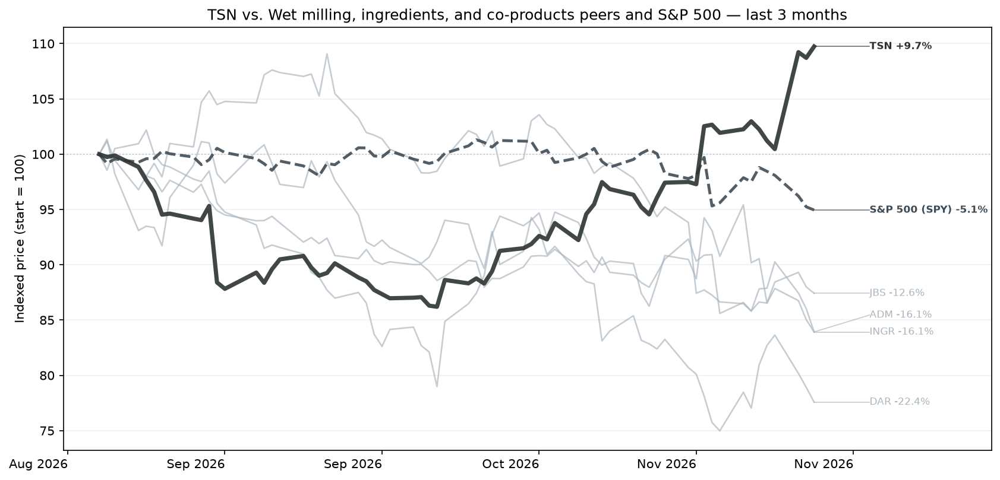

#### Earnings Call Summary

Tyson Foods reported full-year fiscal 2026 adjusted operating income of $1.98 billion and adjusted EPS of $3.44. Prepared Foods operating income grew 5.5% to $1.33 billion with a 12.9% margin, while Chicken delivered $1.86 billion. Performance came in slightly stronger in beef and lighter in chicken than previously estimated.

#### At a Glance

- **Tyson Beats Revenue and EPS Expectations:** Tyson Foods reported Q4 fiscal 2026 revenue of $14.59 billion, surpassing the estimated $14.05 billion, while adjusted EPS came in at $0.61, beating the estimated $0.60.
- **Protein KPIs Reflect Divergent Segment Trends:** The company&#x27;s Chicken segment maintained operational strength with an 8.7% margin and eight consecutive quarters of volume growth, helping to insulate profitability alongside record performance in Prepared Foods.
- **Fiscal 2027 Revenue Outlook Guided Lower:** Management expects fiscal 2027 total sales to decrease between 3.5% and 5.5% year over year, primarily driven by a drop in Beef segment volume due to structural network optimization.
- **Severe Beef Deficit Hardest Hit by Commodity Cycle:** The Beef segment recorded a severe adjusted Q4 operating loss of $171 million as limited cattle supply drove volume down by 12.7% for the quarter.
- **Structural Realignment to Unify Branding Efficiency:** Tyson is shifting to a commercially led framework, which includes placing Pork and Prepared Foods under a single leader to capture higher-value branded margin allocations.
- **Positive Stock Reaction Acknowledges Narrowing Losses:** Tyson&#x27;s shares rose 8.7% following the release, as investors reacted positively to a fiscal 2027 beef segment outlook that implies narrowing macro headwinds and a return toward potential profitability.

#### Key Moments from the Call

- **15m — Allied Beef Partnership Accelerates Amarillo Reopening:** Tyson announced a long-term supply chain partnership with Allied Beef Company to secure domestic cattle supply. This strategic collaboration gives management the confidence to fully restore the second production shift at its Amarillo, Texas facility by summer 2027, mitigating cattle cycle headwinds.
- **19m — Aggressive Share Repurchases and Dividend Increase:** Tyson accelerated its capital return program, executing $300 million in share buybacks during Q4 alone ($427 million for FY26) and raising its quarterly dividend by 2% for fiscal 2027. This strong liquidity position and shareholder alignment will please investors.
- **20m — Fiscal 2027 Guidance Reveals Profit Pressures:** Tyson projected lower fiscal 2027 revenue and potentially lower operating income ($1.7B–$2.15B vs $1.98B in FY26). Investors will be disappointed that market-driven headwinds in chicken and pork, alongside tight cattle supplies, are expected to outweigh controllable operational improvements.
- **43m — Management Overhauls Scorecards with Growth KPIs:** New CEO Jeff Schomburger announced a strategic pivot to a 'commercially led' model, introducing strict brand-building metrics into enterprise scorecards, including blind taste test preferences and shelf-space share. This aims to fix under-indexing shelf display and historically weak innovation success rates.
<h3 id="earnings-ctva">Corteva (<a href="#company-ctva">CTVA</a>) -89.4%</h3>

**Reported:** November 12, 2026 · [Google Finance earnings page](https://www.google.com/finance/quote/CTVA:NYSE?tab=earnings&hl=en)

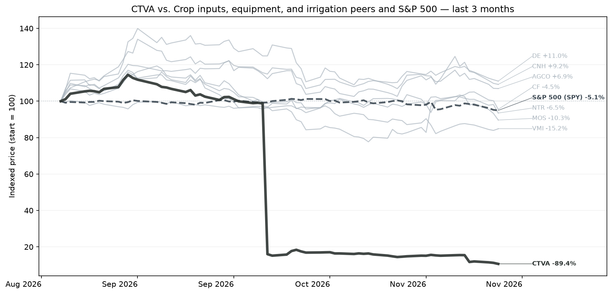

#### Earnings Call Summary

New product volumes grew 20% globally in Q3 2026, driven by high demand for differentiated technologies. Multi-crop herbicide Arylex and insecticide Pyraxalt experienced volume growth exceeding 20%, representing a combined annual revenue of approximately $650M, demonstrating that growers continue to invest in high-yield, premium solutions despite a challenging macroeconomic environment.

#### At a Glance

- **Corteva Misses Top and Bottom Lines:** Corteva reported a reported adjusted EPS of $0.00, missing the estimated adjusted EPS of $0.096, while reported revenue of $1,591,000,000 fell short of the estimated $1,767,904,850.
- **Severe Organic Sales Drops Regionally:** Latin America organic sales suffered a severe 31% decline driven by farmer liquidity constraints and pricing pressure on late-lifecycle molecules in Brazil.
- **Full-Year Guidance Slashed Materially:** Management lowered its full-year 2026 adjusted operating EBITDA guidance to a range of $1.1 billion to $1.125 billion and operating EPS to $0.76 to $0.80 per share to reflect deteriorating market conditions in Brazil.
- **Restructuring Plan to Optimize Network:** The company announced it expects to incur $130 million to $140 million in pre-tax restructuring charges during 2026 to optimize its crop protection manufacturing network.
- **Stock Plunges on Earnings Weakness:** Corteva&#x27;s shares plunged roughly 20% following the earnings release, hitting a new one-year low due to investor disappointment over the guidance cut and Latin American weakness.

#### Key Moments from the Call

- **3m — Brazil Inventory and Generic Backlash:** Corteva admitted to entering the year with severe channel inventory surpluses in Brazil from 2025, which amplified a 31% drop in Latin American organic sales. High interest rates, tight liquidity, and aggressive generic competition from China forced distributors into just-in-time purchasing, crippling Corteva's high-margin volume and biologicals business in the region.
- **13m — Severe Full-Year Guidance Cut:** Management slashed full-year 2026 operating EBITDA guidance to $1.1B–$1.125B (down from ~$1.3B) and lowered operating EPS guidance to $0.76–$0.80. This significant guide-down is entirely driven by severe, rapid market deterioration and inventory headwinds in Brazil, which will also cut Q4 EBITDA in half compared to prior-year levels.
- **20m — North American Acetochlor Pricing Headwind:** North American pricing dropped 12% in Q3 due to anticipated defensive pricing actions on acetochlor to counter European competitors. While a 19% volume increase partially offset the price erosion, this headwind will persist through Q4 2026 and Q1 2027 before finally tapering off and truing up at the channel level by Q2 2027.
- **48m — Near-Term Share Buyback Constraints:** Despite strong executive interest in repurchasing shares at current valuation levels and having an active authorization, tax-related representation constraints from the standalone spin-off legally block Corteva from executing any share buybacks in Q4 2026. Share buybacks will be pushed out and prioritized as part of 2027 capital deployment.
<h3 id="earnings-agro">Adecoagro (<a href="#company-agro">AGRO</a>) -22.6%</h3>

**Reported:** November 12, 2026 · [Google Finance earnings page](https://www.google.com/finance/quote/AGRO:NYSE?tab=earnings&hl=en)

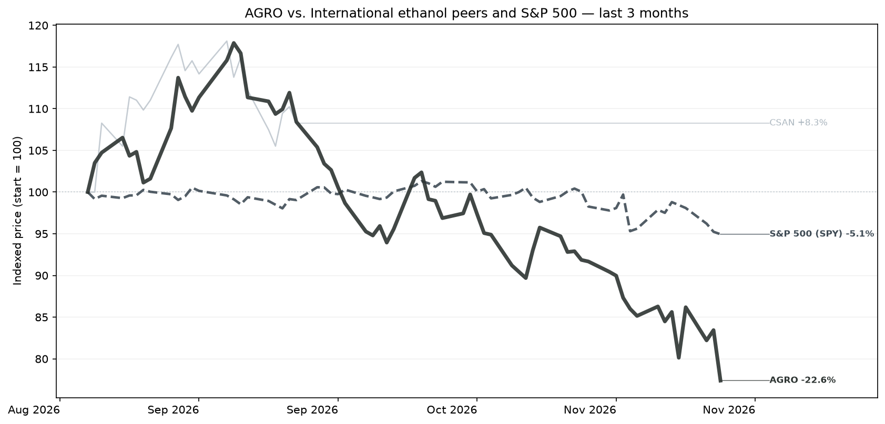

#### Earnings Call Summary

Adecoagro reported record consolidated nine-month adjusted EBITDA of $472 million, up nearly $100 million from the prior record. The company's pro forma Q3 2026 gross sales reached $591 million, supported by strong performance in its fully integrated fertilizers business, which helped offset weaker performance and lower pricing in sugar, ethanol, and energy.

#### At a Glance

- **Adecoagro Misses Estimates on Top and Bottom Lines:** Adecoagro reported Q3 2026 Adjusted EPS of $0.32, missing the estimated $0.479, while reported revenue of $598,436,000 also fell short of the $660,243,560 expectation.
- **Strong Fertilizer Volume Offsets Weaker Sugar Operations:** Adecoagro achieved a record nine-month Adjusted EBITDA of $472 million due to its surging fertilizers division, despite facing weaker prices and operational headwinds in its sugar and ethanol segments.
- **Management Reaffirms Year-End Leverage Targets and Growth:** The company maintained its year-end net leverage target of 2.5x and anticipates mid-teens growth in sugarcane crushing volumes alongside continued margin expansion in fertilizers.
- **Rising Acquisition Debt Interest Costs Weigh on Profits:** Although operating cash profits held steady, net profits excluding one-offs fell by 48% to $38 million due to interest costs on acquisition debt nearly doubling.
- **Disappointment Sparks Muted Share Reaction in Trading:** Following the earnings miss against consensus estimates, the market reacted negatively with shares falling 9.5% to $8.19 in after-hours trading.

#### Key Moments from the Call

- **5m — Earnings Miss Despite Record Metric:** Adecoagro reported Q3 2026 revenue of $598.44M, missing the estimated $660.24M, and reported an EPS of $0.159, significantly below the $0.479 estimate. Although nine-month adjusted EBITDA reached a record high, lower sugar prices and rain-driven operational delays during the quarter disappointed baseline market expectations.
- **13m — Highly Accretive Caarapó Strategic Opportunity:** Adecoagro acquired the Caarapó Mill for $136 million cash, a valuation below $30 per ton of capacity. Fully integrated in September, the mill addresses current excess cluster cane and unlocks capacity up to 5-7 million tons, serving as immediate organic-like growth to boost margins and effective milling hours.
- **31m — Strong Fertilizer Cost Reductions and Outlook:** Management addressed concerns over fertilizer costs, revealing a 10% decline in nine-month production costs per ton to $237. Benefiting from 80-85% fixed gas pricing, the segment expects full-year outperformance. Management plans to reach a Final Investment Decision (FID) by next year to duplicate plant capacity for competitive regional exports.
- **43m — Short-Term Ethanol Sales and Subsidy Push:** Adecoagro is maximizing hydrous ethanol production to exploit favorable domestic supply tightness and government subsidies active until December 9. Management plans to swiftly pivot to anhydrous ethanol in Q1 2027 to capture growing gasoline blend demands, anticipating a 25% price improvement sequentially in Q4 2026.

## Company Overviews

<h3 id="company-ctva">Corteva (CTVA)</h3>

*Crop inputs, equipment, and irrigation · $5.6B · 3m -89.4% · 12m -87.1% · 24m -85.6%*

[Google Finance](https://www.google.com/finance/quote/CTVA:NYSE?tab=earnings&hl=en)

Largest U.S. corn-seed franchise (Pioneer) and a primary input cost for Corn Belt acres.

Corteva is a crop protection pure play. The company was formed in 2019 when it was spun off from DowDuPont and spun off its seeds business, Vylor, in 2026. Corteva is a leader in the development of new crop protection products, including herbicides, insecticides, fungicides, biologicals, and plant health products. Corteva operates globally. North America generates nearly 40% of revenue while Latin America generates over 30%.

<h3 id="company-bayry">Bayer (BAYRY)</h3>

*Crop inputs, equipment, and irrigation · n/a · 3m +0.0% · 12m +79.0% · 24m +159.5%*

[Google Finance](https://www.google.com/finance/quote/BAYRY:NYSE?tab=earnings&hl=en)

Dekalb and former Monsanto corn-seed brands; together with Corteva dominates U.S. corn seed.

BAYER AG S/ADR

<h3 id="company-basfy">BASF (BASFY)</h3>

*Crop inputs, equipment, and irrigation · n/a · 3m +0.0% · 12m +18.5% · 24m +30.2%*

[Google Finance](https://www.google.com/finance/quote/BASFY:NYSE?tab=earnings&hl=en)

Crop-protection chemistry used on U.S. corn acres.

BASF SE S/ADR

<h3 id="company-ntr">Nutrien (NTR)</h3>

*Crop inputs, equipment, and irrigation · $31.3B · 3m -6.5% · 12m +17.8% · 24m +44.7%*

[Google Finance](https://www.google.com/finance/quote/NTR:NYSE?tab=earnings&hl=en)

Largest North American agricultural retailer and a major potash and nitrogen producer.

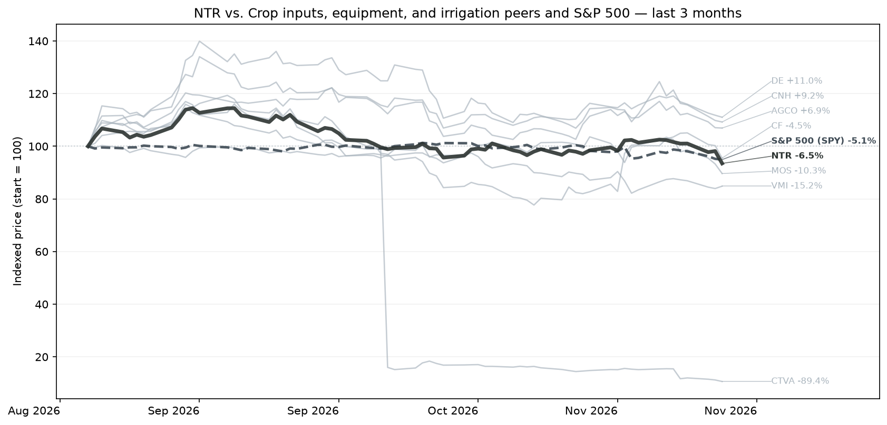

Created in 2018 as a result of the merger between PotashCorp and Agrium, Nutrien is the world's largest fertilizer producer by capacity. Nutrien produces the three main crop nutrients—nitrogen, potash, and phosphate—although its main focus is potash, where it is the global leader in installed capacity with a roughly 20% market share. The company is also the largest agricultural retailer in North America and Australia, selling fertilizers, crop chemicals, seeds, and services directly to farm customers through its brick-and-mortar stores and online platforms.

<h3 id="company-cf">CF Industries (CF)</h3>

*Crop inputs, equipment, and irrigation · $16.6B · 3m -4.5% · 12m +44.4% · 24m +29.9%*

[Google Finance](https://www.google.com/finance/quote/CF:NYSE?tab=earnings&hl=en)

Nitrogen fertilizer producer; corn is the crop that most moves UAN and urea demand.

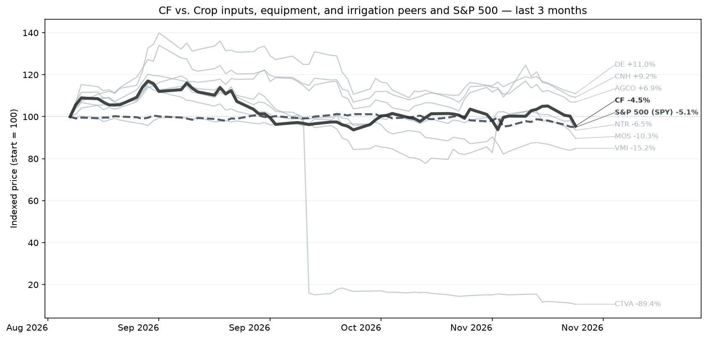

CF Industries is a leading producer and distributor of nitrogen, which is primarily used in fertilizers. The company operates nitrogen manufacturing plants primarily in North America. CF also produces nitrogen in the United Kingdom and holds a joint venture interest in a nitrogen production facility in Trinidad and Tobago. CF makes nitrogen primarily using low-cost US natural gas as its feedstock, making the company one of the lowest-cost nitrogen producers globally. It is also investing in carbon-free blue and green ammonia, which can be used as an alternative fuel to hydrogen or as a means to transport hydrogen.

<h3 id="company-yariy">Yara International (YARIY)</h3>

*Crop inputs, equipment, and irrigation · n/a · 3m +0.0% · 12m +24.7% · 24m +54.4%*

[Google Finance](https://www.google.com/finance/quote/YARIY:NYSE?tab=earnings&hl=en)

Global nitrogen producer that sets the international urea and ammonia reference.

YARA INTL ASA S/ADR

<h3 id="company-mos">Mosaic (MOS)</h3>

*Crop inputs, equipment, and irrigation · $6.3B · 3m -10.3% · 12m -18.7% · 24m -21.5%*

[Google Finance](https://www.google.com/finance/quote/MOS:NYSE?tab=earnings&hl=en)

Phosphate and potash producer that completes corn production budgets.

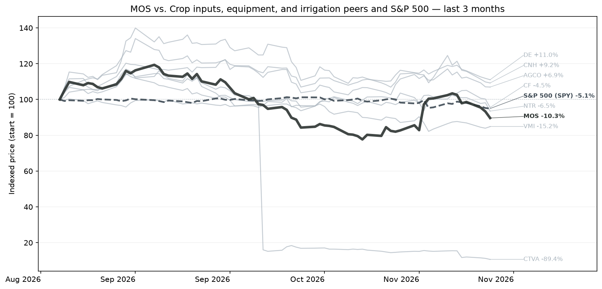

Mosaic is one of the largest phosphate and potash producers in the world. The company's assets include phosphate rock mines in the US and potash mines in Canada. Mosaic also runs a large fertilizer distribution operation in Brazil through its Mosaic Fertilizantes business.

<h3 id="company-de">Deere (DE)</h3>

*Crop inputs, equipment, and irrigation · $173.8B · 3m +11.0% · 12m +35.8% · 24m +61.2%*

[Google Finance](https://www.google.com/finance/quote/DE:NYSE?tab=earnings&hl=en)

Dominant North American farm-equipment maker for corn planting, harvest, and grain handling.

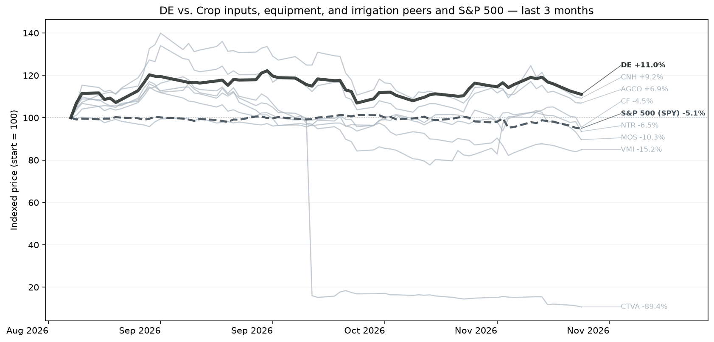

Deere is the world's leading manufacturer of agricultural equipment and a major producer of construction machinery. The company is divided into four reporting segments: production & precision agriculture, or PPA, small agriculture & turf, or SAT, construction & forestry, or CF, and financial services, or FS, its captive finance subsidiary. The core PPA business is the largest contributor to sales and profits by far. Geographically, Deere sales are 60% US/Canada, 17% Europe, 14% Latin America, and 9% rest of the world. Deere goes to market through a robust dealer network that includes over 2,000 dealer locations in North America with reach into over 100 countries. John Deere Financial provides retail financing for machinery to its customers and wholesale financing for dealers.

<h3 id="company-cnh">CNH Industrial (CNH)</h3>

*Crop inputs, equipment, and irrigation · $18.0B · 3m +9.2% · 12m +17.2% · 24m +1.5%*

[Google Finance](https://www.google.com/finance/quote/CNH:NYSE?tab=earnings&hl=en)

Case IH and New Holland farm equipment serving corn growers.

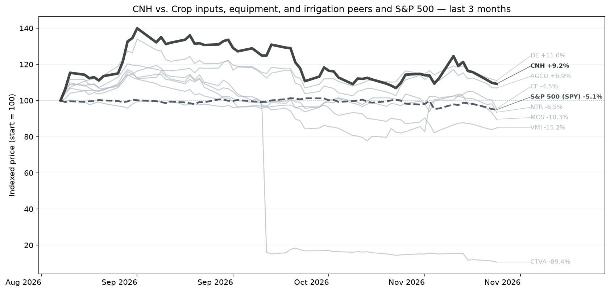

CNH Industrial is the world's second largest manufacturer of agricultural machinery (82% of industrial net sales) as well as a major player in construction equipment (18% of industrial net sales). Its Case and New Holland brands have served farmers for generations. Geographically, agricultural sales are 40% in North America, 32% in Europe, the Middle East, and Africa, 18% in South America, and 10% in Asia-Pacific. CNH's products are available through a robust independent dealer network, which includes over 2,600 dealer and distribution locations and reach into 164 countries. The construction business leverages over 400 dealers. The company's captive finance arm provides retail financing to its customers and wholesale financing to dealers to maintain inventory, thereby supporting sales.

<h3 id="company-agco">AGCO (AGCO)</h3>

*Crop inputs, equipment, and irrigation · $7.3B · 3m +6.9% · 12m +5.2% · 24m +16.0%*

[Google Finance](https://www.google.com/finance/quote/AGCO:NYSE?tab=earnings&hl=en)

Fendt, Massey Ferguson, and Challenger farm equipment with Corn Belt exposure.

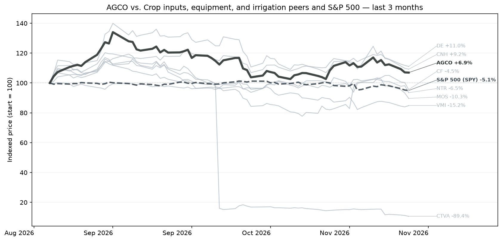

Agco is a global manufacturer of agricultural equipment. Its main machine brands are Fendt, Massey Ferguson, and Valtra; its initiatives in precision agriculture have been organized under the PTx umbrella following a series of acquisitions. While a global business, Agco's sales skew heavily toward Europe/Middle East, representing 50%-60% of sales and even more of operating profits. The company is trying to increase its exposure to the larger North and South American markets. Its products are available through a global dealer network, which includes over 3,000 dealers and distribution locations and reaches into over 140 countries. Additionally, Agco offers retail and wholesale financing to customers through its partnership with Rabobank of the Netherlands, having exited their JV in 2026.

<h3 id="company-vmi">Valmont Industries (VMI)</h3>

*Crop inputs, equipment, and irrigation · $7.9B · 3m -15.2% · 12m +5.1% · 24m +21.0%*

[Google Finance](https://www.google.com/finance/quote/VMI:NYSE?tab=earnings&hl=en)

Center-pivot irrigation (Valley) used on irrigated High Plains corn.

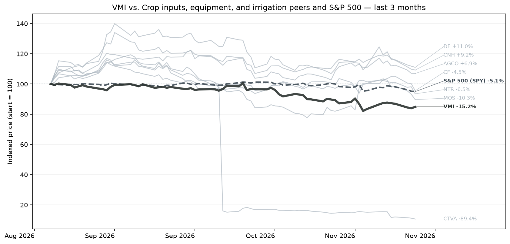

Valmont Industries Inc, along with its subsidiaries, operates as a manufacturer of products and services for infrastructure and agriculture markets. Its reportable segments are Infrastructure and Agriculture. The company generates maximum revenue from the Infrastructure segment, which includes the manufacturing and distribution of products and solutions to serve the infrastructure markets of utility, solar, lighting, transportation, and telecommunications, along with coatings services to protect metal products. The Agriculture segment provides irrigation equipment components, including aftermarket parts and tubular products, and technology solutions for precision agriculture. Geographically, it derives key revenue from the United States, followed by Australia, Brazil, and other regions.

<h3 id="company-adm">Archer Daniels Midland (ADM)</h3>

*Grain origination and agribusiness, U.S. ethanol and process technology, Wet milling, ingredients, and co-products · $32.3B · 3m -16.1% · 12m +16.4% · 24m +27.9%*

[Google Finance](https://www.google.com/finance/quote/ADM:NYSE?tab=earnings&hl=en)

Global grain trader, top U.S. ethanol producer, and major corn wet miller.

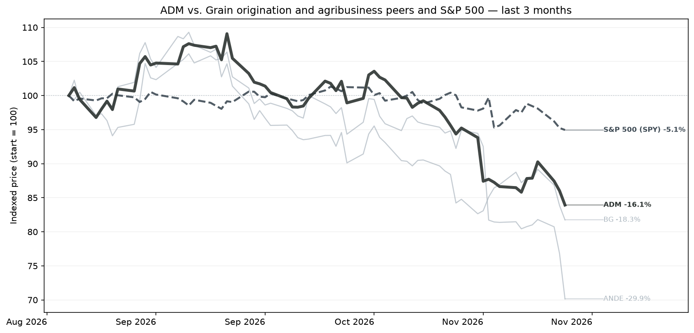

Archer-Daniels-Midland is a major processor of oilseeds, corn, wheat, and other agricultural commodities. The company is also one of the largest grain merchandisers through its extensive network of logistical assets to store and transport crops around the globe. ADM also runs a nutrition business that focuses on both human and animal ingredients and is a large producer of corn-based sweeteners, starches, and ethanol.

<h3 id="company-bg">Bunge (BG)</h3>

*Grain origination and agribusiness · $17.9B · 3m -18.3% · 12m +0.0% · 24m +4.1%*

[Google Finance](https://www.google.com/finance/quote/BG:NYSE?tab=earnings&hl=en)

Global grain and oilseed merchant after the Viterra combination; competitor for corn origination.

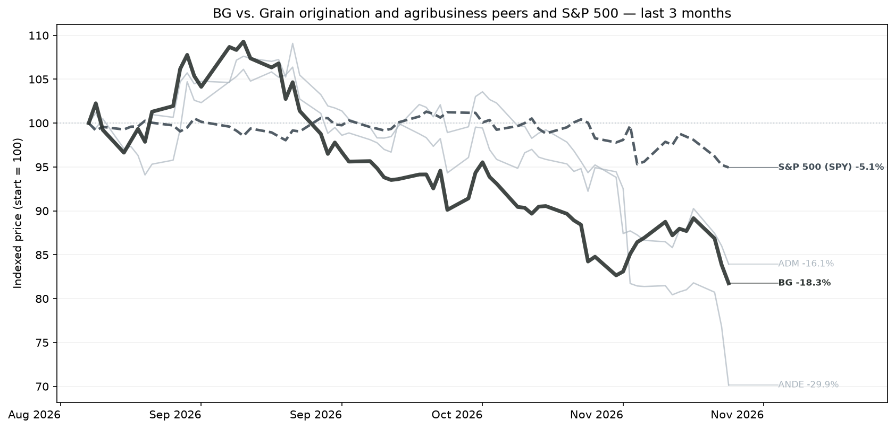

Bunge Global SA is an agribusiness solutions company, connecting farmers to consumers and delivering essential food, feed and fuel to the globe. The company segments include Soybean Processing and Refining; Softseed Processing and Refining; Other Oilseeds Processing and Refining; Grain Merchandising and Milling; and Corporate and Other. It generates maximum revenue from the Soybean Processing and Refining segment, which includes integrated business principally involved in the purchase, storage, transportation, processing, distribution, refining, marketing, and sale of soybeans and soybean related products, as well as biodiesel and fertilizer production and distribution. Geographically, the company operates in United States, Switzerland, Netherlands, and Rest of the World.

<h3 id="company-ande">The Andersons (ANDE)</h3>

*Grain origination and agribusiness, U.S. ethanol and process technology · $1.6B · 3m -29.9% · 12m -3.9% · 24m +0.7%*

[Google Finance](https://www.google.com/finance/quote/ANDE:NASDAQ?tab=earnings&hl=en)

Grain elevators plus four wholly owned ethanol plants totaling about 500 million gallons a year.

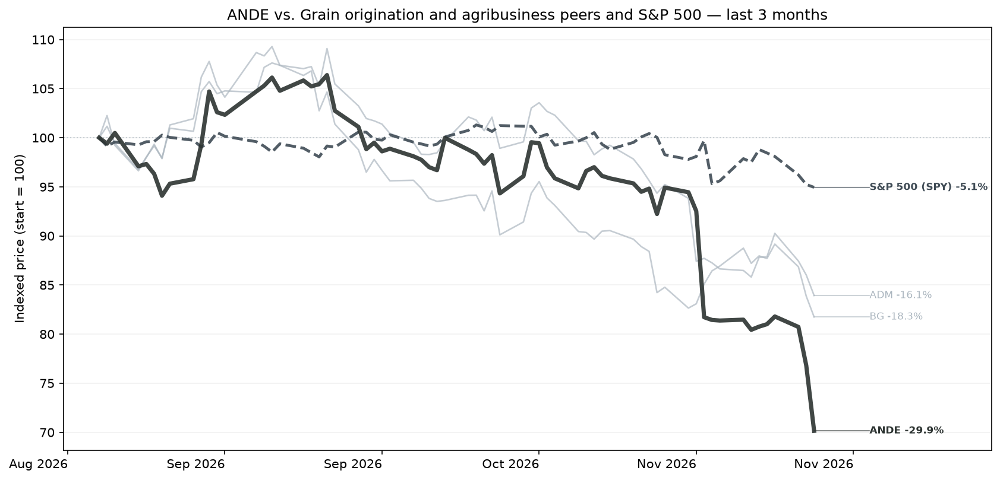

Andersons Inc is an agriculture and renewable fuels company. Its operations are classified into two reportable business segments: Agribusiness, which generates maximum revenue, and Renewables. The Agribusiness segment includes merchandising and managing logistics across various commodities, as well as being a manufacturer, distributor, and retailer of agricultural and related plant nutrients. The segment specializes in the movement of physical commodities such as whole grains, grain products, feed ingredients, and domestic fuel products, among other agricultural commodities. The Renewables segment mainly produces, purchases, and sells ethanol and co-products. Geographically, the company generates maximum revenue from the United States, followed by Canada, Mexico, and other markets.

<h3 id="company-vlo">Valero Energy (VLO)</h3>

*U.S. ethanol and process technology, Fuel blending, refining, and retail · $95.9B · 3m -0.7% · 12m +90.6% · 24m +142.0%*

[Google Finance](https://www.google.com/finance/quote/VLO:NYSE?tab=earnings&hl=en)

World's second-largest corn-ethanol producer with a distinct Ethanol segment and a major blender.

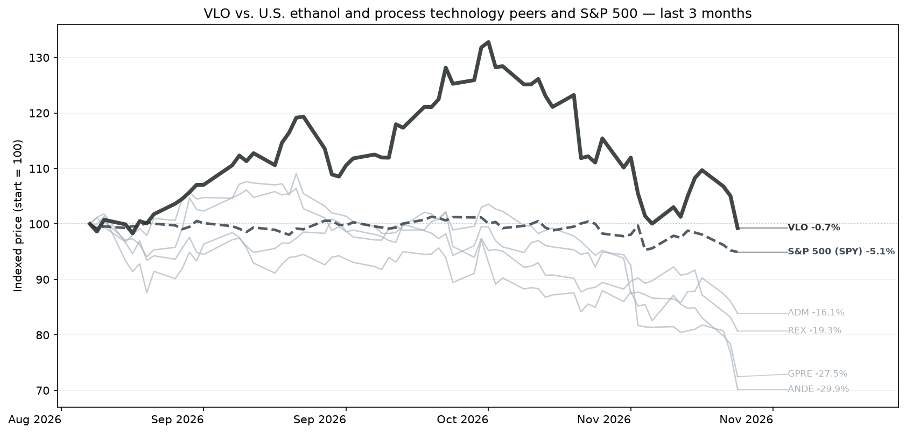

Valero Energy is one of the largest independent refiners in the United States. It operates 15 refineries, with a total throughput capacity of 3.2 million barrels a day in the US, Canada, and the United Kingdom. Valero also owns 12 ethanol plants with capacity of 1.6 billion gallons a year and holds a 50% stake in Diamond Green Diesel, which can produce 1.2 billion gallons per year of renewable diesel.

<h3 id="company-gpre">Green Plains (GPRE)</h3>

*U.S. ethanol and process technology · $820.6M · 3m -27.5% · 12m +15.7% · 24m +10.1%*

[Google Finance](https://www.google.com/finance/quote/GPRE:NASDAQ?tab=earnings&hl=en)

Largest U.S. ethanol pure play, with high-protein feed, corn oil, and Nebraska carbon-capture work.

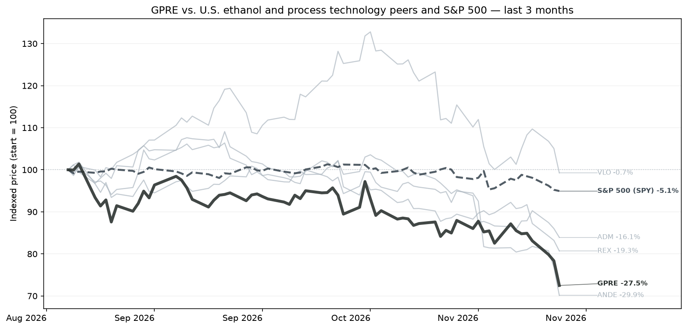

Green Plains Inc manufactures and sells ethanol and ethanol byproducts in two segments based on function. The ethanol production segment, which generates the majority of revenue, includes the production of ethanol, distillers grains, Ultra-High Protein and renewable corn oil. The agribusiness and energy services segment includes grain handling and storage, commodity marketing and merchant trading for company-produced and third-party ethanol, distillers grains, Ultra-High Protein, renewable corn oil, natural gas and other commodities.

<h3 id="company-rex">REX American Resources (REX)</h3>

*U.S. ethanol and process technology · $1.2B · 3m -19.3% · 12m +10.4% · 24m +61.1%*

[Google Finance](https://www.google.com/finance/quote/REX:NYSE?tab=earnings&hl=en)

Holding company with interests in six Corn Belt ethanol plants; cleanest public crush-margin equity.

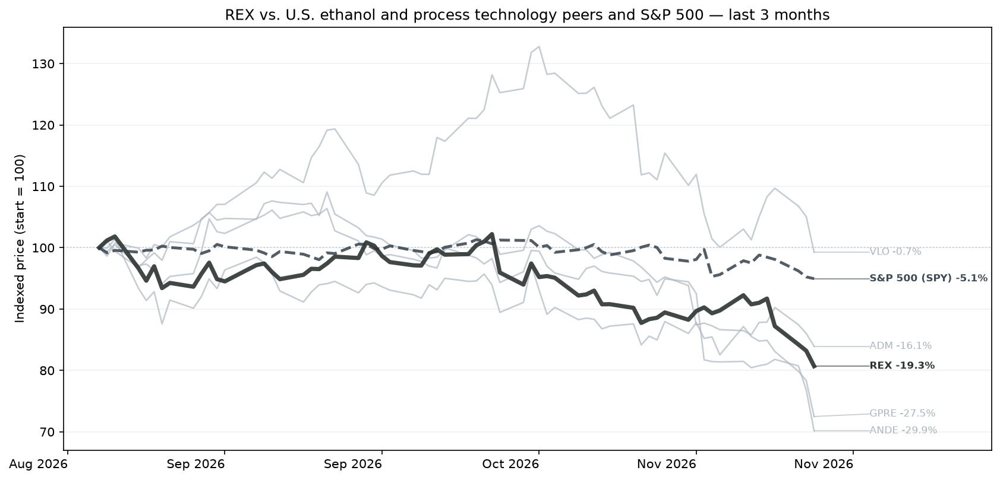

REX American Resources Corp operates as a holding company that engages in investments in alternative energy and ethanol production entities. Its operating segments include Ethanol and By-Products. Its products include Ethanol, dried distillers grains, modified distillers grains, Distillers corn oil, Modified distillers grains, and Other.

<h3 id="company-nvzmy">Novonesis (NVZMY)</h3>

*U.S. ethanol and process technology · n/a · 3m +0.0% · 12m +4.1% · 24m +13.7%*

[Google Finance](https://www.google.com/finance/quote/NVZMY:NYSE?tab=earnings&hl=en)

Dominant supplier of enzymes used in dry-mill ethanol fermentation.

NOVONESIS B UNSP/ADR

<h3 id="company-ingr">Ingredion (INGR)</h3>

*Wet milling, ingredients, and co-products · $5.6B · 3m -16.1% · 12m -15.9% · 24m -36.7%*

[Google Finance](https://www.google.com/finance/quote/INGR:NYSE?tab=earnings&hl=en)

Major corn wet miller producing sweeteners, starches, and specialty ingredients.

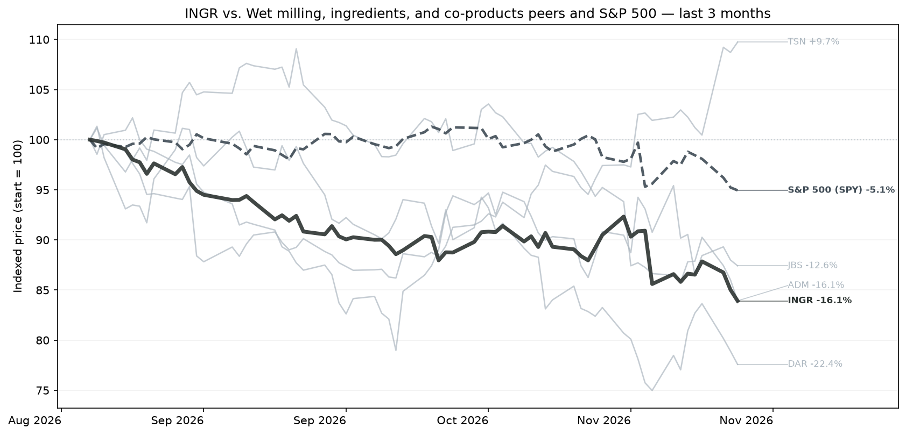

Ingredion provides ingredients to the food, beverage, brewing, and animal nutrition industries. The company processes corn, tapioca, potatoes, stevia, grains, fruits, gums, and vegetables into value-added ingredients. The company sells specialty ingredients, including starch-based texturizers and natural alternative sweeteners such as stevia. Ingredion also sells commodity ingredients that include sweeteners, such as high-fructose corn syrup, and starches, such as those used for sustainable packaging, as well as plant-based proteins. The company plans to acquire Tate & Lyle in an all-cash deal that should close in 2027.

<h3 id="company-dar">Darling Ingredients (DAR)</h3>

*Wet milling, ingredients, and co-products · $8.0B · 3m -22.4% · 12m +52.3% · 24m +24.2%*

[Google Finance](https://www.google.com/finance/quote/DAR:NYSE?tab=earnings&hl=en)

Rendering and used cooking oil; 50/50 owner of Diamond Green Diesel with Valero.

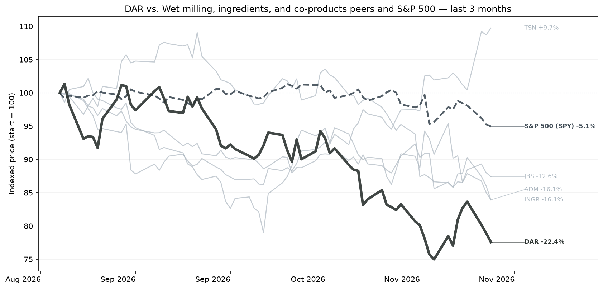

Darling Ingredients Inc is a developer and producer of sustainable natural ingredients from edible and inedible bio-nutrients, creating a wide range of ingredients and customized specialty solutions for customers in the pharmaceutical, food, pet food, animal feed, industrial, fuel, bioenergy and fertilizer industries. It processes by-products from the animal agriculture and food industries into ingredients and products for human nutrition, animal feed, crop inputs, and renewable energy applications. The company operates processing facilities across multiple countries and produces collagen, including gelatin and hydrolyzed collagen, as well as renewable energy products.

<h3 id="company-tsn">Tyson Foods (TSN)</h3>

*Wet milling, ingredients, and co-products · $22.1B · 3m +9.7% · 12m +21.1% · 24m +2.1%*

[Google Finance](https://www.google.com/finance/quote/TSN:NYSE?tab=earnings&hl=en)

Largest U.S. protein company and a primary domestic sink for distillers grains.

Tyson Foods Inc is a protein-focused food producer that sells raw chicken, beef, pork, and prepared foods. The company's products are sold under brands like Tyson, Jimmy Dean, Hillshire Farm, Ball Park, Wright, State Fair, Aidells, Landshire, Reuben, Pierre, Like Mom's, Tortilla Land, etc., mainly by its sales staff to grocery retailers, grocery wholesalers, meat distributors, warehouse club stores, military commissaries, chain restaurants or their distributors, live markets, and other customer segments. It operates in five reportable segments: Beef, Pork, Chicken, Prepared Foods, and International. The majority of its revenue comes from the Beef (also the company's highest-revenue segment) and Chicken segments. Geographically, it caters to both domestic and international markets.

<h3 id="company-jbs">JBS (JBS)</h3>

*Wet milling, ingredients, and co-products · $12.9B · 3m -12.6% · 12m -12.0% · 24m n/a*

[Google Finance](https://www.google.com/finance/quote/JBS:NYSE?tab=earnings&hl=en)

World's largest protein company and a major DDGS buyer in the U.S. and Brazil.

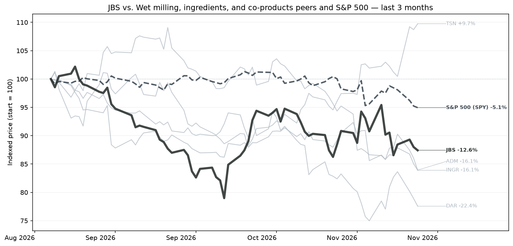

JBS NV is a protein food company, selling protein products, which include fresh and frozen cuts of beef, pork, lamb, fish, whole chickens, and chicken parts, to retailers, and foodservice companies. The food products are marketed under different brands such as Swift, Just Bare, Pilgrim's Pride, Sunnyvalley, Reserva Friboi, Great Southern, etc., globally. The company's reportable segments are Beef North America, which generates maximum revenue, Brazil, Seara, Pork USA, Pilgrim's Pride, Australia, and Others. Geographically, it derives majority of its revenue from United States of America.

<h3 id="company-mpc">Marathon Petroleum (MPC)</h3>

*Fuel blending, refining, and retail · $101.8B · 3m +3.6% · 12m +91.2% · 24m +135.4%*

[Google Finance](https://www.google.com/finance/quote/MPC:NYSE?tab=earnings&hl=en)

Largest U.S. independent refiner and a major Midwest ethanol blender.

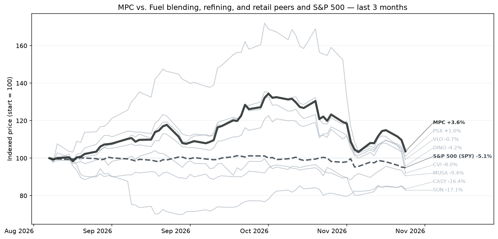

Marathon Petroleum is a leading integrated downstream and midstream energy company that operates 13 refineries in the Gulf Coast, midcontinent, and West Coast regions of the United States with an aggregate crude oil refining capacity of 3.0 million barrels per day. The company is one of the largest producers of renewable diesel in the US; its Dickinson, North Dakota, facility has the capacity to produce 184 million gallons per year, and its Martinez, California, joint venture facility (a 50/50 partnership with Neste) reached its full capacity of 730 million gallons per year in late 2024. Marathon also owns the general partner and approximately 64% of MPLX LP, a large-cap master limited partnership that owns and operates midstream energy infrastructure and logistics assets.

<h3 id="company-psx">Phillips 66 (PSX)</h3>

*Fuel blending, refining, and retail · $95.5B · 3m +1.0% · 12m +82.0% · 24m +87.0%*

[Google Finance](https://www.google.com/finance/quote/PSX:NYSE?tab=earnings&hl=en)

Large blender and marketer with West Coast renewable-diesel capacity.

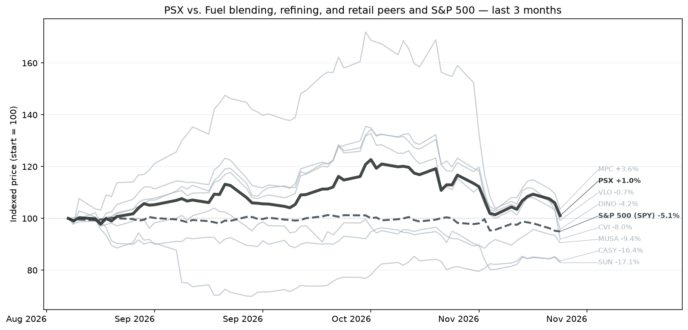

Phillips 66 is an independent refiner that owns or holds an interest in 10 refineries with a total crude throughput capacity of 2.0 million barrels per day at the end of 2025. The midstream segment comprises extensive transportation and natural gas liquids processing assets. It includes 70,000 miles of crude oil, refined petroleum product, NGL, and natural gas pipeline systems and a comprehensive set of refined petroleum product, NGL and crude oil terminals, gathering and processing plants, fractionation facilities, and various other storage and loading facilities. Its CPChem chemical joint venture operates facilities primarily in the United States and the Middle East and produces olefins and polyolefins.

<h3 id="company-dino">HF Sinclair (DINO)</h3>

*Fuel blending, refining, and retail · $15.3B · 3m -4.2% · 12m +67.7% · 24m +114.3%*

[Google Finance](https://www.google.com/finance/quote/DINO:NYSE?tab=earnings&hl=en)

Independent Mid-Continent and Rockies refiner with renewable diesel and RFS blending obligations.

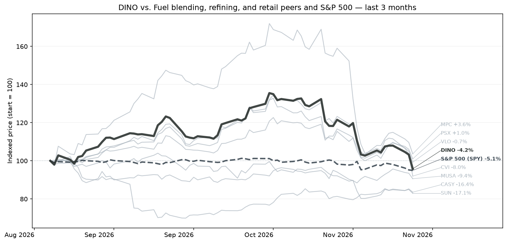

HF Sinclair is an integrated petroleum refiner that owns and operates seven refineries serving the Rockies, midcontinent, Southwest, and Pacific Northwest, with a total crude oil throughput capacity of 678,000 barrels per day. It can produce 380 million gallons of renewable diesel annually. It operates a marketing business with over 350 distributors and 1,700 branded wholesale sites across 30 states. It also owns and operates 4,500 miles of petroleum product pipelines and terminals principally in the Southwestern United States.

<h3 id="company-cvi">CVR Energy (CVI)</h3>

*Fuel blending, refining, and retail · $3.7B · 3m -8.0% · 12m -5.5% · 24m +79.7%*

[Google Finance](https://www.google.com/finance/quote/CVI:NYSE?tab=earnings&hl=en)

Coffeyville, Kansas refiner in the corn complex with renewable diesel and a nitrogen affiliate.

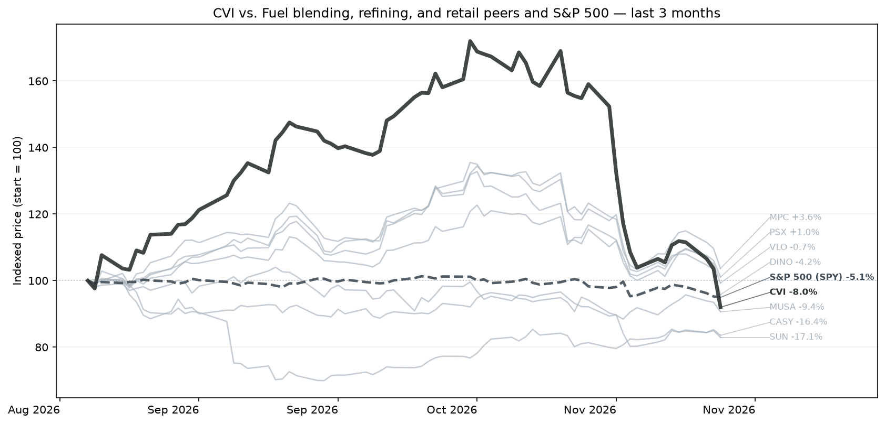

CVR Energy Inc is a holding company that engages in petroleum refining and nitrogen fertilizer manufacturing through its subsidiaries. Subsidiaries include several complex, full-coking crude oil refineries, along with a crude oil gathering system, pipelines, storage tanks, and marketing and supply. The company's refineries can process blends of a variety of crude oil ranging from heavy sour to light sweet crude oil. Crude oil for CVR's refineries is supplied through its wholly-owned gathering system and pipeline. From its refineries, CVR supplies products through tanker trucks directly to customers located in close geographic proximity and customers at throughput terminals. The company's customers include retailers, railroads, and farm cooperatives.

<h3 id="company-sun">Sunoco LP (SUN)</h3>

*Fuel blending, refining, and retail · n/a · 3m -17.1% · 12m +17.0% · 24m +18.5%*

[Google Finance](https://www.google.com/finance/quote/SUN:NYSE?tab=earnings&hl=en)

Fuel distributor and terminal operator that moves finished gasoline and ethanol.

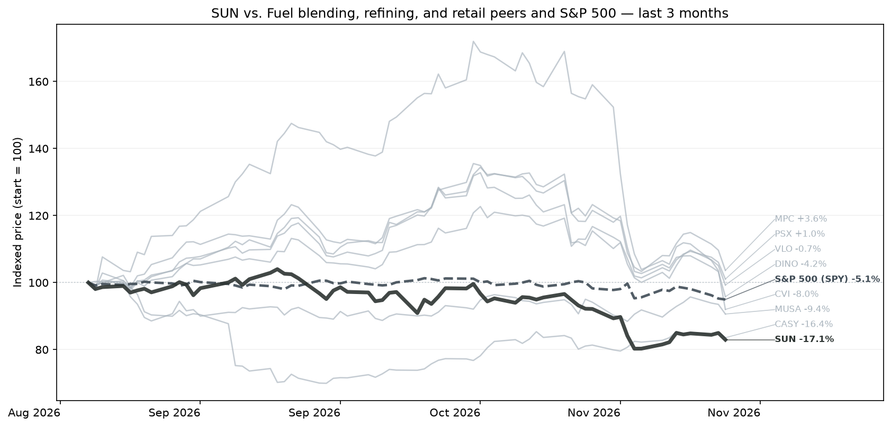

SUNOCO LP

<h3 id="company-casy">Casey&#x27;s General Stores (CASY)</h3>

*Fuel blending, refining, and retail · $25.8B · 3m -16.4% · 12m +25.5% · 24m +69.7%*

[Google Finance](https://www.google.com/finance/quote/CASY:NASDAQ?tab=earnings&hl=en)

Corn Belt convenience-store chain with high E10/E15/E85 exposure.

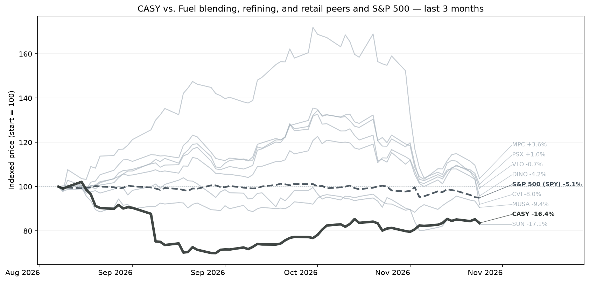

Founded in 1968, Casey's General Stores has become the third-largest convenience store retailer in the United States, operating nearly 3,000 locations across 19 states, primarily in the Midwest. In fiscal 2026, the company generated $17.6 billion in revenue from fuel (60% of sales), grocery and general merchandise (26%), prepared food and dispensed beverages (10%), and areas like wholesale fuel distribution (4%). Casey's footprint skews rural, with over 70% of stores in areas with fewer than 20,000 residents.

<h3 id="company-musa">Murphy USA (MUSA)</h3>

*Fuel blending, refining, and retail · $9.3B · 3m -9.4% · 12m +35.6% · 24m -1.8%*

[Google Finance](https://www.google.com/finance/quote/MUSA:NYSE?tab=earnings&hl=en)

High-volume fuel retailer and national ethanol blender.

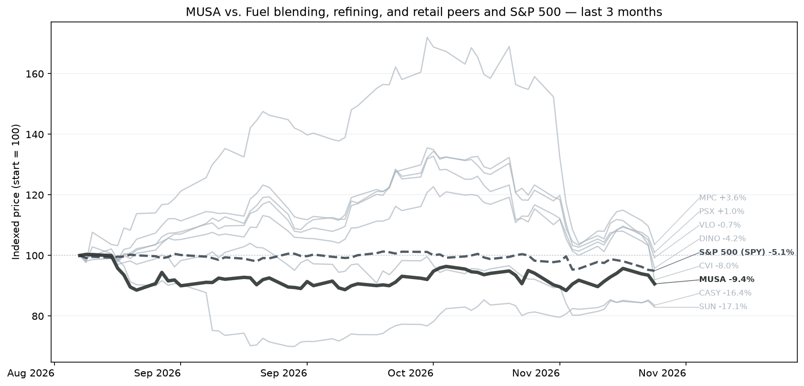

Murphy USA Inc is mainly engaged in the marketing of retail motor fuel products and convenience merchandise through a network of several retail stores in the Southwest, Southeast, Midwest, and Northeast United States. The majority of Murphy USA's stores are located in proximity to Walmart Supercenters, but it also operates standalone stores that market gasoline and other products under the Murphy USA, Murphy Express, and QuickChek brands. In addition, the company also markets fuel to unbranded wholesale customers through a mixture of company-owned and third-party product distribution terminals and pipeline positions. The firm generates maximum revenue through retail sales of petroleum products, and the rest from merchandise sales and wholesale of petroleum products.

<h3 id="company-ntoiy">Neste (NTOIY)</h3>

*Advanced biofuels and SAF · n/a · 3m +0.0% · 12m +72.2% · 24m +136.3%*

[Google Finance](https://www.google.com/finance/quote/NTOIY:NYSE?tab=earnings&hl=en)

Largest global producer of renewable diesel and SAF; sets the price umbrella for corn oil.

NESTE OYJ UNSP/ADR

<h3 id="company-cvx">Chevron (CVX)</h3>

*Advanced biofuels and SAF · $401.7B · 3m +0.1% · 12m +35.7% · 24m +29.0%*

[Google Finance](https://www.google.com/finance/quote/CVX:NYSE?tab=earnings&hl=en)

Owner of Renewable Energy Group biodiesel and renewable-diesel plants that take corn oil at the margin.

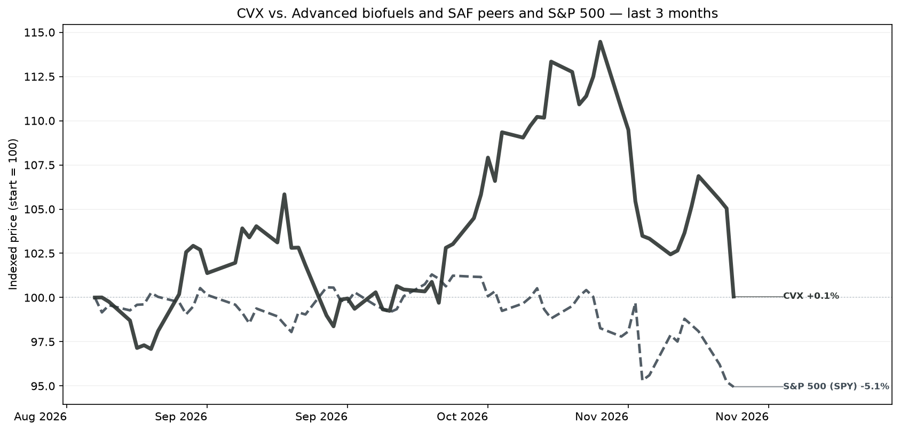

Chevron is an integrated energy company with exploration, production, and refining operations worldwide. It is the second-largest oil company in the United States with 2025 worldwide net oil-equivalent production of 3.7 million barrels per day, including 8.5 billion cubic feet per day of natural gas and 2.3 million barrels of liquids per day. Production takes place in North America, South America, Europe, Africa, Asia, and Australia. The company's refining networks arelocated in the United States and Asia, with a total worldwide refining capacity of 1.8 million barrels of oil a day at year-end 2025. Net proved reserves at year-end 2025 stood at 10.6 billion barrels of oil equivalent, consisting of 5.7 billion barrels of liquids and 29.2 trillion cubic feet of natural gas.

<h3 id="company-csan">Cosan (CSAN)</h3>

*International ethanol · $2.5B · 3m +8.3% · 12m -40.9% · 24m -64.0%*

[Google Finance](https://www.google.com/finance/quote/CSAN:NYSE?tab=earnings&hl=en)

Brazilian holding company and the liquid U.S.-listed proxy for sugarcane ethanol via Raizen.

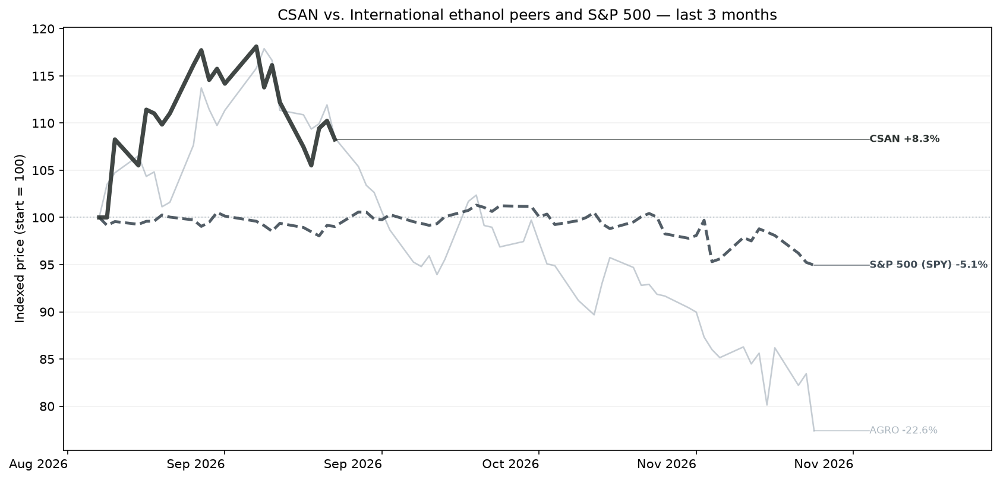

Cosan SA engages in several services throughout the energy and logistics sectors. Its reportable segments are Raizen, Compass, Moove, Rumo, and Radar. It generates the majority of its revenue from Raizen which operates in the production, commercialization, origination, and trading of ethanol, bioenergy, resale, and trading of electricity, renewable sources, marketing, origination, and trading of sugar and fuels, and lubricant.

<h3 id="company-agro">Adecoagro (AGRO)</h3>

*International ethanol · $1.2B · 3m -22.6% · 12m +3.5% · 24m -25.5%*

[Google Finance](https://www.google.com/finance/quote/AGRO:NYSE?tab=earnings&hl=en)

South American farmland and sugar/ethanol producer with U.S.-listed equity.

Adecoagro SA is a Luxembourg-based agricultural company. It is involved in a wide range of businesses, including farming crops and other agricultural products, dairy operations sugar, ethanol, energy production, and land transformation. The group operates in two lines of business, namely, Farming and Sugar, Ethanol and Energy. The Farming is further comprised of three reportable segments: Crops, Rice and Dairy. Sugar, Ethanol and Energy Segment, consists of cultivating sugarcane, which is processed in owned sugar mills, transformed into ethanol, sugar and electricity, in addition to biomethane and then marketed.

<h3 id="company-unp">Union Pacific (UNP)</h3>

*Logistics · $178.8B · 3m -0.3% · 12m +36.0% · 24m +29.0%*

[Google Finance](https://www.google.com/finance/quote/UNP:NYSE?tab=earnings&hl=en)

Primary western Class I for Corn Belt corn, ethanol unit trains, DDGS, and corn oil.

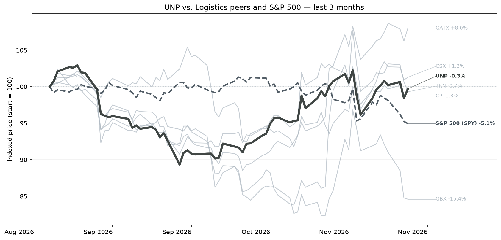

Omaha, Nebraska-based Union Pacific is the largest public railroad in North America. Operating on more than 30,000 miles of track in the western two-thirds of the US, Union Pacific generated $24.5 billion of revenue in 2025 by hauling coal, industrial products, intermodal containers, agricultural goods, chemicals, fertilizers, and automotive goods. Union Pacific owns about one-fourth of Mexican railroad Ferromex and historically derives roughly 10% of its revenue hauling freight to and from Mexico.

<h3 id="company-csx">CSX (CSX)</h3>

*Logistics · $94.6B · 3m +1.3% · 12m +51.1% · 24m +48.4%*

[Google Finance](https://www.google.com/finance/quote/CSX:NASDAQ?tab=earnings&hl=en)

Primary eastern Class I into Northeast and Southeast gasoline markets for ethanol unit trains.

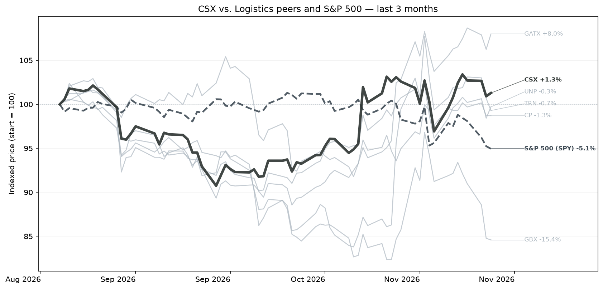

Operating in the Eastern United States, Class I railroad CSX generated revenue of nearly $14 billion in 2025. On its more than 21,000 miles of track, CSX hauls shipments of coal (16% of consolidated revenue), chemicals (17%), intermodal containers (16%), automotive cargo (7%), and a diverse mix of other bulk and industrial merchandise.

<h3 id="company-cp">Canadian Pacific Kansas City (CP)</h3>

*Logistics · $81.1B · 3m -1.3% · 12m +34.5% · 24m +26.3%*

[Google Finance](https://www.google.com/finance/quote/CP:NYSE?tab=earnings&hl=en)

North-south railroad for Midwest corn and ethanol to the Gulf and Mexico.

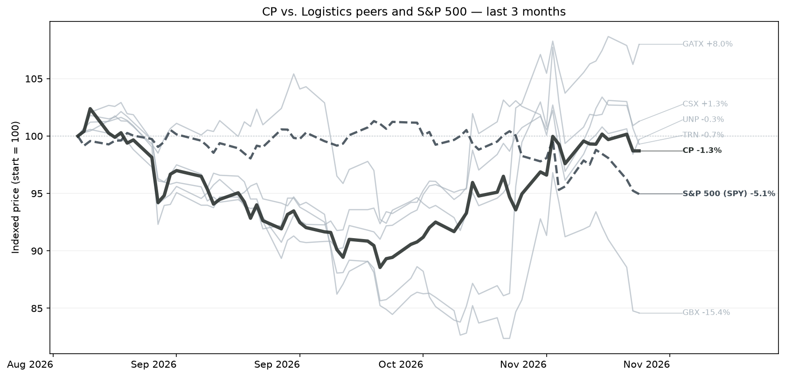

Canadian Pacific Kansas City is a Class I railroad operating on tracks that span most of Canada and into parts of the Midwestern and Northeastern United States. Following the April 2023 Kansas City Southern merger, CPKC operates new single-linehaul services from Canada and the Upper Midwest down through Texas, the Gulf of Mexico, and into Mexico. It also hauls cross-border and intra-Mexico freight via operating concessions on more than 3,000 miles of rail in Mexico. CPKC hauls shipments of grain, intermodal containers, energy products (like crude and frac sand), chemicals, plastics, coal, fertilizer and potash, automotive products, and a diverse mix of other merchandise.

<h3 id="company-gatx">GATX (GATX)</h3>

*Logistics · $6.6B · 3m +8.0% · 12m +24.8% · 24m +24.8%*

[Google Finance](https://www.google.com/finance/quote/GATX:NYSE?tab=earnings&hl=en)

Largest public railcar lessor of ethanol tank cars and grain/DDGS hoppers.

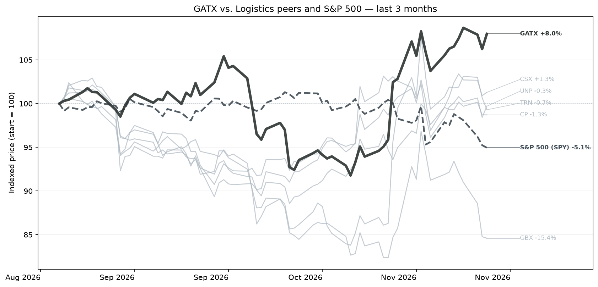

GATX Corp leases transportation assets, including railcars, aircraft spare engines, and tank containers, to customers in North America, Europe, and India. The company's reportable business segments are: Rail North America, Rail International, Engine Leasing, and Other. The majority of its revenue is generated from the Rail North America segment, which is composed of the company's operations in the United States, Canada, and Mexico. This segment mainly provides railcars pursuant to full-service leases under which it maintains the railcars, pays ad valorem taxes and insurance, and provides other ancillary services.

<h3 id="company-trn">Trinity Industries (TRN)</h3>

*Logistics · $2.3B · 3m -0.7% · 12m +16.7% · 24m -22.6%*

[Google Finance](https://www.google.com/finance/quote/TRN:NYSE?tab=earnings&hl=en)

Builds and leases covered hoppers and tank cars used for grain, DDGS, and ethanol.

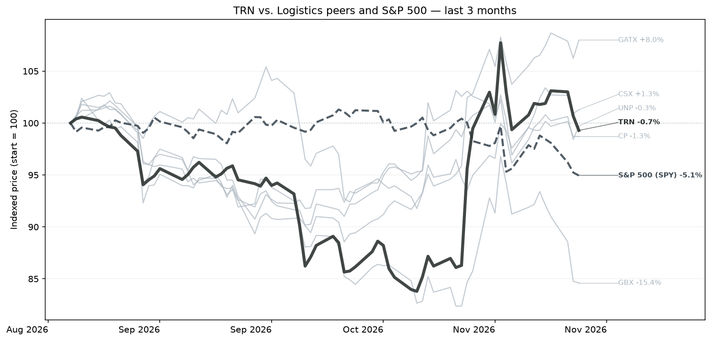

Trinity Industries Inc sells and leases railroad products and railcar maintenance services in North America. The company operates under the name TrinityRail in two main segments: railcar leasing and management services, which owns railcars and provides fleet management and administration services; rail products, which builds, sells, and modifies freight and tank railcars and their components; and all other, which sells highway products such as guardrail and other highway barriers. Customers include railroads, leasing companies, and shipping companies in agriculture, construction, consumer products, energy, and chemicals.

<h3 id="company-gbx">Greenbrier (GBX)</h3>

*Logistics · $1.2B · 3m -15.4% · 12m -8.4% · 24m -40.4%*

[Google Finance](https://www.google.com/finance/quote/GBX:NYSE?tab=earnings&hl=en)

Builds tank cars used for ethanol, renewable fuels, and CO2.

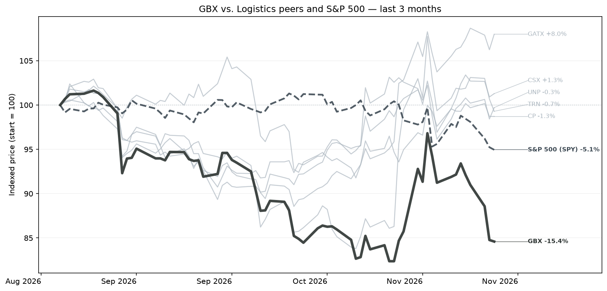

Greenbrier Companies Inc is a supplier of equipment and services to freight transportation markets. The company operates through the Manufacturing and Leasing & Fleet Management segments. The Manufacturing segment designs, builds, and markets freight railcars in North America and Europe, provides freight railcar wheel services, component parts, maintenance, and sustainable conversion services in North America, places railcars on lease to customers, and sells railcars with leases attached to investors. The Leasing & Fleet Management segment provides railcar leasing, railcar management, and regulatory compliance services to railroads and other railcar owners in North America. The company operates in North America, Europe, and Brazil and generates maximum revenue from the United States.

