# Weekly Corn and Ethanol Intel Report

<strong>Week of November 26, 2026</strong>Market data through: November 25, 2026Narrative created: November 27, 2026Nearby corn: $4.397/bu (+$0.007 (+0.2%) week)

Weekly review of corn, ethanol, energy, co-product, policy, and related public-company performance for commodities risk managers at U.S. ethanol plants.

## Strategy Narrative

Nearby futures from Yahoo Finance. Nearby corn is the market&#x27;s current perception of yield and demand risk.

<table><thead><tr><th>Contract</th><th>Last</th><th>Week change</th><th>As of</th></tr></thead><tbody><tr><td>Nearby corn</td><td>$4.397/bu</td><td>+$0.007 (+0.2%)</td><td>November 25, 2026</td></tr><tr><td>RBOB gasoline</td><td>$2.442/gal</td><td>-0.053 (-2.1%)</td><td>November 25, 2026</td></tr><tr><td>Henry Hub</td><td>$3.269/MMBtu</td><td>+0.001 (+0.0%)</td><td>November 25, 2026</td></tr></tbody></table>

<nav class="strategy-narrative-links" aria-label="Strategy narrative sections">
<ul>
<li><a href="#strategy-executive-view-1-harvest-completion-preserved-usda-s-adequate-supply-regime">1. Harvest completion preserved USDA’s adequate-supply regime</a></li>
<li><a href="#strategy-executive-view-2-coastal-inventory-accumulation-confirms-that-ethanol-remains-long-downstream">2. Coastal inventory accumulation confirms that ethanol remains long downstream</a></li>
<li><a href="#strategy-executive-view-3-brazil-s-government-weakened-the-sustained-import-thesis">3. Brazil’s government weakened the sustained-import thesis</a></li>
<li><a href="#strategy-executive-view-4-lower-mississippi-restrictions-have-not-become-a-broad-freight-shock">4. Lower Mississippi restrictions have not become a broad freight shock</a></li>
</ul>
</nav>

<h3 id="executive-view">Executive View</h3>

- **USDA’s tighter-but-adequate November corn balance remains the procurement regime, and nearby futures registered no material change in supply risk.** The official framework remains a **179.6-bushel-per-acre yield, 15.893-billion-bushel crop and 1.758-billion-bushel 2026/27 carryout**. Nearby corn closed November 25 at **$4.397 per bushel, up $0.007, or 0.2%, from November 19**. Harvest reached **94% versus 96% normally**; persistent western and eastern delays may affect local basis and quality, but the nearly flat tape does not support a renewed national scarcity call. (USDA WAOB, [*World Agricultural Supply and Demand Estimates—November 2026*](https://esmis.nal.usda.gov/sites/default/release-files/796142/wasde1126.pdf), November 10; USDA NASS, [*Crop Progress*](https://esmis.nal.usda.gov/sites/default/release-files/796160/prog4726.pdf), November 23.) ([esmis.nal.usda.gov](https://esmis.nal.usda.gov/sites/default/release-files/796142/wasde1126.pdf?utm_source=openai))
- **Ethanol clearance weakened for a second consecutive week.** Production increased only **3,000 barrels per day to 1.129 million**, but inventories rose another **345,000 barrels to 25.253 million**, following the prior week’s 563,000-barrel build. EIA refiner and blender ethanol inputs declined **4,000 barrels per day to 890,000**, while estimated exports improved 7,000 barrels per day to 140,000. Stocks are now approximately **15% above the year-earlier level**. (EIA, [*Weekly Petroleum Status Report*](https://www.eia.gov/petroleum/supply/weekly/), November 25.) ([ir.eia.gov](https://ir.eia.gov/secure/wpsr/overview.pdf?Key-Pair-Id=K3G4O9EVKGEBPJ&Policy=eyJTdGF0ZW1lbnQiOlt7IlJlc291cmNlIjoiaHR0cHM6Ly9pci5laWEuZ292L3NlY3VyZS93cHNyLyoiLCJDb25kaXRpb24iOnsiRGF0ZUxlc3NUaGFuIjp7IkFXUzpFcG9jaFRpbWUiOjE3OTYyMjEyMDB9LCJEYXRlR3JlYXRlclRoYW4iOnsiQVdTOkVwb2NoVGltZSI6MTc5NTYyMDYwMH19fV19&Signature=LGRg0mIIc3S~EA1MDxyjW8Y5vhGeMvaBR~Wi13Wwa48j9L3UzhzuZ5kE-sk2ilLQDT6m-Wmx0T~LlelzS1AYuuf7pOL5MEFl~WIbqbpVrT-VEPYLDahhcUklB-u7i7mSDzu4BjjWeb4Roqg1JLaCGe4wXWA3yunRAsenH434-JubxLdBqtJSpxzFkva2hqYxwbDqbPFE1n7BXVaIzXvivGo4-Ni7fI3HdJh9KQA0lhJ6ezEJWpAGyXNHeZ4cCU2iO7fV-ibx7S2HztETIKIAipSG0pUsFbbMSNOqnr-WMoorSBaWCNn0CV7esmT6L1QYKFvOzvRUhFT5CiCya8RgLg))
- **Gasoline offered less support, even though the weakness reflects high refinery throughput more than a consumption collapse.** RBOB declined **$0.053 to $2.442 per gallon, down 2.1%**, while gasoline stocks increased approximately **1.8 million barrels to 217.7 million**. Refinery utilization surged to **97.5%**, and gasoline supplied eased 76,000 barrels per day to 8.714 million—nearly unchanged from the comparable 2025 week. ([ir.eia.gov](https://ir.eia.gov/secure/wpsr/overview.pdf?Key-Pair-Id=K3G4O9EVKGEBPJ&Policy=eyJTdGF0ZW1lbnQiOlt7IlJlc291cmNlIjoiaHR0cHM6Ly9pci5laWEuZ292L3NlY3VyZS93cHNyLyoiLCJDb25kaXRpb24iOnsiRGF0ZUxlc3NUaGFuIjp7IkFXUzpFcG9jaFRpbWUiOjE3OTYyMjEyMDB9LCJEYXRlR3JlYXRlclRoYW4iOnsiQVdTOkVwb2NoVGltZSI6MTc5NTYyMDYwMH19fV19&Signature=LGRg0mIIc3S~EA1MDxyjW8Y5vhGeMvaBR~Wi13Wwa48j9L3UzhzuZ5kE-sk2ilLQDT6m-Wmx0T~LlelzS1AYuuf7pOL5MEFl~WIbqbpVrT-VEPYLDahhcUklB-u7i7mSDzu4BjjWeb4Roqg1JLaCGe4wXWA3yunRAsenH434-JubxLdBqtJSpxzFkva2hqYxwbDqbPFE1n7BXVaIzXvivGo4-Ni7fI3HdJh9KQA0lhJ6ezEJWpAGyXNHeZ4cCU2iO7fV-ibx7S2HztETIKIAipSG0pUsFbbMSNOqnr-WMoorSBaWCNn0CV7esmT6L1QYKFvOzvRUhFT5CiCya8RgLg))
- **Brazil became a less dependable source of incremental ethanol clearance.** Brazil’s Ministry of Mines and Energy said November 26 that available stocks, projected production and possible imports were sufficient to meet E32 anhydrous demand through the intercrop period. That does not cancel contracted U.S.-linked cargoes, but it weakens the case for a sustained shortage-driven import program. ([gov.br](https://www.gov.br/mme/pt-br/assuntos/noticias/novembro-26/mme-reforca-que-nao-ha-risco-de-desabastecimento-de-etanol-anidro-durante-a-entressafra))
- **Process-energy risk was broadly unchanged.** Henry Hub finished at **$3.269 per MMBtu, essentially flat for the week**. Lower-48 storage posted its first seasonal withdrawal, falling 24 Bcf to **3,858 Bcf**, but remained 80 Bcf, or 2.1%, above the five-year average; Midwest inventories were also 2.0% above average. (EIA, [*Weekly Natural Gas Storage Report*](https://ir.eia.gov/ngs/ngs.html), November 25.) ([ir.eia.gov](https://ir.eia.gov/secure/ngs/ngs.html?Key-Pair-Id=K3LA5VTSIIJNB8&Policy=eyJTdGF0ZW1lbnQiOlt7IlJlc291cmNlIjoiaHR0cHM6Ly9pci5laWEuZ292L3NlY3VyZS9uZ3MvKiIsIkNvbmRpdGlvbiI6eyJEYXRlTGVzc1RoYW4iOnsiQVdTOkVwb2NoVGltZSI6MTc5NjMwNzYwMH0sIkRhdGVHcmVhdGVyVGhhbiI6eyJBV1M6RXBvY2hUaW1lIjoxNzk1NjI2MDAwfX19XX0&Signature=Me~YKC-nd2NipNwpQ-iyLG2LWwDzIGrVSxtNuEOjH~95fnG4nNbuqe3x-sdEX1NflNAJBtQBIjKlQciTgsMl-tyN85~yrK9Y~Sf8hJM6NznsNWKhTvjO440w2RDiJ~AOhPBosBUXn1P9xTZ2Eb-RfFqd~rJmS1plltOv5t0vM5SG6rXpybp0a3BXWGzjHLruA6pYIpBfbAbYKSp7JLC0emOBln2coFHdzCzTm-cj886LoSa31kemzcupFyww61-yiHi7A9-fuvJsZsA6krTfsbAUCCzAJVif2UWQPP~Hw677vU2CtKZY-jfeBLKNsLcWqJ5OKX5~vpOIsgUiquwUQQ&utm_source=openai))
- **Overall plant-margin and risk conditions deteriorated modestly.** Corn and natural gas were essentially unchanged, while ethanol and gasoline inventories increased and RBOB weakened. Ethanol selling, storage and export execution remain more consequential than extending corn coverage.

| Exposure | Current signal | Change from last week | Horizon | Confidence | Main driver |
|---|---|---:|---|---|---|
| Corn procurement | Adequate national supply; localized harvest risk | Broadly unchanged | Winter–Q2 2027 | High | Corn +0.2%; 1.758-billion-bushel carryout |
| Ethanol selling | Two consecutive inventory builds | Deteriorated materially | 1–6 weeks | High | Stocks +908,000 barrels in two weeks |
| Petroleum linkage | High refinery output; weaker futures umbrella | Deteriorated | Days–months | High | RBOB −2.1%; gasoline stocks +1.8 million barrels |
| Export demand | Brazil remains optional, not dependable | Deteriorated selectively | 1–4 months | Medium | Brazilian government sees adequate supply |
| Natural gas | First withdrawal; storage still comfortable | Broadly unchanged | Winter | High | Henry Hub flat; storage 2.1% above average |
| Overall plant margin | Output weakness dominates stable inputs | Deteriorated modestly | Near term | High | Ethanol and gasoline stock builds |

The week extended rather than changed the **adequate-corn, long-product regime**. The important delta is that ethanol stocks continued rising despite stable production and better estimated exports. Existing 45Z margin dispersion, regenerative-ag feedstock documentation and EPA’s proposed SRE reallocation remain strategically important but received no new operative action this week.

<h3 id="strategy-executive-view-1-harvest-completion-preserved-usda-s-adequate-supply-regime">1. Harvest completion preserved USDA’s adequate-supply regime</h3>

**What happened**

National corn harvest advanced from 88% to **94%**, two points behind normal. Iowa reached 92% versus 98% normally, Nebraska 91% versus 96%, South Dakota 87% versus 96% and Ohio 85% versus 92%. Corn export inspections improved to **1.191 million metric tons** for the week ended November 19, but marketing-year inspections of 13.66 million tons remained 22% below last year’s exceptional pace. ([esmis.nal.usda.gov](https://esmis.nal.usda.gov/sites/default/release-files/796160/prog4726.pdf?utm_source=openai))

**Why it matters**

The remaining unharvested acreage is increasingly a local basis, moisture and quality exposure rather than a credible mechanism for materially reducing national production. Favorable rainfall for planting and establishment in Brazil and Argentina also provided no immediate international weather threat sufficient to challenge the U.S. supply cushion. (USDA WAOB, [*Weekly Weather and Crop Bulletin*](https://esmis.nal.usda.gov/sites/default/release-files/796163/wwcb4726.pdf), November 24.) ([esmis.nal.usda.gov](https://esmis.nal.usda.gov/sites/default/release-files/796163/wwcb4726.pdf?utm_source=openai))

**Risk-manager implication**

Futures procurement risk is broadly unchanged. Plants in late-harvest areas should retain flexibility around cash basis and delivery timing, but the flat nearby-corn tape argues against paying a national scarcity premium.

---

<h3 id="strategy-executive-view-2-coastal-inventory-accumulation-confirms-that-ethanol-remains-long-downstream">2. Coastal inventory accumulation confirms that ethanol remains long downstream</h3>

| EIA ethanol balance | Week ended Nov. 13 | Week ended Nov. 20 | Change |
|---|---:|---:|---:|
| Production, million bpd | 1.126 | 1.129 | +0.003 |
| Inventories, million bbl | 24.908 | 25.253 | +0.345 |
| Refiner/blender inputs, million bpd | 0.894 | 0.890 | −0.004 |
| Estimated exports, million bpd | 0.133 | 0.140 | +0.007 |

(EIA, [*Weekly Petroleum Status Report*](https://www.eia.gov/petroleum/supply/weekly/), released November 25.) ([ir.eia.gov](https://ir.eia.gov/secure/wpsr/overview.pdf?Key-Pair-Id=K3G4O9EVKGEBPJ&Policy=eyJTdGF0ZW1lbnQiOlt7IlJlc291cmNlIjoiaHR0cHM6Ly9pci5laWEuZ292L3NlY3VyZS93cHNyLyoiLCJDb25kaXRpb24iOnsiRGF0ZUxlc3NUaGFuIjp7IkFXUzpFcG9jaFRpbWUiOjE3OTYyMjEyMDB9LCJEYXRlR3JlYXRlclRoYW4iOnsiQVdTOkVwb2NoVGltZSI6MTc5NTYyMDYwMH19fV19&Signature=LGRg0mIIc3S~EA1MDxyjW8Y5vhGeMvaBR~Wi13Wwa48j9L3UzhzuZ5kE-sk2ilLQDT6m-Wmx0T~LlelzS1AYuuf7pOL5MEFl~WIbqbpVrT-VEPYLDahhcUklB-u7i7mSDzu4BjjWeb4Roqg1JLaCGe4wXWA3yunRAsenH434-JubxLdBqtJSpxzFkva2hqYxwbDqbPFE1n7BXVaIzXvivGo4-Ni7fI3HdJh9KQA0lhJ6ezEJWpAGyXNHeZ4cCU2iO7fV-ibx7S2HztETIKIAipSG0pUsFbbMSNOqnr-WMoorSBaWCNn0CV7esmT6L1QYKFvOzvRUhFT5CiCya8RgLg))

The build was concentrated downstream: Gulf Coast stocks increased **483,000 barrels** and West Coast stocks rose **392,000**, while Midwest inventories declined 421,000. Barrels moved away from the production region, but terminal and destination markets did not clear them. Meanwhile, gasoline inventories increased as refineries operated at 97.5% utilization.

**Risk-manager implication**

Prompt ethanol price, basis and storage exposure deteriorated materially. Higher estimated exports were insufficient to prevent a second build, and weaker RBOB reduces the price umbrella available to absorb excess supply. Unless production declines or exports accelerate further, low corn costs risk being transferred to ethanol buyers through high utilization.

**Watch next**

Whether total ethanol stocks exceed 25.5 million barrels and whether coastal inventories begin drawing.

---

<h3 id="strategy-executive-view-3-brazil-s-government-weakened-the-sustained-import-thesis">3. Brazil’s government weakened the sustained-import thesis</h3>

**What happened**

Brazil’s energy ministry concluded that domestic stocks, production and possible imports should cover E32 anhydrous demand through the cane intercrop, explicitly stating that it identified no supply-shortage risk. The assessment gives growing year-round corn-ethanol output a role in supporting domestic availability. ([gov.br](https://www.gov.br/mme/pt-br/assuntos/noticias/novembro-26/mme-reforca-que-nao-ha-risco-de-desabastecimento-de-etanol-anidro-durante-a-entressafra))

Separately, USTR proposed increasing tariffs on certain Brazilian sugar imports on November 25. The proposal is not yet effective, but it adds trade-policy uncertainty to a market already viewed as an opportunistic rather than consistently open U.S. ethanol outlet. (USTR, [*Proposed Modifications of the Section 301 Action Regarding Brazil*](https://www.ustr.gov/about/policy-offices/press-office/press-releases/2026/november/ustr-invites-public-comment-proposed-modifications-section-301-action-regarding-brazils-unreasonable), November 25.) ([ustr.gov](https://www.ustr.gov/about/policy-offices/press-office/press-releases/2026/november/ustr-invites-public-comment-proposed-modifications-section-301-action-regarding-brazils-unreasonable?utm_source=openai))

**Risk-manager implication**

Contracted Brazil cargoes remain supportive, but plants should not build utilization or forward-sales assumptions around recurring emergency imports. The next confirming evidence must be actual vessel arrivals, customs volumes and sustained import parity—not statements of buyer interest.

---

<h3 id="strategy-executive-view-4-lower-mississippi-restrictions-have-not-become-a-broad-freight-shock">4. Lower Mississippi restrictions have not become a broad freight shock</h3>

**What happened**

The Coast Guard’s New Orleans safety zone remains authorized through December 11, but USDA’s November 26 transportation data showed no broad escalation: the grain barge-cost index edged down to **194 from 195**, Gulf ocean freight was unchanged and Illinois River barge rates declined 1% week over week. Grain-barge traffic and unloading continued through the New Orleans region. (USDA AMS, [*Grain Transportation Report*](https://www.ams.usda.gov/sites/default/files/media/GTR11262026.pdf), November 26.) ([ams.usda.gov](https://www.ams.usda.gov/sites/default/files/media/GTR11262026.pdf))

**Risk-manager implication**

Maintain scheduling buffers for large tows and deep-draft vessels, but current evidence does not justify treating the restriction as a systemwide corn-basis or ethanol-export disruption. The risk remains shipment-specific rather than industry-wide.

<h3 id="strategic-synthesis">Strategic Synthesis</h3>

Corn costs are stable and process-energy availability remains comfortable, but the output side continues to deteriorate. Two weeks of ethanol builds, rising coastal stocks and a weaker gasoline complex indicate that downstream clearance—not feedstock access—is the binding near-term constraint. Brazil offers selective export value, not a durable solution. Entering next week, the priority is **protecting ethanol realizations and storage capacity while avoiding utilization decisions that assume exports will absorb every incremental gallon**.

<h3 id="what-i-m-watching-next">What I’m Watching Next</h3>

- **December 10, 2026, 11:00 a.m. CST:** USDA WASDE and Crop Production—the next test of the 179.6-bushel yield and 1.758-billion-bushel carryout. ([nass.usda.gov](https://www.nass.usda.gov/Publications/Calendar/reports_by_date.php?month=12&view=l&year=2026&utm_source=openai))
- **December 4, 2026:** EPA comment deadline on additional 2025 SRE reallocation between the 2026 and 2027 compliance years. ([epa.gov](https://www.epa.gov/newsreleases/while-iowa-administrator-zeldin-proposes-100-reallocation-additional-2025-small?utm_source=openai))
- **December 2, 2026, 9:30 a.m. CST:** EIA ethanol and petroleum balance—whether the two-week inventory build continues. ([eia.gov](https://www.eia.gov/petroleum/supply/weekly/schedule.php?utm_source=openai))
- **December 3, 2026:** REX American Resources fiscal third-quarter results and EIA natural-gas storage, providing tests of representative commodity crush and early-winter process costs. ([rexamerican.gcs-web.com](https://rexamerican.gcs-web.com/node/13216/pdf?utm_source=openai))

<h3 id="bottom-line">Bottom Line</h3>

The most consequential weekly change was the **second consecutive ethanol inventory build**, now totaling 908,000 barrels, while RBOB weakened and gasoline stocks increased. Corn procurement risk remains manageable, but ethanol selling, storage and utilization require the closest attention. The December 2 EIA balance is the next print most capable of changing the near-term margin view.

## Notable Changes

Comparison with the final report dated November 19, 2026 (market data through November 18, 2026).

### Sectors

#### Top-three comparison

<table class="sortable"><thead><tr><th class="sortable-heading" data-column="0" data-type="text">Entity</th><th class="sortable-heading" data-column="1" data-type="number">Previous</th><th class="sortable-heading" data-column="2" data-type="number">Current</th><th class="sortable-heading" data-column="3" data-type="number">Change</th><th class="sortable-heading" data-column="4" data-type="number">Current return</th></tr></thead><tbody><tr><td class="text" data-sort="fuel blending, refining, and retail" style=""><a href="#category-fuel-blending-refining-and-retail">Fuel blending, refining, and retail</a></td><td class="" data-sort="1" style="">#1</td><td class="" data-sort="1" style="">#1</td><td class="" data-sort="0" style="">— 0</td><td class="" data-sort="0.729664116322988" style="background:#1a7a3c;color:#ffffff;">+73.0%</td></tr><tr><td class="text" data-sort="u.s. ethanol and process technology" style=""><a href="#category-u-s-ethanol-and-process-technology">U.S. ethanol and process technology</a></td><td class="" data-sort="2" style="">#2</td><td class="" data-sort="2" style="">#2</td><td class="" data-sort="0" style="">— 0</td><td class="" data-sort="0.6428977901847442" style="background:#1a7a3c;color:#ffffff;">+64.3%</td></tr><tr><td class="text" data-sort="advanced biofuels and saf" style=""><a href="#category-advanced-biofuels-and-saf">Advanced biofuels and SAF</a></td><td class="" data-sort="4" style="">#4</td><td class="" data-sort="3" style="">#3</td><td class="rank-change-up" data-sort="-1" style="">↑ 1</td><td class="" data-sort="0.41094241187880404" style="background:#7cc077;color:#111820;">+41.1%</td></tr><tr><td class="text" data-sort="logistics" style=""><a href="#category-logistics">Logistics</a></td><td class="" data-sort="3" style="">#3</td><td class="" data-sort="4" style="">#4</td><td class="rank-change-down" data-sort="1" style="">↓ 1</td><td class="" data-sort="0.32899737384708555" style="background:#7cc077;color:#111820;">+32.9%</td></tr></tbody></table>

### Stocks

#### Top-three comparison

<table class="sortable"><thead><tr><th class="sortable-heading" data-column="0" data-type="text">Entity</th><th class="sortable-heading" data-column="1" data-type="number">Previous</th><th class="sortable-heading" data-column="2" data-type="number">Current</th><th class="sortable-heading" data-column="3" data-type="number">Change</th><th class="sortable-heading" data-column="4" data-type="number">Current return</th></tr></thead><tbody><tr><td class="text" data-sort="valero energy" style="">Valero Energy (<a href="#company-vlo">VLO</a>)</td><td class="" data-sort="2" style="">#2</td><td class="" data-sort="1" style="">#1</td><td class="rank-change-up" data-sort="-1" style="">↑ 1</td><td class="" data-sort="0.851321144036224" style="background:#1a7a3c;color:#ffffff;">+85.1%</td></tr><tr><td class="text" data-sort="marathon petroleum" style="">Marathon Petroleum (<a href="#company-mpc">MPC</a>)</td><td class="" data-sort="1" style="">#1</td><td class="" data-sort="2" style="">#2</td><td class="rank-change-down" data-sort="1" style="">↓ 1</td><td class="" data-sort="0.805935120475644" style="background:#1a7a3c;color:#ffffff;">+80.6%</td></tr><tr><td class="text" data-sort="neste" style="">Neste (<a href="#company-ntoiy">NTOIY</a>)</td><td class="" data-sort="5" style="">#5</td><td class="" data-sort="3" style="">#3</td><td class="rank-change-up" data-sort="-2" style="">↑ 2</td><td class="" data-sort="0.7811518324607329" style="background:#1a7a3c;color:#ffffff;">+78.1%</td></tr><tr><td class="text" data-sort="phillips 66" style="">Phillips 66 (<a href="#company-psx">PSX</a>)</td><td class="" data-sort="3" style="">#3</td><td class="" data-sort="4" style="">#4</td><td class="rank-change-down" data-sort="1" style="">↓ 1</td><td class="" data-sort="0.7492590397154713" style="background:#1a7a3c;color:#ffffff;">+74.9%</td></tr></tbody></table>

#### Largest rank changes

<table class="sortable"><thead><tr><th class="sortable-heading" data-column="0" data-type="text">Entity</th><th class="sortable-heading" data-column="1" data-type="number">Previous</th><th class="sortable-heading" data-column="2" data-type="number">Current</th><th class="sortable-heading" data-column="3" data-type="number">Change</th><th class="sortable-heading" data-column="4" data-type="number">Current return</th></tr></thead><tbody><tr><td class="text" data-sort="darling ingredients" style="">Darling Ingredients (<a href="#company-dar">DAR</a>)</td><td class="" data-sort="7" style="">#7</td><td class="" data-sort="12" style="">#12</td><td class="rank-change-down" data-sort="5" style="">↓ 5</td><td class="" data-sort="0.32896174863387984" style="background:#1a7a3c;color:#ffffff;">+32.9%</td></tr><tr><td class="text" data-sort="cnh industrial" style="">CNH Industrial (<a href="#company-cnh">CNH</a>)</td><td class="" data-sort="21" style="">#21</td><td class="" data-sort="15" style="">#15</td><td class="rank-change-up" data-sort="-6" style="">↑ 6</td><td class="" data-sort="0.2638297872340425" style="background:#1a7a3c;color:#ffffff;">+26.4%</td></tr><tr><td class="text" data-sort="tyson foods" style="">Tyson Foods (<a href="#company-tsn">TSN</a>)</td><td class="" data-sort="18" style="">#18</td><td class="" data-sort="24" style="">#24</td><td class="rank-change-down" data-sort="6" style="">↓ 6</td><td class="" data-sort="0.09687446036953906" style="background:#a9d9a4;color:#111820;">+9.7%</td></tr></tbody></table>

### Subcategory movement since the previous report

<table class="sortable"><thead><tr><th class="sortable-heading" data-column="0" data-type="text">Subcategory</th><th class="sortable-heading" data-column="1" data-type="number">Move</th><th class="sortable-heading" data-column="2" data-type="number">Last Report, 12m Ret</th><th class="sortable-heading" data-column="3" data-type="number">Current Report, 12m Ret</th></tr></thead><tbody><tr><td class="text" data-sort="advanced biofuels and saf" style=""><a href="#category-advanced-biofuels-and-saf">Advanced biofuels and SAF</a></td><td class="" data-sort="0.024625995725665373" style="background:#7cc077;color:#111820;">+2.5%</td><td class="" data-sort="0.357152274225" style="background:#7cc077;color:#111820;">+35.7%</td><td class="" data-sort="0.41094241187880404" style="background:#7cc077;color:#111820;">+41.1%</td></tr><tr><td class="text" data-sort="crop inputs, equipment, and irrigation" style=""><a href="#category-crop-inputs-equipment-and-irrigation">Crop inputs, equipment, and irrigation</a></td><td class="" data-sort="0.004370365914555911" style="background:#d6ecd4;color:#111820;">+0.4%</td><td class="" data-sort="0.273694764186" style="background:#a9d9a4;color:#111820;">+27.4%</td><td class="" data-sort="0.2839663222486192" style="background:#a9d9a4;color:#111820;">+28.4%</td></tr><tr><td class="text" data-sort="international ethanol" style=""><a href="#category-international-ethanol">International ethanol</a></td><td class="" data-sort="-0.003915502122385678" style="background:#fbd5d4;color:#111820;">-0.4%</td><td class="" data-sort="-0.266379772513" style="background:#f5aead;color:#111820;">-26.6%</td><td class="" data-sort="-0.30242015783445375" style="background:#ee8483;color:#111820;">-30.2%</td></tr><tr><td class="text" data-sort="logistics" style=""><a href="#category-logistics">Logistics</a></td><td class="" data-sort="-0.0052715863873976495" style="background:#fbd5d4;color:#111820;">-0.5%</td><td class="" data-sort="0.391446400052" style="background:#7cc077;color:#111820;">+39.1%</td><td class="" data-sort="0.32899737384708555" style="background:#7cc077;color:#111820;">+32.9%</td></tr><tr><td class="text" data-sort="wet milling, ingredients, and co-products" style=""><a href="#category-wet-milling-ingredients-and-co-products">Wet milling, ingredients, and co-products</a></td><td class="" data-sort="-0.012072462059671725" style="background:#f5aead;color:#111820;">-1.2%</td><td class="" data-sort="0.145010744232" style="background:#d6ecd4;color:#111820;">+14.5%</td><td class="" data-sort="0.062084845623931524" style="background:#d6ecd4;color:#111820;">+6.2%</td></tr><tr><td class="text" data-sort="grain origination and agribusiness" style=""><a href="#category-grain-origination-and-agribusiness">Grain origination and agribusiness</a></td><td class="" data-sort="-0.03218600776648288" style="background:#e34948;color:#111820;">-3.2%</td><td class="" data-sort="0.101153398016" style="background:#d6ecd4;color:#111820;">+10.1%</td><td class="" data-sort="0.02778510715401755" style="background:#d6ecd4;color:#111820;">+2.8%</td></tr><tr><td class="text" data-sort="u.s. ethanol and process technology" style=""><a href="#category-u-s-ethanol-and-process-technology">U.S. ethanol and process technology</a></td><td class="" data-sort="-0.05002455926150835" style="background:#c0302f;color:#ffffff;">-5.0%</td><td class="" data-sort="0.700939714931" style="background:#1a7a3c;color:#ffffff;">+70.1%</td><td class="" data-sort="0.6428977901847442" style="background:#1a7a3c;color:#ffffff;">+64.3%</td></tr><tr><td class="text" data-sort="fuel blending, refining, and retail" style=""><a href="#category-fuel-blending-refining-and-retail">Fuel blending, refining, and retail</a></td><td class="" data-sort="-0.05161255625092536" style="background:#c0302f;color:#ffffff;">-5.2%</td><td class="" data-sort="0.800602678128" style="background:#1a7a3c;color:#ffffff;">+80.1%</td><td class="" data-sort="0.729664116322988" style="background:#1a7a3c;color:#ffffff;">+73.0%</td></tr></tbody></table>

### Largest company moves

<table class="sortable"><thead><tr><th class="sortable-heading" data-column="0" data-type="text">Direction</th><th class="sortable-heading" data-column="1" data-type="text">Company</th><th class="sortable-heading" data-column="2" data-type="text">Ticker</th><th class="sortable-heading" data-column="3" data-type="number">Move</th></tr></thead><tbody><tr><td class="text" data-sort="0" style="">Gain</td><td class="text" data-sort="cnh industrial" style="">CNH Industrial</td><td class="text text" data-sort="cnh" style=""><a href="#company-cnh">CNH</a></td><td class="" data-sort="0.05693950177935947" style="background:#7cc077;color:#111820;">+5.7%</td></tr><tr><td class="text" data-sort="0" style="">Gain</td><td class="text" data-sort="cf industries" style="">CF Industries</td><td class="text text" data-sort="cf" style=""><a href="#company-cf">CF</a></td><td class="" data-sort="0.033421284080914715" style="background:#a9d9a4;color:#111820;">+3.3%</td></tr><tr><td class="text" data-sort="0" style="">Gain</td><td class="text" data-sort="trinity industries" style="">Trinity Industries</td><td class="text text" data-sort="trn" style=""><a href="#company-trn">TRN</a></td><td class="" data-sort="0.02652159129547771" style="background:#a9d9a4;color:#111820;">+2.7%</td></tr><tr><td class="text" data-sort="1" style="">Decline</td><td class="text" data-sort="the andersons" style="">The Andersons</td><td class="text text" data-sort="ande" style=""><a href="#company-ande">ANDE</a></td><td class="" data-sort="-0.10292569985266264" style="background:#c0302f;color:#ffffff;">-10.3%</td></tr><tr><td class="text" data-sort="1" style="">Decline</td><td class="text" data-sort="cvr energy" style="">CVR Energy</td><td class="text text" data-sort="cvi" style=""><a href="#company-cvi">CVI</a></td><td class="" data-sort="-0.09863744075829384" style="background:#c0302f;color:#ffffff;">-9.9%</td></tr><tr><td class="text" data-sort="1" style="">Decline</td><td class="text" data-sort="green plains" style="">Green Plains</td><td class="text text" data-sort="gpre" style=""><a href="#company-gpre">GPRE</a></td><td class="" data-sort="-0.07659208261617889" style="background:#e34948;color:#111820;">-7.7%</td></tr></tbody></table>

## Subcategory Performance

<table class="sortable"><thead><tr><th class="sortable-heading" data-column="0" data-type="text">Subcategory</th><th class="sortable-heading" data-column="1" data-type="number">Companies</th><th class="sortable-heading" data-column="2" data-type="number">Market cap</th><th class="sortable-heading" data-column="3" data-type="number">3m Return</th><th class="sortable-heading" data-column="4" data-type="number">12m Return</th><th class="sortable-heading" data-column="5" data-type="number">24m Return</th></tr></thead><tbody><tr><td class="text" data-sort="crop inputs, equipment, and irrigation" style=""><a href="#category-crop-inputs-equipment-and-irrigation">Crop inputs, equipment, and irrigation</a></td><td class="" data-sort="11" style="">11</td><td class="" data-sort="266896616444.65" style="">$266.9B</td><td class="" data-sort="-0.03424006099606307" style="background:#fbd5d4;color:#111820;">-3.4%</td><td class="" data-sort="0.2839663222486192" style="background:#a9d9a4;color:#111820;">+28.4%</td><td class="" data-sort="0.3101615466024214" style="background:#a9d9a4;color:#111820;">+31.0%</td></tr><tr><td class="text" data-sort="grain origination and agribusiness" style=""><a href="#category-grain-origination-and-agribusiness">Grain origination and agribusiness</a></td><td class="" data-sort="3" style="">3</td><td class="" data-sort="51762989197.590004" style="">$51.8B</td><td class="" data-sort="-0.19187934411232554" style="background:#c0302f;color:#ffffff;">-19.2%</td><td class="" data-sort="0.02778510715401755" style="background:#d6ecd4;color:#111820;">+2.8%</td><td class="" data-sort="0.14092588039834753" style="background:#d6ecd4;color:#111820;">+14.1%</td></tr><tr><td class="text" data-sort="u.s. ethanol and process technology" style=""><a href="#category-u-s-ethanol-and-process-technology">U.S. ethanol and process technology</a></td><td class="" data-sort="6" style="">6</td><td class="" data-sort="131704694353.19" style="">$131.7B</td><td class="" data-sort="-0.10120476035678709" style="background:#ee8483;color:#111820;">-10.1%</td><td class="" data-sort="0.6428977901847442" style="background:#1a7a3c;color:#ffffff;">+64.3%</td><td class="" data-sort="1.0165244177931985" style="background:#1a7a3c;color:#ffffff;">+101.7%</td></tr><tr><td class="text" data-sort="wet milling, ingredients, and co-products" style=""><a href="#category-wet-milling-ingredients-and-co-products">Wet milling, ingredients, and co-products</a></td><td class="" data-sort="5" style="">5</td><td class="" data-sort="80925691919.43001" style="">$80.9B</td><td class="" data-sort="-0.08159107146539753" style="background:#ee8483;color:#111820;">-8.2%</td><td class="" data-sort="0.062084845623931524" style="background:#d6ecd4;color:#111820;">+6.2%</td><td class="" data-sort="0.1026266717824716" style="background:#d6ecd4;color:#111820;">+10.3%</td></tr><tr><td class="text" data-sort="fuel blending, refining, and retail" style=""><a href="#category-fuel-blending-refining-and-retail">Fuel blending, refining, and retail</a></td><td class="" data-sort="8" style="">8</td><td class="" data-sort="347384051048.79004" style="">$347.4B</td><td class="" data-sort="-0.05820392340395125" style="background:#f5aead;color:#111820;">-5.8%</td><td class="" data-sort="0.729664116322988" style="background:#1a7a3c;color:#ffffff;">+73.0%</td><td class="" data-sort="1.0209942276306276" style="background:#1a7a3c;color:#ffffff;">+102.1%</td></tr><tr><td class="text" data-sort="advanced biofuels and saf" style=""><a href="#category-advanced-biofuels-and-saf">Advanced biofuels and SAF</a></td><td class="" data-sort="2" style="">2</td><td class="" data-sort="401724108873.68" style="">$401.7B</td><td class="" data-sort="0.053643674142150655" style="background:#a9d9a4;color:#111820;">+5.4%</td><td class="" data-sort="0.41094241187880404" style="background:#7cc077;color:#111820;">+41.1%</td><td class="" data-sort="0.29791423121885185" style="background:#a9d9a4;color:#111820;">+29.8%</td></tr><tr><td class="text" data-sort="international ethanol" style=""><a href="#category-international-ethanol">International ethanol</a></td><td class="" data-sort="2" style="">2</td><td class="" data-sort="3684903276.5199995" style="">$3.7B</td><td class="" data-sort="-0.10359287940886105" style="background:#ee8483;color:#111820;">-10.4%</td><td class="" data-sort="-0.30242015783445375" style="background:#ee8483;color:#111820;">-30.2%</td><td class="" data-sort="-0.5173850864955212" style="background:#ee8483;color:#111820;">-51.7%</td></tr><tr><td class="text" data-sort="logistics" style=""><a href="#category-logistics">Logistics</a></td><td class="" data-sort="6" style="">6</td><td class="" data-sort="364623969225.87" style="">$364.6B</td><td class="" data-sort="-0.02553000620828069" style="background:#fbd5d4;color:#111820;">-2.6%</td><td class="" data-sort="0.32899737384708555" style="background:#7cc077;color:#111820;">+32.9%</td><td class="" data-sort="0.2636706943270273" style="background:#a9d9a4;color:#111820;">+26.4%</td></tr></tbody></table>

Subcategory returns use the most recently saved market capitalizations as weights.

## Stock Performance vs. SPY

The same selected stocks appear in every chart. Each line is labeled at the right with its ticker and return for the displayed window.
### Last 6 months

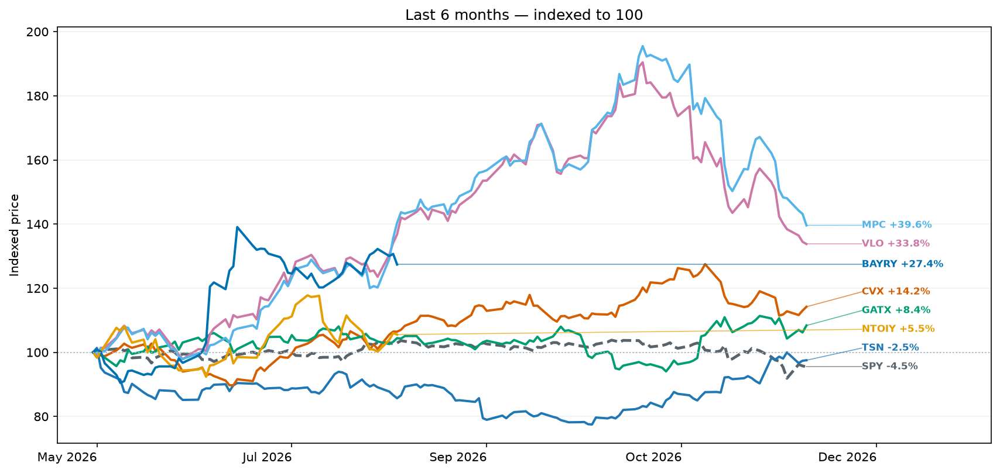

### Last 12 months

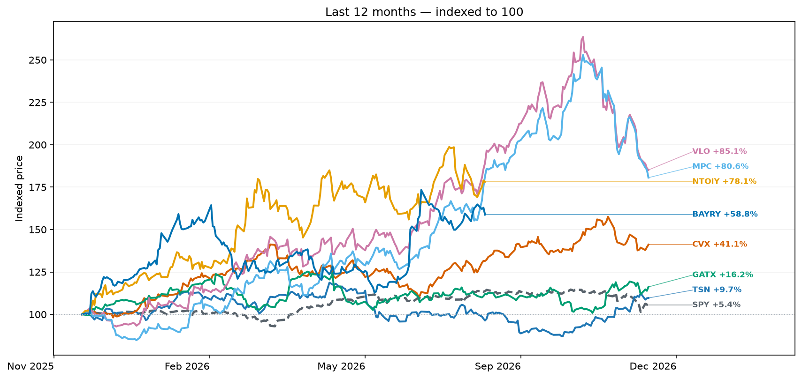

### Last 24 months

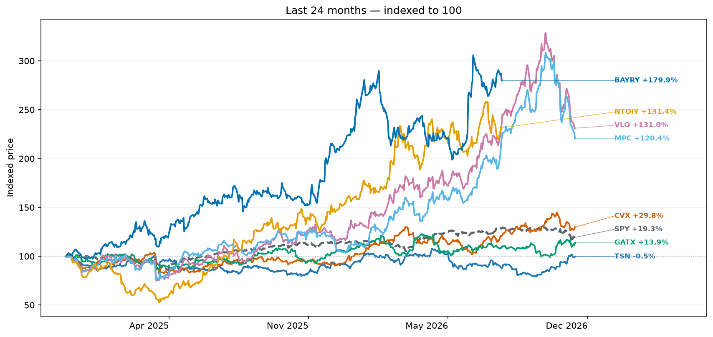

## Current Top Stocks

### Last 3 months

<table class="sortable"><thead><tr><th class="sortable-heading" data-column="0" data-type="number">Rank</th><th class="sortable-heading" data-column="1" data-type="text">Company</th><th class="sortable-heading" data-column="2" data-type="text">Ticker</th><th class="sortable-heading" data-column="3" data-type="number">Market cap</th><th class="sortable-heading" data-column="4" data-type="number">Return</th></tr></thead><tbody><tr><td class="" data-sort="1" style="">1</td><td class="text" data-sort="tyson foods" style="">Tyson Foods</td><td class="text text" data-sort="tsn" style=""><a href="#company-tsn">TSN</a></td><td class="" data-sort="22136063165.5" style="">$22.1B</td><td class="" data-sort="0.12325375773651648" style="background:#1a7a3c;color:#ffffff;">+12.3%</td></tr><tr><td class="" data-sort="2" style="">2</td><td class="text" data-sort="chevron" style="">Chevron</td><td class="text text" data-sort="cvx" style=""><a href="#company-cvx">CVX</a></td><td class="" data-sort="401724108873.68" style="">$401.7B</td><td class="" data-sort="0.053643674142150655" style="background:#7cc077;color:#111820;">+5.4%</td></tr><tr><td class="" data-sort="3" style="">3</td><td class="text" data-sort="gatx" style="">GATX</td><td class="text text" data-sort="gatx" style=""><a href="#company-gatx">GATX</a></td><td class="" data-sort="6638178543.89" style="">$6.6B</td><td class="" data-sort="0.04364390161913834" style="background:#a9d9a4;color:#111820;">+4.4%</td></tr><tr><td class="" data-sort="4" style="">4</td><td class="text" data-sort="trinity industries" style="">Trinity Industries</td><td class="text text" data-sort="trn" style=""><a href="#company-trn">TRN</a></td><td class="" data-sort="2299452671.62" style="">$2.3B</td><td class="" data-sort="0.023043036258895366" style="background:#d6ecd4;color:#111820;">+2.3%</td></tr><tr><td class="" data-sort="5" style="">5</td><td class="text" data-sort="cnh industrial" style="">CNH Industrial</td><td class="text text" data-sort="cnh" style=""><a href="#company-cnh">CNH</a></td><td class="" data-sort="18049714300.32" style="">$18.0B</td><td class="" data-sort="0.0223752151462997" style="background:#d6ecd4;color:#111820;">+2.2%</td></tr></tbody></table>

### Last 12 months

<table class="sortable"><thead><tr><th class="sortable-heading" data-column="0" data-type="number">Rank</th><th class="sortable-heading" data-column="1" data-type="text">Company</th><th class="sortable-heading" data-column="2" data-type="text">Ticker</th><th class="sortable-heading" data-column="3" data-type="number">Market cap</th><th class="sortable-heading" data-column="4" data-type="number">Return</th></tr></thead><tbody><tr><td class="" data-sort="1" style="">1</td><td class="text" data-sort="valero energy" style="">Valero Energy</td><td class="text text" data-sort="vlo" style=""><a href="#company-vlo">VLO</a></td><td class="" data-sort="95852568280.0" style="">$95.9B</td><td class="" data-sort="0.851321144036224" style="background:#1a7a3c;color:#ffffff;">+85.1%</td></tr><tr><td class="" data-sort="2" style="">2</td><td class="text" data-sort="marathon petroleum" style="">Marathon Petroleum</td><td class="text text" data-sort="mpc" style=""><a href="#company-mpc">MPC</a></td><td class="" data-sort="101795453200.8" style="">$101.8B</td><td class="" data-sort="0.805935120475644" style="background:#1a7a3c;color:#ffffff;">+80.6%</td></tr><tr><td class="" data-sort="3" style="">3</td><td class="text" data-sort="neste" style="">Neste</td><td class="text text" data-sort="ntoiy" style=""><a href="#company-ntoiy">NTOIY</a></td><td class="" data-sort="n/a" style="">n/a</td><td class="" data-sort="0.7811518324607329" style="background:#1a7a3c;color:#ffffff;">+78.1%</td></tr><tr><td class="" data-sort="4" style="">4</td><td class="text" data-sort="phillips 66" style="">Phillips 66</td><td class="text text" data-sort="psx" style=""><a href="#company-psx">PSX</a></td><td class="" data-sort="95501416388.46" style="">$95.5B</td><td class="" data-sort="0.7492590397154713" style="background:#1a7a3c;color:#ffffff;">+74.9%</td></tr><tr><td class="" data-sort="5" style="">5</td><td class="text" data-sort="hf sinclair" style="">HF Sinclair</td><td class="text text" data-sort="dino" style=""><a href="#company-dino">DINO</a></td><td class="" data-sort="15342738304.960001" style="">$15.3B</td><td class="" data-sort="0.6416539050535988" style="background:#2f9e44;color:#111820;">+64.2%</td></tr></tbody></table>

### Last 24 months

<table class="sortable"><thead><tr><th class="sortable-heading" data-column="0" data-type="number">Rank</th><th class="sortable-heading" data-column="1" data-type="text">Company</th><th class="sortable-heading" data-column="2" data-type="text">Ticker</th><th class="sortable-heading" data-column="3" data-type="number">Market cap</th><th class="sortable-heading" data-column="4" data-type="number">Return</th></tr></thead><tbody><tr><td class="" data-sort="1" style="">1</td><td class="text" data-sort="bayer" style="">Bayer</td><td class="text text" data-sort="bayry" style=""><a href="#company-bayry">BAYRY</a></td><td class="" data-sort="n/a" style="">n/a</td><td class="" data-sort="1.7987927565392354" style="background:#1a7a3c;color:#ffffff;">+179.9%</td></tr><tr><td class="" data-sort="2" style="">2</td><td class="text" data-sort="neste" style="">Neste</td><td class="text text" data-sort="ntoiy" style=""><a href="#company-ntoiy">NTOIY</a></td><td class="" data-sort="n/a" style="">n/a</td><td class="" data-sort="1.3142857142857145" style="background:#2f9e44;color:#111820;">+131.4%</td></tr><tr><td class="" data-sort="3" style="">3</td><td class="text" data-sort="valero energy" style="">Valero Energy</td><td class="text text" data-sort="vlo" style=""><a href="#company-vlo">VLO</a></td><td class="" data-sort="95852568280.0" style="">$95.9B</td><td class="" data-sort="1.3104434907010014" style="background:#2f9e44;color:#111820;">+131.0%</td></tr><tr><td class="" data-sort="4" style="">4</td><td class="text" data-sort="marathon petroleum" style="">Marathon Petroleum</td><td class="text text" data-sort="mpc" style=""><a href="#company-mpc">MPC</a></td><td class="" data-sort="101795453200.8" style="">$101.8B</td><td class="" data-sort="1.2035764286623394" style="background:#2f9e44;color:#111820;">+120.4%</td></tr><tr><td class="" data-sort="5" style="">5</td><td class="text" data-sort="hf sinclair" style="">HF Sinclair</td><td class="text text" data-sort="dino" style=""><a href="#company-dino">DINO</a></td><td class="" data-sort="15342738304.960001" style="">$15.3B</td><td class="" data-sort="1.0521655898540323" style="background:#7cc077;color:#111820;">+105.2%</td></tr></tbody></table>

## Companies by Subcategory

<h3 id="category-crop-inputs-equipment-and-irrigation"><a href="#subcategory-performance">Crop inputs, equipment, and irrigation</a>Last 3m: -3.4%</h3>

<table class="sortable"><thead><tr><th class="sortable-heading" data-column="0" data-type="text">Company</th><th class="sortable-heading" data-column="1" data-type="text">Ticker</th><th class="sortable-heading" data-column="2" data-type="number">Market cap</th><th class="sortable-heading" data-column="3" data-type="number">3m Return</th><th class="sortable-heading" data-column="4" data-type="number">12m Return</th><th class="sortable-heading" data-column="5" data-type="number">24m Return</th></tr></thead><tbody><tr><td class="text" data-sort="corteva" style="">Corteva</td><td class="text text" data-sort="ctva" style=""><a href="#company-ctva">CTVA</a></td><td class="" data-sort="5578820280.0" style="">$5.6B</td><td class="" data-sort="-0.9006998069498069" style="background:#c0302f;color:#ffffff;">-90.1%</td><td class="" data-sort="-0.8765191297824456" style="background:#c0302f;color:#ffffff;">-87.7%</td><td class="" data-sort="-0.8698814229249012" style="background:#ee8483;color:#111820;">-87.0%</td></tr><tr><td class="text" data-sort="bayer" style="">Bayer</td><td class="text text" data-sort="bayry" style=""><a href="#company-bayry">BAYRY</a></td><td class="" data-sort="n/a" style="">n/a</td><td class="" data-sort="0.0" style="background:#f0efec;color:#111820;">+0.0%</td><td class="" data-sort="0.5878995433789955" style="background:#2f9e44;color:#111820;">+58.8%</td><td class="" data-sort="1.7987927565392354" style="background:#1a7a3c;color:#ffffff;">+179.9%</td></tr><tr><td class="text" data-sort="basf" style="">BASF</td><td class="text text" data-sort="basfy" style=""><a href="#company-basfy">BASFY</a></td><td class="" data-sort="n/a" style="">n/a</td><td class="" data-sort="0.0" style="background:#f0efec;color:#111820;">+0.0%</td><td class="" data-sort="0.14097598760650665" style="background:#d6ecd4;color:#111820;">+14.1%</td><td class="" data-sort="0.3330316742081447" style="background:#d6ecd4;color:#111820;">+33.3%</td></tr><tr><td class="text" data-sort="nutrien" style="">Nutrien</td><td class="text text" data-sort="ntr" style=""><a href="#company-ntr">NTR</a></td><td class="" data-sort="31254695348.48" style="">$31.3B</td><td class="" data-sort="-0.09197119956527644" style="background:#fbd5d4;color:#111820;">-9.2%</td><td class="" data-sort="0.16445993031358896" style="background:#d6ecd4;color:#111820;">+16.4%</td><td class="" data-sort="0.45620915032679754" style="background:#a9d9a4;color:#111820;">+45.6%</td></tr><tr><td class="text" data-sort="cf industries" style="">CF Industries</td><td class="text text" data-sort="cf" style=""><a href="#company-cf">CF</a></td><td class="" data-sort="16632594380.7" style="">$16.6B</td><td class="" data-sort="-0.06523468575974545" style="background:#fbd5d4;color:#111820;">-6.5%</td><td class="" data-sort="0.4985333503379672" style="background:#7cc077;color:#111820;">+49.9%</td><td class="" data-sort="0.33310642160199677" style="background:#d6ecd4;color:#111820;">+33.3%</td></tr><tr><td class="text" data-sort="yara international" style="">Yara International</td><td class="text text" data-sort="yariy" style=""><a href="#company-yariy">YARIY</a></td><td class="" data-sort="n/a" style="">n/a</td><td class="" data-sort="0.0" style="background:#f0efec;color:#111820;">+0.0%</td><td class="" data-sort="0.2308033486721739" style="background:#a9d9a4;color:#111820;">+23.1%</td><td class="" data-sort="0.5913978494623657" style="background:#a9d9a4;color:#111820;">+59.1%</td></tr><tr><td class="text" data-sort="mosaic" style="">Mosaic</td><td class="text text" data-sort="mos" style=""><a href="#company-mos">MOS</a></td><td class="" data-sort="6335819844.15" style="">$6.3B</td><td class="" data-sort="-0.1576986754966887" style="background:#fbd5d4;color:#111820;">-15.8%</td><td class="" data-sort="-0.1611706512778236" style="background:#fbd5d4;color:#111820;">-16.1%</td><td class="" data-sort="-0.19881889763779514" style="background:#fbd5d4;color:#111820;">-19.9%</td></tr><tr><td class="text" data-sort="deere" style=""><a href="#earnings-de">Deere</a></td><td class="text text" data-sort="de" style=""><a href="#company-de">DE</a></td><td class="" data-sort="173840984387.0" style="">$173.8B</td><td class="" data-sort="0.010212122167239324" style="background:#d6ecd4;color:#111820;">+1.0%</td><td class="" data-sort="0.3642496860833848" style="background:#7cc077;color:#111820;">+36.4%</td><td class="" data-sort="0.3903782752038867" style="background:#a9d9a4;color:#111820;">+39.0%</td></tr><tr><td class="text" data-sort="cnh industrial" style="">CNH Industrial</td><td class="text text" data-sort="cnh" style=""><a href="#company-cnh">CNH</a></td><td class="" data-sort="18049714300.32" style="">$18.0B</td><td class="" data-sort="0.0223752151462997" style="background:#d6ecd4;color:#111820;">+2.2%</td><td class="" data-sort="0.2638297872340425" style="background:#a9d9a4;color:#111820;">+26.4%</td><td class="" data-sort="-0.04038772213247177" style="background:#fbd5d4;color:#111820;">-4.0%</td></tr><tr><td class="text" data-sort="agco" style="">AGCO</td><td class="text text" data-sort="agco" style=""><a href="#company-agco">AGCO</a></td><td class="" data-sort="7338437369.05" style="">$7.3B</td><td class="" data-sort="-0.04428110433847254" style="background:#fbd5d4;color:#111820;">-4.4%</td><td class="" data-sort="0.009850350445160139" style="background:#d6ecd4;color:#111820;">+1.0%</td><td class="" data-sort="0.07274373679444612" style="background:#d6ecd4;color:#111820;">+7.3%</td></tr><tr><td class="text" data-sort="valmont industries" style="">Valmont Industries</td><td class="text text" data-sort="vmi" style=""><a href="#company-vmi">VMI</a></td><td class="" data-sort="7865550534.95" style="">$7.9B</td><td class="" data-sort="-0.12830726655205682" style="background:#fbd5d4;color:#111820;">-12.8%</td><td class="" data-sort="0.01434496218589909" style="background:#d6ecd4;color:#111820;">+1.4%</td><td class="" data-sort="0.18129386027218208" style="background:#d6ecd4;color:#111820;">+18.1%</td></tr></tbody></table>

<h3 id="category-grain-origination-and-agribusiness"><a href="#subcategory-performance">Grain origination and agribusiness</a>Last 3m: -19.2%</h3>

<table class="sortable"><thead><tr><th class="sortable-heading" data-column="0" data-type="text">Company</th><th class="sortable-heading" data-column="1" data-type="text">Ticker</th><th class="sortable-heading" data-column="2" data-type="number">Market cap</th><th class="sortable-heading" data-column="3" data-type="number">3m Return</th><th class="sortable-heading" data-column="4" data-type="number">12m Return</th><th class="sortable-heading" data-column="5" data-type="number">24m Return</th></tr></thead><tbody><tr><td class="text" data-sort="archer daniels midland" style="">Archer Daniels Midland</td><td class="text text" data-sort="adm" style=""><a href="#company-adm">ADM</a></td><td class="" data-sort="32257802833.760002" style="">$32.3B</td><td class="" data-sort="-0.16768635285304045" style="background:#ee8483;color:#111820;">-16.8%</td><td class="" data-sort="0.10090834021469863" style="background:#7cc077;color:#111820;">+10.1%</td><td class="" data-sort="0.24087862993298592" style="background:#1a7a3c;color:#ffffff;">+24.1%</td></tr><tr><td class="text" data-sort="bunge" style="">Bunge</td><td class="text text" data-sort="bg" style=""><a href="#company-bg">BG</a></td><td class="" data-sort="17905879230.96" style="">$17.9B</td><td class="" data-sort="-0.2216335540838852" style="background:#e34948;color:#111820;">-22.2%</td><td class="" data-sort="-0.08633913764510781" style="background:#ee8483;color:#111820;">-8.6%</td><td class="" data-sort="-0.016841400847646515" style="background:#fbd5d4;color:#111820;">-1.7%</td></tr><tr><td class="text" data-sort="the andersons" style="">The Andersons</td><td class="text text" data-sort="ande" style=""><a href="#company-ande">ANDE</a></td><td class="" data-sort="1599307132.87" style="">$1.6B</td><td class="" data-sort="-0.3467198038013488" style="background:#c0302f;color:#ffffff;">-34.7%</td><td class="" data-sort="-0.16936269732995524" style="background:#c0302f;color:#ffffff;">-16.9%</td><td class="" data-sort="-0.108741112505228" style="background:#ee8483;color:#111820;">-10.9%</td></tr></tbody></table>

<h3 id="category-u-s-ethanol-and-process-technology"><a href="#subcategory-performance">U.S. ethanol and process technology</a>Last 3m: -10.1%</h3>

<table class="sortable"><thead><tr><th class="sortable-heading" data-column="0" data-type="text">Company</th><th class="sortable-heading" data-column="1" data-type="text">Ticker</th><th class="sortable-heading" data-column="2" data-type="number">Market cap</th><th class="sortable-heading" data-column="3" data-type="number">3m Return</th><th class="sortable-heading" data-column="4" data-type="number">12m Return</th><th class="sortable-heading" data-column="5" data-type="number">24m Return</th></tr></thead><tbody><tr><td class="text" data-sort="valero energy" style="">Valero Energy</td><td class="text text" data-sort="vlo" style=""><a href="#company-vlo">VLO</a></td><td class="" data-sort="95852568280.0" style="">$95.9B</td><td class="" data-sort="-0.0719190874349912" style="background:#f5aead;color:#111820;">-7.2%</td><td class="" data-sort="0.851321144036224" style="background:#1a7a3c;color:#ffffff;">+85.1%</td><td class="" data-sort="1.3104434907010014" style="background:#1a7a3c;color:#ffffff;">+131.0%</td></tr><tr><td class="text" data-sort="green plains" style="">Green Plains</td><td class="text text" data-sort="gpre" style=""><a href="#company-gpre">GPRE</a></td><td class="" data-sort="820598450.56" style="">$820.6M</td><td class="" data-sort="-0.2788978494623656" style="background:#c0302f;color:#ffffff;">-27.9%</td><td class="" data-sort="0.07407407407407418" style="background:#d6ecd4;color:#111820;">+7.4%</td><td class="" data-sort="0.00562324273664494" style="background:#d6ecd4;color:#111820;">+0.6%</td></tr><tr><td class="text" data-sort="rex american resources" style="">REX American Resources</td><td class="text text" data-sort="rex" style=""><a href="#company-rex">REX</a></td><td class="" data-sort="1174417656.0" style="">$1.2B</td><td class="" data-sort="-0.2068641278796426" style="background:#ee8483;color:#111820;">-20.7%</td><td class="" data-sort="0.022424242424242458" style="background:#d6ecd4;color:#111820;">+2.2%</td><td class="" data-sort="0.5711292200232829" style="background:#7cc077;color:#111820;">+57.1%</td></tr><tr><td class="text" data-sort="novonesis" style="">Novonesis</td><td class="text text" data-sort="nvzmy" style=""><a href="#company-nvzmy">NVZMY</a></td><td class="" data-sort="n/a" style="">n/a</td><td class="" data-sort="0.0" style="background:#f0efec;color:#111820;">+0.0%</td><td class="" data-sort="0.03511597938144351" style="background:#d6ecd4;color:#111820;">+3.5%</td><td class="" data-sort="0.09883720930232576" style="background:#d6ecd4;color:#111820;">+9.9%</td></tr><tr><td class="text" data-sort="archer daniels midland" style="">Archer Daniels Midland</td><td class="text text" data-sort="adm" style=""><a href="#company-adm">ADM</a></td><td class="" data-sort="32257802833.760002" style="">$32.3B</td><td class="" data-sort="-0.16768635285304045" style="background:#ee8483;color:#111820;">-16.8%</td><td class="" data-sort="0.10090834021469863" style="background:#d6ecd4;color:#111820;">+10.1%</td><td class="" data-sort="0.24087862993298592" style="background:#d6ecd4;color:#111820;">+24.1%</td></tr><tr><td class="text" data-sort="the andersons" style="">The Andersons</td><td class="text text" data-sort="ande" style=""><a href="#company-ande">ANDE</a></td><td class="" data-sort="1599307132.87" style="">$1.6B</td><td class="" data-sort="-0.3467198038013488" style="background:#c0302f;color:#ffffff;">-34.7%</td><td class="" data-sort="-0.16936269732995524" style="background:#fbd5d4;color:#111820;">-16.9%</td><td class="" data-sort="-0.108741112505228" style="background:#fbd5d4;color:#111820;">-10.9%</td></tr></tbody></table>

<h3 id="category-wet-milling-ingredients-and-co-products"><a href="#subcategory-performance">Wet milling, ingredients, and co-products</a>Last 3m: -8.2%</h3>

<table class="sortable"><thead><tr><th class="sortable-heading" data-column="0" data-type="text">Company</th><th class="sortable-heading" data-column="1" data-type="text">Ticker</th><th class="sortable-heading" data-column="2" data-type="number">Market cap</th><th class="sortable-heading" data-column="3" data-type="number">3m Return</th><th class="sortable-heading" data-column="4" data-type="number">12m Return</th><th class="sortable-heading" data-column="5" data-type="number">24m Return</th></tr></thead><tbody><tr><td class="text" data-sort="ingredion" style="">Ingredion</td><td class="text text" data-sort="ingr" style=""><a href="#company-ingr">INGR</a></td><td class="" data-sort="5600895416.96" style="">$5.6B</td><td class="" data-sort="-0.12736299408058038" style="background:#ee8483;color:#111820;">-12.7%</td><td class="" data-sort="-0.1503997025469418" style="background:#ee8483;color:#111820;">-15.0%</td><td class="" data-sort="-0.385752688172043" style="background:#c0302f;color:#ffffff;">-38.6%</td></tr><tr><td class="text" data-sort="darling ingredients" style="">Darling Ingredients</td><td class="text text" data-sort="dar" style=""><a href="#company-dar">DAR</a></td><td class="" data-sort="8045777925.45" style="">$8.0B</td><td class="" data-sort="-0.22175999999999996" style="background:#c0302f;color:#ffffff;">-22.2%</td><td class="" data-sort="0.32896174863387984" style="background:#1a7a3c;color:#ffffff;">+32.9%</td><td class="" data-sort="0.18316711262466545" style="background:#7cc077;color:#111820;">+18.3%</td></tr><tr><td class="text" data-sort="tyson foods" style="">Tyson Foods</td><td class="text text" data-sort="tsn" style=""><a href="#company-tsn">TSN</a></td><td class="" data-sort="22136063165.5" style="">$22.1B</td><td class="" data-sort="0.12325375773651648" style="background:#7cc077;color:#111820;">+12.3%</td><td class="" data-sort="0.09687446036953906" style="background:#a9d9a4;color:#111820;">+9.7%</td><td class="" data-sort="-0.004544742203416385" style="background:#fbd5d4;color:#111820;">-0.5%</td></tr><tr><td class="text" data-sort="jbs" style="">JBS</td><td class="text text" data-sort="jbs" style=""><a href="#company-jbs">JBS</a></td><td class="" data-sort="12885152577.76" style="">$12.9B</td><td class="" data-sort="-0.1105454545454545" style="background:#ee8483;color:#111820;">-11.1%</td><td class="" data-sort="-0.16915760869565222" style="background:#ee8483;color:#111820;">-16.9%</td><td class="missing" data-sort="—" style="background:#f0efec;color:#111820;">—</td></tr><tr><td class="text" data-sort="archer daniels midland" style="">Archer Daniels Midland</td><td class="text text" data-sort="adm" style=""><a href="#company-adm">ADM</a></td><td class="" data-sort="32257802833.760002" style="">$32.3B</td><td class="" data-sort="-0.16768635285304045" style="background:#e34948;color:#111820;">-16.8%</td><td class="" data-sort="0.10090834021469863" style="background:#a9d9a4;color:#111820;">+10.1%</td><td class="" data-sort="0.24087862993298592" style="background:#2f9e44;color:#111820;">+24.1%</td></tr></tbody></table>

<h3 id="category-fuel-blending-refining-and-retail"><a href="#subcategory-performance">Fuel blending, refining, and retail</a>Last 3m: -5.8%</h3>

<table class="sortable"><thead><tr><th class="sortable-heading" data-column="0" data-type="text">Company</th><th class="sortable-heading" data-column="1" data-type="text">Ticker</th><th class="sortable-heading" data-column="2" data-type="number">Market cap</th><th class="sortable-heading" data-column="3" data-type="number">3m Return</th><th class="sortable-heading" data-column="4" data-type="number">12m Return</th><th class="sortable-heading" data-column="5" data-type="number">24m Return</th></tr></thead><tbody><tr><td class="text" data-sort="valero energy" style="">Valero Energy</td><td class="text text" data-sort="vlo" style=""><a href="#company-vlo">VLO</a></td><td class="" data-sort="95852568280.0" style="">$95.9B</td><td class="" data-sort="-0.0719190874349912" style="background:#f5aead;color:#111820;">-7.2%</td><td class="" data-sort="0.851321144036224" style="background:#1a7a3c;color:#ffffff;">+85.1%</td><td class="" data-sort="1.3104434907010014" style="background:#1a7a3c;color:#ffffff;">+131.0%</td></tr><tr><td class="text" data-sort="marathon petroleum" style="">Marathon Petroleum</td><td class="text text" data-sort="mpc" style=""><a href="#company-mpc">MPC</a></td><td class="" data-sort="101795453200.8" style="">$101.8B</td><td class="" data-sort="-0.044165953570541316" style="background:#fbd5d4;color:#111820;">-4.4%</td><td class="" data-sort="0.805935120475644" style="background:#1a7a3c;color:#ffffff;">+80.6%</td><td class="" data-sort="1.2035764286623394" style="background:#1a7a3c;color:#ffffff;">+120.4%</td></tr><tr><td class="text" data-sort="phillips 66" style="">Phillips 66</td><td class="text text" data-sort="psx" style=""><a href="#company-psx">PSX</a></td><td class="" data-sort="95501416388.46" style="">$95.5B</td><td class="" data-sort="-0.025389093010774744" style="background:#fbd5d4;color:#111820;">-2.5%</td><td class="" data-sort="0.7492590397154713" style="background:#1a7a3c;color:#ffffff;">+74.9%</td><td class="" data-sort="0.7585102420856611" style="background:#7cc077;color:#111820;">+75.9%</td></tr><tr><td class="text" data-sort="hf sinclair" style="">HF Sinclair</td><td class="text text" data-sort="dino" style=""><a href="#company-dino">DINO</a></td><td class="" data-sort="15342738304.960001" style="">$15.3B</td><td class="" data-sort="-0.11147948611686687" style="background:#ee8483;color:#111820;">-11.1%</td><td class="" data-sort="0.6416539050535988" style="background:#2f9e44;color:#111820;">+64.2%</td><td class="" data-sort="1.0521655898540323" style="background:#1a7a3c;color:#ffffff;">+105.2%</td></tr><tr><td class="text" data-sort="cvr energy" style="">CVR Energy</td><td class="text text" data-sort="cvi" style=""><a href="#company-cvi">CVI</a></td><td class="" data-sort="3748907794.72" style="">$3.7B</td><td class="" data-sort="-0.23982013489882592" style="background:#c0302f;color:#ffffff;">-24.0%</td><td class="" data-sort="-0.115664051147922" style="background:#fbd5d4;color:#111820;">-11.6%</td><td class="" data-sort="0.589864158829676" style="background:#7cc077;color:#111820;">+59.0%</td></tr><tr><td class="text" data-sort="sunoco lp" style="">Sunoco LP</td><td class="text text" data-sort="sun" style=""><a href="#company-sun">SUN</a></td><td class="" data-sort="n/a" style="">n/a</td><td class="" data-sort="-0.16777629826897467" style="background:#e34948;color:#111820;">-16.8%</td><td class="" data-sort="0.11706881143878456" style="background:#d6ecd4;color:#111820;">+11.7%</td><td class="" data-sort="0.15334932644399335" style="background:#d6ecd4;color:#111820;">+15.3%</td></tr><tr><td class="text" data-sort="casey&#x27;s general stores" style="">Casey&#x27;s General Stores</td><td class="text text" data-sort="casy" style=""><a href="#company-casy">CASY</a></td><td class="" data-sort="25822959877.89" style="">$25.8B</td><td class="" data-sort="-0.13487461591832695" style="background:#ee8483;color:#111820;">-13.5%</td><td class="" data-sort="0.2224867817500613" style="background:#a9d9a4;color:#111820;">+22.2%</td><td class="" data-sort="0.6372247883889421" style="background:#7cc077;color:#111820;">+63.7%</td></tr><tr><td class="text" data-sort="murphy usa" style="">Murphy USA</td><td class="text text" data-sort="musa" style=""><a href="#company-musa">MUSA</a></td><td class="" data-sort="9320007201.96" style="">$9.3B</td><td class="" data-sort="-0.03353773230005275" style="background:#fbd5d4;color:#111820;">-3.4%</td><td class="" data-sort="0.33477944614745136" style="background:#a9d9a4;color:#111820;">+33.5%</td><td class="" data-sort="-0.0750162022034998" style="background:#fbd5d4;color:#111820;">-7.5%</td></tr></tbody></table>

<h3 id="category-advanced-biofuels-and-saf"><a href="#subcategory-performance">Advanced biofuels and SAF</a>Last 3m: +5.4%</h3>

<table class="sortable"><thead><tr><th class="sortable-heading" data-column="0" data-type="text">Company</th><th class="sortable-heading" data-column="1" data-type="text">Ticker</th><th class="sortable-heading" data-column="2" data-type="number">Market cap</th><th class="sortable-heading" data-column="3" data-type="number">3m Return</th><th class="sortable-heading" data-column="4" data-type="number">12m Return</th><th class="sortable-heading" data-column="5" data-type="number">24m Return</th></tr></thead><tbody><tr><td class="text" data-sort="neste" style="">Neste</td><td class="text text" data-sort="ntoiy" style=""><a href="#company-ntoiy">NTOIY</a></td><td class="" data-sort="n/a" style="">n/a</td><td class="" data-sort="0.0" style="background:#f0efec;color:#111820;">+0.0%</td><td class="" data-sort="0.7811518324607329" style="background:#1a7a3c;color:#ffffff;">+78.1%</td><td class="" data-sort="1.3142857142857145" style="background:#1a7a3c;color:#ffffff;">+131.4%</td></tr><tr><td class="text" data-sort="chevron" style="">Chevron</td><td class="text text" data-sort="cvx" style=""><a href="#company-cvx">CVX</a></td><td class="" data-sort="401724108873.68" style="">$401.7B</td><td class="" data-sort="0.053643674142150655" style="background:#1a7a3c;color:#ffffff;">+5.4%</td><td class="" data-sort="0.4109424118788041" style="background:#7cc077;color:#111820;">+41.1%</td><td class="" data-sort="0.29791423121885185" style="background:#a9d9a4;color:#111820;">+29.8%</td></tr></tbody></table>

<h3 id="category-international-ethanol"><a href="#subcategory-performance">International ethanol</a>Last 3m: -10.4%</h3>

<table class="sortable"><thead><tr><th class="sortable-heading" data-column="0" data-type="text">Company</th><th class="sortable-heading" data-column="1" data-type="text">Ticker</th><th class="sortable-heading" data-column="2" data-type="number">Market cap</th><th class="sortable-heading" data-column="3" data-type="number">3m Return</th><th class="sortable-heading" data-column="4" data-type="number">12m Return</th><th class="sortable-heading" data-column="5" data-type="number">24m Return</th></tr></thead><tbody><tr><td class="text" data-sort="cosan" style="">Cosan</td><td class="text text" data-sort="csan" style=""><a href="#company-csan">CSAN</a></td><td class="" data-sort="2504672704.64" style="">$2.5B</td><td class="" data-sort="-0.024822695035460973" style="background:#fbd5d4;color:#111820;">-2.5%</td><td class="" data-sort="-0.4466800804828973" style="background:#c0302f;color:#ffffff;">-44.7%</td><td class="" data-sort="-0.6386333771353483" style="background:#c0302f;color:#ffffff;">-63.9%</td></tr><tr><td class="text" data-sort="adecoagro" style="">Adecoagro</td><td class="text text" data-sort="agro" style=""><a href="#company-agro">AGRO</a></td><td class="" data-sort="1180230571.8799999" style="">$1.2B</td><td class="" data-sort="-0.2707581227436823" style="background:#c0302f;color:#ffffff;">-27.1%</td><td class="" data-sort="0.003726708074534013" style="background:#d6ecd4;color:#111820;">+0.4%</td><td class="" data-sort="-0.26007326007326004" style="background:#ee8483;color:#111820;">-26.0%</td></tr></tbody></table>

<h3 id="category-logistics"><a href="#subcategory-performance">Logistics</a>Last 3m: -2.6%</h3>

<table class="sortable"><thead><tr><th class="sortable-heading" data-column="0" data-type="text">Company</th><th class="sortable-heading" data-column="1" data-type="text">Ticker</th><th class="sortable-heading" data-column="2" data-type="number">Market cap</th><th class="sortable-heading" data-column="3" data-type="number">3m Return</th><th class="sortable-heading" data-column="4" data-type="number">12m Return</th><th class="sortable-heading" data-column="5" data-type="number">24m Return</th></tr></thead><tbody><tr><td class="text" data-sort="union pacific" style="">Union Pacific</td><td class="text text" data-sort="unp" style=""><a href="#company-unp">UNP</a></td><td class="" data-sort="178809950174.4" style="">$178.8B</td><td class="" data-sort="-0.03940506084604989" style="background:#f5aead;color:#111820;">-3.9%</td><td class="" data-sort="0.29359230035550166" style="background:#2f9e44;color:#111820;">+29.4%</td><td class="" data-sort="0.2147538981394781" style="background:#7cc077;color:#111820;">+21.5%</td></tr><tr><td class="text" data-sort="csx" style="">CSX</td><td class="text text" data-sort="csx" style=""><a href="#company-csx">CSX</a></td><td class="" data-sort="94621630119.3" style="">$94.6B</td><td class="" data-sort="-0.011591962905718733" style="background:#fbd5d4;color:#111820;">-1.2%</td><td class="" data-sort="0.4492917847025495" style="background:#1a7a3c;color:#ffffff;">+44.9%</td><td class="" data-sort="0.39438539111474524" style="background:#1a7a3c;color:#ffffff;">+39.4%</td></tr><tr><td class="text" data-sort="canadian pacific kansas city" style="">Canadian Pacific Kansas City</td><td class="text text" data-sort="cp" style=""><a href="#company-cp">CP</a></td><td class="" data-sort="81059892862.8" style="">$81.1B</td><td class="" data-sort="-0.016048991658747735" style="background:#fbd5d4;color:#111820;">-1.6%</td><td class="" data-sort="0.29268969343875706" style="background:#2f9e44;color:#111820;">+29.3%</td><td class="" data-sort="0.2527221400725903" style="background:#7cc077;color:#111820;">+25.3%</td></tr><tr><td class="text" data-sort="gatx" style="">GATX</td><td class="text text" data-sort="gatx" style=""><a href="#company-gatx">GATX</a></td><td class="" data-sort="6638178543.89" style="">$6.6B</td><td class="" data-sort="0.04364390161913834" style="background:#a9d9a4;color:#111820;">+4.4%</td><td class="" data-sort="0.1619261477045908" style="background:#a9d9a4;color:#111820;">+16.2%</td><td class="" data-sort="0.13856121263981414" style="background:#a9d9a4;color:#111820;">+13.9%</td></tr><tr><td class="text" data-sort="trinity industries" style="">Trinity Industries</td><td class="text text" data-sort="trn" style=""><a href="#company-trn">TRN</a></td><td class="" data-sort="2299452671.62" style="">$2.3B</td><td class="" data-sort="0.023043036258895366" style="background:#d6ecd4;color:#111820;">+2.3%</td><td class="" data-sort="0.140536456365697" style="background:#a9d9a4;color:#111820;">+14.1%</td><td class="" data-sort="-0.19877919320594473" style="background:#ee8483;color:#111820;">-19.9%</td></tr><tr><td class="text" data-sort="greenbrier" style="">Greenbrier</td><td class="text text" data-sort="gbx" style=""><a href="#company-gbx">GBX</a></td><td class="" data-sort="1194864853.8600001" style="">$1.2B</td><td class="" data-sort="-0.1738754325259515" style="background:#c0302f;color:#ffffff;">-17.4%</td><td class="" data-sort="-0.1448399373181105" style="background:#f5aead;color:#111820;">-14.5%</td><td class="" data-sort="-0.4395539906103285" style="background:#c0302f;color:#ffffff;">-44.0%</td></tr></tbody></table>

## Upcoming Earnings

No saved earnings dates fall within the next seven days.

## Recent Earnings Highlights — 3m Ret

Companies covered in this section:
<ul class="section-jump-list">
<li><a href="#earnings-de">Deere (DE)</a></li>
</ul>
<h3 id="earnings-de">Deere (<a href="#company-de">DE</a>) +1.0%</h3>

**Reported:** November 25, 2026 · [Google Finance earnings page](https://www.google.com/finance/quote/DE:NYSE?tab=earnings&hl=en)

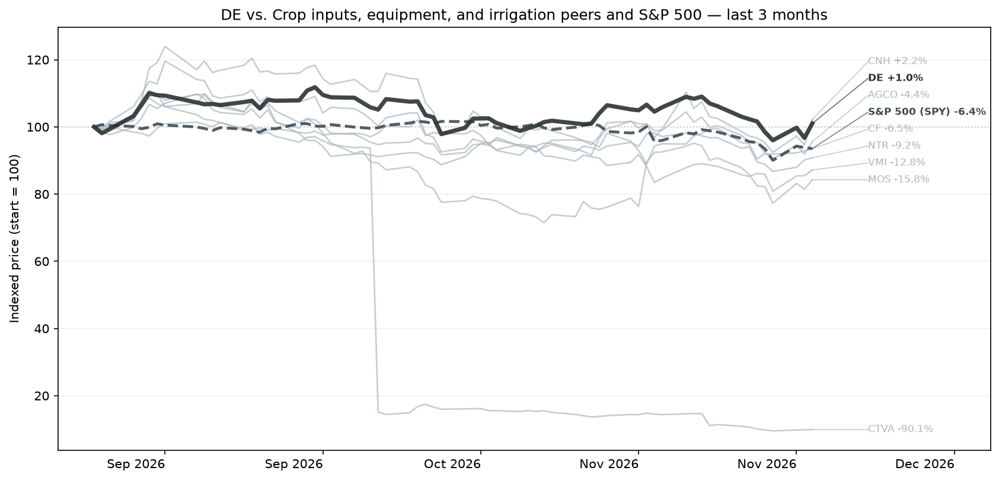

#### Earnings Call Summary

Deere & Co. closed fiscal 2026 with full-year net sales and revenues up 4% to $47.7B and net income of $4.86B ($17.95 per diluted share). Q4 net sales for Equipment Operations down 1% to $10.5B, while Q4 net income dipped 1% to $1.05B ($3.89 per diluted share), lagging estimated EPS of $4.012.

#### At a Glance

- **Deere Reports Mixed Q4 Results:** Deere &amp; Co reported a reported revenue of $10,514,000,000, which surpassed the expected estimate of $10,344,259,380; however, reported adjusted EPS of $3.89 missed the forecasted estimate of $4.012.
- **Divergent Performance Across Business Segments:** Production &amp; Precision Agriculture sales dropped 15% year-over-year due to lower shipment volumes, whereas Small Agriculture &amp; Turf and Construction &amp; Forestry segment sales grew by 10% and 12%, respectively.
- **Soft Forward Fiscal Guidance Issued:** Deere projected full-year fiscal 2027 net income to range between $4.50 billion and $5.25 billion, a conservative outlook trailing the consensus analyst estimate of about $6.1 billion.
- **Agricultural Cycle Formally Touched Trough:** Management declared that the agricultural equipment cycle officially hit its lower bound in 2026, setting the stage for a measured, North American-led recovery moving forward.
- **Anticipated Macro and Pension Headwinds:** The firm&#x27;s fiscal 2027 performance faces about $500 million in higher pension costs, alongside an estimated $300 million net tariff headwind that could restrict margin expansions.

#### Key Moments from the Call

- **15m — Agricultural Cycle Troughs:** Management confirmed the ag equipment cycle bottomed out in 2026. Strong double-digit momentum in North American Early Order Programs indicates a replacement cycle driven by aged fleets and severely depleted dealer field inventories, giving investors visible signs of an unfolding cyclical inflection.
- **35m — UAW Labor Contingency Pressures Working Capital:** With labor contracts expiring late fiscal 2027, Deere is aggressively building buffer inventory to withstand potential work disruptions. While mitigating customer disruption risk, this defensive production strategy will tie up significant working capital on the balance sheet during the back half of the year.
- **43m — Margin Headwinds from Tariffs and Investments:** Deere's 2027 segment margins reflect strict cost inflation and a $300M net tariff headwind from lapping prior-year refunds. Additionally, deliberate margin compression in Small Ag and Construction stems from elevated, proactive R&D/SG&A spend to migrate advanced agricultural technology stacks into those respective product segments.
- **46m — Operationalizing Core AI Monetization:** Deere launched "JD," a direct conversational AI interface utilizing its 500 million global agronomic acres of data. Scaled adoption of advanced systems like See & Spray and Harvest Settings Automation points to strong monetization capability through software and high-value recurring technological integration.

## Company Overviews

<h3 id="company-ctva">Corteva (CTVA)</h3>

*Crop inputs, equipment, and irrigation · $5.6B · 3m -90.1% · 12m -87.7% · 24m -87.0%*

[Google Finance](https://www.google.com/finance/quote/CTVA:NYSE?tab=earnings&hl=en)

Largest U.S. corn-seed franchise (Pioneer) and a primary input cost for Corn Belt acres.

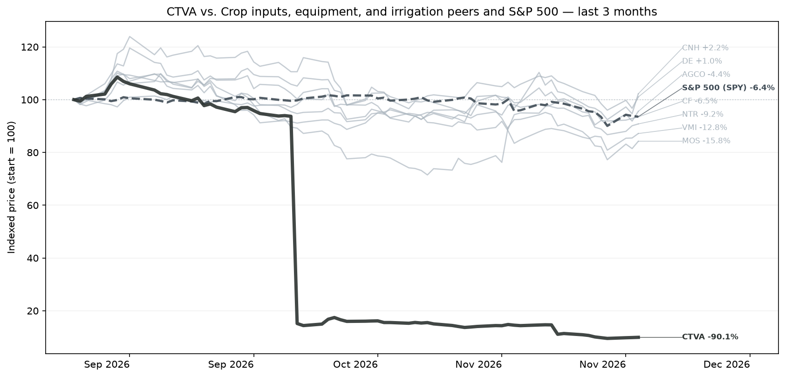

Corteva is a crop protection pure play. The company was formed in 2019 when it was spun off from DowDuPont and spun off its seeds business, Vylor, in 2026. Corteva is a leader in the development of new crop protection products, including herbicides, insecticides, fungicides, biologicals, and plant health products. Corteva operates globally. North America generates nearly 40% of revenue while Latin America generates over 30%.

<h3 id="company-bayry">Bayer (BAYRY)</h3>

*Crop inputs, equipment, and irrigation · n/a · 3m +0.0% · 12m +58.8% · 24m +179.9%*

[Google Finance](https://www.google.com/finance/quote/BAYRY:NYSE?tab=earnings&hl=en)

Dekalb and former Monsanto corn-seed brands; together with Corteva dominates U.S. corn seed.

BAYER AG S/ADR

<h3 id="company-basfy">BASF (BASFY)</h3>

*Crop inputs, equipment, and irrigation · n/a · 3m +0.0% · 12m +14.1% · 24m +33.3%*

[Google Finance](https://www.google.com/finance/quote/BASFY:NYSE?tab=earnings&hl=en)

Crop-protection chemistry used on U.S. corn acres.

BASF SE S/ADR

<h3 id="company-ntr">Nutrien (NTR)</h3>

*Crop inputs, equipment, and irrigation · $31.3B · 3m -9.2% · 12m +16.4% · 24m +45.6%*

[Google Finance](https://www.google.com/finance/quote/NTR:NYSE?tab=earnings&hl=en)

Largest North American agricultural retailer and a major potash and nitrogen producer.

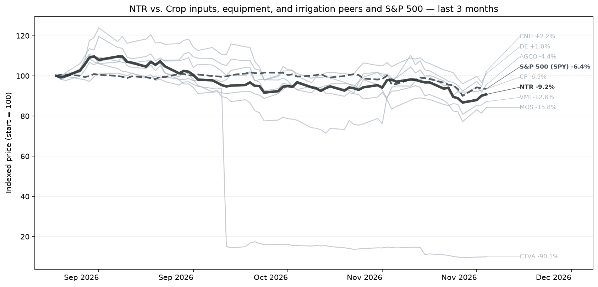

Created in 2018 as a result of the merger between PotashCorp and Agrium, Nutrien is the world's largest fertilizer producer by capacity. Nutrien produces the three main crop nutrients—nitrogen, potash, and phosphate—although its main focus is potash, where it is the global leader in installed capacity with a roughly 20% market share. The company is also the largest agricultural retailer in North America and Australia, selling fertilizers, crop chemicals, seeds, and services directly to farm customers through its brick-and-mortar stores and online platforms.

<h3 id="company-cf">CF Industries (CF)</h3>

*Crop inputs, equipment, and irrigation · $16.6B · 3m -6.5% · 12m +49.9% · 24m +33.3%*

[Google Finance](https://www.google.com/finance/quote/CF:NYSE?tab=earnings&hl=en)

Nitrogen fertilizer producer; corn is the crop that most moves UAN and urea demand.

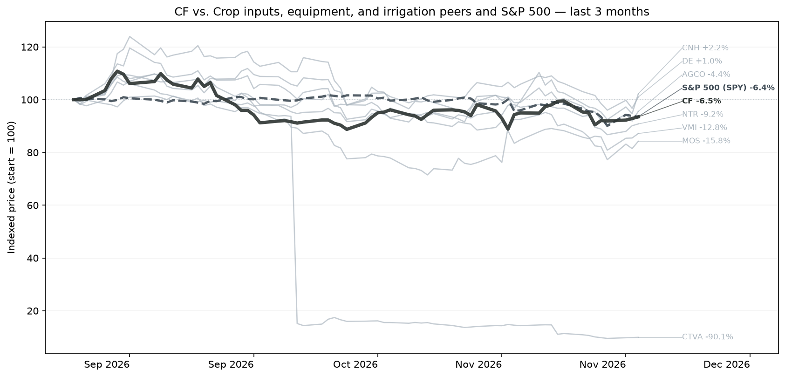

CF Industries is a leading producer and distributor of nitrogen, which is primarily used in fertilizers. The company operates nitrogen manufacturing plants primarily in North America. CF also produces nitrogen in the United Kingdom and holds a joint venture interest in a nitrogen production facility in Trinidad and Tobago. CF makes nitrogen primarily using low-cost US natural gas as its feedstock, making the company one of the lowest-cost nitrogen producers globally. It is also investing in carbon-free blue and green ammonia, which can be used as an alternative fuel to hydrogen or as a means to transport hydrogen.

<h3 id="company-yariy">Yara International (YARIY)</h3>

*Crop inputs, equipment, and irrigation · n/a · 3m +0.0% · 12m +23.1% · 24m +59.1%*

[Google Finance](https://www.google.com/finance/quote/YARIY:NYSE?tab=earnings&hl=en)

Global nitrogen producer that sets the international urea and ammonia reference.

YARA INTL ASA S/ADR

<h3 id="company-mos">Mosaic (MOS)</h3>

*Crop inputs, equipment, and irrigation · $6.3B · 3m -15.8% · 12m -16.1% · 24m -19.9%*

[Google Finance](https://www.google.com/finance/quote/MOS:NYSE?tab=earnings&hl=en)

Phosphate and potash producer that completes corn production budgets.

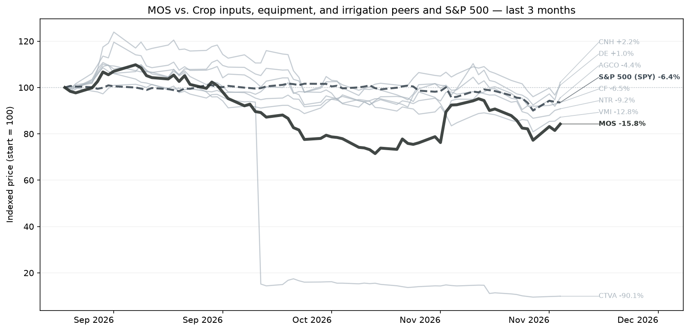

Mosaic is one of the largest phosphate and potash producers in the world. The company's assets include phosphate rock mines in the US and potash mines in Canada. Mosaic also runs a large fertilizer distribution operation in Brazil through its Mosaic Fertilizantes business.

<h3 id="company-de">Deere (DE)</h3>

*Crop inputs, equipment, and irrigation · $173.8B · 3m +1.0% · 12m +36.4% · 24m +39.0%*

[Google Finance](https://www.google.com/finance/quote/DE:NYSE?tab=earnings&hl=en)

Dominant North American farm-equipment maker for corn planting, harvest, and grain handling.

Deere is the world's leading manufacturer of agricultural equipment and a major producer of construction machinery. The company is divided into four reporting segments: production & precision agriculture, or PPA, small agriculture & turf, or SAT, construction & forestry, or CF, and financial services, or FS, its captive finance subsidiary. The core PPA business is the largest contributor to sales and profits by far. Geographically, Deere sales are 60% US/Canada, 17% Europe, 14% Latin America, and 9% rest of the world. Deere goes to market through a robust dealer network that includes over 2,000 dealer locations in North America with reach into over 100 countries. John Deere Financial provides retail financing for machinery to its customers and wholesale financing for dealers.

<h3 id="company-cnh">CNH Industrial (CNH)</h3>

*Crop inputs, equipment, and irrigation · $18.0B · 3m +2.2% · 12m +26.4% · 24m -4.0%*

[Google Finance](https://www.google.com/finance/quote/CNH:NYSE?tab=earnings&hl=en)

Case IH and New Holland farm equipment serving corn growers.

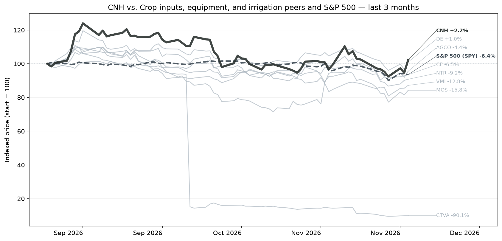

CNH Industrial is the world's second largest manufacturer of agricultural machinery (82% of industrial net sales) as well as a major player in construction equipment (18% of industrial net sales). Its Case and New Holland brands have served farmers for generations. Geographically, agricultural sales are 40% in North America, 32% in Europe, the Middle East, and Africa, 18% in South America, and 10% in Asia-Pacific. CNH's products are available through a robust independent dealer network, which includes over 2,600 dealer and distribution locations and reach into 164 countries. The construction business leverages over 400 dealers. The company's captive finance arm provides retail financing to its customers and wholesale financing to dealers to maintain inventory, thereby supporting sales.

<h3 id="company-agco">AGCO (AGCO)</h3>

*Crop inputs, equipment, and irrigation · $7.3B · 3m -4.4% · 12m +1.0% · 24m +7.3%*

[Google Finance](https://www.google.com/finance/quote/AGCO:NYSE?tab=earnings&hl=en)

Fendt, Massey Ferguson, and Challenger farm equipment with Corn Belt exposure.

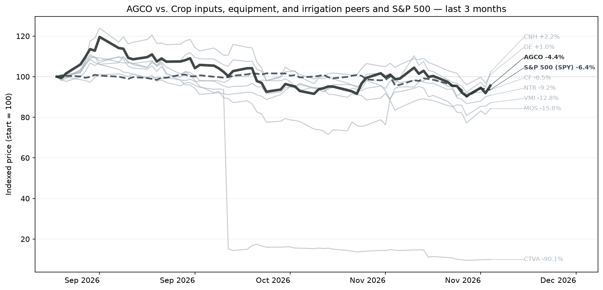

Agco is a global manufacturer of agricultural equipment. Its main machine brands are Fendt, Massey Ferguson, and Valtra; its initiatives in precision agriculture have been organized under the PTx umbrella following a series of acquisitions. While a global business, Agco's sales skew heavily toward Europe/Middle East, representing 50%-60% of sales and even more of operating profits. The company is trying to increase its exposure to the larger North and South American markets. Its products are available through a global dealer network, which includes over 3,000 dealers and distribution locations and reaches into over 140 countries. Additionally, Agco offers retail and wholesale financing to customers through its partnership with Rabobank of the Netherlands, having exited their JV in 2026.

<h3 id="company-vmi">Valmont Industries (VMI)</h3>

*Crop inputs, equipment, and irrigation · $7.9B · 3m -12.8% · 12m +1.4% · 24m +18.1%*

[Google Finance](https://www.google.com/finance/quote/VMI:NYSE?tab=earnings&hl=en)

Center-pivot irrigation (Valley) used on irrigated High Plains corn.

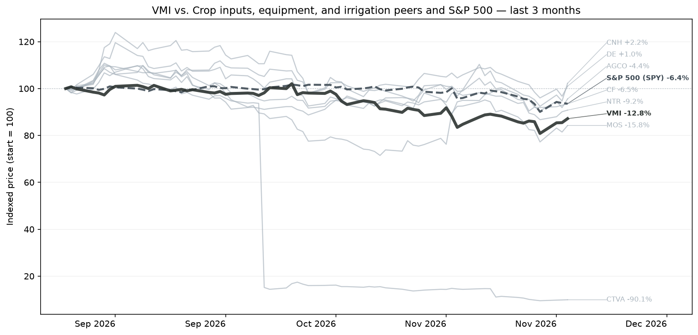

Valmont Industries Inc, along with its subsidiaries, operates as a manufacturer of products and services for infrastructure and agriculture markets. Its reportable segments are Infrastructure and Agriculture. The company generates maximum revenue from the Infrastructure segment, which includes the manufacturing and distribution of products and solutions to serve the infrastructure markets of utility, solar, lighting, transportation, and telecommunications, along with coatings services to protect metal products. The Agriculture segment provides irrigation equipment components, including aftermarket parts and tubular products, and technology solutions for precision agriculture. Geographically, it derives key revenue from the United States, followed by Australia, Brazil, and other regions.

<h3 id="company-adm">Archer Daniels Midland (ADM)</h3>

*Grain origination and agribusiness, U.S. ethanol and process technology, Wet milling, ingredients, and co-products · $32.3B · 3m -16.8% · 12m +10.1% · 24m +24.1%*

[Google Finance](https://www.google.com/finance/quote/ADM:NYSE?tab=earnings&hl=en)

Global grain trader, top U.S. ethanol producer, and major corn wet miller.

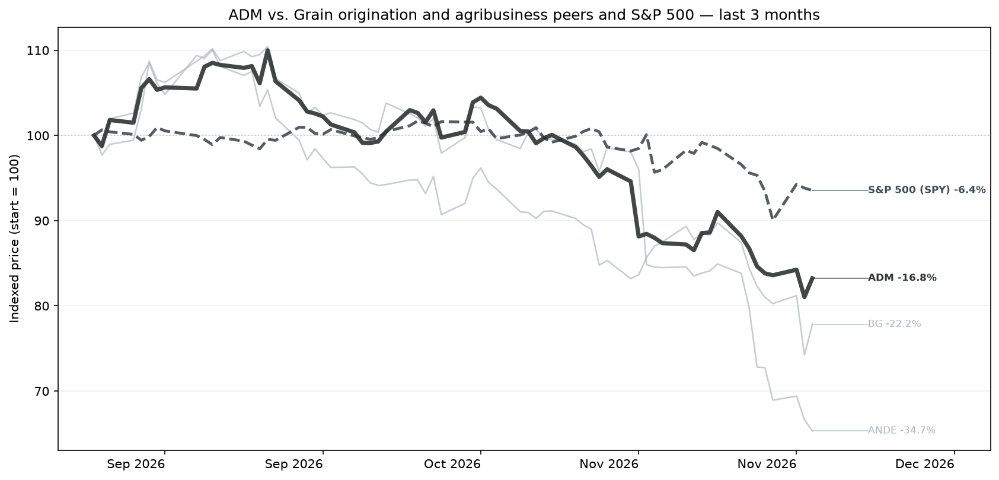

Archer-Daniels-Midland is a major processor of oilseeds, corn, wheat, and other agricultural commodities. The company is also one of the largest grain merchandisers through its extensive network of logistical assets to store and transport crops around the globe. ADM also runs a nutrition business that focuses on both human and animal ingredients and is a large producer of corn-based sweeteners, starches, and ethanol.

<h3 id="company-bg">Bunge (BG)</h3>

*Grain origination and agribusiness · $17.9B · 3m -22.2% · 12m -8.6% · 24m -1.7%*

[Google Finance](https://www.google.com/finance/quote/BG:NYSE?tab=earnings&hl=en)

Global grain and oilseed merchant after the Viterra combination; competitor for corn origination.

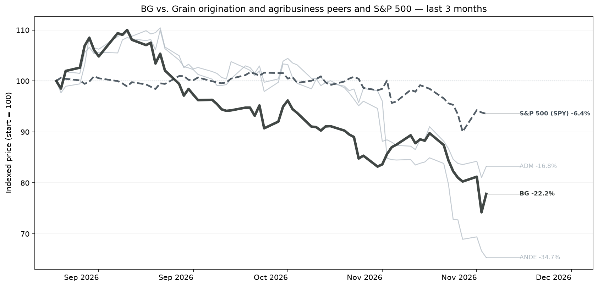

Bunge Global SA is an agribusiness solutions company, connecting farmers to consumers and delivering essential food, feed and fuel to the globe. The company segments include Soybean Processing and Refining; Softseed Processing and Refining; Other Oilseeds Processing and Refining; Grain Merchandising and Milling; and Corporate and Other. It generates maximum revenue from the Soybean Processing and Refining segment, which includes integrated business principally involved in the purchase, storage, transportation, processing, distribution, refining, marketing, and sale of soybeans and soybean related products, as well as biodiesel and fertilizer production and distribution. Geographically, the company operates in United States, Switzerland, Netherlands, and Rest of the World.

<h3 id="company-ande">The Andersons (ANDE)</h3>

*Grain origination and agribusiness, U.S. ethanol and process technology · $1.6B · 3m -34.7% · 12m -16.9% · 24m -10.9%*

[Google Finance](https://www.google.com/finance/quote/ANDE:NASDAQ?tab=earnings&hl=en)

Grain elevators plus four wholly owned ethanol plants totaling about 500 million gallons a year.

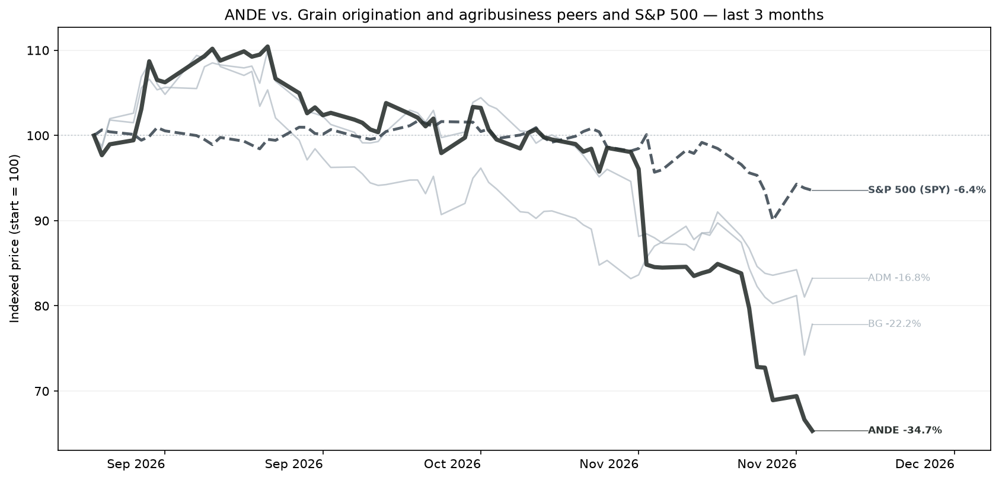

Andersons Inc is an agriculture and renewable fuels company. Its operations are classified into two reportable business segments: Agribusiness, which generates maximum revenue, and Renewables. The Agribusiness segment includes merchandising and managing logistics across various commodities, as well as being a manufacturer, distributor, and retailer of agricultural and related plant nutrients. The segment specializes in the movement of physical commodities such as whole grains, grain products, feed ingredients, and domestic fuel products, among other agricultural commodities. The Renewables segment mainly produces, purchases, and sells ethanol and co-products. Geographically, the company generates maximum revenue from the United States, followed by Canada, Mexico, and other markets.

<h3 id="company-vlo">Valero Energy (VLO)</h3>

*U.S. ethanol and process technology, Fuel blending, refining, and retail · $95.9B · 3m -7.2% · 12m +85.1% · 24m +131.0%*

[Google Finance](https://www.google.com/finance/quote/VLO:NYSE?tab=earnings&hl=en)

World's second-largest corn-ethanol producer with a distinct Ethanol segment and a major blender.

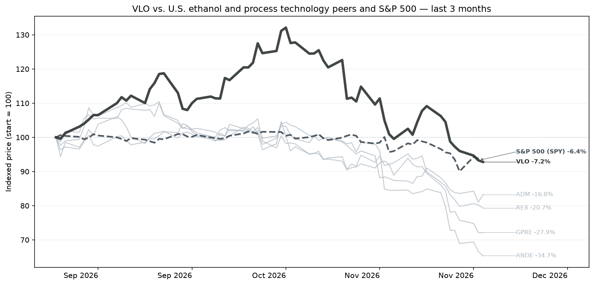

Valero Energy is one of the largest independent refiners in the United States. It operates 15 refineries, with a total throughput capacity of 3.2 million barrels a day in the US, Canada, and the United Kingdom. Valero also owns 12 ethanol plants with capacity of 1.6 billion gallons a year and holds a 50% stake in Diamond Green Diesel, which can produce 1.2 billion gallons per year of renewable diesel.

<h3 id="company-gpre">Green Plains (GPRE)</h3>

*U.S. ethanol and process technology · $820.6M · 3m -27.9% · 12m +7.4% · 24m +0.6%*

[Google Finance](https://www.google.com/finance/quote/GPRE:NASDAQ?tab=earnings&hl=en)

Largest U.S. ethanol pure play, with high-protein feed, corn oil, and Nebraska carbon-capture work.

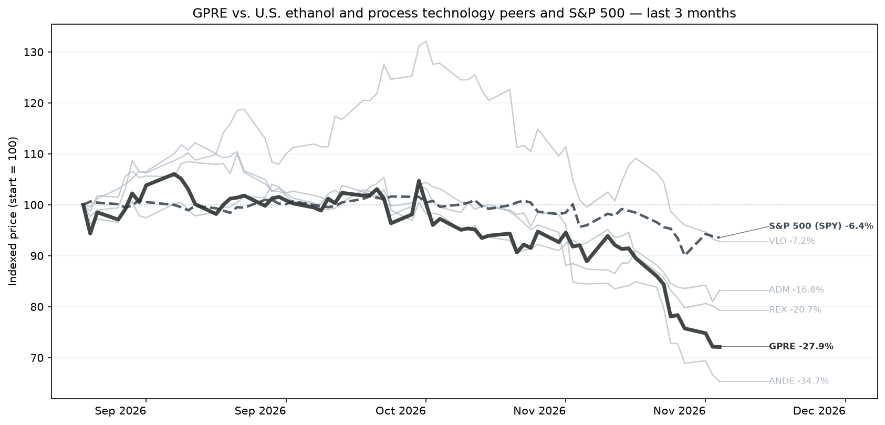

Green Plains Inc manufactures and sells ethanol and ethanol byproducts in two segments based on function. The ethanol production segment, which generates the majority of revenue, includes the production of ethanol, distillers grains, Ultra-High Protein and renewable corn oil. The agribusiness and energy services segment includes grain handling and storage, commodity marketing and merchant trading for company-produced and third-party ethanol, distillers grains, Ultra-High Protein, renewable corn oil, natural gas and other commodities.

<h3 id="company-rex">REX American Resources (REX)</h3>

*U.S. ethanol and process technology · $1.2B · 3m -20.7% · 12m +2.2% · 24m +57.1%*

[Google Finance](https://www.google.com/finance/quote/REX:NYSE?tab=earnings&hl=en)

Holding company with interests in six Corn Belt ethanol plants; cleanest public crush-margin equity.

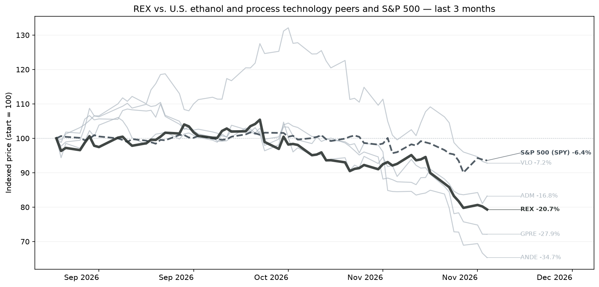

REX American Resources Corp operates as a holding company that engages in investments in alternative energy and ethanol production entities. Its operating segments include Ethanol and By-Products. Its products include Ethanol, dried distillers grains, modified distillers grains, Distillers corn oil, Modified distillers grains, and Other.

<h3 id="company-nvzmy">Novonesis (NVZMY)</h3>

*U.S. ethanol and process technology · n/a · 3m +0.0% · 12m +3.5% · 24m +9.9%*

[Google Finance](https://www.google.com/finance/quote/NVZMY:NYSE?tab=earnings&hl=en)

Dominant supplier of enzymes used in dry-mill ethanol fermentation.

NOVONESIS B UNSP/ADR

<h3 id="company-ingr">Ingredion (INGR)</h3>

*Wet milling, ingredients, and co-products · $5.6B · 3m -12.7% · 12m -15.0% · 24m -38.6%*

[Google Finance](https://www.google.com/finance/quote/INGR:NYSE?tab=earnings&hl=en)

Major corn wet miller producing sweeteners, starches, and specialty ingredients.

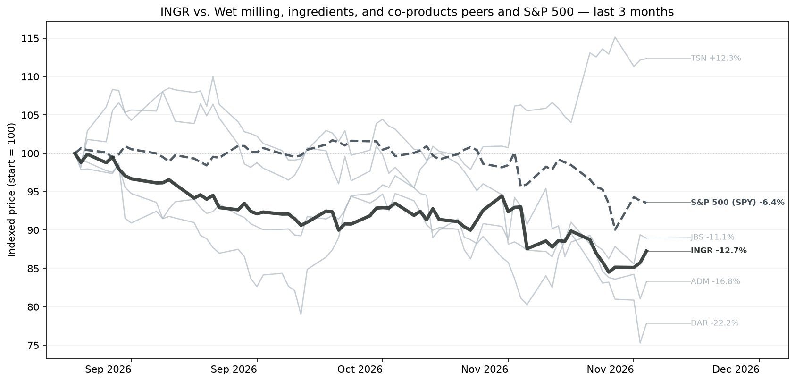

Ingredion provides ingredients to the food, beverage, brewing, and animal nutrition industries. The company processes corn, tapioca, potatoes, stevia, grains, fruits, gums, and vegetables into value-added ingredients. The company sells specialty ingredients, including starch-based texturizers and natural alternative sweeteners such as stevia. Ingredion also sells commodity ingredients that include sweeteners, such as high-fructose corn syrup, and starches, such as those used for sustainable packaging, as well as plant-based proteins. The company plans to acquire Tate & Lyle in an all-cash deal that should close in 2027.

<h3 id="company-dar">Darling Ingredients (DAR)</h3>

*Wet milling, ingredients, and co-products · $8.0B · 3m -22.2% · 12m +32.9% · 24m +18.3%*

[Google Finance](https://www.google.com/finance/quote/DAR:NYSE?tab=earnings&hl=en)

Rendering and used cooking oil; 50/50 owner of Diamond Green Diesel with Valero.

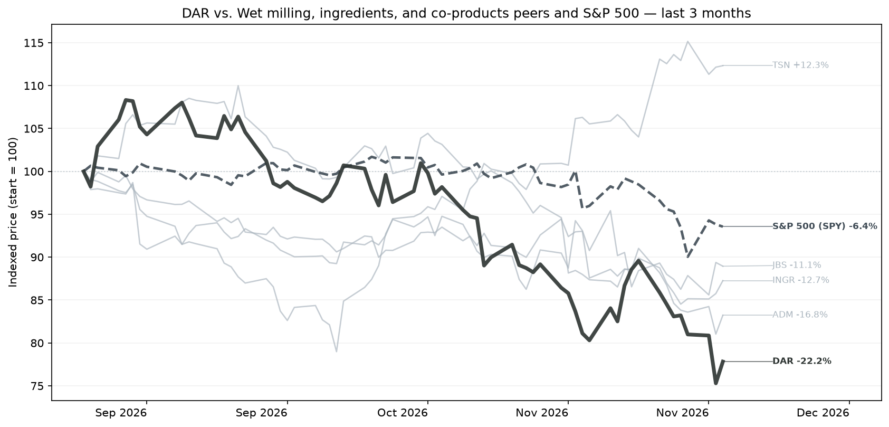

Darling Ingredients Inc is a developer and producer of sustainable natural ingredients from edible and inedible bio-nutrients, creating a wide range of ingredients and customized specialty solutions for customers in the pharmaceutical, food, pet food, animal feed, industrial, fuel, bioenergy and fertilizer industries. It processes by-products from the animal agriculture and food industries into ingredients and products for human nutrition, animal feed, crop inputs, and renewable energy applications. The company operates processing facilities across multiple countries and produces collagen, including gelatin and hydrolyzed collagen, as well as renewable energy products.

<h3 id="company-tsn">Tyson Foods (TSN)</h3>

*Wet milling, ingredients, and co-products · $22.1B · 3m +12.3% · 12m +9.7% · 24m -0.5%*

[Google Finance](https://www.google.com/finance/quote/TSN:NYSE?tab=earnings&hl=en)

Largest U.S. protein company and a primary domestic sink for distillers grains.

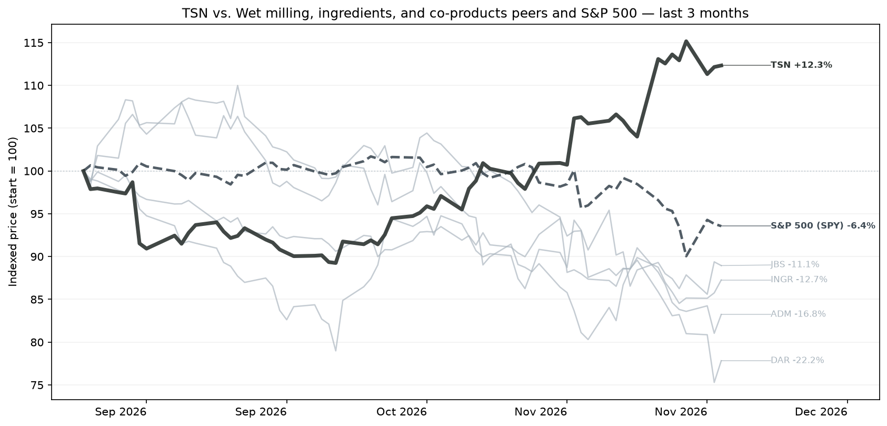

Tyson Foods Inc is a protein-focused food producer that sells raw chicken, beef, pork, and prepared foods. The company's products are sold under brands like Tyson, Jimmy Dean, Hillshire Farm, Ball Park, Wright, State Fair, Aidells, Landshire, Reuben, Pierre, Like Mom's, Tortilla Land, etc., mainly by its sales staff to grocery retailers, grocery wholesalers, meat distributors, warehouse club stores, military commissaries, chain restaurants or their distributors, live markets, and other customer segments. It operates in five reportable segments: Beef, Pork, Chicken, Prepared Foods, and International. The majority of its revenue comes from the Beef (also the company's highest-revenue segment) and Chicken segments. Geographically, it caters to both domestic and international markets.

<h3 id="company-jbs">JBS (JBS)</h3>

*Wet milling, ingredients, and co-products · $12.9B · 3m -11.1% · 12m -16.9% · 24m n/a*

[Google Finance](https://www.google.com/finance/quote/JBS:NYSE?tab=earnings&hl=en)

World's largest protein company and a major DDGS buyer in the U.S. and Brazil.

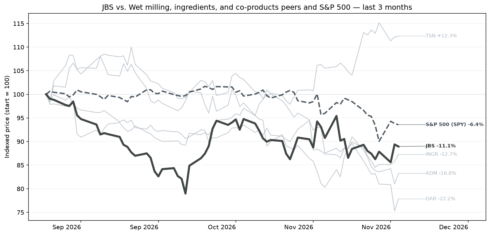

JBS NV is a protein food company, selling protein products, which include fresh and frozen cuts of beef, pork, lamb, fish, whole chickens, and chicken parts, to retailers, and foodservice companies. The food products are marketed under different brands such as Swift, Just Bare, Pilgrim's Pride, Sunnyvalley, Reserva Friboi, Great Southern, etc., globally. The company's reportable segments are Beef North America, which generates maximum revenue, Brazil, Seara, Pork USA, Pilgrim's Pride, Australia, and Others. Geographically, it derives majority of its revenue from United States of America.

<h3 id="company-mpc">Marathon Petroleum (MPC)</h3>

*Fuel blending, refining, and retail · $101.8B · 3m -4.4% · 12m +80.6% · 24m +120.4%*

[Google Finance](https://www.google.com/finance/quote/MPC:NYSE?tab=earnings&hl=en)

Largest U.S. independent refiner and a major Midwest ethanol blender.

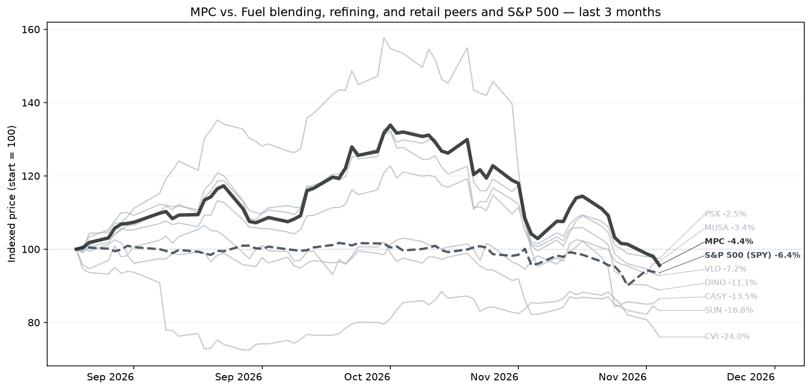

Marathon Petroleum is a leading integrated downstream and midstream energy company that operates 13 refineries in the Gulf Coast, midcontinent, and West Coast regions of the United States with an aggregate crude oil refining capacity of 3.0 million barrels per day. The company is one of the largest producers of renewable diesel in the US; its Dickinson, North Dakota, facility has the capacity to produce 184 million gallons per year, and its Martinez, California, joint venture facility (a 50/50 partnership with Neste) reached its full capacity of 730 million gallons per year in late 2024. Marathon also owns the general partner and approximately 64% of MPLX LP, a large-cap master limited partnership that owns and operates midstream energy infrastructure and logistics assets.

<h3 id="company-psx">Phillips 66 (PSX)</h3>

*Fuel blending, refining, and retail · $95.5B · 3m -2.5% · 12m +74.9% · 24m +75.9%*

[Google Finance](https://www.google.com/finance/quote/PSX:NYSE?tab=earnings&hl=en)

Large blender and marketer with West Coast renewable-diesel capacity.

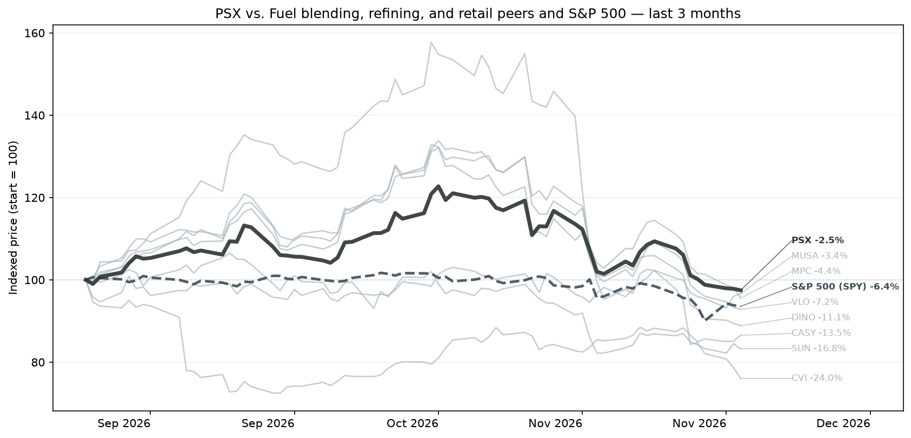

Phillips 66 is an independent refiner that owns or holds an interest in 10 refineries with a total crude throughput capacity of 2.0 million barrels per day at the end of 2025. The midstream segment comprises extensive transportation and natural gas liquids processing assets. It includes 70,000 miles of crude oil, refined petroleum product, NGL, and natural gas pipeline systems and a comprehensive set of refined petroleum product, NGL and crude oil terminals, gathering and processing plants, fractionation facilities, and various other storage and loading facilities. Its CPChem chemical joint venture operates facilities primarily in the United States and the Middle East and produces olefins and polyolefins.

<h3 id="company-dino">HF Sinclair (DINO)</h3>

*Fuel blending, refining, and retail · $15.3B · 3m -11.1% · 12m +64.2% · 24m +105.2%*

[Google Finance](https://www.google.com/finance/quote/DINO:NYSE?tab=earnings&hl=en)

Independent Mid-Continent and Rockies refiner with renewable diesel and RFS blending obligations.

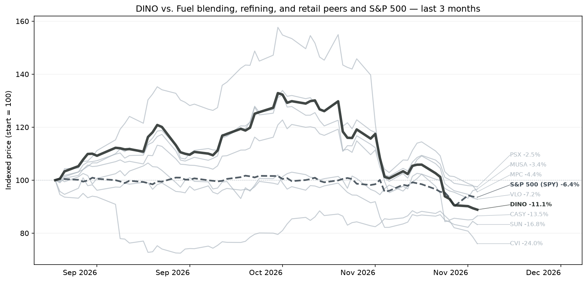

HF Sinclair is an integrated petroleum refiner that owns and operates seven refineries serving the Rockies, midcontinent, Southwest, and Pacific Northwest, with a total crude oil throughput capacity of 678,000 barrels per day. It can produce 380 million gallons of renewable diesel annually. It operates a marketing business with over 350 distributors and 1,700 branded wholesale sites across 30 states. It also owns and operates 4,500 miles of petroleum product pipelines and terminals principally in the Southwestern United States.

<h3 id="company-cvi">CVR Energy (CVI)</h3>

*Fuel blending, refining, and retail · $3.7B · 3m -24.0% · 12m -11.6% · 24m +59.0%*

[Google Finance](https://www.google.com/finance/quote/CVI:NYSE?tab=earnings&hl=en)

Coffeyville, Kansas refiner in the corn complex with renewable diesel and a nitrogen affiliate.

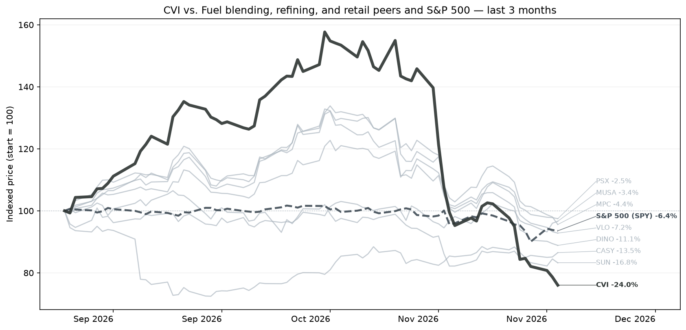

CVR Energy Inc is a holding company that engages in petroleum refining and nitrogen fertilizer manufacturing through its subsidiaries. Subsidiaries include several complex, full-coking crude oil refineries, along with a crude oil gathering system, pipelines, storage tanks, and marketing and supply. The company's refineries can process blends of a variety of crude oil ranging from heavy sour to light sweet crude oil. Crude oil for CVR's refineries is supplied through its wholly-owned gathering system and pipeline. From its refineries, CVR supplies products through tanker trucks directly to customers located in close geographic proximity and customers at throughput terminals. The company's customers include retailers, railroads, and farm cooperatives.

<h3 id="company-sun">Sunoco LP (SUN)</h3>

*Fuel blending, refining, and retail · n/a · 3m -16.8% · 12m +11.7% · 24m +15.3%*

[Google Finance](https://www.google.com/finance/quote/SUN:NYSE?tab=earnings&hl=en)

Fuel distributor and terminal operator that moves finished gasoline and ethanol.

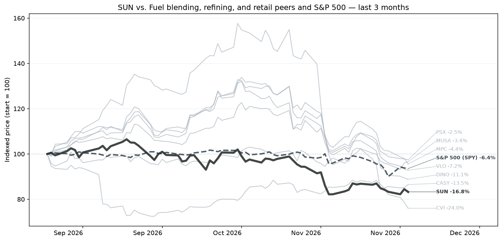

SUNOCO LP

<h3 id="company-casy">Casey&#x27;s General Stores (CASY)</h3>

*Fuel blending, refining, and retail · $25.8B · 3m -13.5% · 12m +22.2% · 24m +63.7%*

[Google Finance](https://www.google.com/finance/quote/CASY:NASDAQ?tab=earnings&hl=en)

Corn Belt convenience-store chain with high E10/E15/E85 exposure.

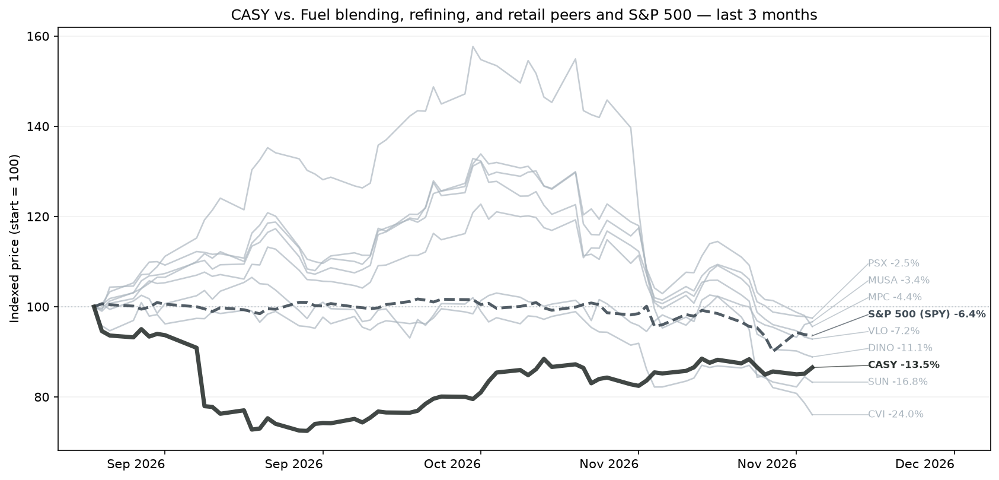

Founded in 1968, Casey's General Stores has become the third-largest convenience store retailer in the United States, operating nearly 3,000 locations across 19 states, primarily in the Midwest. In fiscal 2026, the company generated $17.6 billion in revenue from fuel (60% of sales), grocery and general merchandise (26%), prepared food and dispensed beverages (10%), and areas like wholesale fuel distribution (4%). Casey's footprint skews rural, with over 70% of stores in areas with fewer than 20,000 residents.

<h3 id="company-musa">Murphy USA (MUSA)</h3>

*Fuel blending, refining, and retail · $9.3B · 3m -3.4% · 12m +33.5% · 24m -7.5%*

[Google Finance](https://www.google.com/finance/quote/MUSA:NYSE?tab=earnings&hl=en)

High-volume fuel retailer and national ethanol blender.

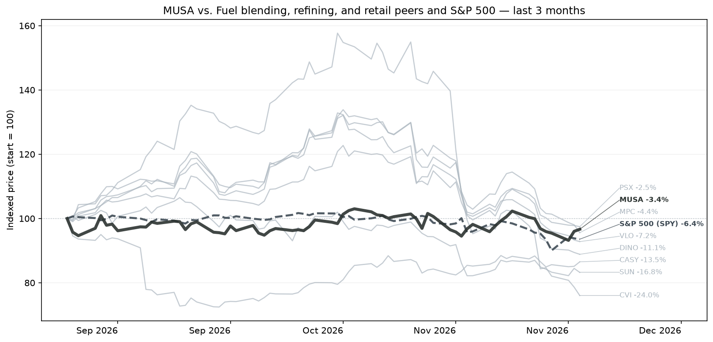

Murphy USA Inc is mainly engaged in the marketing of retail motor fuel products and convenience merchandise through a network of several retail stores in the Southwest, Southeast, Midwest, and Northeast United States. The majority of Murphy USA's stores are located in proximity to Walmart Supercenters, but it also operates standalone stores that market gasoline and other products under the Murphy USA, Murphy Express, and QuickChek brands. In addition, the company also markets fuel to unbranded wholesale customers through a mixture of company-owned and third-party product distribution terminals and pipeline positions. The firm generates maximum revenue through retail sales of petroleum products, and the rest from merchandise sales and wholesale of petroleum products.

<h3 id="company-ntoiy">Neste (NTOIY)</h3>

*Advanced biofuels and SAF · n/a · 3m +0.0% · 12m +78.1% · 24m +131.4%*

[Google Finance](https://www.google.com/finance/quote/NTOIY:NYSE?tab=earnings&hl=en)

Largest global producer of renewable diesel and SAF; sets the price umbrella for corn oil.

NESTE OYJ UNSP/ADR

<h3 id="company-cvx">Chevron (CVX)</h3>

*Advanced biofuels and SAF · $401.7B · 3m +5.4% · 12m +41.1% · 24m +29.8%*

[Google Finance](https://www.google.com/finance/quote/CVX:NYSE?tab=earnings&hl=en)

Owner of Renewable Energy Group biodiesel and renewable-diesel plants that take corn oil at the margin.

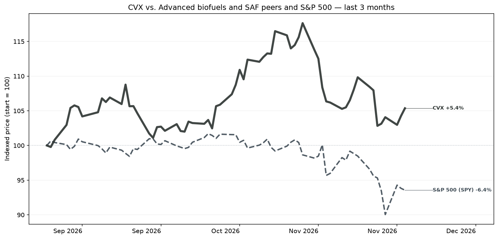

Chevron is an integrated energy company with exploration, production, and refining operations worldwide. It is the second-largest oil company in the United States with 2025 worldwide net oil-equivalent production of 3.7 million barrels per day, including 8.5 billion cubic feet per day of natural gas and 2.3 million barrels of liquids per day. Production takes place in North America, South America, Europe, Africa, Asia, and Australia. The company's refining networks arelocated in the United States and Asia, with a total worldwide refining capacity of 1.8 million barrels of oil a day at year-end 2025. Net proved reserves at year-end 2025 stood at 10.6 billion barrels of oil equivalent, consisting of 5.7 billion barrels of liquids and 29.2 trillion cubic feet of natural gas.

<h3 id="company-csan">Cosan (CSAN)</h3>

*International ethanol · $2.5B · 3m -2.5% · 12m -44.7% · 24m -63.9%*

[Google Finance](https://www.google.com/finance/quote/CSAN:NYSE?tab=earnings&hl=en)

Brazilian holding company and the liquid U.S.-listed proxy for sugarcane ethanol via Raizen.

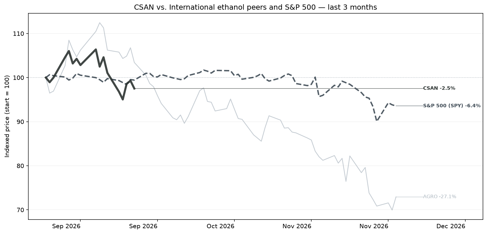

Cosan SA engages in several services throughout the energy and logistics sectors. Its reportable segments are Raizen, Compass, Moove, Rumo, and Radar. It generates the majority of its revenue from Raizen which operates in the production, commercialization, origination, and trading of ethanol, bioenergy, resale, and trading of electricity, renewable sources, marketing, origination, and trading of sugar and fuels, and lubricant.

<h3 id="company-agro">Adecoagro (AGRO)</h3>

*International ethanol · $1.2B · 3m -27.1% · 12m +0.4% · 24m -26.0%*

[Google Finance](https://www.google.com/finance/quote/AGRO:NYSE?tab=earnings&hl=en)

South American farmland and sugar/ethanol producer with U.S.-listed equity.

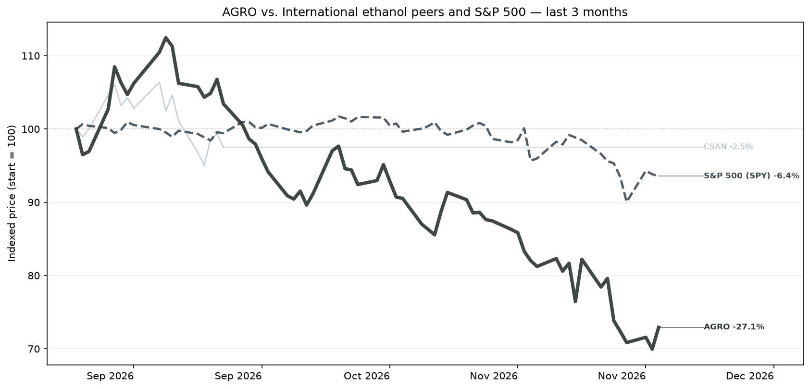

Adecoagro SA is a Luxembourg-based agricultural company. It is involved in a wide range of businesses, including farming crops and other agricultural products, dairy operations sugar, ethanol, energy production, and land transformation. The group operates in two lines of business, namely, Farming and Sugar, Ethanol and Energy. The Farming is further comprised of three reportable segments: Crops, Rice and Dairy. Sugar, Ethanol and Energy Segment, consists of cultivating sugarcane, which is processed in owned sugar mills, transformed into ethanol, sugar and electricity, in addition to biomethane and then marketed.

<h3 id="company-unp">Union Pacific (UNP)</h3>

*Logistics · $178.8B · 3m -3.9% · 12m +29.4% · 24m +21.5%*

[Google Finance](https://www.google.com/finance/quote/UNP:NYSE?tab=earnings&hl=en)

Primary western Class I for Corn Belt corn, ethanol unit trains, DDGS, and corn oil.

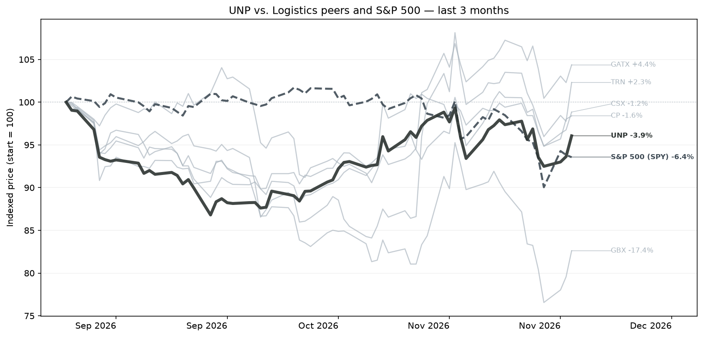

Omaha, Nebraska-based Union Pacific is the largest public railroad in North America. Operating on more than 30,000 miles of track in the western two-thirds of the US, Union Pacific generated $24.5 billion of revenue in 2025 by hauling coal, industrial products, intermodal containers, agricultural goods, chemicals, fertilizers, and automotive goods. Union Pacific owns about one-fourth of Mexican railroad Ferromex and historically derives roughly 10% of its revenue hauling freight to and from Mexico.

<h3 id="company-csx">CSX (CSX)</h3>

*Logistics · $94.6B · 3m -1.2% · 12m +44.9% · 24m +39.4%*

[Google Finance](https://www.google.com/finance/quote/CSX:NASDAQ?tab=earnings&hl=en)

Primary eastern Class I into Northeast and Southeast gasoline markets for ethanol unit trains.

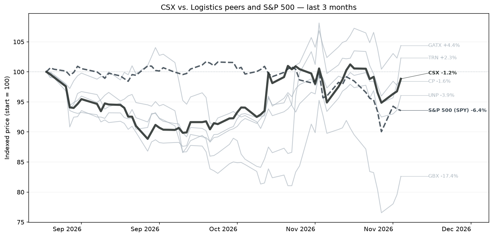

Operating in the Eastern United States, Class I railroad CSX generated revenue of nearly $14 billion in 2025. On its more than 21,000 miles of track, CSX hauls shipments of coal (16% of consolidated revenue), chemicals (17%), intermodal containers (16%), automotive cargo (7%), and a diverse mix of other bulk and industrial merchandise.

<h3 id="company-cp">Canadian Pacific Kansas City (CP)</h3>

*Logistics · $81.1B · 3m -1.6% · 12m +29.3% · 24m +25.3%*

[Google Finance](https://www.google.com/finance/quote/CP:NYSE?tab=earnings&hl=en)

North-south railroad for Midwest corn and ethanol to the Gulf and Mexico.

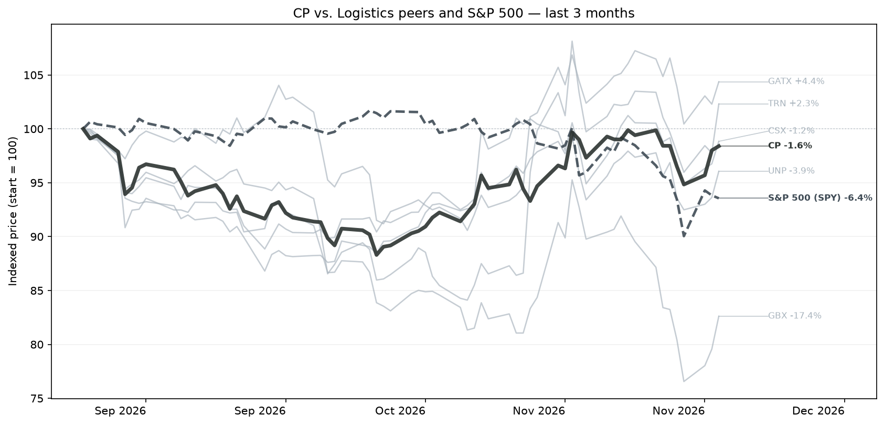

Canadian Pacific Kansas City is a Class I railroad operating on tracks that span most of Canada and into parts of the Midwestern and Northeastern United States. Following the April 2023 Kansas City Southern merger, CPKC operates new single-linehaul services from Canada and the Upper Midwest down through Texas, the Gulf of Mexico, and into Mexico. It also hauls cross-border and intra-Mexico freight via operating concessions on more than 3,000 miles of rail in Mexico. CPKC hauls shipments of grain, intermodal containers, energy products (like crude and frac sand), chemicals, plastics, coal, fertilizer and potash, automotive products, and a diverse mix of other merchandise.

<h3 id="company-gatx">GATX (GATX)</h3>

*Logistics · $6.6B · 3m +4.4% · 12m +16.2% · 24m +13.9%*

[Google Finance](https://www.google.com/finance/quote/GATX:NYSE?tab=earnings&hl=en)

Largest public railcar lessor of ethanol tank cars and grain/DDGS hoppers.

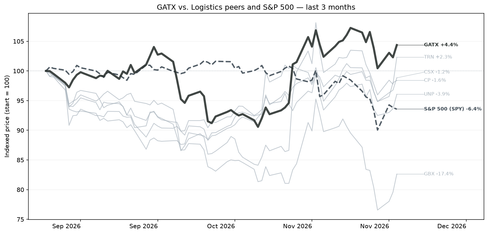

GATX Corp leases transportation assets, including railcars, aircraft spare engines, and tank containers, to customers in North America, Europe, and India. The company's reportable business segments are: Rail North America, Rail International, Engine Leasing, and Other. The majority of its revenue is generated from the Rail North America segment, which is composed of the company's operations in the United States, Canada, and Mexico. This segment mainly provides railcars pursuant to full-service leases under which it maintains the railcars, pays ad valorem taxes and insurance, and provides other ancillary services.

<h3 id="company-trn">Trinity Industries (TRN)</h3>

*Logistics · $2.3B · 3m +2.3% · 12m +14.1% · 24m -19.9%*

[Google Finance](https://www.google.com/finance/quote/TRN:NYSE?tab=earnings&hl=en)

Builds and leases covered hoppers and tank cars used for grain, DDGS, and ethanol.

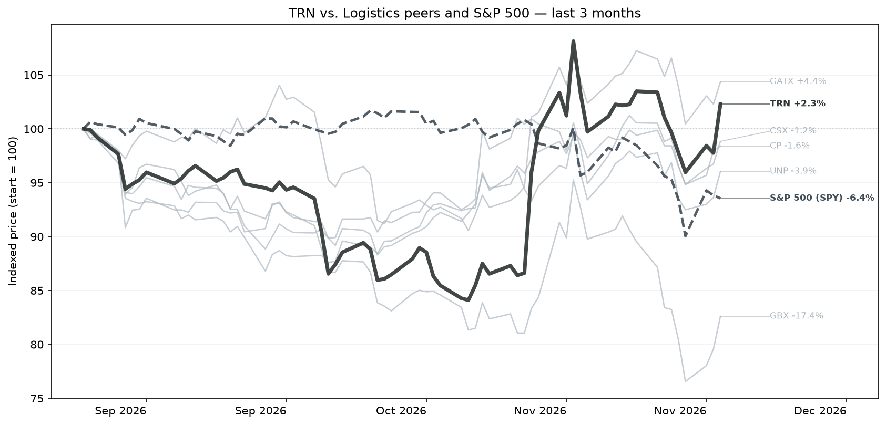

Trinity Industries Inc sells and leases railroad products and railcar maintenance services in North America. The company operates under the name TrinityRail in two main segments: railcar leasing and management services, which owns railcars and provides fleet management and administration services; rail products, which builds, sells, and modifies freight and tank railcars and their components; and all other, which sells highway products such as guardrail and other highway barriers. Customers include railroads, leasing companies, and shipping companies in agriculture, construction, consumer products, energy, and chemicals.

<h3 id="company-gbx">Greenbrier (GBX)</h3>

*Logistics · $1.2B · 3m -17.4% · 12m -14.5% · 24m -44.0%*

[Google Finance](https://www.google.com/finance/quote/GBX:NYSE?tab=earnings&hl=en)

Builds tank cars used for ethanol, renewable fuels, and CO2.

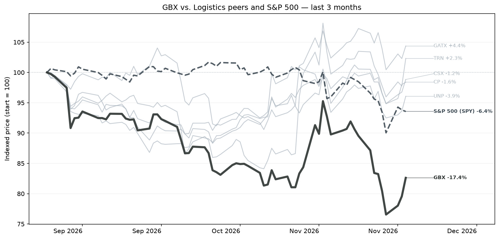

Greenbrier Companies Inc is a supplier of equipment and services to freight transportation markets. The company operates through the Manufacturing and Leasing & Fleet Management segments. The Manufacturing segment designs, builds, and markets freight railcars in North America and Europe, provides freight railcar wheel services, component parts, maintenance, and sustainable conversion services in North America, places railcars on lease to customers, and sells railcars with leases attached to investors. The Leasing & Fleet Management segment provides railcar leasing, railcar management, and regulatory compliance services to railroads and other railcar owners in North America. The company operates in North America, Europe, and Brazil and generates maximum revenue from the United States.

